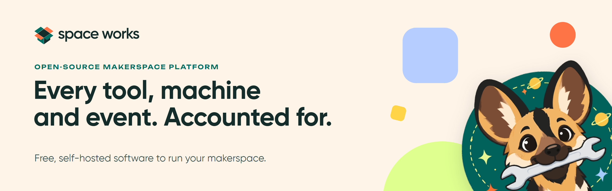
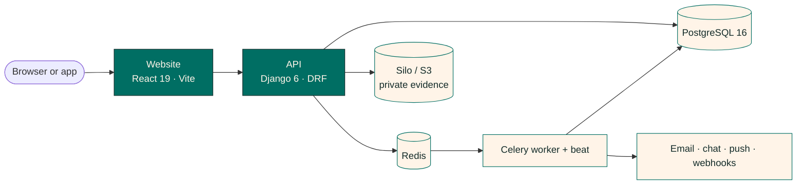

<picture>
  <source media="(prefers-color-scheme: dark)" srcset="docs/readme/banner-dark.png" />
  <source media="(prefers-color-scheme: light)" srcset="docs/readme/banner.png" />
  
</picture>

<div align="center">

<h3>Run the space, not the spreadsheet.</h3>

<p>Open-source makerspace management: tools, machines, members, events, bookings and money in one place, with a trail behind every handover.</p>

<p>
  <a href="https://github.com/SpaceWorks-Labs/SpaceWorks/actions/workflows/checks.yml"></a>
  <a href="LICENSE"></a>
  <a href="https://github.com/SpaceWorks-Labs/SpaceWorks/releases/latest"></a>
  <a href=".github/DEVELOPMENT.md"></a>
  <a href=".github/DEVELOPMENT.md"></a>
  <a href="https://www.djangoproject.com"></a>
  <a href="https://react.dev"></a>
</p>

<p>
  <a href="docs/README.md">Docs</a> ·
  <a href="docs/install-and-update.md">Install</a> ·
  <a href="docs/MODULES.md">Modules</a> ·
  <a href="#integrations">Integrations</a> ·
  <a href="#api">API</a> ·
  <a href="CHANGELOG.md">Changelog</a> ·
  <a href=".github/SECURITY.md">Security</a>
</p>

</div>

**Space Works is free, open-source software for running a makerspace.** It shows what equipment
exists, who has borrowed it, what is available, and how every loan, machine job, event and booking
moves from request to completion. Every physical handover leaves evidence (a QR scan, a photo, a
remark and an audit entry), so tools stay traceable to people. One self-hosted deployment can run
**many makerspaces**, each with its own inventory, public URL, staff, chat rooms, QR namespace and
audit scope. You install only the areas you use, and your members' data stays in your own database.
Space Works started in the **TinkerSpace Kochi** community; run it for yours, fork it, or adapt it
to the way your workshop works.

<!--
  SCREENSHOT GALLERY PLACEHOLDER — filled in the final phase of release 2.
  Add "## A look around" with a two-column <table> of docs/readme/screens/*.webp images, each with
  alt text and a one-line bold caption (public catalogue, staff dashboard, handover with evidence,
  machine queue, events, bookings, member area, dark mode). No image tags until the files exist.
-->

## Who it is for

- **Makerspaces, hackerspaces, fab labs and community workshops** that lend tools and run shared
  machines, and want to stop tracking them in spreadsheets and chat threads.
- **University labs and institutional workshops** that need named accountability for every item
  that leaves the shelf, and may already have their own identity provider.
- **Networks of spaces** (a city network, a university, a chain) that want one deployment, separate
  spaces, and organization-level staff who can act across them.
- **Operators** who want to self-host on their own server, with a guided installer, pinned releases,
  backups before every update and no third party in the loop.

## What you can do

Grouped the way a space actually works. The full list lives in [Features](docs/FEATURES.md).

### Lend tools and hardware

- A **public catalogue** per makerspace, with per-item control over what the public sees.
- **Borrow requests** that staff review, accept and issue; **direct handouts** at the front desk; and
  optional **QR self-checkout and return** for eligible tools.
- **Evidence on every handover:** a reviewed issue needs a box QR scan and a photo; a return needs a
  photo and a remark. Boxes, tools and individual assets keep their scan history.
- Asset units, containers, stock transfers between spaces, printable QR sheets, stocktakes and a
  "to buy" list, each a module you can leave out.

### Run any machine

- **Any machine your space owns.** 3D printers, laser cutters, CNC mills and routers, vinyl cutters and
  PCB mills come built in, and a space can add **its own machine types**: an embroidery machine, a
  lathe, a resin printer, a kiln, a soldering station. Each type sets how use is measured (minutes,
  weight, volume, length or count) and which materials and colours it takes.
- One **service queue** for every type: members request work, staff review, run and hand back the job,
  with consumables drawn from tracked spools and stock.
- **Maintenance**, warranty and usage records, and optional **certification** per machine type before
  a member can book or request work.
- Per-person machine-type scope, so a Machine Manager sees only their machines.

### Events and bookings

- **Events:** one-off and recurring, approvals and waitlists, ticket types, invitations and promo codes,
  QR door check-in with an offline roster and PIN stations, feedback, attendance certificates,
  printable badges and member calendar feeds.
- **Bookings:** bookable resources with public self-booking, recurrence, rescheduling, arrival scanning,
  printable passes and a requests queue.
- Both share curated public websites, email campaigns, draft cloning and scoped reports.

### Members, money and messages

- **Membership:** join requests, waivers, referrals, plans and renewals, opt-in maker profiles and a
  consent-based member directory; **presence** check-in with a privacy-controlled TV display.
- **Sign-in** with password, Google, Apple, GitHub, your own OIDC provider or a phone code, or run with
  no member accounts at all using walk-in records. See [Sign-in, identity and borrowing](docs/sign-in-and-borrowing.md).
- **Money owed is always recorded**, with offline receipts, due dates and reminders; online checkout
  through **Stripe or Razorpay** is optional.
- **Notifications** by email, in-app inbox, Telegram, Slack, Mattermost, Discord, signed webhooks, SMS
  and WhatsApp, routed to [rooms and recipients](docs/notification-routing.md) you choose.
- **Reports:** analytics, CSV/XLSX exports and accessible charts with table fallbacks.

### Run it with confidence

- **Append-only audit logs** and immutable evidence records; photo bytes can expire under a per-space
  retention policy while the metadata, remarks and scans remain.
- **Nine built-in roles**, scoped per makerspace and per action, plus a separate superadmin control plane.
- Live staff queues over Server-Sent Events, full-text search with typo tolerance, request IDs across
  logs and a token-protected Prometheus endpoint.
- Platform backups, single-space restore points, and an encrypted export to move a space onto its own server.

## Integrations

Space Works talks to the tools your space already uses. Every integration is optional and set up per
makerspace; leave one out and nothing else changes.

| Area | Works with |
| --- | --- |
| **Phone apps** | The API and registrations for your own branded Android and iOS apps, for members and staff, with push notifications and staff access as a verified step-up ([mobile integration](docs/mobile-integration.md)) |
| **Connected machines** | Printers and label printers on your own network, enrolled with a signed device identity; jobs report back through the normal workflow ([device protocol](docs/device-protocol.md)) |
| **Messages** | Email, in-app inbox, Telegram, Slack, Mattermost, Discord, SMS and WhatsApp (Twilio or Meta), routed to the [rooms and people](docs/notification-routing.md) you choose |
| **Sign-in** | Password, Google, Apple, GitHub, your own OIDC provider and phone codes ([sign-in methods](docs/sign-in-and-borrowing.md)) |
| **Payments** | Stripe and Razorpay checkout, UPI QR codes, offline receipts, and India GST invoices ([payments and billing](docs/payment-billing.md)) |
| **Calendars** | Google Calendar, Apple Calendar and Outlook: one-click "Add to Google Calendar", `.ics` downloads on every event and booking confirmation, and subscribable iCal feeds for events, bookings and maintenance |
| **Your own systems** | The [API guide](docs/api-guide.md): Swagger and ReDoc on every deployment, signed [webhooks](docs/webhooks-v2.md), scoped and signed [API clients](docs/api-client-protocol.md) (also space to space), personal access tokens, OAuth app connections, and CSV/XLSX import and export |
| **Storage** | Any S3-compatible bucket: the bundled Silo store, AWS S3, Cloudflare R2 or MinIO |

## Modules

A makerspace only carries the parts it uses. Space Works ships **37 modules**: **6 core** modules that
are always on (the public catalogue, request workflow, staff admin, evidence uploads, QR management and
the scanner), because the handover rules depend on them, and the rest are **opt-in**. The console groups
them into areas:

| Area | Modules |
| --- | --- |
| **Inventory** *(always on)* | [`public_inventory`](docs/MODULES.md#public_inventory), [`request_workflow`](docs/MODULES.md#request_workflow), [`staff_admin`](docs/MODULES.md#staff_admin), [`evidence_uploads`](docs/MODULES.md#evidence_uploads), [`qr_management`](docs/MODULES.md#qr_management), [`scanner`](docs/MODULES.md#scanner), [`asset_units`](docs/MODULES.md#asset_units), [`containers`](docs/MODULES.md#containers), [`bulk_import`](docs/MODULES.md#bulk_import), [`stock_transfers`](docs/MODULES.md#stock_transfers), [`qr_print_batches`](docs/MODULES.md#qr_print_batches), [`guest_handover`](docs/MODULES.md#guest_handover), [`procurement`](docs/MODULES.md#to-buy-was-procurement) |
| **Stocktake** | [`stocktake`](docs/MODULES.md#stocktake) |
| **Machines** | [`machines`](docs/MODULES.md#machines), [`machine_service`](docs/MODULES.md#machine_service), [`printing`](docs/MODULES.md#printing), [`maintenance`](docs/MODULES.md#maintenance-was-maintenance) |
| **Events** | [`events`](docs/MODULES.md#events) |
| **Bookings** | [`bookings`](docs/MODULES.md#bookings) |
| **Membership** | [`membership`](docs/MODULES.md#membership), [`member_accounts`](docs/MODULES.md#member_accounts), [`presence`](docs/MODULES.md#presence) |
| **Notifications** | [`notifications`](docs/MODULES.md#notifications), [`email`](docs/MODULES.md#email), [`telegram`](docs/MODULES.md#telegram), [`slack`](docs/MODULES.md#slack), [`mattermost`](docs/MODULES.md#mattermost), [`discord`](docs/MODULES.md#discord), [`webhook`](docs/MODULES.md#webhook) |
| **Reports** | [`reports`](docs/MODULES.md#reports) |
| **Payments** | [`payments`](docs/MODULES.md#payments) (online checkout only; the ledger is always present) |
| **Mobile apps** | [`mobile`](docs/MODULES.md#mobile) |
| **Connected devices** | [`devices`](docs/MODULES.md#devices) |

Uninstalling a module hides its surfaces and **keeps its data**; deleting a module's rows is a separate,
superadmin-only step. [Choosing modules](docs/choosing-modules.md) covers setup areas, features,
defaults and the commands; [MODULES.md](docs/MODULES.md) explains each module and what happens without it.

## Quick start

On a 64-bit Linux server (or macOS / Windows with Docker Desktop running), as a user with `sudo`:

```bash
curl -fsSL https://raw.githubusercontent.com/SpaceWorks-Labs/SpaceWorks/main/install.sh | bash
```

The installer asks every question first (hosting, website, HTTPS, storage, your makerspace and admin,
sign-in providers and which areas to turn on), shows one summary, and **changes nothing until you
confirm**. It then installs Docker if needed, generates every secret, pulls the newest published
release's images and creates your first admin and makerspace. You need a 64-bit (x86_64 or arm64)
machine, internet access to `github.com` and `ghcr.io`, and at least 8 GiB of free disk.

Run the same command again later to **update** (it backs up the database first), **change modules**, or
both. A GitHub Actions runner on your server can deploy each new release automatically.

| Read this | When you want to |
| --- | --- |
| [Setting up Space Works](docs/setup-for-makerspaces.md) | A plain-language walkthrough, no technical background needed |
| [Install and update](docs/install-and-update.md) | Every installer question, forks, manual setup, automatic deploys, Windows |
| [Self-hosting guide](docs/self-hosting.md) | The production reference: HTTPS, the control plane, backups, environment |
| [Recovery after an update](docs/update-recovery.md) | Restore a database dump or inspect a failed deployment |

After install the public catalogue is at `/`, the staff console at `/admin`, the API at `/api` and the
superadmin-only Django control plane at `/control/` (never exposed on the public port by default).

**Running from source** for development: `./scripts/dev.sh up --build` starts the whole stack in Docker
with live reload, `./scripts/dev.sh test` runs the backend tests against disposable services and
`./scripts/dev.sh e2e` runs the browser tests. See [DEVELOPMENT.md](.github/DEVELOPMENT.md).

## Hosting

Space Works is built to be **self-hosted inside the makerspace, on your own server**.
[Choose your hosting](docs/choose-your-hosting.md) compares every shape side by side. The supported
shapes are:

- **One server with Docker Compose** (the installer's default): app, PostgreSQL, Redis, Silo object
  storage, Celery worker and beat, and optional automatic HTTPS with Caddy.
- **API on your server, website elsewhere** such as Netlify, with HTTPS on both sides and the required
  origin, cookie, tenant-domain and storage settings.
  See [split deployment](docs/README-HOSTING.md#split-deployment-backend-on-your-server-frontend-on-netlify).
- **Managed cloud and Kubernetes**: provider recipes and their operational contracts are in the
  [hosting overview](docs/deploy/cloud-overview.md) and the [Helm guide](docs/helm.md). Full host
  defaults remain unchanged; managed/free is explicit and subject to release acceptance gates.
- **A tenant on a neighbour's instance**, then an approved, encrypted export onto your own server when
  you are ready. See [moving a makerspace](docs/README-HOSTING.md#moving-a-makerspace-onto-its-own-server)
  and the [account portability contract](docs/account-portability.md).

Keep a scheduler: production uses Celery beat, while the cloud profile uses cron. The retired
all-in-one image is unsupported. [Recovery](docs/update-recovery.md) is separate from updates. The
[hosting guide](docs/README-HOSTING.md#hosting) covers first-run generated credentials and the details.

User guides are in the in-app **Help** centre and the [role manual index](docs/USER-MANUALS.md).
For deployment work, use the [operator manual](docs/operator-manual.md), [logging and audit guide](docs/logging-and-audit.md)
and [audit action reference](docs/audit-action-reference.md). The [switch-off reference](docs/MODULES-OFF.md)
explains every module and capability, retained data and re-enabling.

## Architecture



The website is a thin client over an API built from deep modules. Two rules hold the system together:
**one workflow module owns every request state transition**, and **one availability module owns all
quantity math**, so stock can never go below zero and every handover is audited the same way. Every
query for staff is scoped to a makerspace through the access-control module.

**Stack:** Django 6 + DRF · React 19 + Vite 8 + Tailwind CSS 4 + TypeScript (TanStack Query v5) ·
PostgreSQL 16 · Celery + Redis · Silo (S3-compatible MinIO fork) · django-unfold admin ·
drf-spectacular / OpenAPI. Delivered as two Docker images (`spaceworks-backend`, `spaceworks-frontend`);
everything else is official upstream images. Read [ARCHITECTURE.md](ARCHITECTURE.md) for request flows,
tenancy and the module map.

## API

Every endpoint is documented in OpenAPI. A running deployment serves Swagger UI at `/docs/`, ReDoc at
`/redoc/` and the schema at `/schema/`; the versioned API lives under `/api/v1/`. To connect another
system, start with the [API guide](docs/api-guide.md), then the [API client protocol](docs/api-client-protocol.md) (scoped, signed clients) and
[signed webhooks v2](docs/webhooks-v2.md). Printers and label printers use the
[device protocol](docs/device-protocol.md); branded phone apps use the [mobile integration guide](docs/mobile-integration.md).

## Roles and access

Access is per makerspace and per action. The platform **Super Admin** is global; each makerspace has
nine fixed built-in roles:

| Role | Scope |
| --- | --- |
| **Space Manager** | Makerspace administration, settings, staff and domain workflows |
| **Inventory Manager** | Hardware lifecycle, inventory, QR, evidence and audit; no printing, staff or settings |
| **Machine Manager** | Machines, service, maintenance and usage within assigned machine types |
| **Event Manager** | Events and registration workflows |
| **Booking Manager** | Resources and reservation workflows |
| **Handover** | Issue accepted requests/direct handouts, return tools, upload evidence and collect completed jobs |
| **Technician** | Assigned repair jobs, scheduled maintenance and machine service state |
| **Shop Manager** | The shop: products, stock, orders, the front desk and cash-ups |
| **Member** | Community services without staff management actions |

Space Manager and Member each stand alone; the other seven combine. One person has one account; staff
roles are added to it, and staff always use two-step sign-in. Organizations can grant actions across
linked spaces without conferring membership. Staff roles, invitations and machine scope are covered in [Roles & access](docs/README-HOSTING.md#roles--access).

## Design system

Space Works follows the [Space Works brand v1](docs/brand/): neutral first, accent second, and one bold
moment per layout.

| | Colour | Hex | Used for |
| --- | --- | --- | --- |
|  | Deep Ink | `#142C2A` | Text, structure and depth |
|  | Warm Cream | `#FFF4E8` | Canvas and breathing room |
|  | Maker Teal | `#006E63` | Primary actions, links and focus |
|  | Workshop Orange | `#FF7447` | Emphasis, with an ink label; never text |
|  | Citron | `#DFFF8F` | Fresh fields and short tags |
|  | Sky Blue | `#B5CDFF` | Supporting information |
|  | Warm Yellow | `#FFD447` | Small highlights |

- **Type.** Gilroy for text and headings; Unbounded for one short accent per layout. GitHub controls
  Markdown body fonts here; the app loads the approved fonts.
- **Logo.** Use the supplied logo masters in [docs/brand](docs/brand/) as they are; never rebuild them.
- **Voice.** Clear, warm and specific.

## Documentation

| Read this | When you want to |
| --- | --- |
| [Documentation index](docs/README.md) | See every guide, grouped by task |
| [Features](docs/FEATURES.md) | See everything Space Works does today |
| [Modules](docs/MODULES.md) and [choosing modules](docs/choosing-modules.md) | Decide what to turn on |
| [Self-hosting](docs/self-hosting.md) and [advanced configuration](.github/ADVANCED.md) | Run it in production |
| [Events programme guide](docs/events/README.md) | Run hackathons, mentoring and volunteering (pre-release, off by default) |
| [Environment reference](docs/environment-reference.md) | Look up an environment variable |
| [Development](.github/DEVELOPMENT.md) | Run from source and run the tests |

## Roadmap

Ongoing work is focused on reliable, backup-first self-hosting from published releases, stable workflows
across the full module set, and continued accessibility, mobile, reporting and resilience work. Broader
hardware integration (CNC controllers, door access) is further work. See the [roadmap](docs/future-work.md)
and [GitHub issues](https://github.com/SpaceWorks-Labs/SpaceWorks/issues).

## Contributing

Space Works is a collaborative project for the makerspace community, and **contributors are very
welcome**: code, docs, translations, or just running it at your space and reporting what is rough.

- [Report a bug or suggest a feature](https://github.com/SpaceWorks-Labs/SpaceWorks/issues/new/choose).
- Branch from `dev` (`feature/<short-slug>` or `fix/<short-slug>`) and open your pull request against
  `dev`. `main` is production; only [@Shaan-Shoukath](https://github.com/Shaan-Shoukath) merges to it.
- Found a security issue? Report it privately as described in the [security policy](.github/SECURITY.md),
  not in a public issue.

Read the [contributing guide](.github/CONTRIBUTING.md) and the [code of conduct](.github/CODE_OF_CONDUCT.md)
before your first pull request. **No CLA is required**: by opening a pull request you agree your
contribution is offered under the project's AGPL-3.0-or-later licence (inbound = outbound).

## Licence

Space Works is **free and open source software**, licensed under the
[GNU Affero General Public License v3.0 or later](LICENSE) (`AGPL-3.0-or-later`). In plain language:

- You can use, study, change and share it, for **any** purpose, commercial or noncommercial.
- If you share it, or a modified version, you share the source under the same licence.
- **If you run a modified version and let users interact with it over a network**, you must offer
  those users the corresponding source code of your modified version too.
- It comes with no warranty.

See [NOTICE](NOTICE) for attribution and third-party licences. The self-hosted fonts keep their own
licences (see `frontend/public/fonts/LICENSES/`) and are not covered by the AGPL.
