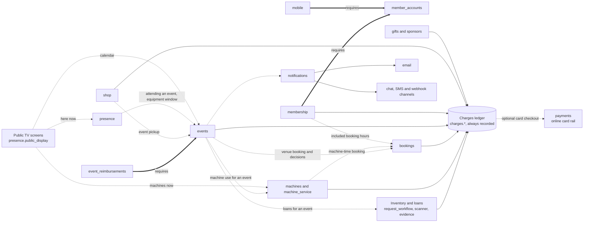

# Space Works features

Everything Space Works runs today, area by area. The [README](../README.md) has the short version;
[MODULES.md](MODULES.md) explains each module key and what happens without it, and
[Choosing modules](choosing-modules.md) shows how areas, modules and features fit together.
[Limits](LIMITS.md) lists quotas, upload bounds and who can change them;
[Free and paid](../README.md#free-and-paid) explains all seven charge switches.

One deployment can host **many makerspaces**. Each has its own inventory, public URL, staff,
Telegram group, QR namespace and audit scope. Queries and actions are scoped to that makerspace.

## What you can run

- **Inventory.** A public catalogue by makerspace/category, reviewed borrow requests,
  staff direct handouts, and eligible authenticated QR self-checkout/return when enabled. Reviewed
  issues require a box QR scan and photo; returns require a photo and remark. Every handover is audited.

  **Free / paid:** Works free. Optional rental, deposits, late, damage and lost fees use `charges.loans`. Online payments are optional.

- **Machines and 3D printing.** Public print requests, machine/service queues, printers, spools,
  filament usage, slicer estimates and optional staff-private cash charges at collection; maintenance,
  certification and usage records.

  **Free / paid:** Works free. Optional job, material and session charges use `charges.machines`. Online payments are optional.

- **Events.** One-off events and recurring series, approval/waitlists, ticket types, invitations,
  promo codes, account-linked speakers and claim links, collaborative hosts and participating-organization
  audiences. A simpler create form and drawer keep advanced controls under More. QR door check-in includes
  an expiring offline roster and event-scoped PIN stations. Feedback, attendance certificates,
  printable badges, owned ticket downloads and member calendar feeds complete the attendee workflow.

  **Free / paid:** Works free. Optional tickets, add-ons, venue fees, team entry and deposits use `charges.events`. Online payments are optional.

- **Bookings.** Bookable resources and public self-booking, recurrence, rescheduling, private
  confirmations, arrival scanning and printable passes. A requests queue, decision reasons, place-photo
  galleries and check-out remarks with issue follow-up complete the resource workflow. Public events
  show a Hosted at venue block. Both Events and Bookings support resource staff grants, draft cloning,
  answer edits, cancellation undo, curated websites, email campaigns, signed server reads and scoped
  reports through shared infrastructure.

  **Free / paid:** Works free. Optional resource and time fees use `charges.bookings`; included plan hours are applied before billing. Online payments are optional.

- **People and access.** Ten fixed built-in roles per makerspace: Space Manager, Inventory Manager,
  Machine Manager, Event Manager, Booking Manager, Handover, Technician, Shop Manager, Fundraising and Member. Staff
  roles combine (Space Manager and Member stand alone), with per-person machine-type scope. Organizations can link spaces, publish profiles and cross-space event catalogues,
  and grant actions across the network without conferring membership identity. Superadmins use a
  separate Django control plane; see [roles and access](README-HOSTING.md#roles--access).

  **Free / paid:** Works free. No fee is charged for this feature. Online payments are optional.

- **Public pages.** Makerspaces and organizations share the `/<handle>` namespace with member
  profiles. Owners save drafts and explicitly publish section layouts; events keep their existing
  website editor and gain `/e/<code>` links. Organization pages show linked public spaces and
  organized events, including a minimal past archive. See the
  [publication and portability rules](INVARIANTS.md#public-pages-shared-handles-and-owner-builders).

  **Free / paid:** Works free. No fee is charged for this feature. Online payments are optional.

- **Live work and search.** Staff queues, loans and check-ins update after commit through Redis-backed
  Server-Sent Events, falling back to polling. Inventory, machine and event lists support `?q=`
  full-text search with typo tolerance. Boxes, tools and individual assets have QR/scan history.

  **Free / paid:** Works free. No fee is charged for this feature. Online payments are optional.

- **Money and reports.** Track debt and offline receipts independently of optional Stripe/Razorpay
  checkout. One pricing kernel prices every charge (rate cards, item prices, member discounts, fee
  waivers); everything is free until a space sets prices. Optional GST/tax, a two-person check for
  offline income, pay links, disputes, a finance ledger with receipts, and refunds only through
  staff-approved refund cases (including offers when a price drops after people paid). Donations,
  recurring pledges, optional 80G receipts and sponsors with a public sponsor wall. Per-space Metabase
  analytics (off by default) give each space a read-only database login over curated views. Overdue tracking, CSV/XLSX exports and accessible charts with table fallbacks cover
  operations. Historical metric rollups are append-only: corrections add revisions. Every module
  has a substantive report or an explicitly gated row.

  **Free / paid:** Works free. Debt tracking uses `charges.enabled` plus each area switch; reports have no fee. Existing debts and receipts remain readable with charges off. Online payments are optional.

- **Platform overview (superadmin).** One page in the web superadmin console totals every live
  space: people, inventory, machines, events, bookings, membership, money and operations, each total
  beside its per-space table, with this month / this year / all time / custom periods, a toggle for
  archived and not-serving spaces, drill-down into each space and an audited CSV. Money stays per
  currency, a block hides where its module is off everywhere, and no member name is shown. See
  [MODULES.md](MODULES.md#the-platform-overview-superadmin-not-a-module).

  **Free / paid:** Works free. No fee is charged for this feature. Online payments are optional.

- **Notifications.** Transactional personal outboxes, verified Telegram, Slack, Mattermost, Discord
  and Twilio/Meta WhatsApp connections, Twilio SMS, per-category selection and email fallback; staff
  rooms retain their delivery matrix. Space Managers configure encrypted channel credentials. Member
  JWTs reach personal routes; browser OAuth completes through authenticated challenge verification.
  WhatsApp Twilio and Meta are registered/mounted; remaining delivery limits are recorded in the
  [delivery contract](notification-contract.md#integration-limits-in-this-tree). Sender-bound
  consent, durable STOP and per-device envelope push preserve account-only owner access independently
  of inbox installation. Sending activation and destructive retirement remain held pending
  [conversion/replay sign-off](notification-reconciliation-rollout.md). Routing to rooms and
  recipients is described in [Notification channels, rooms and recipients](notification-routing.md).

  **Free / paid:** Works free. No fee is charged for this feature. Online payments are optional.

- **Accounts and profiles.** One account per person: staff roles are granted to that account, and the
  superadmin has a separate platform account. People sign in with password, Google, Apple, GitHub,
  OIDC (Keycloak, Authentik, Azure AD, Okta) or phone/SMS. Anyone with a staff role must use a second
  factor (an authenticator or a passkey), with one 3-day grace to enrol. Unusual sign-ins are checked
  and alerted ("this wasn't me" signs out everywhere), IPs can be blocked, CAPTCHA (Turnstile) and
  breached-password checks are available, and each space sets its own staff session, idle-timeout,
  passkey and staff IP rules. Member methods are switchable;
  external identity and staff-created walk-ins support spaces without the member-account ecosystem
  (see [Sign-in, identity and borrowing](sign-in-and-borrowing.md)). One global member profile per account (visible to signed-in members by default, with a separate open-web switch) includes
  status, experience, education, verified and self-reported achievements, projects, optional GitHub counts and a consent-based member directory.
  Public pages at `/<handle>` add fresh publication consent, separate activity-family opt-ins,
  counts-only activity and GitHub calendars, and HOSTED/SPOKE event badges. Public reads expose
  `viewer_is_owner`; the member profile exposes this membership's `verified` flag.

  **Free / paid:** Works free. No fee is charged for this feature. Online payments are optional.

- **Presence.** Time-limited member and guest check-in with project/visitor/event statuses, renewal
  prompts, a hard location check for self check-in and a staff alternative. Privacy controls govern
  the public TV display at `/m/<slug>/now`; browser GPS remains spoofable. Presence is installed on
  existing spaces by migration 0096; new spaces opt in. Defaults are 1/2/3/4 h.

  **Free / paid:** Works free. No fee is charged for this feature. Online payments are optional.

- **Shop.** An optional per-space shop: consumables, kits and merch with variants, online checkout
  (Stripe/Razorpay or pay at the desk), a front-desk till with cash-ups, pickup codes and receipts. Stock
  moves only through the inventory availability module, and every sale is in the ledger.

  **Free / paid:** Catalogue, stock, consumables and staff management work free. Selling requires `charges.enabled` and `charges.shop`; offline cash with a receipt works when they are on. Online payments are optional. Charges off refuses new sales and keeps saved prices and existing debts.

- **ID cards.** A free-canvas card designer, digital member cards with a public validity check,
  ID programmes under membership, event badges and tickets that every event organizer can edit, wallet
  passes and door scans. Cards carry no fee.

  **Free / paid:** Works free. No fee is charged for this feature. Online payments are optional.

- **Repairs and maintenance.** Members report issues on what they used; staff triage them into work
  orders, assign a Technician or an outside contact, approve quotes and track parts. Maintenance,
  To-Buy and warranty live under each area (machines, bookings, inventory). Metered machine sessions
  bill time on a machine from a QR scan, a staff start or (later) the machine itself.

  **Free / paid:** Works free. Maintenance has no member fee; expenses remain recorded. Optional borrower damage fees use `charges.loans`, and machine jobs use `charges.machines`. Online payments are optional.

- **Events depth.** Paid ticketing with orders, seats, tiers, add-ons, series passes, transfers and
  venue fees; calendar invites on confirmation emails; applications with review stages for any event;
  crew and custom check-in lists; hackathon finalists, prize payouts, entry fees and leader-pays teams.

  **Free / paid:** Works free. Optional tickets, add-ons, teams, entry fees, venue fees and deposits use `charges.events`; judging and applications need no payment. Online payments are optional.

- **Help and public stats.** An in-app help centre with role-based guides, and a public stats page per
  space (events, machines, inventory, community) with a TV mode and small-number suppression.

  **Free / paid:** Works free. No fee is charged for this feature. Online payments are optional.

- **Space management.** Task-grouped Space Manager navigation, a searchable settings hub and setup
  checklist; domain managers reach their own settings from their consoles. The dashboard counts
  unresolved booking issues under current booking authority and links to the issues view.

  **Free / paid:** Works free. No fee is charged for this feature. Online payments are optional.

- **Modules and editions.** Install only the areas you use; uninstall hides surfaces and retains data.
  Events-only and bookings-only editions hide unused Inventory surfaces through `SPACEWORKS_EDITION`.

  **Free / paid:** Works free. No fee is charged for this feature. Online payments are optional.

- **Operations.** `X-Request-ID` connects JSON request logs and Celery; a token-protected Prometheus
  endpoint reports queues, delivery failures and storage. Run tests locally before pushing with
  `./scripts/dev.sh test` and `./scripts/dev.sh e2e`. Actions builds/publishes backend/frontend images,
  creates the GitHub Release, promotes rolling tags and optionally deploys through a self-hosted
  runner. `security-audit.yml` runs `pip-audit` on PRs.

  **Free / paid:** Works free. No fee is charged for this feature. Online payments are optional.

- **A durable handover trail.** Audit logs are append-only; attached photo metadata and scan records
  are immutable. Photo bytes can expire under a per-space retention policy with an explicit expired
  state; metadata, remarks and scans remain. A separate default-off cleanup can remove proven unused
  upload slots that never became handover evidence.

  **Free / paid:** Works free. Evidence, scan history and audit logs have no fee; retention affects photo bytes, never the accountability record. Online payments are optional.

- **Membership plans and guest passes.** Plans, admission, current terms, renewal, waivers,
  included booking/machine hours and scoped guest passes work without a payment gateway.

  **Free / paid:** Works free. Dues, admission and guest-pass fees use `charges.membership`;
  online payments are optional.
- **Stocktake and transfers.** Scan-first stock counts, variances and recorded movements
  use the shared inventory availability services.

  **Free / paid:** Works free. No fee for counting or moving stock; online payments are optional.
- **Mobile apps and connected devices.** Android and iOS device sessions, push and the optional
  payment sheet; signed printer/label connections, adapters, telemetry and camera records.

  **Free / paid:** Works free. Device connections have no separate fee. Machine charges use
  `charges.machines`; the native payment sheet uses the same optional online rail as the web.
- **Donations and sponsors.** Campaigns, sponsor recognition, recurring pledges and optional
  tax-exempt receipts use the shared donations ledger.

  **Free / paid:** Works free for campaigns and recognition. Accepting donation or sponsor money
  requires `charges.donations`; online payments are optional and offline gifts get a receipt.
- **API access, backups and portability.** Scoped API clients, signed integration reads, full
  data export, deployment/space backups and tenant migration support taking your data with you.

  **Free / paid:** Works free. No member fee for integrations, backups or export; online payments
  are optional and are not required for portability.

## Events programme

**Free / paid:** Works free. Mentoring, volunteering, submissions and judging need no payment;
optional entry/team/deposit charges use `charges.events`. Online payments are optional.

Hackathons, Mentor Desk, mentor rounds, volunteering and the project gallery are ordinary per-space
switches, off for a new space. See [current status](events/integration-status.md) for what has runtime
evidence. The [Events programme guide](events/README.md) links the
organizer, participant, mentor, volunteer and judge runbooks.

## Also in the staff console

- A **schedule** that puts bookings, events, shifts, machine jobs and maintenance on one calendar.

  **Free / paid:** Works free. No fee for this feature; online payments are optional.

- **Repairs and issue reports** with work orders, quotes and parts, an **incident register** for safety
  events, a **to-buy** list and **consumables** stock.

  **Free / paid:** Works free. Optional borrower damage fees use `charges.loans`; online payments are optional.

- **Gifts and sponsors** with a public sponsor wall, next to the shop and the finance ledger.

  **Free / paid:** Works free for campaigns and recognition. Accepting real money uses `charges.donations`; online payments are optional.

- **Metabase analytics** per space (off by default), **API clients**, a full **data export**, **backups**
  and a move-to-another-server tool.

  **Free / paid:** Works free. No fee for this feature; online payments are optional.

- A **public TV screen** (see below).

  **Free / paid:** Works free. No fee for this feature; online payments are optional.

## Public TV

**Free / paid:** Works free. Presence and display screens charge no fee; online payments are optional.

A paired screen in the workshop shows who is here now, machines in use or free, the events calendar and an
announcement, plus optional public stats, opening hours, inventory highlights and sponsors. It needs the
Presence module and its **Space display screens** capability (off by default). Staff open **Settings,
Display screens**, then either enter the 6-character code the TV shows at `/display` (valid 30 minutes) or
create a screen with an address and open that on the TV or an Anthias player. Each section appears only
while its module is on (presence, events, machines), and the screen shows only what the public page shows a
logged-out visitor. Steps: [display screens](how-to/display-screens.md), [Anthias](how-to/anthias.md).

## How features connect

Thick arrows are requirements; dashed arrows are optional links that exist only while both modules are on.
The same map and a per-module table are in the [README](../README.md#how-modules-connect) and
[MODULES.md](MODULES.md#every-module-its-gates-and-its-money). Each feature below says what it works with
and what happens when that other module is off. When it is off, the link goes quiet and the feature keeps
working on its own.

| Feature | Works with | When the other module is off | Free / paid |
| --- | --- | --- | --- |
| Inventory and loans | **Events**: a loan can be tied to an event and shows on the event's equipment desk. **Charges ledger**: deposits, late fees, rental, damage and lost charges. | Loans stay ordinary loans; with `charges.loans` off nothing is charged. | Works free. Optional charges: `charges.loans`. Online payments optional. |
| Machines | **Events**: a job or session can be logged for an event. **Bookings**: machine-time bookings. **Charges ledger**: metered sessions and priced jobs. **Public TV**: machines in use or free. | With events off the "for which event" picker is empty; the machine work itself is unchanged. | Works free. Optional charges: `charges.machines`. Online payments optional. |
| Events | **Loans**, **machines**, **bookings** (venue booking and decisions), **presence** (attending an event, equipment windows), **shop** (event pickup), **notifications**, and the **charges ledger** for tickets, venue fees, entry fees, teams and deposits. Event reimbursements need events. | Each link goes quiet; registrations and charges already recorded are kept. | Works free. Optional charges: `charges.events`. Online payments optional. |
| Bookings | **Membership**: included booking hours per membership term. **Events** and **machines** as above. **Charges ledger**. | Without membership there are no included hours; bookings are priced as usual. | Works free. Optional charges: `charges.bookings`. Online payments optional. |
| Membership and people | **Member accounts** (required). **Bookings** (included hours). **Charges ledger**: dues, terms, renewals, admission fees and guest passes. | The staff roster and role assignment never depend on membership. | Works free. Optional charges: `charges.membership`. Online payments optional. |
| Money | One **charges ledger** for every area. The **payments** module adds card checkout on top. **Email** sends due-date reminders. | Without payments, owed money is still recorded and settled by hand; without email, reminders are skipped. | Works free. Each `charges.<domain>` switch controls debt; online rail optional. |
| Notifications | **Email**, **SMS**, **WhatsApp**, **Telegram**, **Slack**, **Mattermost**, **Discord** and **signed webhooks**, each its own module. Events send notices through the inbox. | A switched-off channel stops sending and keeps its saved credentials. Account recovery mail is exempt from the email module. | Works free. No fee for this feature. Online payments optional. |
| Presence | **Events** (a person can be checked in as attending an event), the **public TV**. | Without events, the event title is not shown on the screen or the roster. | Works free. No fee for this feature. Online payments optional. |
| Shop | **Events** (pick up an order at an event), the **charges ledger** (every sale is recorded). | Event pickup is its own switch (`shop.event_pickup`); without `charges.shop`, new sales are refused while catalogue, stock, saved prices and existing debts remain. | Catalogue and stock work free. Selling requires `charges.shop`; offline cash with a receipt works. Online payments optional. |
| Public TV | **Presence** (here now), **events** (calendar), **machines** (machines now). | That section is left out; the others still show. | Works free. No fee for this feature. Online payments optional. |

