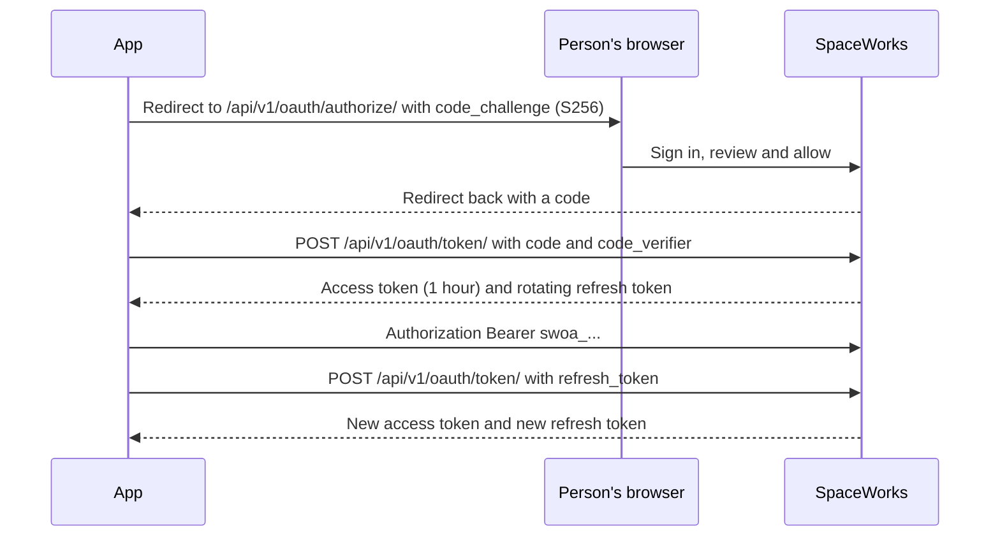

# Authentication

SpaceWorks has four credential types. Pick by who is calling.

## Browser sessions (the web app)

People sign in with `POST /api/v1/auth/login` (or a social, passkey or phone sign-in). The response carries a short-lived **access token** (15 minutes); send it as `Authorization: Bearer <access>`.

- The **refresh token** is an `HttpOnly` cookie named `refresh_token`, scoped to the path `/api/v1/auth/` and valid for 7 days. `POST /api/v1/auth/refresh` returns a new access token and **rotates** the refresh token; the old one is blacklisted.
- Refresh and logout are cookie-bearing, so they are CSRF-protected: the request must carry the header `X-Refresh-CSRF` (its value is not secret; its presence forces a CORS preflight) from an `Origin` on the allowlist.
- `POST /api/v1/auth/logout` ends one session; `POST /api/v1/auth/logout-all` ends all of them.
- Staff routes also require two-step sign-in. See [Two-step sign-in](../how-to/staff-and-superadmin-mfa.md).
- Sensitive actions (credentials, backups, key changes) additionally need a **recent re-authentication** within ten minutes; otherwise they answer `403` with `recent_reauth_required`.

## API clients (servers)

A Space Manager creates a client under **Settings > Integrations > API access** (or `/admin/api-access`) and picks who will use it (*Our own system* or *Another space*) and its scopes. The secret is shown once.

### Scopes

| Scope | Reaches |
| --- | --- |
| `public:read`, `public:write` | Every registered public route of the space |
| `public:<area>:read`, `public:<area>:write` | Public routes of one area only |
| `events:read`, `participants:read`, `orders:read`, `bookings:read`, `booking_resources:read` | Signed integration reads (granted by the platform superadmin) |

Areas: `catalogue`, `events`, `stats`, `bookings`, `pages`, `requests`, `machine_service`, `memberships`, `presence`, `shop`, `donations`, `pricing`, `id_programmes`, `repairs`, `hosting`. A route not in the registry is always refused, whatever the scopes say. A **peer** client (another space's backend) may hold only `public:catalogue:read`, `public:events:read` and `public:stats:read`, and only reaches GET and HEAD.

### Signing a request

Send these headers on every request to a protected path (`/api/public/` and `/api/v1/public/` by default, plus the signed read prefixes):

| Header | Value |
| --- | --- |
| `X-Client-Id` | The client id |
| `X-Timestamp` | Unix seconds, within 300 seconds of server time (`HMAC_MAX_CLOCK_SKEW_SECONDS`) |
| `X-Nonce` | A fresh value of `[A-Za-z0-9._~-]`, up to 128 characters. Replays are rejected |
| `X-Signature` | `hex(HMAC-SHA256(secret, METHOD "\n" FULL_PATH "\n" TIMESTAMP "\n" NONCE "\n" BODY))` |

`FULL_PATH` includes the query string. `BODY` is the raw body, empty for GET. Sending `X-Nonce` opts you into replay protection immediately.

```python
import hashlib, hmac, secrets, time, requests

def signed(method, base, path, client_id, secret, body=b""):
    ts, nonce = str(int(time.time())), secrets.token_urlsafe(24)
    message = b"\n".join([method.encode(), path.encode(), ts.encode(), nonce.encode(), body])
    sig = hmac.new(secret.encode(), message, hashlib.sha256).hexdigest()
    headers = {"X-Client-Id": client_id, "X-Timestamp": ts, "X-Nonce": nonce, "X-Signature": sig}
    return requests.request(method, base + path, data=body or None, headers=headers, timeout=10)
```

Any credential failure answers a uniform `401 {"detail": "Invalid client signature."}`; the server log has the real reason. Rotating a secret keeps the old one valid for 24 hours. Two settings stage enforcement: `API_CLIENT_AUTH_REQUIRED` and `APICLIENT_REQUIRE_NONCE`, both off by default. Run `python manage.py api_client_enforcement_report` to see what would break first. Full rules: [API client protocol](../api-client-protocol.md).

Two other client shapes exist for first-party sites: a **browser client** (`X-Client-Id` plus a registered `Origin`, never elevated) and a **publishable key** (`X-Publishable-Key`, scoped to its space).

## Personal access tokens

A person creates one at `/account/api-access` after a fresh sign-in check: a name, scopes and an expiry (90 days by default, one year at most). The token (`swpat_...`) is shown once. Send it as `Authorization: Bearer swpat_...`.

| Scope | Reaches |
| --- | --- |
| `account:read`, `account:write` | The person's own member routes |
| `public:read`, `public:write`, `public:<area>:*` | The public API, as that person |
| `staff:read`, `staff:write` | Staff routes of **one** space where the person holds a staff role |

Every request replays live checks (account state, roles, MFA, module state). Tokens never reach sign-in, MFA, passkeys, credentials, API clients, backups, superadmin routes or `/control/`. Payout and reimbursement money answers `403` with `full_session_required`.

## OAuth app connections

A Space Manager registers an app under **API access > App connections** with HTTPS redirect URIs, a type (*has a server* is confidential; *phone or browser* is public with PKCE only) and its scopes.



- PKCE with `S256` is required.
- Access tokens (`swoa_...`) last one hour. Each refresh returns a **new** refresh token, and reuse of an old one ends the whole chain. Revoke with `POST /api/v1/oauth/revoke/`.
- With `OAUTH_OIDC_RSA_PRIVATE_KEY` set, the server is also an OpenID Provider: `/api/v1/oauth/.well-known/openid-configuration`, `jwks.json` and `userinfo/`; ask for the `openid` scope.
- People see and disconnect their apps at `/account/api-access`.

## See also

- [API guide](../api-guide.md) for more snippets.
- [Errors](errors.md) and [Rate limits](rate-limits.md)
