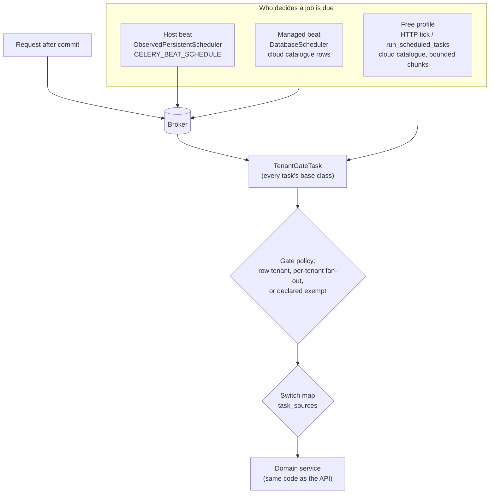

# Background jobs

Everything slow or scheduled runs in **Celery** workers, never in the request. That covers outbound email, chat,
push and webhooks, exports, backups, retention, reminders and device sweeps. A request only enqueues a job, and only
**after its transaction commits** (`transaction.on_commit`), so a rolled-back request never leaves a job behind.

## The parts

- **Beat schedule.** `config/settings_beat.py` and `settings_beat_extensions.py` hold `CELERY_BEAT_SCHEDULE` for a
  self-hosted (host) deployment. Host beat is `ObservedPersistentScheduler`: Celery's file-backed scheduler plus a
  heartbeat that the installer and the platform health checks read.
- **Cloud job catalogue.** `operations/cloud_jobs/catalog.py` lists every periodic task once, with its interval in
  minutes. Two schedulers read only this list:
  - the managed full profile's beat (`cloud_jobs/beat.DatabaseScheduler`, due times kept in the database);
  - the free profile, which has no beat: an HTTP tick or `manage.py run_scheduled_tasks --due-only` from cron runs
    due tasks synchronously in fair, **bounded** chunks (`cloud_jobs/bounded.py`, `tick_service.py`).

  So **every beat entry must also be a catalogue row**, or it never runs on a managed or free deployment.
  `tests/modules/test_nca_audit_0120_tasks.py` enforces this, and also that every entry names the task's
  registered Celery name: the module that *defines* the task, not one that re-exports it.
- **Switch map.** `operations/cloud_jobs/task_sources.py` maps every scheduled task to the switch that owns it.
  There are three kinds:
  - `gated(source)` skips every space where that module or capability is off.
  - `per_row` means each row checks its own switch.
  - `platform` covers deployment work, security, recovery, the money ledger, legal retention, and byte retention
    that must outlive a module.

  `tests/modules/test_scheduled_task_sources.py` fails when a scheduled task is unmapped.
- **Tenant gate.** `config/celery.py` makes `tenant_migration.task_gate.TenantGateTask` the base class of every
  task. Before the task body runs, it applies the source gate, the pause/read-only controls and the superadmin
  bypass. Every task must be declared in the gate policy (`tenant_migration/gate_policy_tasks.py` and the
  per-release `gate_policy_r2_*.py` files) as exactly one of:
  - **row tenant** (`TASK_TENANT_RESOLVERS`): the task works on one row, for example one email or one push. Its
    space is read from that row, and the task holds that space's write boundary. A frozen space refuses the job.
  - **per tenant** (`TASK_INTERNAL_PARTICIPANTS`): a deployment-wide sweep that enters each space through
    `fanout_tenant_write`. That call is skip-and-count: a frozen, paused or migrating space is skipped, counted and
    retried next run, and the call also sets that space's row-level security scope. Every function that calls it
    must be listed in `FANOUT_GATE_PARTICIPANTS`.
  - **exempt** (`TASK_EXEMPTIONS`): platform work that writes no tenant row, for example backups, the platform
    sign-in SMS and installer diagnostics. Each one carries a written reason.

  `tenant_migration/source_gate_guards.validate_task_coverage` and `validate_fanout_gate_coverage` fail the build
  when a task or a fan-out is undeclared. An undeclared task would silently run under the deployment-wide unscoped
  writer lock.

## Conventions every task follows

- **Idempotent.** A task may run twice: `acks_late` is on, so a worker that dies redelivers the job, and sweeps
  overlap. Each task claims its row first (a state compare-and-set, `select_for_update`, a lease or a unique key),
  then works. A replay finds nothing to do.
- **Retries are bounded and only for transient errors.** The limit is either `max_retries` or an attempt counter
  on the row (cut-outs, webhook pushes, delivery legs), with backoff between tries. A final error, such as a
  refused input, a 4xx answer or a revoked target, fails at once, with a typed code.
- **No outbound call inside a transaction.** Claim in one transaction, call the provider, record the result in a
  second one (see `devices/services_adapter_webhook.deliver`). Every outbound HTTP call has a connect and a read
  timeout, follows no redirects, and checks for a public target where the URL is user-supplied.
- **Time limits.** There is no global Celery time limit yet. Outbound tasks set per-task `soft_time_limit` /
  `time_limit`; on the soft limit they record a retryable `timeout` and back off:
  - email and SMS delivery: `EMAIL_TASK_SOFT/HARD_TIME_LIMIT`;
  - adapter webhook push: 30 / 45 s; its sweep: 240 / 300 s;
  - Anthias sync: 120 / 150 s;
  - background-eraser cut-out: 150 / 180 s;
  - audit verification.
- **Switch-aware.** A gated sweep reads the space's switches through `makerspaces.scheduled_scope` or
  `module_enabled` / `feature_enabled`. Work for a switched-off space waits; it is not deleted. Retention sweeps
  are `platform` on purpose: bytes must still expire after a module is turned off.
- **Fail safe.** One bad row never stops a sweep: it is logged and skipped. A notification problem never fails the
  workflow that caused it.
- **Read-only spaces.** A read-only space still runs sweeps that only deliver, expire, retain or settle (the
  `READ_ONLY_OPERATIONS` list in `space_controls/write_policy.py`) and skips sweeps that create records. A paused
  space runs neither. The adapter safety sweep (idle auto-off, maximum session length) is on that list on purpose: it
  only powers a machine off or ends a session, so it also runs in a read-only space.

## Every task

How to read the columns:

- **Schedule**: the host beat entry. "on demand" means the task is queued by a workflow.
- **Cloud**: the catalogue interval (managed and free profiles).
- **Switch**: the `task_sources` entry: a module or capability, `per-row`, or `platform`.
- **Gate**: the tenant gate declaration: `row: <Model>`, `per tenant`, or `exempt`.
- **Limits**: time limits and retries, where the task sets them.

### accounts

| Task | Schedule | Cloud | Switch | Gate | Limits | Purpose |
|---|---|---|---|---|---|---|
| `saved_details.tasks.process_saved_details` | cron(minute=*/5) | 5 min | platform | exempt | - | Global account-owned vault work takes global/account fences and cannot mutate tenant event rows. |
| `tasks.drain_password_reset_envelopes_task` | cron(minute=*) | 1 min | platform | exempt | - | Platform-global account recovery. |
| `tasks.expire_pii_access_windows_task` | cron(minute=*/5) | 5 min | platform | exempt | - | Closes platform-owned PII windows (OMITTED, never exported) at their expiry and appends the expiry audit row, exactly as the lazy close on any read do... |
| `tasks.purge_auth_challenges_task` | cron(hour=3, minute=30) | 1440 min | platform | exempt | - | Platform-global auth retention. |
| `tasks.purge_deleted_accounts_task` | cron(hour=3, minute=20) | 1440 min | platform | per tenant | - | Account erasure uses one skip-and-count boundary per tenant. |
| `tasks.revoke_apple_tokens_task` | on demand | - | - | exempt | - | Platform-global Apple credential revocation; no tenant writes. |
| `tasks_channel_usage.flush_channel_usage_task` | cron(minute=*) | 1 min | platform | exempt | - | Counts-only channel analytics: moves the cached per-hour web / ios / android / api_client call counts (by channel, app area and makerspace) from Redis into `ChannelUsageDay`. Without Redis (cron mode) each worker buffers in process and writes at most once a minute itself, so this task has nothing to drain; counts are approximate by design. |
| `tasks_login_security.purge_login_security_task` | cron(hour=3, minute=40) | 1440 min | platform | exempt | - | Platform-global IP auto-block and django-axes telemetry retention (OMITTED/EMPTY rows); no tenant writes. |
| `tasks_security_alerts.deliver_security_alert_task` | on demand | - | - | exempt | - | Platform security-alert mail for one account (OMITTED/EMPTY SecurityAlert rows); no tenant writes. |

### admin_api

| Task | Schedule | Cloud | Switch | Gate | Limits | Purpose |
|---|---|---|---|---|---|---|
| `tasks.process_bulk_import_job` | on demand | - | `bulk_import` | row: BulkImportJob | - | Runs one staff bulk-import job. |

### apiclients

| Task | Schedule | Cloud | Switch | Gate | Limits | Purpose |
|---|---|---|---|---|---|---|
| `tasks.flush_api_client_usage_task` | cron(minute=*) | 1 min | platform | per tenant | - | Writes only deployment-local last-seen telemetry on ApiClient rows; it moves no tenant data and so needs no per-tenant gate. |

### audit

| Task | Schedule | Cloud | Switch | Gate | Limits | Purpose |
|---|---|---|---|---|---|---|
| `tasks.run_audit_attestation_task` | cron(minute=*/5) | 5 min | platform | exempt | - | Deployment-local audit attestation: batches and leaves are deployment state (OMITTED_MODELS), not tenant domain data, and sealing appends only to that... |
| `tasks.run_audit_verification` | on demand | - | platform | row: AuditVerificationRun | time-limited | append-only audit integrity |

### backup

| Task | Schedule | Cloud | Switch | Gate | Limits | Purpose |
|---|---|---|---|---|---|---|
| `tasks.cleanup_expired_restore_rollbacks_task` | cron(hour=4, minute=5) | 1440 min | platform | exempt | - | Deployment recovery cleanup. |
| `tasks.purge_expired_backup_archives_task` | cron(hour=3, minute=55) | 1440 min | platform | exempt | - | Platform backup retention. |
| `tasks.reconcile_backup_artifacts_task` | cron(minute=*/5) | 5 min | platform | exempt | - | Deployment-local backup staging, verification, and artifact ledger recovery. |
| `tasks.reencrypt_archives_task` | cron(minute=*/10) | 10 min | platform | exempt | - | Release 2 L11: one bounded batch of a requested re-encryption to the current keys. |
| `tasks.run_backup_archive_task` | on demand | - | - | exempt | - | Deployment/tenant backup control plane. |
| `tasks.run_restore_drill_now_task` | on demand | - | - | exempt | - | #190: one drill of a chosen space's latest archive, started from the web console. |
| `tasks.run_restore_drill_task` | cron(minute=20) | 60 min | platform | exempt | - | Release 2 L11: one due restore drill per tick, isolated and throwaway (#128 C-22). |
| `tasks.scheduled_deployment_backup_task` | cron(hour=2, minute=0) | 1440 min | platform | exempt | - | Deployment backup control plane. |
| `tasks.scheduled_space_backups_task` | cron(hour=1-7, minute=*/10) | 10 min | platform | exempt | - | Nightly one-space archives: read-only snapshots under the deployment lease, the same control plane as run_backup_archive_task. |
| `tasks_offsite.push_offsite_backups_task` | cron(minute=*/5) | 5 min | platform | exempt | - | Deployment offsite copy control plane: pushes, prunes and re-verifies sealed archives. |
| `tasks_offsite.rehydrate_backup_archive_task` | on demand | - | - | exempt | - | Deployment recovery: rehydrates a sealed archive from an offsite destination. |
| `tasks_space_keys.space_archive_key_task` | on demand | - | - | row: BackupArchive | - | Re-encrypts or purges one space archive on a retired backup key. |
| `tasks_space_restore.resume_space_restores_task` | cron(minute=*/5) | 5 min | platform | exempt | - | Resumes the two per-space restore steps above, one operation per tick. |
| `tasks_space_restore.run_space_restore_apply_task` | on demand | - | - | exempt | - | Per-space restore apply: claims the space's own source gate (quiesced_snapshot) before it writes, so it IS the gate owner rather than a gated writer. |
| `tasks_space_restore.run_space_restore_preview_task` | on demand | - | - | exempt | - | Per-space restore preview: read-only comparison of an archive with the live space. |

### card_designs

| Task | Schedule | Cloud | Switch | Gate | Limits | Purpose |
|---|---|---|---|---|---|---|
| `tasks.fetch_card_font_task` | on demand | - | - | exempt | - | Platform font library: fetches one font family into the shared CardFont rows (OMITTED); no tenant row is read or written. |
| `tasks.process_card_job` | on demand | - | - | row: CardJob | - | One bounded chunk of a bulk card job; dispatches the next. |
| `tasks.process_photo_batch` | on demand | - | - | row: CardPhotoBatch | - | Apply a reviewed bulk photo batch, one bounded chunk at a time (D314c addendum). |
| `tasks.process_photo_cutout` | on demand | - | - | row: CardPhotoCutout | time-limited, retries row-bounded | One background-removal attempt (D314c); a transient provider failure re-queues itself with backoff. |
| `tasks.purge_expired_card_job_results` | cron(minute=7) | 60 min | platform | per tenant | - | Bulk files are kept 7 days (Q-I1), then the object and its link go. |
| `tasks.refresh_wallet_passes` | cron(minute=*/30) | 30 min | per-row | per tenant | - | Live pass updates for renewals and expiries that happen outside a card service. |
| `tasks.remind_photo_requests` | cron(minute=17) | 60 min | per-row | per tenant | - | Q-I4: one reminder 7 days after a "photo needs update" request, then none. |
| `tasks.resume_card_jobs` | cron(minute=*) | 1 min | per-row | per tenant | - | Each card-job chunk reads and writes inside its job's own space; a frozen space's job waits. |

### data_export

| Task | Schedule | Cloud | Switch | Gate | Limits | Purpose |
|---|---|---|---|---|---|---|
| `subject_tasks.run_subject_export_task` | on demand | - | - | row: DataExportJob | - | Builds one personal (subject-access) export. |
| `subject_tasks.sweep_subject_exports_task` | on demand | 60 min | platform | per tenant | - | Queued personal exports use separate skip-and-count tenant boundaries. |
| `tasks.purge_expired_exports_task` | cron(hour=3, minute=45) | 1440 min | platform | per tenant | - | Each expired export uses the skip-and-count tenant boundary. |
| `tasks.run_data_export_task` | on demand | - | platform | row: DataExportJob | - | staff data export is core |

### devices

| Task | Schedule | Cloud | Switch | Gate | Limits | Purpose |
|---|---|---|---|---|---|---|
| `tasks.adapter_media_sweep_task` | cron(minute=*/10) | 10 min | platform | per tenant | - | Telemetry downsampling and artifact retention. |
| `tasks.adapter_safety_sweep_task` | cron(minute=*) | 1 min | `devices + machines.integrations` | per tenant | - | Idle auto-off and session-ending notices, from the binding safety config (server-side). |
| `tasks.adapter_webhook_sweep_task` | cron(minute=*) | 1 min | `devices + machines.integrations` | per tenant | time-limited | Retry due pushes and prune the delivery log. |
| `tasks.deliver_adapter_webhook_task` | on demand | - | - | row: AdapterWebhookDelivery | time-limited | One push attempt (retries are driven by the sweep with backoff). |
| `tasks.purge_adapter_recordings_task` | cron(hour=3, minute=40) | 1440 min | platform | per tenant | - | Delete camera recordings past their retention window (one tenant boundary per space). |
| `tasks.scan_offline_devices_task` | cron(minute=*) | 1 min | `devices` | per tenant | - | Offline/retention service gates each tenant separately. |

### encryption

| Task | Schedule | Cloud | Switch | Gate | Limits | Purpose |
|---|---|---|---|---|---|---|
| `rekey_tasks.advance_key_jobs_task` | cron(minute=*) | 1 min | platform | per tenant | - | one bounded chunk of every running per-space key job (beat, every minute). |

### event_reimbursements

| Task | Schedule | Cloud | Switch | Gate | Limits | Purpose |
|---|---|---|---|---|---|---|
| `tasks.sweep_deadlines_task` | cron(minute=*/5) | 5 min | `events + event_reimbursements` | per tenant | - | Excludes non-open source gates, then each sweep_one/defer step enters the event host's prepared boundary_tenant_write before fences and programme lock... |

### events

| Task | Schedule | Cloud | Switch | Gate | Limits | Purpose |
|---|---|---|---|---|---|---|
| `approval_digest.send_approval_digests_task` | cron(minute=*/30) | 30 min | `events.approval_digest` | per tenant | - | Bounded: one page of servable spaces per run; each space is its own failure domain. |
| `broadcast_channels.event_broadcast_channels` | on demand | - | - | row: EventBroadcast | - | Sends one event broadcast to its chat channels. |
| `certificates.tasks.process_batch` | on demand | - | - | row: CertificateIssueBatch | - | Issues one certificate batch. |
| `certificates.tasks.render_one` | on demand | - | - | row: EventAttendanceCertificate | retries 3 | Renders one attendance certificate. |
| `certificates.tasks.resume_batches` | cron(minute=*) | 1 min | `events` | per tenant | - | Dispatches persisted batch IDs to the existing tenant-resolved worker; it grants no issuance authority. |
| `certificates.tasks.resume_certificates` | cron(minute=*/5) | 5 min | `events` | per tenant | - | Dispatches persisted certificate IDs to the existing tenant-resolved renderer; it grants no issuance authority. |
| `programme.broadcast_schedule.resume_scheduled_broadcasts` | cron(minute=*) | 1 min | `events.broadcasts` | per tenant | - | G wires this task to periodic recovery; it also works after enqueue loss. |
| `reminders_payments.sweep_order_checkouts_task` | cron(minute=*) | 1 min | `events.orders` | per tenant | - | Each order expiry, settlement retry and reminder runs inside that order's own event write boundary, which holds its space's source gate. |
| `staged_forms.tasks.reconcile_stage_forms_task` | cron(minute=*/5) | 5 min | `events` | per tenant | - | Each event reconciliation enters boundary_tenant_write for its host before key preparation, fences and stage locks. |
| `staged_forms.tasks.recover_stage_files_task` | cron(minute=*/5) | 5 min | `events` | per tenant | - | Each leased asset validation enters its host's boundary_tenant_write; scanner and storage I/O run outside row locks. |
| `staged_forms.tasks.sweep_stage_file_retention_task` | cron(hour=3, minute=50) | 1440 min | platform | per tenant | - | Retention takes the retained shared_boundary per cleanup locator; permanent FK-free locators keep deleting bytes after MIGRATED_OUT or purge. |
| `submissions.integrity_jobs.sweep_integrity_checks_task` | cron(minute=*/15) | 15 min | `events.submission_integrity` | per tenant | - | GitHub I/O runs outside locks; each check result is written under the event write boundary inside the space's skip-and-count source boundary. |
| `submissions.storage_reconcile.reconcile_event_storage_task` | cron(hour=4, minute=25) | 1440 min | `events` | per tenant | - | Each event is reconciled under the retention boundary (shared source boundary, fences, event lock). |
| `tasks.extend_event_series_task` | cron(minute=10) | 60 min | `events` | per tenant | - | Each series extension locks its own makerspace and uses the skip-and-count tenant boundary; the queryset is servable-filtered before iteration. |
| `tasks_assets.reconcile_asset_obligations_task` | cron(minute=*/5) | 5 min | platform | per tenant | - | Permanent FK-free custody reconciliation deletes only exact reserved locators; survives tenant purge. |
| `tasks_assets.sweep_asset_deadlines_task` | cron(minute=*) | 1 min | `events.hackathons` | per tenant | - | Each due event enters the canonical B source boundary before workflow locks. |
| `tasks_assets.sweep_asset_retention_task` | cron(minute=*/5) | 5 min | platform | per tenant | - | Expiry uses the narrow retained source lock and recovery/not-restored checks; no publication authority. |
| `tasks_assets.sweep_asset_work_task` | cron(minute=*) | 1 min | platform | per tenant | - | Each live scan enters B's ordered boundary; byte cleanup enters only the retained boundary. |
| `tasks_attendance.send_attendance_round_task` | on demand | - | - | row: EventAttendanceRound | retries 3 | Sends one attendance-confirmation round. |
| `tasks_cloud.cleanup_print_jobs_task` | on demand | - | platform | per tenant | - | Delegates to the Events certificate print cleanup, which owns its per-tenant source fences. |
| `tasks_cloud.cleanup_programme_receipts_task` | on demand | - | platform | per tenant | - | Delegates to the installed Events runtime callback, which owns its per-tenant source fences. |
| `tasks_cloud.process_asset_work_task` | on demand | - | platform | per tenant | - | Each submission asset job runs inside its event tenant's skip-and-count boundary. |
| `tasks_cloud.resume_certificates_task` | on demand | - | `events` | per tenant | - | Each certificate batch chunk and render uses its event tenant's skip-and-count boundary. |
| `tasks_cloud.sweep_asset_lifecycle_task` | on demand | - | platform | per tenant | - | Delegates to the installed Events runtime callback, which owns its per-tenant source fences. |
| `tasks_cloud.sweep_stage_file_retention_task` | on demand | - | platform | per tenant | - | Delegates to the installed Events runtime callback, which owns its per-tenant source fences. |
| `tasks_contributions.sweep_contributor_maintenance_task` | cron(minute=*) | 1 min | `events` | per tenant | - | Each tenant is skip-and-count gated before domain maintenance or provider delivery. |
| `tasks_id_cards.reconcile_event_id_cards_task` | cron(minute=*/15) | 15 min | `events.id_cards` | per tenant | - | Each event's card issue and revoke runs in that event's own space. |
| `tasks_invites.send_invite_updates_task` | on demand | - | - | row: Event | retries 3 | Sends calendar invite updates for one event. |
| `tasks_programme.sweep_admission_deadlines_task` | cron(minute=*/5) | 5 min | `events.hackathons` | per tenant | - | Retries are safe: each service rechecks state/deadline under the event lock. |
| `tasks_recovery.sweep_judging_notices_task` | cron(minute=*) | 1 min | `events` | per tenant | - | Judging notice dispatch re-enters the live source boundary for each notice. |
| `tasks_recovery.sweep_print_cleanup_task` | cron(minute=*/5) | 5 min | platform | per tenant | - | Retained print cleanup gates recovery and touches only owned expired/cancelled bytes. |

### evidence

| Task | Schedule | Cloud | Switch | Gate | Limits | Purpose |
|---|---|---|---|---|---|---|
| `tasks.cleanup_abandoned_evidence_uploads_task` | cron(minute=40, hour=*/6) | 360 min | platform | per tenant | - | New cleanup uses the skip-and-count tenant boundary; receipt reconciliation is declared deployment coordination. |
| `tasks.sweep_evidence_retention_task` | cron(minute=10, hour=*/6) | 360 min | platform | per tenant | - | Each evidence expiry uses the skip-and-count tenant boundary. |

### hardware_requests

| Task | Schedule | Cloud | Switch | Gate | Limits | Purpose |
|---|---|---|---|---|---|---|
| `tasks.send_return_reminders_task` | cron(minute=0) | 60 min | platform | per tenant | - | Each reminder lifecycle uses the skip-and-count tenant boundary. |
| `tasks_loans.sweep_loan_pickups_task` | cron(minute=*/15) | 15 min | `loans.pickup_windows` | per tenant | - | Each pickup expiry and waitlist lapse runs inside its own skip-and-count tenant boundary. |
| `tasks_replay.cleanup_replay_commands_task` | cron(hour=3, minute=20) | 1440 min | platform | per tenant | - | Per-tenant skip-and-count replay cleanup. |

### hosting_requests

| Task | Schedule | Cloud | Switch | Gate | Limits | Purpose |
|---|---|---|---|---|---|---|
| `tasks.sweep_hosting_requests_task` | cron(hour=3, minute=45) | 1440 min | platform | exempt | - | Platform-global hosting-request retention; deletes/redacts OMITTED platform rows, no tenant writes. |

### integrations

| Task | Schedule | Cloud | Switch | Gate | Limits | Purpose |
|---|---|---|---|---|---|---|
| `broadcasts_worker.broadcast_batch` | on demand | - | - | per tenant | - | Typed adapter resolves one tenant; shared source and PII fences precede campaign/outbox locks. |
| `broadcasts_worker.resume_broadcasts` | on demand | - | - | per tenant | - | Campaign/outbox recovery uses per-tenant skip-and-count boundaries. |
| `destination_health.disable_dead_destinations_task` | cron(minute=50) | 60 min | per-row | per tenant | - | A dead room is switched off under tenant_write for its own makerspace. |
| `notification_tasks.deliver_envelope` | on demand | - | - | per tenant | - | Cutover fence precedes per-leg tenant boundaries; no external call holds an application transaction. |
| `notification_tasks.sweep_notification_outbox` | cron(minute=*) | 1 min | platform | per tenant | - | Enqueues tenant-resolved delivery tasks; media cleanup uses per-tenant skip-and-count gates. |
| `tasks.deliver_email_task` | on demand | - | - | row: EmailLog | time-limited, retries 3 | Sends one queued email (claimed EmailLog row). |
| `tasks.deliver_notification_task` | on demand | - | - | row: NotificationDeliveryLog | time-limited, retries 3 | Delivers one notification leg (NotificationDeliveryLog row). |
| `tasks_messaging.canonical_retention_task` | on demand | 60 min | platform | per tenant | - | Canonical leg retention uses per-tenant skip-and-count gates; processed receipts are deployment-local. |
| `tasks_messaging.deliver_messaging_task` | on demand | - | - | per tenant | - | Worker acquires sender lock first and holds tenant_write during claims and fenced completion. |
| `tasks_messaging.sweep_messaging_task` | on demand | 5 min | platform | per tenant | - | Replays durable signed ingress receipts through notification_ingress.process, which holds the cutover/tenant boundary per receipt; sender protections ... |
| `tasks_messaging_settings.wipe_messaging_credentials_task` | cron(hour=2, minute=15) | 1440 min | platform | exempt | - | Deployment-local callback credential retention: wipes expired verification material on operational credential versions, never tenant settings or porta... |
| `tasks_transient.deliver_transient_email_task` | on demand | - | - | row: EmailLog | time-limited, retries 4 | Send one sealed email. Idempotent: ``_claim_log`` refuses SENT/SKIPPED/in-flight rows, and an unresolved provider acceptance is never re-sent, so a re... |
| `tasks_transient.deliver_transient_sms_task` | on demand | - | - | exempt | time-limited, retries 3 | Send one sealed SMS (login/verification code). A provider rejection retries with backoff; a send that already reported success is never repeated becau... |

### inventory

| Task | Schedule | Cloud | Switch | Gate | Limits | Purpose |
|---|---|---|---|---|---|---|
| `tasks.snapshot_stock_task` | cron(hour=0, minute=15) | 1440 min | platform | per tenant | - | Daily stock observations gate each tenant separately. |

### machines

| Task | Schedule | Cloud | Switch | Gate | Limits | Purpose |
|---|---|---|---|---|---|---|
| `tasks_jobs.sweep_job_flow_task` | cron(minute=*/15) | 15 min | `machines.job_requests` | per tenant | - | Each job quote, pickup and prepay step runs inside its own skip-and-count tenant boundary. |
| `tasks_sessions.sweep_machine_sessions_task` | cron(minute=*/5) | 5 min | `machines.sessions` | per tenant | - | Each auto-stop runs inside its own skip-and-count tenant boundary. |

### makerspaces

| Task | Schedule | Cloud | Switch | Gate | Limits | Purpose |
|---|---|---|---|---|---|---|
| `tasks.cleanup_public_page_assets_task` | cron(minute=10) | 60 min | platform | per tenant | - | Typed tenant cleanup uses per-tenant fanout and repeats the write fence under owner locks; organization cleanup is global. |
| `tasks.refresh_github_contributions_task` | cron(hour=4, minute=15) | 1440 min | `membership` | per tenant | - | Refresh the cached GitHub contribution counts on maker profiles. |
| `tasks.verify_github_ownership_task` | on demand (GitHub sign-in linked, profile GitHub username saved; deduped 60 s) | - | platform | exempt (one account's own profile, writes cache only) | 30 s soft / 45 s hard | Check that the profile's GitHub username belongs to the linked GitHub sign-in, then refresh its calendar. |
| `tasks_membership.run_membership_renewals_task` | cron(minute=30) | 60 min | `membership` | per tenant | - | Each term expiry and renewal charge, each space's guest-pass sweep and each space's join follow-up sweep use the skip-and-count tenant boundary. |
| `tasks_station.purge_expired_operator_leases_task` | cron(hour=3, minute=25) | 1440 min | platform | per tenant | - | Each tenant's expired kiosk leases use the skip-and-count tenant boundary. |

### managed_hosting

| Task | Schedule | Cloud | Switch | Gate | Limits | Purpose |
|---|---|---|---|---|---|---|
| `tasks.sweep_limit_thresholds_task` | cron(minute=7,37) | 30 min | per-row | exempt | - | Decision 328a: 80 / 100 percent limit warnings for every space; a no-op for a space with no limits. |
| `tasks.sweep_managed_hosting_task` | cron(minute=41) | 60 min | platform | exempt | - | Managed-hosting trials and billing: platform rows; read-only is a space-control lifecycle step. |

### notifications

| Task | Schedule | Cloud | Switch | Gate | Limits | Purpose |
|---|---|---|---|---|---|---|
| `browser_alerts.deliver_browser_alert` | on demand | - | - | per tenant | - | Subscription bookkeeping is written under tenant_write for the row's own makerspace; a closed gate skips the alert. |
| `browser_firebase_delivery.deliver_registration` | on demand | - | - | per tenant | - | Holds the registration's tenant boundary; a frozen source leaves the wake-up pending. |
| `escalation.escalate_unseen_task` | cron(minute=*/5) | 5 min | `notifications.escalation` | per tenant | - | Each space's escalation rows are written inside its own skip-and-count source boundary. |
| `tasks.deliver_member_push` | on demand | - | - | per tenant | - | Resolves the canonical envelope delivery's tenant and holds its source boundary; an optional inbox never provides sending authority. |
| `tasks.sweep_member_push` | cron(minute=*/5) | 5 min | platform | per tenant | - | Recovery enqueues each tenant's rows inside a skip-and-count source boundary. |

### operations

| Task | Schedule | Cloud | Switch | Gate | Limits | Purpose |
|---|---|---|---|---|---|---|
| `cloud_jobs.diagnostics.installer_roundtrip` | on demand | - | - | exempt | - | Installer scheduler diagnostics: writes one short-lived cache nonce, never tenant data. |
| `cloud_jobs.maintenance.cleanup_staging` | on demand | 60 min | platform | exempt | - | Managed private-staging cleanup is deployment coordination state, not tenant data. |
| `cloud_jobs.maintenance.refresh_storage` | on demand | 5 min | platform | exempt | - | Deployment storage-capability qualification: probes configured buckets only. |
| `cloud_jobs.maintenance.sample_storage` | on demand | 15 min | platform | exempt | - | Deployment storage-usage sampling: writes only deployment accounting rows. |
| `tasks.finalize_report_rollups_task` | cron(hour=1, minute=0) | 1440 min | `reports` | per tenant | retries 3, autoretry | Each rollup finalisation uses the skip-and-count tenant boundary; the makerspace queryset is servable-filtered before iteration. |
| `tasks_admissions.sweep_membership_admissions_task` | cron(minute=*/5) | 5 min | `membership` | per tenant | - | Admission expiry and committed-settlement recovery gate each tenant before writes. |
| `tasks_platform.run_platform_problem_checks_task` | cron(minute=*/15) | 15 min | platform | exempt | - | Read-only platform monitoring; writes only a disposable deployment cache marker. |
| `tasks_platform_overview.compute_platform_overview_task` | on demand | - | - | exempt | - | Read-only platform monitoring across spaces (counts and per-currency money); writes only a disposable deployment cache entry, never tenant rows. |
| `tasks_reminders.run_reminder_sweep_task` | cron(minute=*/5) | 5 min | per-row | per tenant | - | Reminder discovery, claims and dispatch use one skip-and-count tenant boundary. |
| `tasks_report_schedules.run_report_schedules_task` | cron(minute=*/15) | 15 min | per-row | per tenant | - | Each due schedule runs inside its own skip-and-count tenant boundary; the due queryset is filtered to report-eligible (servable) makerspaces first. |

### payments

| Task | Schedule | Cloud | Switch | Gate | Limits | Purpose |
|---|---|---|---|---|---|---|
| `donations.tasks.raise_pledges_task` | cron(minute=7) | 60 min | `finance.recurring_donations` | per tenant | - | Each due pledge raises its gift and charge inside its own space's tenant write boundary, which holds that space's source gate. |
| `donations.tasks.remind_perks_task` | cron(hour=6, minute=17) | 1440 min | `finance.sponsors` | per tenant | - | Each perk reminder stamps one perk and queues one staff notice inside its own space's boundary. |
| `event_payouts.tasks.recover_finance_work_task` | cron(minute=*/5) | 5 min | `events + event_reimbursements` | per tenant | - | Upload validation and permanent locator cleanup enter the asset host's prepared scope; cleanup locators are FK-free deployment coordination. |
| `event_payouts.tasks.run_due_retention_task` | on demand | - | - | per tenant | - | Targeted retention for one obligation or asset uses the same per-host prepared scope as the periodic sweep. |
| `event_payouts.tasks.sweep_retention_task` | cron(hour=3, minute=55) | 1440 min | platform | per tenant | - | Core finance retention: each asset/obligation enters worker_boundary.prepared_scope for its host; the deployment cursor is coordination only. |
| `tasks.issue_missing_bills_task` | cron(minute=*/5) | 5 min | platform | per tenant | - | Bill recovery gates each tenant before discovering or issuing documents. |
| `tasks.rebuild_refund_cases_task` | cron(minute=17) | 60 min | platform | per tenant | - | Refund-case rebuild gates each tenant before discovering or opening cases. |
| `tasks.run_gateway_poll_task` | cron(minute=*/5) | 5 min | platform | per tenant | - | Gateway poll gates each tenant before reading providers or settling a capture. |

### presence

| Task | Schedule | Cloud | Switch | Gate | Limits | Purpose |
|---|---|---|---|---|---|---|
| `tasks.expire_presence_sessions_task` | every 60 s | 1 min | `presence` | per tenant | - | Expiry and reminder outbox writes gate every tenant separately. |
| `tasks_anthias.sync_anthias_player_task` | on demand | - | - | per tenant | time-limited, retries 4 | Writes player status inside tenant_write for one space. |

### shop

| Task | Schedule | Cloud | Switch | Gate | Limits | Purpose |
|---|---|---|---|---|---|---|
| `tasks.sweep_shop_task` | cron(minute=*) | 1 min | `shop` | per tenant | - | Each lapse runs through the shop's order services, which lock the order and call assert_write_allowed for its space; a settlement only records money a... |

### space_controls

| Task | Schedule | Cloud | Switch | Gate | Limits | Purpose |
|---|---|---|---|---|---|---|
| `tasks.run_space_schedules_task` | cron(minute=23) | 60 min | platform | exempt | - | Scheduled archive and purge run the express lifecycle exclusions; reminders are platform mail. |
| `tasks.send_announcement_emails_task` | cron(minute=*/5) | 5 min | platform | exempt | - | Platform announcements: platform rows and platform mail only, no tenant writes. |

### tenant_migration

| Task | Schedule | Cloud | Switch | Gate | Limits | Purpose |
|---|---|---|---|---|---|---|
| `tasks.cleanup_abandoned_import_objects_task` | cron(minute=35) | 60 min | platform | exempt | - | Target-side import object rollback does not mutate the frozen source. |
| `tasks.cleanup_expired_import_jobs_task` | cron(minute=20) | 60 min | platform | exempt | - | Target-side import retention and recovery. |
| `tasks.cleanup_refused_tenant_dump_artifacts_task` | cron(minute=40) | 60 min | platform | exempt | - | unpublished-byte cleanup mutates only source-deployment coordination state. |
| `tasks.resume_expired_finalizing_import_jobs_task` | cron(minute=*/5) | 5 min | platform | exempt | - | Target-side import finalization recovery does not mutate the frozen source. |
| `tasks.run_import_job_task` | on demand | - | platform | exempt | - | Target-side tenant materialization does not mutate the frozen source. |
| `tasks.run_migration_export_job_task` | on demand | - | platform | per tenant | - | The source export claims and holds source_archive_write for its full lifecycle. |
| `tasks.run_selfhost_move_export_task` | on demand | - | - | exempt | - | Release 2 L11: the superadmin-run PORTABLE export of a self-host move (#128 C-23). |
| `tasks.stage_import_job_task` | on demand | - | platform | exempt | - | Target-side import staging does not mutate the frozen source. |

