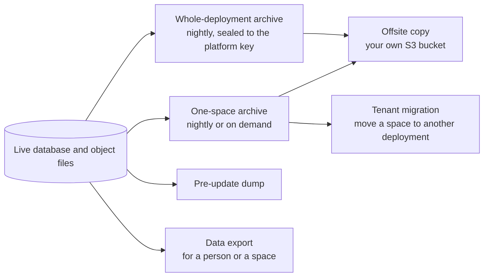

# Data and privacy

## Evidence photos

Photos prove handovers and returns. They live in a **private** object-store bucket and are never public. Reads use short-lived signed URLs.

- **Upload.** Browsers upload to a presigned URL that always points at a *staging* key, with the content type and size range bound in the signature. The final key is never client-writable. The workflow promotes the photo exactly once when it is attached.
- **Immutability.** An attached evidence row is never deleted or replaced. The only update is a one-way mark that a workflow has consumed the upload.
- **Retention.** Photo bytes can expire after a configured window (365 days by default). Only the stored bytes are removed; the row, remarks, QR scans and audit history remain, so the accountability trail survives. An expired photo answers "gone" rather than looking for the file.
- **Abandoned uploads.** A separate cleanup, off by default and requiring both a deployment switch and a per-space opt-in, can delete old uploads that were never attached to anything. It keeps a permanent receipt of each deletion.
- **Upload scanning.** An optional antivirus scan policy can be configured for uploads.

## The audit log

Every state-changing action records an entry through one service. The log is **append-only**: the model refuses edits and deletes and PostgreSQL triggers enforce the same rule underneath. Entries are scoped to a makerspace. Metadata is reviewed so entries do not carry secrets. See the [audit action reference](../audit-action-reference.md) and [logging and audit](../logging-and-audit.md).

## What the public can see

Public inventory never exposes storage locations, box IDs, QR codes, scan history, evidence photos, requester history or hidden counts. Each item chooses whether it is public and how availability is shown: exact count, status only (Available, Limited, Unavailable) or hidden. An exact count is shown only if the item also allows it.

## Personal data

- **Scoped encryption.** Selected personal fields (such as phone and email in some flows) can be encrypted per space with keys held outside the database, plus a keyed index so search still works. It is opt-in and must be enabled deliberately; read the [operator runbook](../scoped-pii-encryption.md) before turning it on, because switching it off is not a rollback.
- **Key rotation.** Per-space keys can be rotated, including an emergency re-key.
- **Sign-in memory.** To spot unusual sign-ins the app stores keyed fingerprints of devices and networks, not raw addresses, and forgets them on a schedule.
- **Account deletion.** A member can delete their account after settling obligations. Sessions end immediately, memberships are revoked, and identity copies are archived for 90 days (configurable) before a daily purge removes them. See [account deletion](../privacy-account-deletion.md) and [account portability](../account-portability.md).
- **Analytics access.** BI tools get read-only logins over curated views, scoped to a space. See [integrations](integrations.md).

## Money records

Money owed is recorded in a permanent ledger that does not depend on the online payment rail. Receipts and manual settlements are append-only, with corrections recorded as new rows. A restricted member can still see and pay their own charges.

## Exports, backups and moving spaces

- **Backups.** The whole deployment is archived nightly and encrypted to the platform key; each space is archived on its own schedule and can be restored from the app. Every update also takes a pre-update database dump. Offsite copies go to an S3-compatible bucket you own and are read back and checked. Restoring one space never rolls back accounts, the audit history, money records or evidence photos. See [backup and restore](../backup-and-restore.md).
- **Data export and tenant migration.** Every data model is classified so exports and moves know what to include, what to strip (such as credentials and provider handles) and what must stay. A space can be moved to another deployment, including from a hosted deployment to its own server. A frozen source gate prevents divergence during the move.
- **Retention and purge.** A superadmin can archive or purge a space; purge is a deliberate, separately confirmed act, and shared organizations are never purged with a space.
