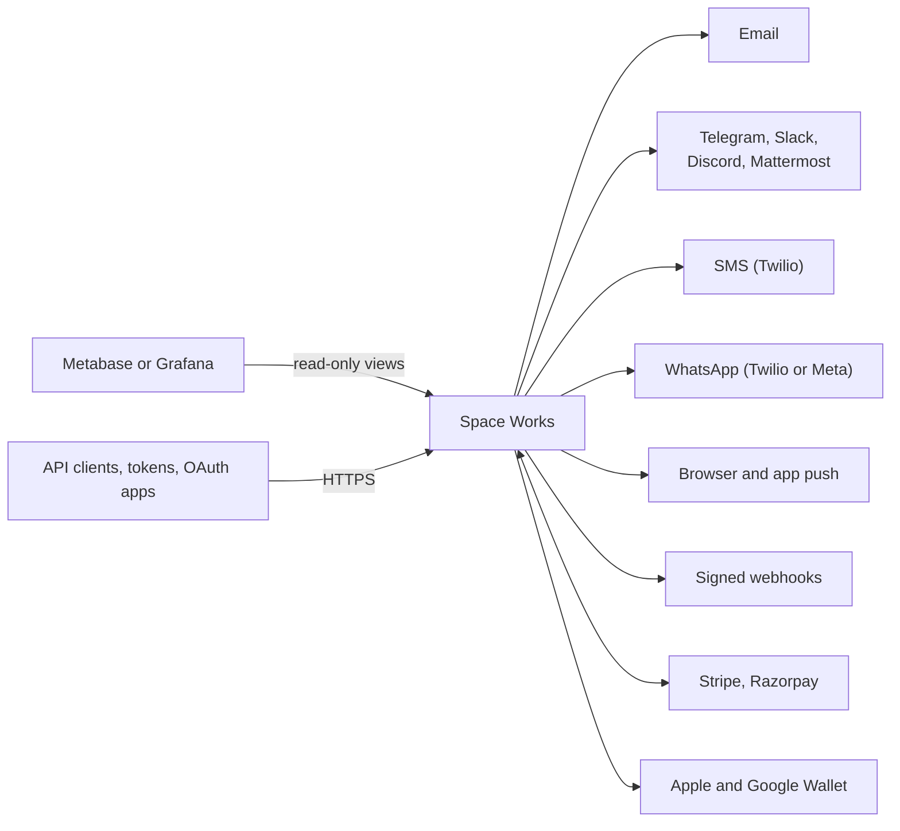

# Integrations

Space Works talks to the outside world in three directions: it **sends** messages and webhooks, it **takes payments and reads provider events**, and it **exposes an API** for other systems. Outbound calls are designed to fail safe: a down provider never breaks a loan or a booking.

## Notifications and messaging channels

Email, Telegram, Slack, Mattermost, Discord and webhooks are each a **module**, so a space that lives in Discord ships no Slack surface. Turning a module on never starts sending by itself: you add the credential and then enable the events you want in a per-feature by per-channel matrix. Turning a module off stops delivery but keeps the stored credential.

- **Chat is outbound only.** A chat message can never carry an action that changes a request. Financial amounts are kept out of staff chat. Chat channels are configured per makerspace; a space can have several **rooms** and route alerts by machine, machine type or inventory category.
- **Personal delivery** (SMS, WhatsApp, push, inbox) goes through one envelope pipeline with consent, per-person category choices and suppression. SMS uses Twilio; WhatsApp uses Twilio or Meta. Opting in needs a verified phone and explicit in-app consent; replying START at the provider does not subscribe anyone, and STOP is honoured.
- **Push.** Browser alerts and native push are separate paths; a Firebase web path is also supported.
- **Webhooks.** Signed webhooks carry only IDs (format version 2), never names, emails, phone numbers or credentials.

Read more: [notification channels](../notification-routing.md), [SMS and WhatsApp](../messaging-channels.md), [Notifications v2 contract](../notification-contract.md), [personal notifications](../notification-inbox.md) and [signed webhooks](../webhooks-v2.md).

## Payments: ledger versus rail

Two halves with different lifetimes:

| Half | What it does | Optional? |
| --- | --- | --- |
| **Ledger** (`payments`) | Records money owed, payments, manual settlements with receipts, reconciliation, member history and reports. | No. It is permanent core: a deployment that cannot read or settle money it holds has lost data. |
| **Rail** (`payments_rail`) | Checkout, the native payment sheet, Stripe Connect, refunds, credentials and provider webhooks. | Yes. Online payments are an opt-in area. |

Debts are recorded whether or not a gateway exists. A charge raised with no gateway is claimed by the first checkout that reaches a provider. Staff can mark a charge paid offline, which requires a receipt (method, reference, date). Stripe and Razorpay are the supported providers. Credentials are stored encrypted and write-only. See [payments and billing](../payment-billing.md) and [payment documents](../payment-documents.md).

## Analytics

Space Works does not bundle a BI tool. With the `analytics` module on, a Space Manager creates a **read-only database login** limited to curated views for that space, then connects **Metabase** or **Grafana** (or both) to it. Dashboards can be embedded inside the staff console. A starter bundle for Grafana is generated for you. Separately, optional web telemetry providers can be configured with visitor consent. See [Metabase setup](../metabase-setup.md), [Grafana setup](../grafana-setup.md), [analytics views](../analytics-views.md), [monitoring and analytics](../monitoring-and-analytics.md) and [web telemetry providers](../web-telemetry-providers.md).

Operators can also expose Prometheus-style HTTP metrics at `/api/v1/metrics/`, guarded by a deployment token.

## Wallet passes

Member, programme and event cards, and guest passes, can be added to Apple Wallet and Google Wallet when the wallet switch is on. Passes never carry photos, email, phone or birth date. Credentials resolve in order: the space's own, the platform's, then deployment files. Member cards update by push; guest passes are static and revocable on the server. See [wallet passes](../wallet-passes.md).

## API access for other systems

Pick the credential that matches who is calling:

| You are | Credential | Acts as |
| --- | --- | --- |
| A backend of your own | **API client** (signed server client) | the client, on public routes and signed integration reads |
| Another space reading your public data | **API client, peer type** | the client, read-only |
| A person automating their own work | **Personal access token** | that person, within the token's scopes |
| A third-party app people sign in to | **OAuth 2.0 / OIDC app connection** | each person who connects it, within the consented scopes |

Server clients sign each request with **HMAC-SHA256** over the method, full path, timestamp, an optional nonce and the body, within a clock-skew window. Browser clients are identified by client ID and registered origin but are not trusted for rate-limit tiers. A **publishable key** scopes a tenant's public website to that space. Scopes are per area (catalogue, events, stats, bookings and so on) and an unregistered protected route is denied. None of these can do more than their owner may do at that moment. Every route is documented in the live OpenAPI at `/docs/`, `/redoc/` and `/schema/`.

Read more: [API guide](../api-guide.md), [API client protocol](../api-client-protocol.md) and [mobile integration](../mobile-integration.md).

## How outbound messages are sent

Every outbound message (email, SMS, WhatsApp, push, chat rooms, webhooks, Telegram) and the fan-out that decides who gets it runs in a **Celery worker**, never inside the web request that caused it.

- **Notifications.** A domain action calls a notification adapter. In a web request, admin action or management command the adapter does not resolve recipients or render anything: `integrations/fanout_jobs.py` writes one id-only job row (a `legacy.lifecycle` notification envelope) in the same transaction and enqueues it after commit. The worker re-runs the adapter by ids: recipient resolution, per-recipient locale rendering, preference, quiet-hour and limit checks, inbox rows and delivery. The per-minute outbox sweeper re-queues a job whose enqueue was lost.
- **Idempotency and ordering.** Inner `emit()` calls dedupe on their own `dedup_key`, so a retried job never duplicates inbox rows or sends. Jobs for the same subject run in order (an "issued" job blocks the "returned" job of the same request for up to 30 minutes). Failures are recorded on the job, retried with exponential backoff (6 attempts) and then marked dead with an error log. They never reach the request.
- **Mail.** Ordinary mail goes through the email outbox (`EmailLog` row, then `deliver_email_task` with backoff). Secret-bearing mail and SMS (sign-in codes, reset links, invitations) are never stored, so the body is sealed (Fernet, 15-minute expiry) into the task arguments; the broker only ever holds ciphertext.
- **Platform-credential limits, channel switches, member preferences and the audit trail** are applied by the dispatcher in the worker, unchanged.
- **Stays inline, on purpose.** The explicit "send a test email/SMS now" admin actions (synchronous, short timeout, clear error). Brokerless and free installs (`CELERY_TASK_ALWAYS_EAGER`, or the `free` profile, which has no worker and drains on a tick): the same code runs inline in the web container. Tests run eager, so behaviour is deterministic.

- **Call-time state.** A deferred job stores ids plus the state-bearing columns of each row as of the call (status, version, timestamps, enum choices, foreign-key ids; never free text or personal data, and account rows carry the id only). The worker overlays them on the freshly loaded row, so dedup keys and revisions read what the caller decided on, even though the job runs seconds later. A string that looks like an address is refused and that call stays inline.
- **No double sends.** Inside a job every legacy fan-out gets a stable event key (job id and call number). A re-run reaches the same shell, and each email, inbox and room leg is recorded on it in the same transaction as the leg's log rows, so a resumed job sends only the legs that never went out.
- **One-time-code sealing key.** The sealing key is derived with HKDF-SHA256 from `TRANSIENT_MAIL_KEY` (or `SECRET_KEY` when unset) under the label `spaceworks/transient-mail/v1`, so it is neither the raw secret nor usable for anything else. To rotate, set the new value as `TRANSIENT_MAIL_KEY` and keep the old one in `TRANSIENT_MAIL_KEY_PREVIOUS` (Django's `SECRET_KEY_FALLBACKS` also counts) for one deploy; sealed messages live 15 minutes.

New notification code must call an adapter (decorated with `safe_adapter`, `safe_notification` or `deferred_fanout`) or the outbox, not a provider; `backend/tests/parity_0120/mail_celery/test_no_inline_sends.py` fails on a direct send outside the dispatcher modules.

