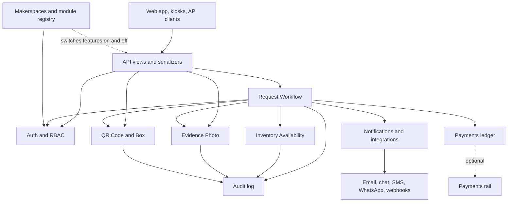

# Modules and the two load-bearing rules

The backend is organised as Django apps with clear responsibilities. Two rules are load-bearing; the rest of the structure exists to make them easy to follow.

## Rule 1: one workflow owns every state transition

The **Request Workflow** module (`apps/hardware_requests/workflow.py`) is the only place a hardware request changes status. The staff console, the handover desk, kiosks, self-checkout, the `/control/` review page and API clients all call the same service. Nothing writes `HardwareRequest.status` directly.

Chat is not a decision surface. The Telegram accept and reject buttons were removed; the webhook route remains only so an old deployment's bot does not retry forever, and it ignores every callback. If a chat path into decisions were ever re-added it would have to go through the workflow module.

## Rule 2: one availability module owns all quantity math

The **Inventory Availability** module (`apps/inventory/availability.py`) is the only place available, reserved and issued counts change. Reserve, issue, return and mark-lost all pass through it, and it enforces that availability never drops below zero. No other module computes these numbers.

## The deep modules

| Module | Responsibility |
| --- | --- |
| **Auth and RBAC** | Role and action matrix and makerspace scoping on every query. Interface: `can(actor, action, resource)` and scoping helpers. Also blocks restricted or suspended users. |
| **Request Workflow** | The state machine, audit entries, notification triggers, and coordination with inventory. |
| **Inventory Availability** | Quantity math and asset status for QR-tracked tools. |
| **QR Code and Box** | Generate, resolve and revoke QR codes, assign boxes to requests, keep scan history. |
| **Evidence Photo** | Issue and return photo metadata, immutable once attached, linked to actor, request and QR scans. Handles presigned upload, retention and cleanup. |
| **Audit** | Append-only log written through one `record(...)` service. |
| **Notifications and Integrations** | Outbound alerts and delivery to each channel. |
| **Makerspaces** | Tenants, the module registry, capabilities and settings. |
| **Payments (ledger) and Payments rail** | Money owed and settled; the optional online checkout. |

Beyond these, the code has an app per product area: machines, printing, events, bookings, membership, shop, maintenance, procurement, presence, devices, analytics, organizations, backup, data export and tenant migration. `apps/makerspaces/module_registry.py` is the single source of truth for module keys, defaults and dependencies. The user-facing description of each is in the [module reference](../MODULES.md).

## Module dependency diagram

## Modules are installable

Core modules cannot be switched off. Others are opt-in per makerspace, and a feature that is off must disappear cleanly, including its menus, routes and notifications. Modules can declare dependencies on each other, and some removable apps are designed so that a deployment can tombstone them without losing data. The payment **ledger** is permanently core; only the **rail** is removable. See [integrations](integrations.md).

## Conventions for contributors

- Every state-changing endpoint writes an audit entry.
- Every route has an OpenAPI description and, if it is on a protected surface, a scope registration.
- Source files are kept small, with one responsibility each; large files are split into sibling modules behind thin re-export barrels.
- Every new data model must be classified for export and tenant migration, or the drift checks fail the build.

The per-directory source map is in the repository at [docs/SOURCE-MAP.md](https://github.com/SpaceWorks-Labs/SpaceWorks/blob/dev/docs/SOURCE-MAP.md).
