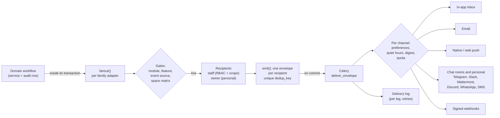

# Notifications

A notification is always a **side effect of a workflow that already ran**: a loan was issued, a job report is
waiting for review, a limit was crossed. A notification can never change state back. Chat is outbound only, and the
Telegram webhook acknowledges and discards callbacks.

This page explains the pipeline and lists every event the platform can send. Related pages:

- [notification-contract.md](../notification-contract.md) covers the delivery contract in detail.
- [notification-coverage.md](../notification-coverage.md) says which code path produces which event.

## The pipeline

1. **Emit inside the workflow.**
   - The service that changed state calls its family adapter, for example `hardware_requests/notifications_p2.py` or
     `devices/adapter_notifications.py`.
   - `fanout()` runs inside the domain transaction, so a workflow that rolls back sends nothing.
   - Builders wrapped in `safe_notification` / `safe_adapter` hand the work to Celery and catch any failure, so a
     notification problem never fails the workflow.
2. **Gates.** An event is emitted only when all of these are on for the space:
   - its **family module** (`recipients_selection.FEATURE_MODULES`);
   - its narrower **event source**, a capability (`notification_catalog_sources.EVENT_SOURCES`);
   - the channel, in the space's **channel matrix** (`notification_catalog.is_notification_enabled`, defaults in
     `DEFAULT_CHANNEL_STATE`).

   Every envelope checks its source again at send time. Each source kind registers an `eligible(envelope)` in the
   `notification_sources` registry, which reloads the row and compares its revision. So a row that was undone,
   revoked or switched off since the emit is not delivered.
3. **Recipients.**
   - Staff come from `staff_notifications.staff_user_ids_for_feature`. That is the space's explicit recipient picks
     for the family and event (`NotificationRecipient`). Without picks, it is the active staff whose role holds the
     family's action, narrowed by machine scope when the event has one.
   - Machine-service job notices (`printing` family, decision 343) are selectable for STAFF only, per event and machine
     type (`RecipientMachineTypeScope`): `submitted`, `accepted`, `rejected`, `started`, `completed`, `failed`,
     `cancelled`, `collected`, `reprinted`, `changes_requested`, `resubmitted`, `quoted`, `quote_approved`,
     `quote_declined`, `quote_expired`, `requeued`, `uncollected`, `no_show_flagged`, `session_auto_stopped`
     (`integrations/recipients_staff_only.py`). Rules name roles or people only; the job owner's own notices ignore
     them (`requester_selected` answers yes for this family). A notice whose type no rule covers keeps the default
     audience, so a space with no rules behaves as before. The machine type wizard's Notifications step edits them.
   - Recipients are never members of another space and never restricted accounts.
   - The **owner**, the member the event is about, gets personal copies only.
4. **One envelope per recipient.** `notification_outbox.emit` creates a `NotificationEnvelope` with a unique
   `dedup_key`, built from the source kind, the source row, its **revision** and the recipient.
   - A repeat call (a retry, a replay, a second sweep) reserves the same envelope. **This is the dedupe for every
     catalogue event.**
   - Repeating events add their own guard before they emit: a "sent at" stamp on the row, a cache window or a marker
     row. The 0.12.0 table below lists them.
5. **Delivery.** `notification_tasks.deliver_envelope` is a tenant-gated Celery task. For each channel it applies:
   - the person's preferences and categories (`notifications/preferences.py`);
   - quiet hours and digest timing;
   - quota budgets;
   - the email gate: email goes out only when the space's mail transport and the `email` module allow it.

   Each leg is a `NotificationDelivery` row:
   - it holds a claim lease;
   - it gets at most `MAX_ATTEMPTS` (4) tries, with backoff, and only on a retryable provider error;
   - it ends in a final state: `sent`, `delivered`, `failed` or `skipped`.

   The staff **delivery log** reads these rows. The outbox sweeper (`sweep_notification_outbox`, every minute)
   re-enqueues anything a lost broker message left behind.
6. **Copy.** Subjects and bodies are rendered in the recipient's language. They come from:
   - the template registry (`email_templates_registry*.py`), which each space can edit;
   - the chat templates (`chat_templates_catalog`);
   - the push categories (`push_categories.py`).

   The frontend labels every event code in `features/notifications/notificationEventLabels.ts`.
   `tests/modules/test_nca_audit_0120_notifications.py` fails when a catalogue event has no label.

The limit notices skip the catalogue on purpose and write **inbox rows directly**, because they tell Space Managers
and superadmins about the platform, not about a domain row: `platform_limit.warning` / `platform_limit.reached`
(`managed_hosting/limit_notices.py`). Each row has a fixed `event_key` per space, limit key, level, month and person.

## Families

| Family | Module switch | Default channels | Staff recipients | Personal (owner) copies |
|---|---|---|---|---|
| `hardware_requests` | `request_workflow` | email, Telegram room (inbox opt-in) | inventory staff with the request actions | requester |
| `printing` | `machine_service` | email (inbox opt-in) | machine staff, machine-scoped; selectable per event and machine type for the staff notices (see below) | requester / job owner (never changed by a staff pick) |
| `events` | `events` | inbox | organisers and event staff | registrant, applicant, team member |
| `bookings` | `bookings` | email, Telegram room, inbox | booking staff | booker |
| `maintenance` | `machines.maintenance` | inbox | machine staff, machine-scoped | reporter |
| `members` | `membership` | inbox | Space Managers / membership staff | member, applicant, guardian, guest |
| `api_access` | platform | email, Telegram, inbox | Space Managers | requester |
| `devices` | `devices` | inbox | device staff (machine staff for adapter notices) | member at the machine (session ending, detection) |
| `payments` | `request_workflow` (the ledger is core) | inbox (the payer's receipt email defaults on) | finance staff | payer |
| `stock` | `inventory.tobuy` or `machines.tobuy` | inbox | inventory staff | - |
| `certifications` | `machines` | inbox | - (staff made the decision) | member (machine access granted, revoked, expiring) |
| `presence` | `presence` | inbox, native push | - | member |

Email, Telegram, Slack, Mattermost, Discord, WhatsApp, SMS and webhooks each also need their own module or channel
setup. A channel that is not set up is skipped, not failed.

## The 0.12.0 events

| Event | Family | Recipients | Dedupe | Notes |
|---|---|---|---|---|
| `adapter_attention`, `adapter_runout` | devices | staff | the adapter event's `operation_id` (one row per report) | from `job.needs_attention` and `consumable.runout` |
| `adapter_detection` | devices | staff + the job owner | one per binding and kind per 5 min (cache) | never acts on its own |
| `adapter_access_denied` | devices | staff | one per binding and reason per 10 min | unknown or locked credentials are not notified |
| `adapter_session_ending` | devices | member | one per session (a derived event row) | sent 5 minutes before `max_session_minutes` |
| `adapter_job_review` | devices | staff | one per job (a `job.review_needed` row) | a finished or failed adapter job report is waiting for review; the member hears `printing.completed` / `failed` when staff apply it |
| `offline`, `recovered` | devices | staff | the state edge | device liveness |
| `granted`, `revoked`, `expiring` | certifications | member | the grant's revision; `expiry_notice_sent_at` | machine access (decision 319); the expiry sweep takes one tenant boundary per grant |
| `profile_opened` | members | member | `open_notice_pending` + revision | one-time notice (decision 303d) |
| `platform_limit.warning`, `platform_limit.reached` | (direct inbox) | Space Managers, superadmins | per space, key, level, month and person; a marker row per crossing | decision 328a: 80 % and 100 % |
| `incident_reported` | maintenance | staff | the incident row | a safety incident or near miss reported to the register |
| `hours_bank_low` | bookings | booking staff | a level marker | an organisation's hours bank |
| `guardian_consent_requested` | members | guardian | the consent row's revision | personal only |

These are not notified, by design; each has a status and an audit row instead:

- An Anthias sync failure: the player shows `error` with its reason, and every sync is audited.
- A background-eraser cut-out finishing or failing: the card screen polls the job, and every attempt is audited.
- A username change.

## Every catalogue event

The catalogue is `integrations/notification_catalog.FEATURE_EVENTS`. "Narrower switch" is the capability an event
needs on top of its family's module (`EVENT_SOURCES`); `-` means the family switch alone is enough. An event listed
under several families is a separate preference cell in each.

#### hardware_requests (family switch: `request_workflow`)

| Event | Narrower switch |
|---|---|
| `submitted` | - |
| `accepted` | - |
| `rejected` | - |
| `issued` | - |
| `partially_returned` | - |
| `returned` | - |
| `closed_with_issue` | - |
| `return_reminder` | - |
| `deposit_raised` | - |
| `late_fee_raised` | - |
| `rental_raised` | - |
| `damage_charged` | - |
| `lost_charged` | - |
| `fees_waived` | `loans.fee_waivers` |
| `overdue_escalated` | - |
| `back_available` | `inventory.notify_when_back` |
| `problem_report.filed` | - |
| `cancelled` | - |
| `expired` | - |
| `waitlist_offer` | `loans.waitlist` |
| `issue_reported` | `inventory.issue_reporting|inventory.repairs` |
| `repair_quote_pending` | `inventory.repairs` |
| `maintenance_due_soon` | `inventory.maintenance` |
| `maintenance_overdue` | `inventory.maintenance` |
| `linked_event_changed` | `events` |
| `renewed` | `loans.renewals` |
| `pickup_expiring` | `loans.pickup_windows` |
| `repair_closed` | `inventory.issue_reporting|inventory.repairs` |

#### printing (family switch: `printing`)

| Event | Narrower switch |
|---|---|
| `submitted` | - |
| `accepted` | - |
| `started` | - |
| `rejected` | - |
| `completed` | - |
| `failed` | - |
| `collected` | - |
| `reprinted` | - |
| `next` | - |
| `cancelled` | - |
| `changes_requested` | - |
| `resubmitted` | - |
| `quoted` | `machines.job_quotes` |
| `quote_reminder` | `machines.job_quotes` |
| `quote_approved` | `machines.job_quotes` |
| `quote_declined` | `machines.job_quotes` |
| `quote_expired` | `machines.job_quotes` |
| `requeued` | - |
| `pickup_reminder` | - |
| `uncollected` | - |
| `no_show_flagged` | - |
| `session_auto_stopped` | `machines.sessions` |

#### events (family switch: `events`)

| Event | Narrower switch |
|---|---|
| `published` | - |
| `cancelled` | - |
| `completed` | - |
| `registration_created` | - |
| `registration_pending_approval` | - |
| `registration_waitlisted` | - |
| `registration_approved` | - |
| `registration_rejected` | - |
| `registration_cancelled` | - |
| `registration_restored` | - |
| `registration_promoted` | - |
| `registration_attended` | - |
| `series_published` | - |
| `series_cancelled` | - |
| `series_completed` | - |
| `series_generation_failed` | - |
| `reminder` | - |
| `application_submitted` | `events.applications|events.hackathons` |
| `application_offered` | `events.applications|events.hackathons` |
| `application_waitlisted` | `events.applications|events.hackathons` |
| `application_rejected` | `events.applications|events.hackathons` |
| `application_confirmed` | `events.applications|events.hackathons` |
| `application_declined` | `events.applications|events.hackathons` |
| `application_expired` | `events.applications|events.hackathons` |
| `application_withdrawn` | `events.applications|events.hackathons` |
| `rsvp_extended` | - |
| `team_eligibility_changed` | `events.hackathons` |
| `event_cancelled` | - |
| `certificate_ready` | - |
| `certificate_revoked` | - |
| `approval_digest` | `events.approval_digest` |
| `registration_removed` | - |
| `ticket_resent` | - |
| `mentor_help_alert` | `events.mentor_chat_alerts` |
| `mentor_help_update` | `events.mentoring` |
| `certificate_signature_requested` | - |
| `team_invited` | `events.hackathons` |
| `team_join_requested` | `events.hackathons` |
| `team_join_declined` | `events.hackathons` |
| `team_membership_updated` | `events.hackathons` |
| `team_reopened` | `events.hackathons` |
| `team_disbanded` | `events.hackathons` |
| `team_leadership_transferred` | `events.hackathons` |
| `team_member_removed` | `events.hackathons` |
| `invitation` | - |
| `order_confirmed` | `events.orders` |
| `order_payment_reminder` | `events.orders` |
| `order_abandoned` | `events.orders` |
| `ticket_type_changed` | `events.ticket_types` |
| `pass_occurrence_cancelled` | `events.series_passes` |
| `ticket_claim_invite` | - |
| `ticket_transfer_received` | `events.transfers` |
| `registration_updated` | - |
| `ticket_pay_link` | - |
| `pay_window_opened` | `events.pay_window` |
| `pay_window_expired` | `events.pay_window` |
| `application_stage_advanced` | `events.application_stages` |
| `attendance_confirmation` | `events.attendance_confirmation` |
| `attendance_reminder` | `events.attendance_confirmation` |
| `attendance_replied` | `events.attendance_confirmation` |
| `crew_invited` | `events.crew` |
| `crew_decided` | `events.crew` |
| `finalists_announced` | `events.finalists` |
| `prize_payout_recorded` | `events.prize_payouts` |
| `prize_split_proposed` | `events.prize_payouts` |
| `prize_claim_verified` | `events.prize_payouts` |
| `prize_forfeited` | `events.prize_payouts` |
| `prize_recovery_opened` | `events.prize_payouts` |
| `peoples_choice_open` | `events.peoples_choice` |
| `stage_deadline_reminder` | `events.hackathons` |
| `stage_shortlisted` | `events.hackathons` |
| `stage_not_shortlisted` | `events.hackathons` |
| `stage_promoted` | `events.hackathons` |
| `judge_reminder` | `events.hackathons` |
| `linked_booking_changed` | `bookings` |
| `event_booking_linked` | `bookings` |
| `event_loan_linked` | `request_workflow` |
| `event_loan_unlinked` | `request_workflow` |

#### bookings (family switch: `bookings`)

| Event | Narrower switch |
|---|---|
| `created` | - |
| `confirmed` | - |
| `rejected` | - |
| `cancelled` | - |
| `restored` | - |
| `completed` | - |
| `no_show` | - |
| `reminder` | - |
| `issue_reported` | `bookings.issue_reporting` |
| `repair_quote_pending` | `bookings.room_repairs` |
| `invitation` | `bookings.staff_grants` |
| `maintenance_due_soon` | `bookings.room_maintenance` |
| `maintenance_overdue` | `bookings.room_maintenance` |
| `linked_event_changed` | `events` |
| `room_outage` | `bookings.room_repairs|bookings.room_maintenance` |
| `repair_closed` | - |
| `booking_loan_linked` | `request_workflow` |
| `booking_loan_unlinked` | `request_workflow` |
| `hours_bank_low` | `bookings.organization_bookings` |

#### maintenance (family switch: `machines.maintenance`)

| Event | Narrower switch |
|---|---|
| `schedule_created` | - |
| `schedule_updated` | - |
| `schedule_deactivated` | - |
| `logged` | - |
| `schedule_completed` | - |
| `due_soon` | - |
| `overdue` | - |
| `issue_reported` | `machines.issue_reporting` |
| `repair_quote_pending` | `machines.repairs` |
| `repair_dispatched` | `machines.repairs` |
| `incident_reported` | `safety.incidents` |
| `repair_closed` | `machines.issue_reporting|machines.repairs` |

#### members (family switch: `membership`)

| Event | Narrower switch |
|---|---|
| `request_pending` | - |
| `member_joined` | - |
| `approved` | - |
| `declined` | - |
| `renewal_due` | - |
| `lapsed` | - |
| `renewal_failed` | - |
| `awaiting_payment` | - |
| `payment_due` | - |
| `renewed` | - |
| `grace_started` | - |
| `cancelled` | - |
| `broadcast` | `membership.broadcasts` |
| `joined` | - |
| `verified` | - |
| `invitation` | - |
| `vouched` | `membership.vouching` |
| `changes_requested` | - |
| `resubmitted` | - |
| `erasure_approved` | `membership.erasure` |
| `erasure_rejected` | `membership.erasure` |
| `card_issued` | - |
| `card_design_pending` | - |
| `card_photo_requested` | - |
| `card_job_finished` | - |
| `programme_card_decided` | `membership.id_programmes` |
| `event_card_issued` | `events.id_cards` |
| `guest_pass_issued` | `membership.guest_passes` |
| `guest_pass_expiring` | `membership.guest_passes` |
| `guest_pass_sponsor_notice` | `membership.guest_passes` |
| `join_followup` | `membership.join_funnel` |
| `guardian_consent_requested` | `membership.minors` |
| `profile_opened` | `membership` |

#### api_access (family switch: `platform`)

| Event | Narrower switch |
|---|---|
| `api_key_request_resolved` | - |
| `subdomain_request_resolved` | - |
| `email.failed` | `email` |
| `scheduled_report` | `reports` |
| `space_restore_completed` | - |
| `space_restore_failed` | - |
| `emergency_rekey_started` | - |
| `emergency_rekey_completed` | - |
| `emergency_rekey_failed` | - |
| `selfhost_move_status` | - |

#### devices (family switch: `devices`)

| Event | Narrower switch |
|---|---|
| `offline` | - |
| `recovered` | - |
| `adapter_attention` | - |
| `adapter_runout` | - |
| `adapter_session_ending` | - |
| `adapter_access_denied` | - |
| `adapter_detection` | - |
| `adapter_job_review` | - |

#### payments (family switch: `request_workflow`)

| Event | Narrower switch |
|---|---|
| `charge_raised` | - |
| `payment_due_soon` | - |
| `payment_due_today` | - |
| `payment_overdue` | - |
| `payment_received` | - |
| `refund_issued` | - |
| `payment_failed` | - |
| `document_issued` | `billing.documents` |
| `refund_due_opened` | - |
| `refund_request_received` | - |
| `refund_request_approved` | - |
| `refund_request_declined` | - |
| `refund_approval_failed` | - |
| `paid_claim_received` | `billing.offline_claims` |
| `paid_claim_confirmed` | `billing.offline_claims` |
| `paid_claim_rejected` | `billing.offline_claims` |
| `settlement_awaiting_confirmation` | - |
| `capture_flagged` | `billing.capture_flags` |
| `dispute_opened` | `billing.disputes` |
| `donation_received` | `finance.donations` |
| `pledge_due` | `finance.recurring_donations` |
| `perk_due` | `finance.sponsors` |
| `shop_order_placed` | `shop` |
| `shop_order_paid` | `shop` |
| `shop_order_ready` | `shop` |
| `shop_order_lapsed` | `shop` |
| `shop_order_pickup_moved_to_space` | `shop` |
| `shop_order_collected` | `shop` |
| `shop_order_cancelled` | `shop` |
| `shop_order_unfulfilled` | `shop` |
| `shop_order_reminder` | `shop` |
| `shop_order_receipt` | `shop` |
| `shop_order_new` | `shop` |
| `shop_low_stock` | `shop` |
| `shop_order_ready_for_pickup` | `shop` |
| `shop_order_picked_up` | `shop` |
| `shop_order_delivered` | `shop` |
| `shop_order_pickup_moved` | `shop` |

#### stock (family switch: `inventory.tobuy|machines.tobuy`)

| Event | Narrower switch |
|---|---|
| `low_stock` | - |
| `procurement_received` | - |
| `scheduled` | - |
| `completed` | - |
| `to_buy_created` | - |

#### certifications (family switch: `machines`)

| Event | Narrower switch |
|---|---|
| `granted` | `machines` |
| `revoked` | `machines` |
| `expiring` | `machines` |
| `expired` | `machines` |

#### presence (family switch: `presence`)

| Event | Narrower switch |
|---|---|
| `expired` | - |
