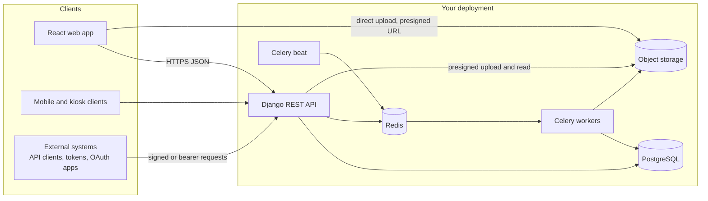
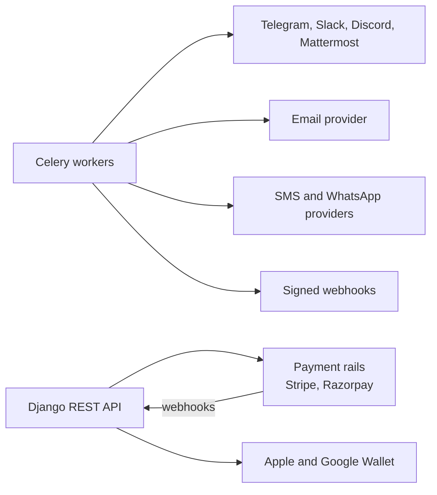
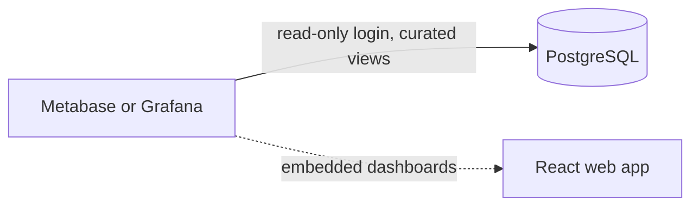

# Architecture overview

Space Works is a set of thin clients over one API server. The API is built from deep modules (see [modules](modules.md)). Notifications flow **outward** to chat, email and messaging channels; nothing in chat can change the state of a request.

Three views, from the inside out. First, what runs in your deployment:

Second, what leaves your deployment. Only the workers send messages; the API talks to payment rails and wallets directly:

Third, the optional analytics tools, which read curated views and never write:

## The parts

| Part | Role |
| --- | --- |
| **React web app** | The public inventory and event pages, the member area, and the staff console at `/admin`. It holds no business rules; the server decides. |
| **Django REST API** | Authentication, role checks, makerspace scoping, workflows and audit. Documented as OpenAPI at `/schema/`, with Swagger UI at `/docs/` and ReDoc at `/redoc/`. |
| **PostgreSQL** | The system of record. Database triggers back up the append-only rules for audit and evidence rows, and row-level security is a second tenant fence. |
| **Redis** | Cache and rate-limit state, and the broker for background jobs. |
| **Celery workers and beat** | Deliver notifications, expire evidence photo bytes, send reminders, run scheduled backups and other periodic work. |
| **Object storage** | A private S3-compatible bucket for evidence photos and other files. The standard install bundles Silo; you can use your own S3 or compatible service. Browsers upload with short-lived presigned URLs. |
| **Outbound channels** | Email, chat, SMS, WhatsApp and webhooks. See [integrations](integrations.md). |
| **Payment rails** | Optional online checkout. The ledger is core; the rail is removable. |
| **Metabase or Grafana** | Not bundled. Space Works gives each space a read-only database login over curated views. |

## What the standard Docker install runs

The Compose stack starts the database, Redis, object storage (plus a bucket setup job), a one-shot migration job and start-up safety check, the backend API, a live service for long-lived connections, Celery worker and beat, and the frontend. Other shapes (split website, cloud providers, a free profile) swap some of these for outside services. See [choose your hosting](../choose-your-hosting.md) and [mix and match](../deploy/mix-and-match.md).

## Request flow in one paragraph

A browser calls the API. Middleware identifies the caller (session, token, signed client or publishable key) and the makerspace. The view asks the Auth and RBAC module whether the actor may perform the action in that space. State changes go through the workflow module, quantity changes through the availability module, and the result is written to the audit log inside the same database transaction. After commit, notifications are queued for workers.

## Design rules that shape everything

- **Thin clients.** The web app, mobile apps and kiosks all use the same API.
- **One owner per rule.** State transitions live in one workflow module and quantity math in one availability module. See [modules](modules.md).
- **Tenant scoping on every query.** See [tenancy and roles](tenancy-and-roles.md).
- **Evidence and audit are append-only.** See [data and privacy](data-and-privacy.md).
- **Fail safe on outbound services.** A failed email, chat message or payment call must never crash a request.
