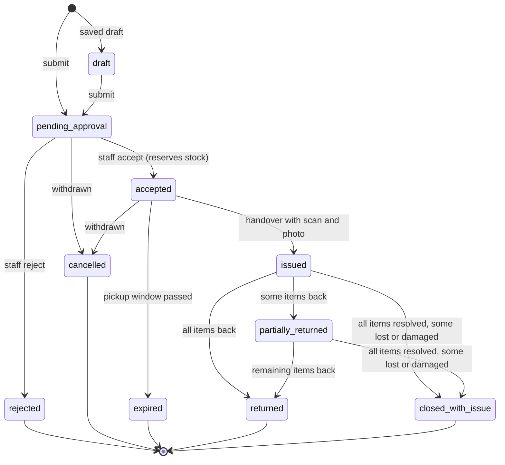
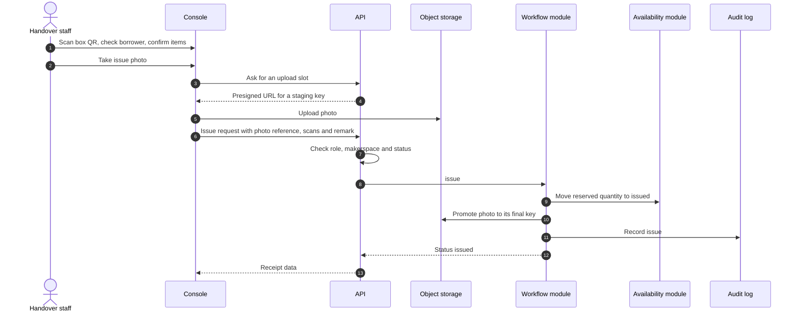
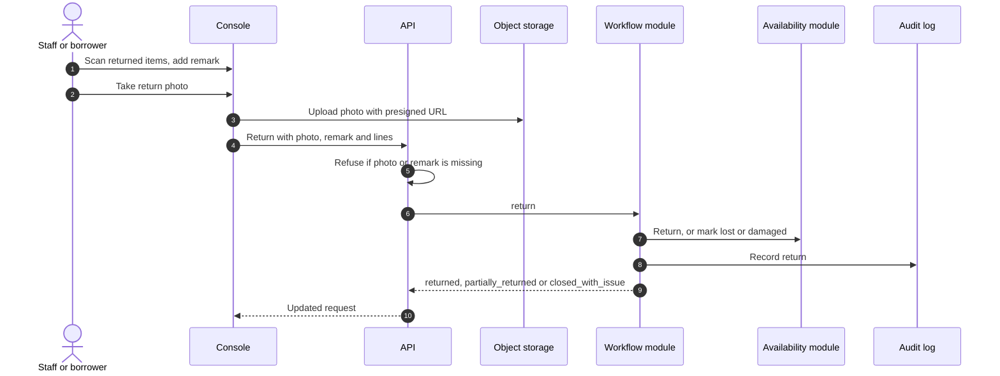

# The request lifecycle

A hardware **request** is a proposal to borrow equipment. It moves through a fixed set of states, and only the workflow module may move it. Every move writes an audit entry.

## State machine

The main path starts at `pending_approval` (submission creates requests there; `draft` exists as a status), then `rejected` or `accepted`, then `issued`, then `partially_returned`, `returned` or `closed_with_issue`. `cancelled` and `expired` are terminal exits from pending or accepted: a borrower can withdraw their own request while the loan-withdrawals feature is on, staff can cancel, and an accepted request that is never collected can expire. Both release any reservation through the availability module.

A return closes the request only when every issued unit is accounted for as returned, damaged or missing. If any unit is damaged or missing (or an accountability record exists), the final status is `closed_with_issue` instead of `returned`; otherwise the request stays `partially_returned`.

`closed_with_issue` is how lost or damaged hardware ties back to the requester's **access status**: a restriction can follow, and charges can be raised.

## Hard rules

- Reviewed-request hardware **cannot be issued** without both a box QR scan and an issue photo.
- Public self-checkout and staff direct handouts **cannot be issued** without uploaded issue evidence and an eligible scanned or selected tool.
- Hardware **cannot be returned** without a return photo and a return remark.
- Issued quantity cannot exceed accepted quantity without authorised permission.
- Evidence rows and QR scan records are immutable; the audit log is append-only.

## Issue sequence

Every presigned upload lands on a **staging** key, and the final object key is never writable by the client. The workflow promotes the staged photo exactly once, so an accepted photo cannot be swapped through a still-valid upload link.

## Return sequence

## Variants

- **Direct handout:** staff issue without a prior request. The same evidence rules apply.
- **Self-checkout and kiosks:** eligible QR tools can be issued and returned by an authenticated person with evidence, where the space has enabled it.
- **Renewals, waitlists and pickup windows** are optional loan features layered on this lifecycle.
- **Equipment kits and context:** a request can name an event or booking purpose; the purpose explains the request and grants nothing.

For the screens and steps staff follow, see the in-app help. For the rules in force, see [data and privacy](data-and-privacy.md) and [loan policy](../loan-policy.md).
