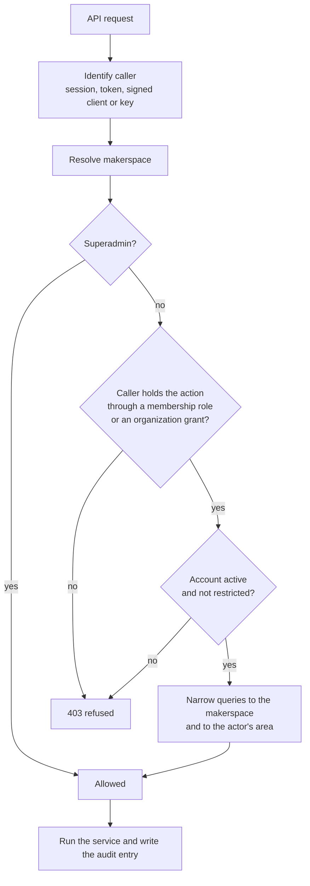

# Tenancy and roles

## One deployment, many makerspaces

Every domain record belongs to a **makerspace**. A makerspace owns its inventory, public URL, staff, chat rooms, QR namespace and audit scope. One deployment can run a single space or many, either under `/m/<slug>` paths or on subdomains. Hosting other makerspaces is an optional switch for the platform owner; spaces are unlimited by default, and a hosted space can carry a plan, limits and rates.

Scoping is enforced in layers, because a missed filter is a data leak, not just a bug:

1. **The Auth module** scopes every list and query for makerspace staff through shared helpers. Views do not hand-write tenant filters.
2. **Origin scoping** ties a public site, publishable key or API client to its makerspace.
3. **PostgreSQL row-level security** is a database-level backstop. Per-request settings tell the database which space the transaction belongs to, and policies refuse rows from other spaces.
4. **Scoped encryption** protects selected personal data with per-space keys. See [data and privacy](data-and-privacy.md).

## Roles are bundles of actions

Authority comes from **actions**, never from role names. Each space has ten fixed built-in roles; their names and grants cannot be edited.

| Role | What it can do |
| --- | --- |
| **Space Manager** | Administers the space: staff, settings, inventory, machines, events, bookings, membership and finance. |
| **Inventory Manager** | Runs the hardware lifecycle, inventory, QR, evidence and audit. No machines, staff or settings. |
| **Machine Manager** | Manages machines, service work, maintenance and usage within the machine types and individual machines assigned to that person. |
| **Event Manager** | Manages events, registrations, event reports and email templates. |
| **Booking Manager** | Manages bookable spaces, bookings, rules and reports. |
| **Fundraising** | Runs donations, campaigns, pledges and sponsors. Sees nothing else of the space's money. |
| **Handover** | The front desk: issues accepted requests and direct handouts, takes returns, uploads evidence, collects completed machine jobs. Cannot accept or reject requests, edit inventory or manage QR. |
| **Technician** | Works assigned repair jobs and scheduled maintenance. No inventory, money or settings. |
| **Shop Manager** | Runs the shop. Nothing else. |
| **Member** | Uses community services with no staff actions. |

A membership has a primary role and optional extra roles. Space Manager and Member must stand alone; the other eight combine freely, for example Event Manager plus Booking Manager. Guest Admin and Print Manager are retired.

**Area managers** are the roles that run one area. Each sees only what it manages: lists, details, reports, searches and feeds narrow to the actor's area on the server, not just in the console. The Space Manager sees all areas, grouped by area. Machine Manager and Technician scope is per person, by machine type and/or individual machine (new in 0.12.0): nothing selected means no machines, and a selected type includes machines added to it later.

**Staff on one account.** There is one account per person. A staff role is added to a person's own account, either by picking an active member or by an emailed invitation the person accepts. Only the superadmin grants or changes the Space Manager role. Nobody changes their own roles, and the last active Space Manager cannot be removed. Every staff role requires two-step sign-in (authenticator or passkey) with a single 3-day grace for someone who has just gained a role.

## Organizations

An **organization** (a network, university or chain) can be linked to makerspaces as owner, manager or affiliate. An organization can grant its member accounts specific actions across its spaces without giving them a staff role or membership. Grants confer **actions, never identity**: an organization administrator may hold event management across a network without being listed as that space's staff. Every new makerspace has an owner organization. Organization membership never widens role-based authority.

## Superadmin

The platform superadmin is global and always on: no space can hide from them. They use the staff console plus the Django control plane at `/control/`, which is not reachable on the public port unless an operator enables it. Superadmin operations are actions routed through the same services; they never edit state directly.

## How a permission check flows

Restricted and suspended accounts are blocked everywhere except the pages needed to clear the restriction, such as paying an outstanding charge.

## Who may submit a borrow request

This follows the modules rather than a separate switch.

| Member accounts | Membership | Who may submit |
| --- | --- | --- |
| on | on | Active members of that space |
| on | off | Any active signed-in account |
| off | off | Anyone, giving name, phone and email, with the email confirmed by a one-time code |

See [sign-in and borrowing](../sign-in-and-borrowing.md) for the details.
