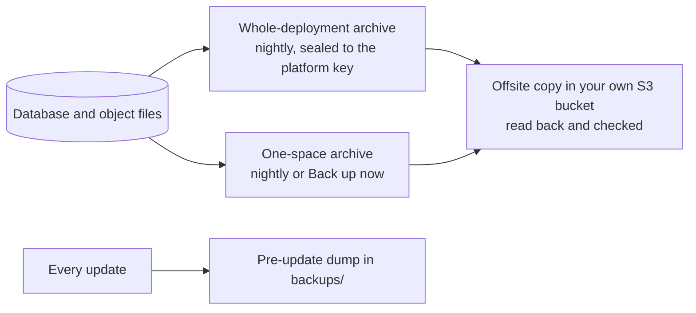
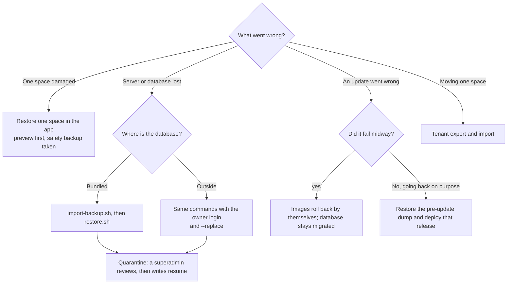

# Backup and restore

One guide for keeping a Space Works install recoverable: what is backed up, how often, where the copies go,
how to restore each kind of install, how to go back after an upgrade, and how to prove a backup works.
Background and the exact commands for key rotation, drills and self-host moves stay in
[Self-hosting](self-hosting.md#backups); the update-specific procedures stay in
[Database recovery after an update](update-recovery.md).

## What is backed up

| Layer | What it holds | Made by | Restored with |
| --- | --- | --- | --- |
| **Whole-deployment archive** | The entire database (every space, every module, accounts, audit, money, the encrypted fields as stored, the database's own immutability triggers) plus the object files, signed and encrypted to the **platform key** | Nightly at 02:00, and on demand (Backup and restore, or `/control/`) | `scripts/import-backup.sh` then `scripts/restore.sh` (disaster restore) |
| **One-space archive** | One space's rows and files (guest passes, minors and consents, incidents, volunteer credits, supervised sessions, bookings, loans, events and so on). Accounts, the live audit history, money records and evidence photos are append-only and are never rolled back | Nightly, two spaces per ten minutes between 01:00 and 08:00, and **Back up now** | The app: Backup and restore, choose the space, preview, confirm with your password and the space slug |
| **Pre-update dump** | A SQL dump of the active database, taken before every update | `scripts/update.sh` (and the automatic deploy runner) into `backups/` | The documented offline procedure, [below](#roll-back-an-upgrade) |
| **Offsite copies** | A verified copy of any archive above on an S3-compatible destination you own | Every five minutes while a destination is enabled | [Offsite copies](#offsite-copies) |

Retention: nightly archives keep 7 daily copies and 4 weekly copies; on-demand archives keep the configured
number of days (default set under Backup settings). The newest verified offsite copy of each destination is never
pruned, even past its window.



### What is not in a backup

- **Your `.env` and keys.** The archive carries ciphertext; the keys that open it (`SECRET_KEY`,
  `API_CLIENT_ENC_KEY`, `PII_MASTER_KEY`, `PII_SEARCH_HASH_KEY`, `AUDIT_MAC_MASTER_KEY`, `ACCOUNT_PII_MASTER_KEY`,
  `EVENT_REGISTRATION_CREDENTIAL_*`, `PUSH_TOKEN_HMAC_KEY` and the rest of the continuity set) travel in the
  archive's sealed continuity record, but keep an independent copy of `.env` off the server anyway. Losing them makes
  encrypted fields (minors' guardian details, incident notes, integration and wallet secrets) unreadable.
- **The platform key.** It opens whole-deployment archives and must stay off the server.
- **Files you mounted yourself:** deployment-wide wallet certificates (`WALLET_*_FILE`), the web-push VAPID key and
  any provider credentials supplied only through the environment.
- **Expired evidence photo bytes.** The photo record, scans, remarks and audit trail stay; the bytes follow the
  evidence-retention window.
- **Platform-level settings are not part of a space move.** Request-rate overrides, the hosting switch, each
  space's hosting type, and wallet signing credentials (platform or per space) are never in a tenant export or a
  one-space archive; they are re-entered on the target.

## How often, and where the copies go

- Whole deployment: nightly. One space: nightly. Pre-update: on every update. Run one any time before risky changes.
- Keep at least one copy **off this server**. Add a destination under Backup and restore, **Offsite copies**
  (any S3-compatible bucket: R2, B2, S3, Supabase Storage, MinIO elsewhere). Space Works uploads the encrypted archive,
  reads it back and checks its size and SHA-256 before it counts as a copy; verified copies are re-checked every
  30 days.

## Offsite copies

- **Add and test** a destination, then **probe** it (a read/write check). These need no extra proof.
- **Push now, rotate credentials, retire a destination and rehydrate an archive** (bring a copy back from the
  destination) are destructive or credential-bearing: they ask you to confirm your password again if you have not
  signed in in the last ten minutes (`recent_reauth_required`). Every step is audited.
- A copy is only trusted once its read-back matches. A failed verification stays visible on the destination and is
  retried; it is never silently counted.

## Restore

Pick the row that matches what went wrong.

| Situation | Procedure |
| --- | --- |
| One space was damaged or edited by mistake | **Restore one space** in the app. Preview first: it lists what will be replaced, rows after the restore point that are kept (money, audit, evidence) and anything that blocks it. A safety backup of the space is taken before anything changes |
| The server is lost, or the database is unusable | **Disaster restore** on a new or reset install, below |
| An update went wrong | [Roll back an upgrade](#roll-back-an-upgrade) |
| Moving one space to another server | Tenant export and import ([Self-hosting](self-hosting.md#move-a-space-to-this-server-self-host-move)) |



### Disaster restore, bundled database

1. Install the **same release** (or newer) on the new host, with the same `.env` keys (restore them from your off-server copy).
2. Put the platform age identity on the host for this run only: `BACKUP_AGE_IDENTITY_FILE` (default
   `<ops>/work/age-identity.txt`). Remove it afterwards.
3. `sudo bash scripts/import-backup.sh <archive.tar.age> <superadmin-username> [expected-sha256]` registers the archive and records the restore.
4. `sudo bash scripts/restore.sh <restore-uuid>`. The supervisor verifies the archive, drains writers, takes its own
   pre-restore snapshot, restores the database and objects, re-grants the runtime database login and checks readiness.
   If anything fails it puts the snapshot back.
5. A disaster restore enters **quarantine**: a superadmin reviews the result in `/control/` and acknowledges before
   normal writes resume. Then run the [verification](#verify-a-backup) checks.

Restoring recreates every immutability trigger (guest passes, evidence, audit, booking decisions, equipment
snapshots) because the database catalogue is part of the dump and is checked against the release's managed
function catalogue; a restore that would lose one is refused.

### Disaster restore, outside database (Supabase, Neon, RDS and similar)

The same two commands apply when `.env` has `SPACEWORKS_DATABASE=external`. Differences:

- The restore runs from a one-off backend container with the **owner** login (`SPACEWORKS_MAINTENANCE_DATABASE_URL`,
  the direct or session connection, never a transaction pooler and never the narrow runtime login).
- Because the outside database always holds freshly migrated tables, the restore refuses to replace it unless it holds
  no accounts yet or you confirm: `sudo bash scripts/restore.sh <uuid> --replace`, or `SPACEWORKS_RESTORE_REPLACE=1`,
  or type the database name when asked.
- A pre-restore dump is written to the private work directory first and put back if the restore fails or is interrupted.
- The client is chosen by the server's major version (16 or 17); another major is refused.

### Restore one space from a whole-deployment archive

Extract the space on a trusted machine and copy only the decrypted directory to the host
([Restore one space](self-hosting.md#restore-one-space)); it then appears as a restore point for that space.

## Roll back an upgrade

Upgrades are **forward-only** (decision 219g). The updater refuses an older target release, and never points an old
release at a database a newer release has migrated.

- **A failed update** rolls the application images back by itself and leaves the database as the new release migrated
  it. Nothing is restored automatically; the pre-update dump stays in `backups/`.
- **Going back on purpose** means restoring the pre-update dump the updater took, then deploying the release that dump
  came from:
  - bundled database: `backups/pre-update-<timestamp>.sql.gz` (plain SQL). Follow
    [Restore a pre-update SQL dump](update-recovery.md#restore-a-pre-update-sql-dump).
  - outside database: `backups/pre-update-<timestamp>.dump` (custom format, written with the version-matched
    `pg_dump`). Restore it with `pg_restore --clean --if-exists --no-owner --no-acl` of the same major version using
    the owner login, against the **direct** connection; the same quiesce, grants and image-tag steps apply
    ([outside database notes](update-recovery.md#restore-a-pre-update-sql-dump)).
  - Object files are not in the dump. Restore the matching object-storage state if the update changed files.

## Verify a backup

A backup you have not restored is a hope. Check on a schedule:

1. **Drills.** The server drills one space every seven days (configurable): it restores that space's latest archive into a
   throwaway database with a throwaway key, checks every row and object, then destroys both. Failures email the
   superadmins; review them under Backup keys, drills and notices.
2. **Offsite copies.** Open the destination: every upload shows `verified` and the read-back time.
3. **After any restore.** `GET /api/v1/health/readiness/` is ready; the superadmin Platform dashboard shows backups,
   offsite copies and the scheduler green; spot-check a guest pass, a minor's consent (the guardian name must read back)
   and an incident in a restored space.
4. **Before a release.** On a development stack run the live round trip, which seeds sample data, backs it up,
   wipes it, restores it and checks counts, an encrypted field and the immutability triggers:

   ```bash
   ./scripts/dev.sh up --build
   ./scripts/dev/backup-roundtrip.sh --clean
   ```
