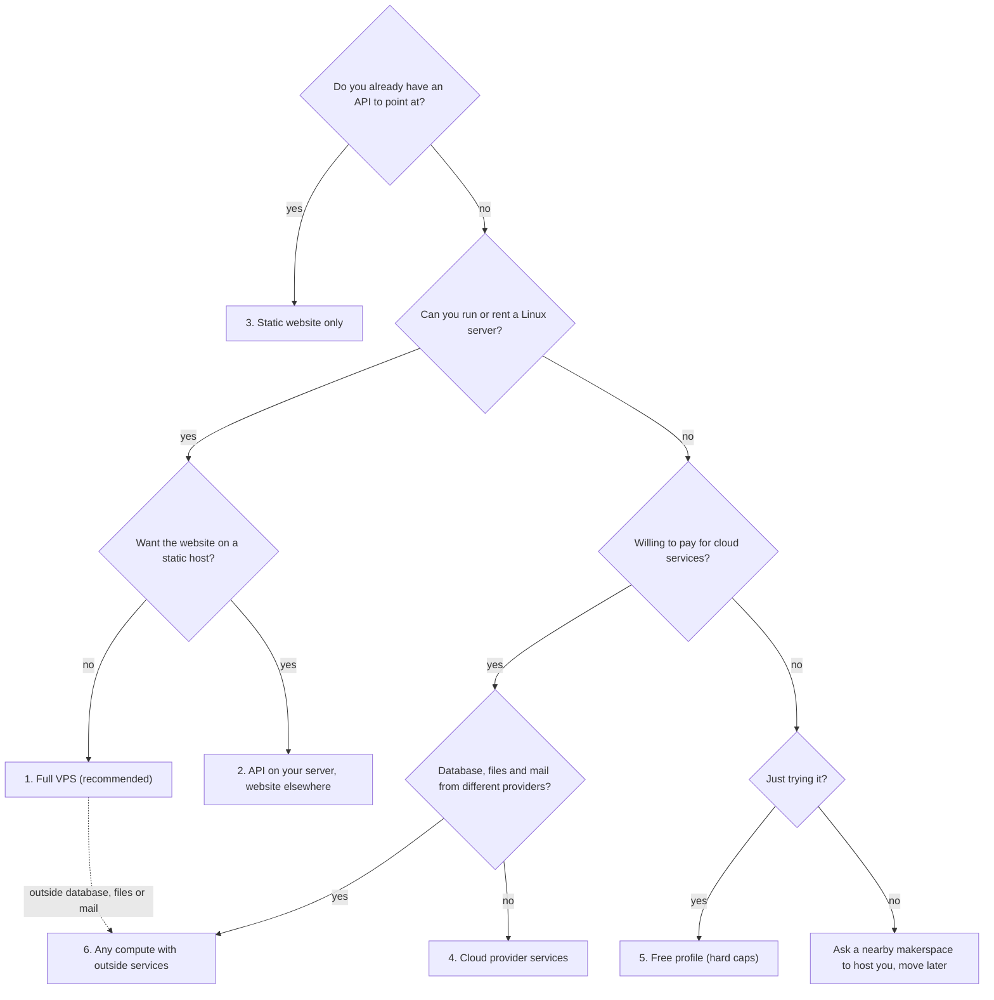

# Choose your hosting

Space Works is built to run **on your own server, inside the makerspace**. Start there unless you have a
reason not to. Every other shape below exists for a specific need, and each one gives something up.
This page compares them so you can pick before you install; the linked guides carry the steps.

## The short answer

- **You have (or can rent) one Linux server:** use the [full VPS](#1-full-vps-recommended). It runs
  everything, it is what the installer sets up, and it is the only shape with the complete backup,
  restore and update-rollback contract.
- **You want the website on Netlify or another static host:** keep the API on your server and use the
  [split deployment](#2-api-on-your-server-website-elsewhere).
- **You cannot run a server at all:** use a [cloud recipe](#4-cloud-provider-services) on a paid plan, or
  ask a nearby makerspace to host you and [move to your own server](README-HOSTING.md#moving-a-makerspace-onto-its-own-server) later.
- **You want the database from one provider, files from another and mail from a third:** read
  [mix and match](deploy/mix-and-match.md). Any compute, PostgreSQL, S3-compatible storage and email provider combine.
- **You want to try it for free on hosted services:** the [free profile](#5-free-profile) works, with
  hard caps and best-effort scheduling.



## Comparison

| | 1. Full VPS | 2. API on your server, website elsewhere | 3. Static website only | 4. Cloud provider services | 5. Free profile | 6. Any compute with outside database, storage and mail |
| --- | --- | --- | --- | --- | --- | --- |
| What you run | One server: app, PostgreSQL, Redis, object storage, worker, beat, live events, website | The same server without the website container | Nothing: a static build pointed at an existing API | Provider web, worker and scheduler roles; provider database, object storage and mail | One web container plus an external tick | The backend roles on any compute; PostgreSQL, buckets and mail from any provider |
| How you install | `install.sh` (pinned release) | `install.sh`, answer **API-only** (`--frontend api-only`) | `npm run build`, or a [static adapter](deploy/cloud-static.md) | The setup wizard, then the provider | `install.sh --profile free` or the wizard | The setup wizard (provider `docker`), then your compute; the installer with **External S3-compatible buckets** keeps its bundled database |
| Files | `docker-compose.prod.yml` + `docker/compose.tls.yml` | + `docker/compose.api-only.yml`, `netlify.toml` | `netlify.toml`, `deploy/static/` | `render.yaml`, `deploy/<provider>/`, `charts/spaceworks`, `docker-compose.managed*.yml` | `docker-compose.free.yml`, `deploy/render.free.yaml` | `docker-compose.managed*.yml`, `docker-compose.cloud.yml` |
| HTTPS | Caddy, automatic; or your own proxy; or plain HTTP on this machine only | Caddy on the API; the static host on the website | The static host | The provider | The provider | The provider or your own proxy |
| Scheduled jobs | Celery beat (or, with Redis set to none, a once-a-minute scheduler loop) | Celery beat (or the same scheduler loop) | n/a | beat, or the brokerless loop/external scheduler | The authenticated tick (every 10 minutes by default) | beat, loop, external scheduler or the tick |
| Backups and recovery | Full: scheduled database and object backups, restore, drills, key rotation, update rollback | Same as the full VPS | n/a | Your provider's backups plus portable dumps | No scheduled dump; external backups only | Your providers' backups plus portable dumps |
| Control plane (`/control/`) | Server only by default: the SSH-tunnel port (automatic HTTPS), else off; optional website route with an IP allowlist | Server only | n/a | Not served (`CONTROL_PLANE_PROXY=false`); use the web superadmin console | Not served | Not served |
| Live updates | Live events process | Live events process | Uses the API's | Optional live process, otherwise polling | Polling | Optional live process, otherwise polling |
| Card photo clean-up and wallet passes | Yes (model on the `card_models` volume; wallet certificate files mounted read-only) | Yes | Uses the API's | No (no durable storage shared by web and worker) | No | No |
| Website | Included, or API-only | API-only | Is the website | Optional: add the website image, or API-only | Static host | Optional, or API-only |
| Cost and care | One server you patch | One server you patch, plus a static host | A static host | Several paid services | Free tiers with hard caps and cold starts | Several services you choose |
| Hosting other makerspaces (optional) | Yes: subdomain edge, on-demand certificates (`docker/compose.saas.yml`) | Yes, the same way | No | Where wildcard hostnames can be routed | No | Where wildcard hostnames can be routed |
| Checked for 0.12.0 | Config checked; boot steps in the release report | Config checked | Config checked | Config checked (no real accounts) | Config checked | Config checked |

"Config checked" means `docker compose config`, `helm lint`/`helm template`, the blueprint and redirect files and the
environment lists were validated against the settings the backend reads, without a real provider account.

## 1. Full VPS (recommended)

One Linux server with Docker. The [installer](install-and-update.md) asks every question first, writes a
private `.env`, pulls pinned images and starts everything. Choose automatic HTTPS (Caddy) for anything other
people will use; plain HTTP is limited to `localhost` for a trial on your own machine. An
[Oracle Always Free VM](deploy/cloud-oracle-free.md) is this shape too.

Everything works without any outside service: inventory, loans, bookings, events, machines, cards, the
member app, backups. Optional features call out only when you switch them on (mail, SMS/WhatsApp, payments,
Turnstile). Two 0.12.0 defaults do make outbound calls: the breached-password check (HIBP range API,
2 second timeout, fails open) and card font downloads (Google Fonts). On an offline server set
`PASSWORD_BREACH_CHECK_ENABLED=False` and `CARD_FONT_DOWNLOADS_ENABLED=False`.

The photo clean-up model is fetched once, into the shared volume:

```bash
scripts/spaceworks-compose.sh bundled run --rm --no-deps backend --role management python manage.py fetch_card_photo_model
```

Reference: [self-hosting guide](self-hosting.md), [hosting and roles](README-HOSTING.md#hosting).

## 2. API on your server, website elsewhere

The installer's **API-only** answer (`install.sh --frontend api-only`) drops the website container and
publishes the API through Caddy or your own proxy. It also fits a backend for mobile apps and
integrations with no website at all: leave the website question blank and set `PUBLIC_APP_BASE_URL` to
the domain emailed links should open. The website is the same React build, hosted anywhere static (`netlify.toml` at the
repository root configures Netlify). Both sides must be HTTPS: sign-in uses cross-site cookies.

What has to line up (the installer sets the backend half):

- `CORS_ALLOWED_ORIGINS`, `CSRF_TRUSTED_ORIGINS` and `PLATFORM_STAFF_ORIGINS` name the website origin exactly;
- `AUTH_COOKIE_SECURE=True` and `AUTH_COOKIE_SAMESITE=None`;
- each makerspace's `frontend_domain` is the website's domain, or tenant routes are refused;
- `AWS_S3_PUBLIC_ENDPOINT_URL` and `PUBLIC_IMAGE_BASE_URL` are public HTTPS addresses, and the bucket's CORS
  rules allow the website origin (presigned uploads go straight from the browser to storage);
- `VITE_API_URL` on the static host is your API, for example `https://api.example.org/api`.

Link previews, embeds, the sitemap and the native-app association files are rendered by the backend. On
Netlify, fill in the commented proxy block in `netlify.toml`; on other hosts, proxy the same paths. Some
browsers block third-party cookies across unrelated domains, so a website and API under one parent domain
(`app.example.org` and `api.example.org`) is the reliable choice. Details:
[split deployment](README-HOSTING.md#split-deployment-backend-on-your-server-frontend-on-netlify).

## 3. Static website only

A static build pointed at someone else's API: a branded site for one makerspace on a shared deployment, or
the website half of shape 2. The [static adapters](deploy/cloud-static.md) for Netlify (same-origin edge
proxy), Cloudflare Pages/Workers and Vercel keep everything on one origin, which avoids the third-party
cookie problem. See [single-tenant frontend](single-tenant-frontend.md).

## 4. Cloud provider services

Run the setup wizard (`scripts/init-cloud-environment.py`, [environment/setup](deploy/cloud-environment.md))
and deploy the rendered recipe to [Render](deploy/cloud-render.md), [Railway](deploy/cloud-railway.md),
[Fly](deploy/cloud-fly.md), [Koyeb](deploy/cloud-koyeb.md), [Cloud Run](deploy/cloud-cloud-run.md),
[DigitalOcean](deploy/cloud-digitalocean.md), [AWS](deploy/cloud-aws.md) (App Runner or ECS Fargate with RDS, S3
and SES), [Azure](deploy/cloud-azure.md) (Container Apps with PostgreSQL Flexible Server),
[Hetzner and Coolify](deploy/cloud-hetzner-coolify.md), [Kubernetes/Helm](deploy/cloud-kubernetes.md) or plain
[Docker](deploy/cloud-docker.md). You supply PostgreSQL 16/17 (direct or session transport, never transaction
pooling), two buckets and a mail provider. Choose Redis (web, worker, one beat) or brokerless (web, worker,
scheduler). The [contracts](deploy/cloud-contracts.md) and [recovery](deploy/cloud-recovery.md) pages say what
the provider must guarantee; none of these recipes has been deployed to a real account for this release.
Every recipe runs **Full** (with the website image) or **API-only** (no web container): see
[the matrix](deploy/cloud-overview.md#website-full-or-api-only).

## 5. Free profile

One web container on a free tier, an external database, storage and mail, and a scheduled tick from a
Cloudflare Worker or another trigger. Hard caps on rows, files and mail per tick; reminders can be late;
no scheduled database dump. Read the [free guide](deploy/cloud-free.md) before relying on it.

## 6. Any compute with outside database, storage and mail

The same backend roles on a VPS, a PaaS or a cloud, with PostgreSQL from Supabase, Neon, RDS or Azure, buckets from
R2, B2, S3 or Supabase Storage and mail from Resend, Postmark, SES, Brevo, Mailgun or SMTP. The
[mix-and-match guide](deploy/mix-and-match.md) lists the exact settings per class, which stores are **limited**
(presigned `PUT`, no versioning or Object Lock) and which give full parity, the browser-facing storage and CORS
rules, and three worked examples.

## Hosting other makerspaces (optional, any shape)

Hosting other makerspaces is not a separate product or shape. It is an optional capability of a normal install:
each space gets its own subdomain, and the superadmin approves requests to join. It works on the full VPS (with
the subdomain edge and on-demand certificates) and on cloud shapes that can route wildcard hostnames. See
[Plans and hosting other makerspaces (optional)](self-hosting.md#plans-and-hosting-other-makerspaces-optional). The
plan, trial and hosting-invoice limiter is built but **off by default**: the compose files leave
`MANAGED_PLANS_ENABLED` empty so the superadmin switch in the console controls it (a set `False` would lock it off),
`MANAGED_BILLING_ONLINE_ENABLED` is `False`, the installer never sets them, and
nothing about them is visible or enforced while they are off. Never turn them on for a single makerspace. The
files `docker-compose.managed*.yml` and `render.managed.yaml` are for installs that host other makerspaces or run on
cloud services; they keep those names.

## 0.12.0 settings in every shape

Each 0.12.0 setting (Turnstile, login IP blocking, breached-password check, passkey name, browser alerts,
messaging webhook base URL, native app minimums, card fonts and the photo model) has a safe default: leaving it
unset behaves exactly as before. The full VPS, cloud compose files pass them through explicitly; the
free and brokerless compose files, `render.yaml` and the Fly, Railway, Koyeb, DigitalOcean and Cloud Run recipes
rely on the backend defaults, so set a key there only when you want to change it. They are listed in
[the environment reference](environment-reference.md) and, for the cloud recipes, in
[the 0.12.0 settings](deploy/cloud-environment.md#new-settings-in-0120). Turnstile needs its site key on
the website too: the bundled nginx derives its CSP from `TURNSTILE_SITE_KEY`; a static host needs
`https://challenges.cloudflare.com` added to its CSP by hand.
