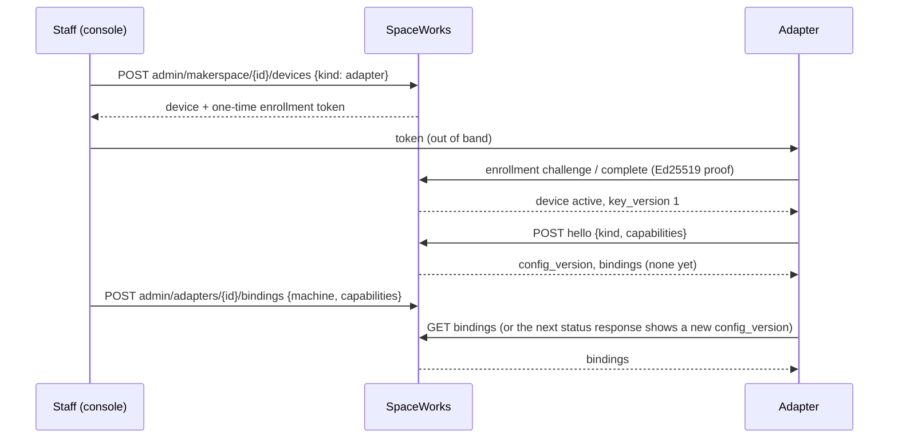
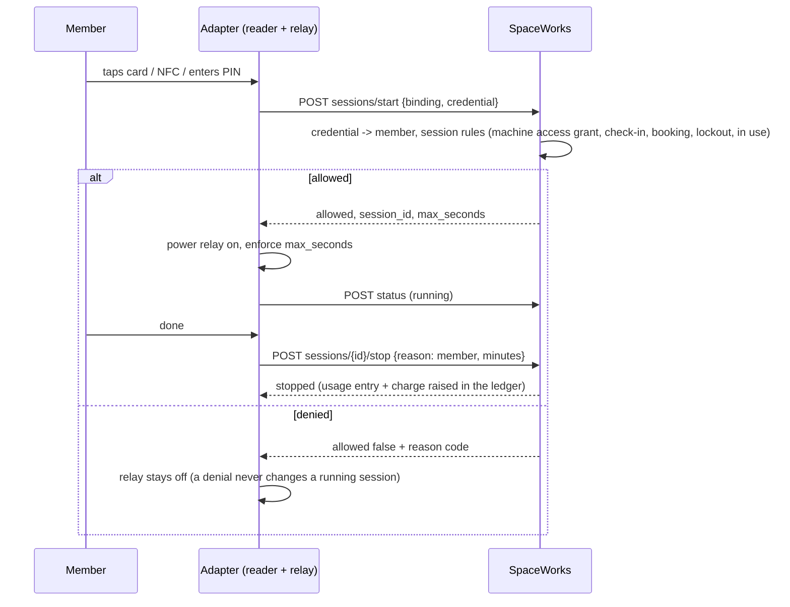
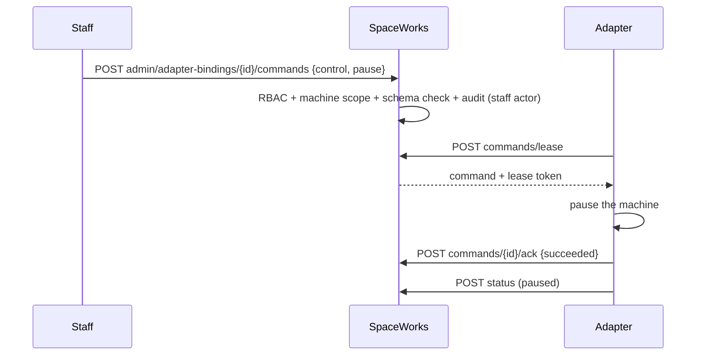
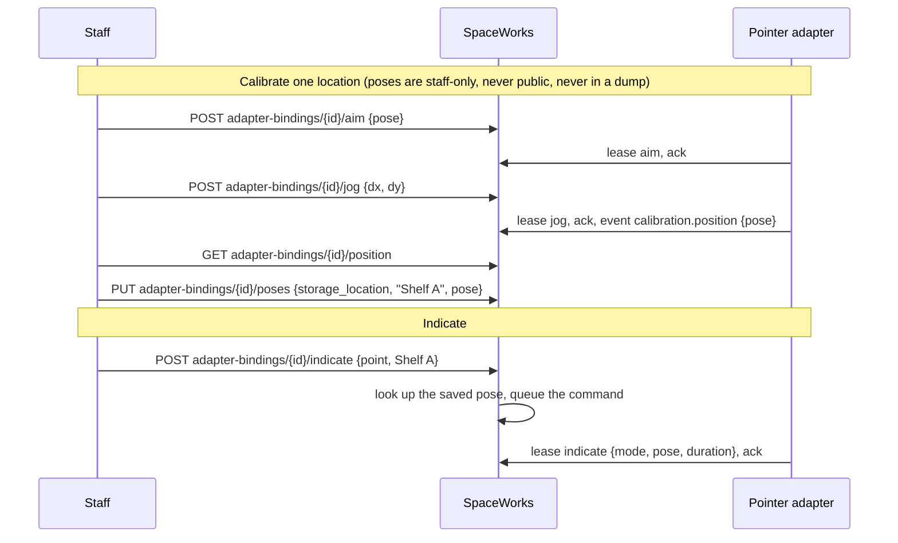

# Sequence diagrams

## Enroll and hello



## Access and a metered session



## Control (staff pauses a machine)



## Shelf pointer: calibrate, then indicate



### Show on shelf, clear and shelf checks (staff)

```mermaid
sequenceDiagram
  participant S as Staff (item, box, issue line, stocktake)
  participant API as SpaceWorks
  participant P as Pointer adapter
  S->>API: POST makerspace/{id}/shelf-pointer/coverage {targets}
  API-->>S: {results: [{target, covered}]}  (never a pose; 404 while machines.integrations is off)
  S->>API: POST makerspace/{id}/shelf-pointer/show {target_type, target_id, duration_seconds}
  API->>API: find the covering pose, clamp to laser_max_power_pct / max_on_seconds, audit (no pose)
  P->>API: POST commands/lease  (indicate {mode, pose, duration_seconds})
  P->>API: POST commands/{id}/ack
  S->>API: POST makerspace/{id}/shelf-pointer/clear
  API->>API: always queued: never capped or rate limited
  P->>P: switches off; also auto-clears when duration_seconds ends
  S->>API: GET makerspace/{id}/shelf-pointer/locations, then POST makerspace/{id}/shelf-checks {entries}
```

Pose kinds (`pan_tilt`, `led_segment`, `galvo_xy`) are published in `schemas/pose.*.json`; see the
[shelf-pointer hardware page](hardware/shelf-pointer.md) for what a Raspberry Pi or ESP32 adapter must do.

## Camera watch (staff or the job owner; recording opt-in)

```mermaid
sequenceDiagram
  participant V as Viewer (staff or job owner)
  participant API as SpaceWorks
  participant A as Adapter (camera)
  V->>API: POST adapter-bindings/{id}/watch {record?}  or  POST member/adapter-watch/requests/{id}
  API->>API: switch + limit check, audit row naming the viewer, 5 minute session
  V->>API: POST member/adapter-watch/{id}/signal {offer}
  A->>API: GET media/{watch}/signal?after=0  (offer + optional TURN ice_servers)
  A->>API: POST media/{watch}/signal {answer, candidates}
  V->>API: GET member/adapter-watch/{id}/signal  (answer, candidates)
  Note over V,A: media flows peer to peer; the server only relays signaling
  A->>API: POST media/{watch}/snapshot  (fallback still, cached 60 s, only while watching)
  V->>API: GET member/adapter-watch/{id}/frame
  V->>API: DELETE member/adapter-watch/{id}
```

Only the watch's own viewer (staff with MANAGE_DEVICES and machine scope, or the member whose in-progress request runs on
that machine) can use the signaling, frame and end routes; anyone else gets 404. Recording needs
`machines.integrations.recording`, is requested per watch, uploaded by the adapter through
`POST media/{watch}/recording` (a presigned upload), deleted after seven days by a Celery sweep, and audited at every
step. TURN is optional: set `ADAPTER_TURN_URLS` and `ADAPTER_TURN_SECRET` and both sides receive ephemeral credentials.

## Job dispatch and files (`job.dispatch`, `file.fetch`)

```mermaid
sequenceDiagram
  participant S as Staff
  participant API as SpaceWorks
  participant A as Adapter
  S->>API: POST adapter-bindings/{id}/jobs {service_request_id}
  API->>API: in-progress request assigned to the bound machine; PrinterJob + adapter_job command; audit
  A->>API: POST jobs/lease
  Note over API: held back while the area-clear gate (binding config) is not satisfied
  A->>API: POST jobs/{id}/ack {lease_token, external_job_id}
  A->>API: GET jobs/{id}/file  (short-lived signed URLs, audited)
  A->>API: POST jobs/{id}/progress {progress_percent}
  A->>API: POST jobs/{id}/report {operation_id, outcome, actual_minutes, consumptions[], profile_consumptions[]?}
  API->>API: claim (idempotent by operation_id) then staff review; machine-service workflow complete or fail
```

The run record is the existing printer job, so the legacy printer routes are untouched. An adapter binding never
auto-applies a terminal report: it lands in `needs_review` and staff approve it through the existing printer-job
approve route, which calls the same `complete` or `fail` workflow actions.

## Kiosk checkout (`checkout.kiosk`, child switch `machines.integrations.kiosk`)

```mermaid
sequenceDiagram
  participant M as Member
  participant A as Adapter (kiosk)
  participant API as SpaceWorks
  M->>A: NFC tag, member number + PIN, or card QR + PIN
  A->>API: POST kiosk/sessions {binding_id, credential}
  API->>API: member lookup + lockout, audit; 5 minute session bound to this device and key
  A->>API: POST kiosk/sessions/{sid}/scan {qr_payload}  (checkout | return | ineligible)
  A->>API: POST kiosk/sessions/{sid}/evidence {evidence_type, content_type}  (presigned STAGING upload)
  A->>A: PUT the photo to upload_url
  A->>API: POST kiosk/sessions/{sid}/issue {qr_payload, evidence_id}
  A->>API: POST kiosk/sessions/{sid}/return {qr_payload, evidence_id, remark}
  A->>API: DELETE kiosk/sessions/{sid}
```

Issue and return are the existing self-checkout workflow, unchanged: authenticated member, eligible tool, uploaded
issue evidence, return photo AND remark, same-requester return, borrow limits, charges and audit. The adapter cannot
skip any of it; refusals come back as typed codes (`tool_state_conflict`, `requester_blocked`, `deposit_required`,
`evidence_not_uploaded`, `checkout_refused`, `return_refused`).

## Label printing (`label.print`)

Staff send a QR label batch to the adapter's device exactly as to a label printer. The adapter hears about it as an
adapter command `label.print` / `print` carrying `label_command_id`, then leases the command, downloads the content
and reports the result through the existing label routes.
