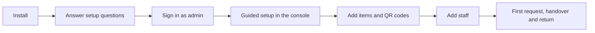

# Getting started

This page takes you from nothing to your first tracked loan. Each step links to the page with the details.



## 1. Install

You need one always-on computer or server (any spare PC, mini-PC or small VPS) with Docker. On Linux the installer can offer to install Docker for you; on Windows and macOS install Docker Desktop first and, on Windows, run the installer from Git Bash.

```bash
curl -fsSL https://github.com/SpaceWorks-Labs/SpaceWorks/releases/latest/download/install.sh | sh
```

The installer downloads the newest tagged release (never a moving branch), asks every question up front, shows one summary and continues only after you confirm. It installs into `/opt/spaceworks` by default. The full guide is [setup for makerspaces](../setup-for-makerspaces.md); for the technical reference see [install and update](../install-and-update.md) and [choose your hosting](../choose-your-hosting.md).

## 2. Answer the setup questions

Setup asks, among other things:

| Question | Notes |
| --- | --- |
| Hosting model | One space, several spaces under `/m/<slug>`, or a subdomain platform. |
| HTTPS | Local-only HTTP, automatic HTTPS through Caddy, or your own proxy. |
| File storage | The bundled Silo object store, or your own S3-compatible bucket. |
| Areas | Which parts of the product to install (below). |
| Organization and makerspace name | Every makerspace is owned by an organization; setup creates both. |
| Admin account | Username, email, and a password (generated if you leave it blank). |
| Who can submit borrow requests | Members, any signed-in account, or anyone. |
| Sign-in choices | Two-step sign-in and which social providers to offer. |

### The setup areas

Setup groups modules into **areas**. You can change them later in the console.

| Area | Default | What it brings |
| --- | --- | --- |
| Inventory | yes | Public catalogue, requests, handover, QR, evidence, returns, stocktake. |
| Machines | yes | Machine jobs, sessions, certifications, maintenance, printing. |
| Reports | yes | Built-in reports. |
| Events | no | Event pages, registration, tickets, check-in. |
| Bookings | no | Rooms and resources. |
| Membership | no | Plans, renewals, member cards. |
| Online payments | no | The payment rail (Stripe or Razorpay). |
| Chat | no | Chat notifications such as Telegram. |

Per-person member accounts are always installed. Staff two-step sign-in is mandatory for every staff role and is not a setup question.

## 3. Sign in and run the guided setup

Open the address you chose and sign in with the admin account. As Space Manager, the console opens a **guided setup** with five skippable steps: name your space, add a logo, set opening hours, choose what the space runs, and invite staff. A **Next steps** card on Home tracks progress from your real records.

Settings has a **Overview** checklist too. A sensible order: choose [modules and features](../choosing-modules.md), set up the public site, add your team, then choose how people are notified.

## 4. Add items

In the console, open Inventory and add items and categories. Tools that need individual tracking get QR-coded units; consumables and bulk stock are counted instead. Print QR labels and stick them on boxes and tools. Bulk import is available for larger catalogues.

## 5. Meet the roles

Every space has ten built-in roles. Roles combine, except Space Manager and Member, which stand alone.

| Role | In one line |
| --- | --- |
| Space Manager | Runs the whole space. |
| Inventory Manager | Runs the hardware lifecycle, QR and evidence. |
| Machine Manager | Runs machines, within assigned machine types. |
| Event Manager | Runs events and registrations. |
| Booking Manager | Runs rooms, resources and bookings. |
| Handover | Issues and takes back equipment at the front desk. |
| Technician | Works assigned repairs and maintenance. |
| Shop Manager | Runs the shop. |
| Member | Uses community services. |

Anyone with a staff role must use two-step sign-in. Details are in [tenancy and roles](../architecture/tenancy-and-roles.md).

## 6. Your first loan

1. **A member signs in and requests** an item from the Inventory page. Who may submit depends on your setting: members only, any signed-in account, or anyone with an emailed confirmation code.
2. **Staff review.** An Inventory Manager or Space Manager accepts the request, which reserves the stock.
3. **Handover.** Handover staff open the request, scan the box QR, check the borrower, confirm items, take the **issue photo**, add a remark and confirm. Space Works refuses to issue without the scan and photo.
4. **Return.** When the item comes back, staff record the return with a **return photo** and a **remark**. The request closes as returned, or as closed with an issue if something is lost or damaged.

Everything above leaves an audit entry. See [the request lifecycle](../architecture/request-lifecycle.md) for the full state machine.

## Next steps

- [FAQ and troubleshooting](faq.md)
- [Backup and restore](../backup-and-restore.md): set this up before you need it.
- [Notification channels](../notification-routing.md)
- [Self-hosting reference](../self-hosting.md)
