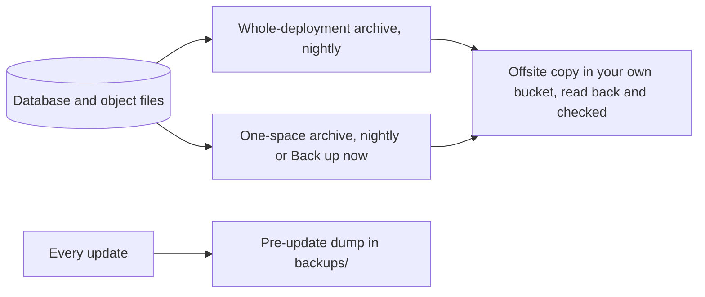
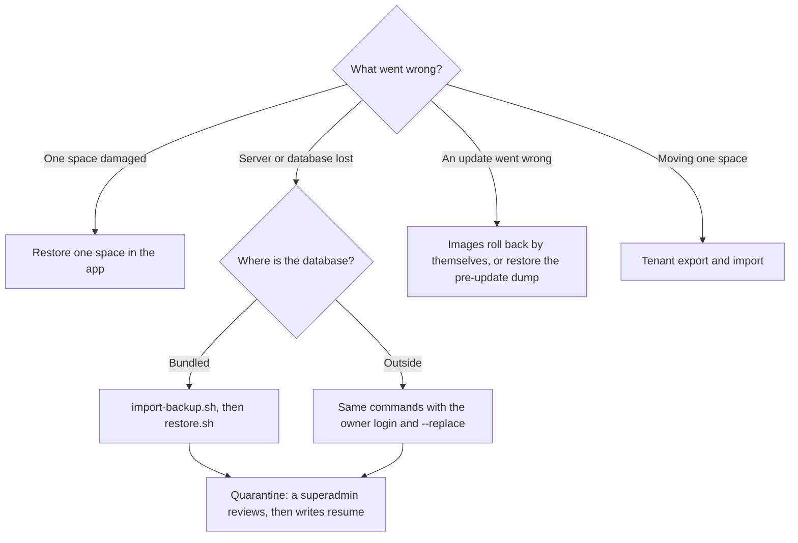

# Backups and restore

A backup you have not restored is a hope. This page is the short version; the full guide with every command is
[Backup and restore](../backup-and-restore.md).

## What is backed up

| Layer | What it holds | Made by |
| --- | --- | --- |
| Whole-deployment archive | The entire database and the object files, sealed to the platform key | Nightly at 02:00, and on demand |
| One-space archive | One space's rows and files. Accounts, audit history, money records and evidence photos are append-only and never rolled back | Nightly, and **Back up now** |
| Pre-update dump | A SQL dump of the active database | Every update, into `backups/` |
| Offsite copy | A verified copy of any archive on an S3-compatible destination you own | Every five minutes while a destination is enabled |

Nightly archives keep 7 daily and 4 weekly copies. The newest verified offsite copy is never pruned.



### What is not in a backup

- Your **`.env` and keys.** The archive holds ciphertext. Keep an independent copy of `.env` off the server:
  without `API_CLIENT_ENC_KEY`, `PII_MASTER_KEY` and the other keys, encrypted fields cannot be read.
- The **platform key**, which opens whole-deployment archives and must stay off the server.
- Files you mounted yourself, such as wallet certificates and the web-push key.
- Expired evidence photo bytes. The record, scans, remarks and audit trail stay.

## Offsite copies

Add a destination under **Backup and restore, Offsite copies** (any S3-compatible bucket: R2, B2, S3, Supabase
Storage, MinIO elsewhere). Space Works uploads the encrypted archive, reads it back and checks its size and
SHA-256 before it counts as a copy, and re-checks verified copies every 30 days. Pushing now, rotating
credentials, retiring a destination and rehydrating an archive ask you to confirm your password again if you
have not signed in within ten minutes. Keep at least one copy off the server.

## Restore

| Situation | Procedure |
| --- | --- |
| One space damaged or edited by mistake | **Restore one space** in the app: preview, confirm with your password and the space slug. A safety backup is taken first. |
| Server lost or database unusable | Disaster restore on a new install: `scripts/import-backup.sh`, then `scripts/restore.sh`. |
| An update went wrong | Roll back as described in [Upgrades](upgrades.md#rollback). |
| Moving one space to another server | Tenant export and import (below). |



For a disaster restore, install the same release (or newer) with the same keys, put the platform age
identity on the host for the run only, then:

```bash
sudo bash scripts/import-backup.sh <archive.tar.age> <superadmin-username> [expected-sha256]
sudo bash scripts/restore.sh <restore-uuid>
```

The supervisor verifies the archive, drains writers, takes its own pre-restore snapshot, restores the database
and objects, re-grants the runtime login and checks readiness. If anything fails it puts the snapshot back. A
disaster restore enters **quarantine**: a superadmin reviews it in `/control/` and acknowledges before normal
writes resume. For an outside database the restore needs the owner login and `--replace` (or typing the
database name when asked).

## Verify a backup

1. **Drills.** The server restores one space's latest backup into a throwaway database every seven days
   (configurable), checks every row and object, then destroys both. Failures email the superadmins.
2. **Offsite copies.** Open the destination: each upload should show `verified` and a read-back time.
3. **After any restore.** `GET /api/v1/health/readiness/` is ready, and the superadmin Platform dashboard shows
   backups, offsite copies and the scheduler green.
4. **Round trip.** On a development stack, `./scripts/dev/backup-roundtrip.sh --clean` seeds data, backs it up,
   wipes it, restores it and checks counts, an encrypted field and the immutability triggers.

## Moving a space between servers

A Space Manager asks the platform operator to move their space. The source superadmin approves and exports it
to the target server's key; the target imports it with `manage.py import_portable_tenant_dump`. Every person is
created; staff and members keep their password and authenticator, sessions and devices do not travel, and
platform-level records (plans, invoices, rate overrides) stay behind. See
[Move a space to this server](../self-hosting.md#move-a-space-to-this-server-self-host-move).
