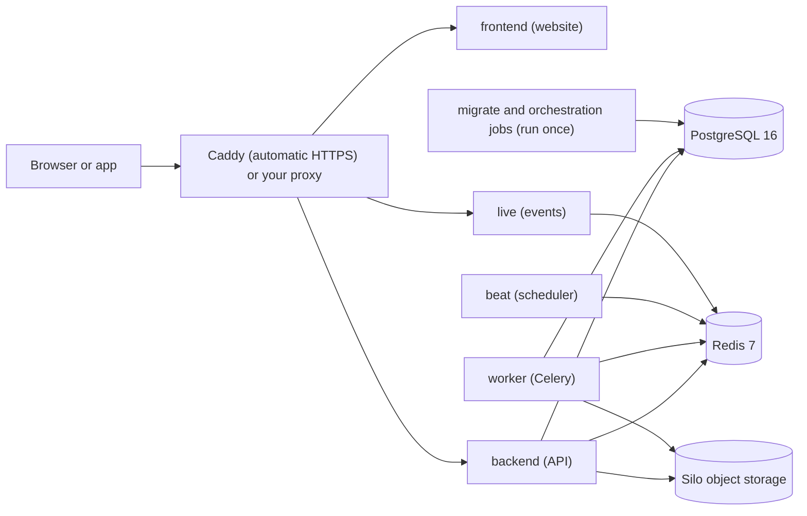

# Docker Compose profiles

Space Works runs through Docker Compose. The installer picks and layers the files for you, so most operators
never edit them. This page explains what each profile runs, so you can read your own install or build a
custom one.

Do not call `docker compose` directly on an installed server. Use the wrapper in the install directory,
which loads the right layers and the trust records the installer wrote:

```bash
scripts/spaceworks-compose.sh bundled ps
scripts/spaceworks-compose.sh bundled logs backend
```

## Profiles at a glance

| Profile | Files | What it runs | Use it for |
| --- | --- | --- | --- |
| Full (default) | `docker-compose.prod.yml`, plus `docker/compose.tls.yml` for automatic HTTPS | Database, Redis, object storage, backend, live events, worker, scheduler and the website | One server running everything. |
| Split (API-only) | The full files plus `docker/compose.api-only.yml` (and `docker/compose.api-only-edge.yml` behind Caddy) | The same, without the website container; an `api-edge` nginx exposes only the API | Mobile apps, integrations, or a website on a static host. |
| Free | `docker-compose.free.yml` | One web container with an authenticated external tick; database, storage and mail are outside | Trials on free tiers with hard caps. |
| Cloud services (managed) | `docker-compose.managed.yml` (Redis) or `docker-compose.managed-brokerless.yml` (no Redis), `docker-compose.cloud.yml` | Backend roles only; database, buckets and mail come from providers | Provider-run hosting. See [Cloud and providers](cloud.md). |
| Hosting other makerspaces | `docker/compose.saas.yml` layer | Subdomain edge with on-demand certificates | The optional hosted-spaces capability. See [Own and hosted spaces](managed-spaces.md). |

"Managed" in a file name is packaging for provider-run clouds. It is not a separate product.

## Full



`docker-compose.prod.yml` defines these services:

| Service | Purpose |
| --- | --- |
| `db` | PostgreSQL 16 (`postgres:16`). |
| `minio` | The bundled object store. It runs **Silo** (`pgsty/silo`), the maintained S3-compatible fork of the archived MinIO. The service name stays `minio` so existing endpoint URLs keep working. |
| `createbuckets` | Creates the private evidence bucket and the public image bucket, with CORS, then exits. |
| `redis` | Redis 7 for the task queue, cache and live-event channel. |
| `backend` | The API (Gunicorn), from `ghcr.io/spaceworks-labs/spaceworks-backend`. |
| `live` | A dedicated process for live (server-sent) events, same backend image. |
| `orchestration-init`, `orchestration-ready`, `migrate` | One-shot start-up safety checks and database migrations. They run once and stop; they are required. |
| `worker`, `beat` | Celery worker and scheduler, same backend image. |
| `frontend` | The website (nginx serving the React build), from `ghcr.io/spaceworks-labs/spaceworks-frontend`. |

The `candidate-backend` service sits behind the `host-recovery` profile and is used only by restore tooling.
`docker/compose.tls.yml` adds `caddy`, which terminates HTTPS, obtains certificates automatically and routes
`/api` and docs paths to Django and everything else to the website.

Volumes hold PostgreSQL data, object files (`minio_data`), the scheduler state and the card photo model
(`card_models`). Back up the database, `minio_data` and your `.env` together; see [Backups](backups.md).

## Split (API-only)

`docker/compose.api-only.yml` parks the website behind an inactive profile and adds `api-edge`, an nginx
that exposes only the API. Choose it at install time with `--frontend api-only`. The choice is made once;
a contradicting value on an existing install is refused. Both sides must be HTTPS, because sign-in uses
cross-site cookies. See [Cloud and providers](cloud.md#api-only-setups) for what has to line up.

## Free

`docker-compose.free.yml` is standalone and runs a single web container. Tasks run eagerly inside the web
process, there is no Redis and no beat, and reminders are driven by an authenticated external tick (every 10
minutes by default). Run the finite release step first, then bring up the one web service. The file is
marked as preparation: it requires an immutable backend image digest, and live account acceptance has not
been recorded.

## Cloud services

`docker-compose.managed.yml` runs `backend`, `worker` and `beat` with a finite `release` job under a
`release` profile. `docker-compose.managed-brokerless.yml` replaces Redis and beat with `cron`, a scheduler
that wakes at least every 60 seconds. `docker-compose.cloud.yml` is a fuller cloud layout with `live`,
`cron`, `frontend` and the same finite jobs. Run the release job to completion before starting the
steady-state services. These files are standalone: never layer them over the full files.

## Other layers

| File | Adds |
| --- | --- |
| `docker/compose.external-db.yml` | Removes the bundled PostgreSQL; uses an outside server. |
| `docker/compose.external-redis.yml` | Removes the bundled Redis; uses an outside `rediss://` server. |
| `docker/compose.no-redis.yml` | Cron mode (`SPACEWORKS_REDIS=none`): removes Redis and the worker; the scheduler slot runs `run_scheduled_tasks --due-only` once a minute. |
| `docker/compose.external-storage.yml` | Removes bundled storage; uses an outside S3-compatible service. |
| `docker/compose.control-tunnel.yml` | The loopback HTTPS listener for the SSH-tunnel control plane. |
| `docker-compose.scanner.yml` | An optional ClamAV upload scanner (explicit add-on). |
| `docker/compose.build.yml` | Builds the images from source instead of pulling them (developers). |

The three external layers stack with each other. See [Hybrid setups](hybrid.md).
