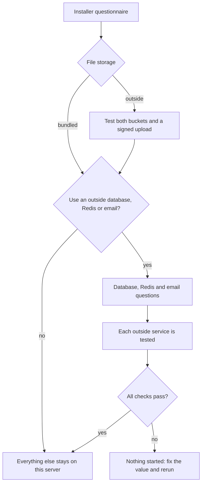

# Hybrid setups

By default every component runs on your server. Quick setup always keeps all of them there. In the full
questionnaire you can move any one of them to an outside service and leave the rest local. Each outside
service is tested before setup starts anything.

| Component | Default | Outside option |
| --- | --- | --- |
| Website | Full: web app and API on this server | API-only, with the website hosted elsewhere or not at all |
| Database | Bundled PostgreSQL 16 | Any PostgreSQL 16 or 17: Supabase, Neon, Amazon RDS, your own |
| Redis | Bundled Redis | Any `rediss://` Redis: Upstash, Redis Cloud, ElastiCache |
| File storage | Bundled Silo | Any S3-compatible service: Cloudflare R2, Backblaze B2, Amazon S3, Supabase Storage |
| Email | Set up later in the control panel | An SMTP server now; API providers (Resend, Postmark, Brevo, SES, Mailgun, SendGrid) are chosen in the control panel |

## Database

Give the owner login (on Supabase, the `postgres` user) as a direct or session-mode URL with
`?sslmode=require`. Setup creates its own limited login, `spaceworks_app`, with a generated password. The
owner login is used only by the one-shot set-up and migration jobs, never by the running services. The
database must be empty on a first install; setup refuses one that already holds tables.

A **transaction pooler** (Supabase port 6543, a Neon host containing `-pooler`) is refused, because the
application holds advisory locks and `pg_dump` and migrations cannot run through one. A **session pooler**
(Supabase port 5432 on the `pooler.supabase.com` host) works for the running services; setup then also asks
for the direct URL, which migrations and backups use.

## File storage

Choose a **storage profile**:

- `limited` suits R2, B2, Supabase Storage and most services: uploads use a presigned PUT, the upload size is
  checked after the upload, and there is no object history.
- `full` is for Amazon S3 or MinIO with versioning on: presigned POST with a size policy and version history.

Create a CORS rule on the private bucket for your website origin yourself. Objects are never copied for you
when you change storage later; copy both buckets first.

## What setup tests

| Check | Proves |
| --- | --- |
| Database | Reachable, TLS off your network, PostgreSQL 16 or 17, a matching `pg_dump`, can create the limited login and a table, required extensions available, empty on first install |
| Redis | `PING` answers and a value can be stored and read back |
| Storage | Both buckets open, write, read and delete work, a signed browser upload and download work, the public bucket is served at the image URL |
| Email | The SMTP host accepts the login and, if asked, a test message |

If a check fails, nothing was started.

## Changing a component later

`bash scripts/switch-services.sh status` shows where each component runs. The installer menu offers
**Change outside services**.

| Command | What it does |
| --- | --- |
| `bash scripts/switch-services.sh redis` | Switch Redis between this server and an outside URL after you confirm waiting jobs are dropped. |
| `bash scripts/switch-services.sh email` | Switch between control-panel email and an SMTP server. |
| `bash scripts/switch-services.sh storage --files-copied` | Point at another S3-compatible service, after you have copied both buckets. |
| `bash scripts/switch-services.sh database` | Refuses and prints the steps. The database is never switched in place. |

To move the database, take a backup, run setup in a new folder choosing the new database, restore the archive
with `scripts/import-backup.sh`, check it, then retire the old install.

## Without Redis

To run with no Redis at all, use the brokerless cloud layout (`docker-compose.managed-brokerless.yml`). See
[mix and match](../deploy/mix-and-match.md#redis-optional).

## Worked example

A server of your own, Cloudflare R2 for files, Supabase for the database, Upstash for Redis and Resend for
email is a supported combination. The step-by-step answers are in
[Install and update](../install-and-update.md#worked-example-your-server-cloudflare-r2-supabase-upstash-and-resend).
That example was checked against configuration only, not against live provider accounts.
