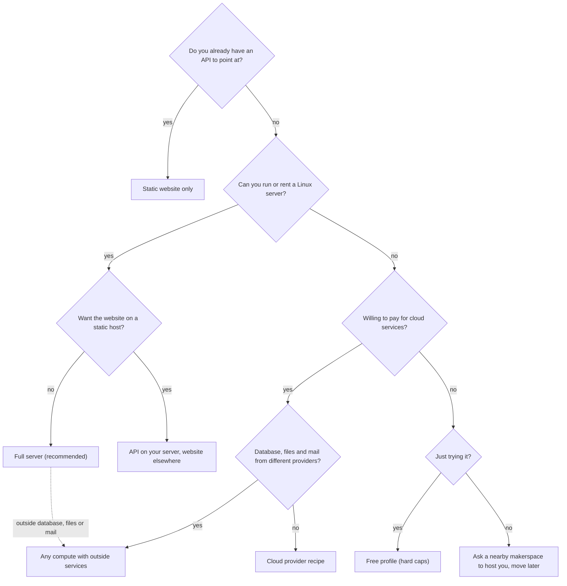

# Choose a hosting method

Space Works is built to run **on your own server, inside the makerspace**. Start there unless you have a
reason not to. Every other shape exists for a specific need and gives something up. There is one product and
one deployment mode: you run it yourself. Everything else on this page is a way of packaging that.

## Decide in one minute

| Shape | Choose it when | Read |
| --- | --- | --- |
| Full server | You have or can rent one Linux server. It runs everything and is the only shape with the complete backup, restore and update-rollback contract. | [Quick install](quick-install.md), [Docker Compose](docker-compose.md) |
| API on your server, website elsewhere | The website should live on Netlify or another static host. | [Docker Compose](docker-compose.md), [Cloud and providers](cloud.md) |
| Cloud provider recipe | You cannot run a server and will pay for provider services. | [Cloud and providers](cloud.md) |
| Any compute, outside services | Database from one provider, files from another, mail from a third. | [Hybrid setups](hybrid.md) |
| Free profile | You are trying it on free tiers and accept hard caps and late reminders. | [Cloud and providers](cloud.md#free-profile) |
| Hosting other makerspaces | You also want to run spaces for other people. Optional on any normal install. | [Own and hosted spaces](managed-spaces.md) |

The longer comparison table lives in [Choose your hosting](../choose-your-hosting.md).

## Requirements

| Profile | Memory | Disk | CPU | Notes |
| --- | --- | --- | --- | --- |
| Full server (installer) | 2 GB is the floor (with swap), 4 GB recommended; the installer warns below that | 10 GB free, plus room for backups and uploaded files | Not checked by the installer; any modern 64-bit x86_64 or arm64 CPU | Linux with root or `sudo`, or macOS with Docker Desktop. Ports 80 and 443 free for automatic HTTPS. |
| API-only | Slightly less (no website container) | Same | Same | Mobile apps and integrations, or a website hosted elsewhere. |
| Cloud provider recipe | Set by your provider plan | Provider database and buckets | Provider plan | You supply PostgreSQL 16 or 17, two buckets and a mail provider. |
| Free profile | One small web container (the recipe targets a 512 MB free instance) | External database and storage free tiers | Shared | Hard caps; reminders may be late; no scheduled database dump. |

The installer needs outbound access to `github.com`, `api.github.com` and `ghcr.io`. Docker and Docker Compose
are installed for you on Linux. These figures come from the installer's own checks; the cloud and free figures
are provider-dependent and were checked against configuration only, not against a live account.

## What every shape shares

- The same backend image, published at `ghcr.io/spaceworks-labs/spaceworks-backend`, runs every role (web,
  worker, scheduler, live events).
- PostgreSQL 16 or 17 holds the data. Redis is optional in the brokerless layouts.
- Files live in S3-compatible object storage, either the bundled Silo store or one you provide.
- Updates only move forward. See [Upgrades](upgrades.md).

## Next steps

1. [Quick install](quick-install.md) for the one-line installer.
2. [Security hardening](security.md) before real members use it.
3. [Backups and restore](backups.md) so a bad day is recoverable.
