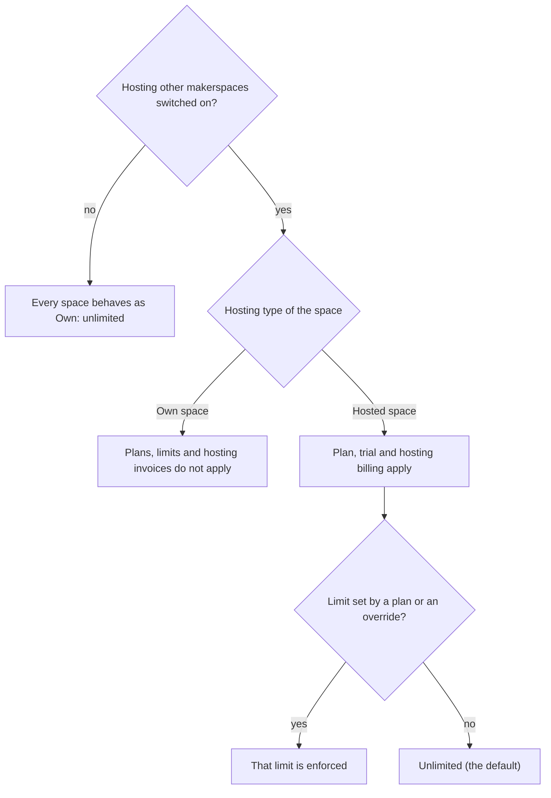

# Own and hosted spaces

Space Works has **one deployment mode: you run it yourself**. If you also want to run spaces for other people
(a regional network, a university, a hosting business), you can switch on **Hosting other makerspaces**. It is
a setting on a normal install, not a different product. Nothing here is required to run a space.

## Own space or hosted space

Each space is one of two kinds, and the superadmin chooses per space. One install can mix both.

| Kind | Plans and limits | Hosting invoices |
| --- | --- | --- |
| **Own space** | None. The space is unlimited. | None. |
| **Hosted space** | A plan and per-space limits can apply, with an optional trial. | Recorded invoices can apply. |

## Turning it on

Sign in as superadmin and open **Platform, Spaces, Hosting other makerspaces**. The switch is **off by
default**, and every change is audited. Switching it off hides everything described here and deletes nothing:
plans, invoices, requests, overrides and rate settings stay in the database and return when you switch it back
on. Never turn it on for a single makerspace.

With it on you get:

| Feature | What it gives you |
| --- | --- |
| Host-your-makerspace requests | A public form on the platform landing page, and invitations from an existing space or organization. Applicants confirm their email before a request reaches review. |
| Plans and fair-use limits | Plan tiers (limits, optional trial, optional recorded invoices) and per-space limits with current usage. |
| Stripe Connect and email caps | New Connect onboarding and charges, and the per-space email cap, follow the switch. Existing Connect charges keep settling with it off. SMS, push, WhatsApp, wallet and attestation platform fallbacks do not depend on it: they apply on every install (Decision: platform fallbacks apply on every install). |
| Platform subdomains | `<name>.your-domain` for a space, when a platform domain is set. |

Older installs and cloud presets use legacy names that still work. `MANAGED_PLANS_ENABLED` is an optional
override: unset, the console switch decides; `true` or `false` forces it and locks the switch.
`PLATFORM_DOMAIN_SUFFIX` is the domain your spaces live under. The `docker-compose.managed*.yml` files and
`SPACEWORKS_DEPLOYMENT_MODE=managed` are packaging for provider-run clouds, not a separate product.

## Plans, limits and rates

The effective limit for a space is, in order: the **space override**, then its **plan**, then the built-in
fair-use default (only when a platform domain is set), otherwise **unlimited**. A space with no plan and no
override on a plain install is unrestricted. Out of the box there are no limits.

- **Plans** are created, edited and archived by the superadmin under **Platform, Spaces, Plans**. A plan can
  set numeric limits, monthly allowances (email, SMS, WhatsApp, events) and the modules it allows.
- **Per-space overrides** are set in the space's details, under Limits. Each row shows the effective value,
  where it comes from (override, plan, default or unlimited) and current usage. Limits cover products, assets,
  machines, events, bookings, staff, members, storage, monthly print requests, daily email and each
  notification channel, signed webhooks, API clients, machine-service requests, data exports and guest and day
  passes per day. `-1` means unlimited; a blank field follows the plan.
- **Request rate limits.** The deployment-wide API throttles (login, one-time codes, uploads and so on) are
  listed under **Platform, Spaces, Request rate limits**. The environment variable `THROTTLE_<SCOPE>` stays
  the default; the superadmin may override a scope within ten times either side of it, and "Use default"
  removes the override. Every change is audited.
- **Overdue invoices** restrict a space (read-only after a grace period) only while Auto-enforce is on.

## Usage limits on platform credentials

New in 0.12.0. When a space has no credentials of its own for a channel, it can fall back to the platform's shared ones (the platform mail account, SMS, WhatsApp, push, wallet certificates and the platform payment rail). The superadmin can cap how much a space uses that shared path each month.

- **Default is no limit.** Nothing is enforced until the superadmin sets a value for a space; an empty value or -1 means unlimited.
- **Only the shared path is counted.** Mail, SMS, WhatsApp or wallet sent with the space's own credentials is never counted or limited.
- **Payments.** A limit only refuses a new online payment page on the platform rail. Offline settlement and the space's own gateway are untouched.
- **Where it is set.** Per space, in the superadmin's limits for that space. The first time a space reaches a limit in a month an audit entry is written and staff see a notice.

The Space Manager decides which notification channels the space uses, whether the platform credentials may be used at all, and can save the space's own credentials instead. See [Notifications and messaging](../modules/notifications-and-messaging.md) and [Platform and superadmin](../modules/platform.md#usage-limits-on-platform-credentials).

## Who sees usage

| Role | What they see |
| --- | --- |
| Superadmin | The **Platform dashboard**: every space, current usage, delivery counts and checks. |
| Space Manager | A **Usage and limits** tab for their own space, with the effective limits including overrides. |
| Anyone who hits a limit | A message naming the limit and, where a plan applies, the plan. |

When you switch hosting on for a database that already holds objects, run `manage.py recompute_storage` once
so the storage counter is right.

## How it works underneath

One application stack serves every space. There is no database per space: every row is scoped to a makerspace
and every query goes through the same role checks. Spaces are reached at `/m/<slug>`, at a platform subdomain
or at a verified custom domain. Plan for one failure and capacity boundary on a single server: scale up first,
and move to a managed database and object storage before adding application nodes.

Each space brings its own Stripe or Razorpay account, email and chat integrations; these are stored encrypted
per space and are never visible to another space. For subdomains you need wildcard DNS and TLS; the layered
stack is started with `SPACEWORKS_COMPOSE_LAYER=saas scripts/spaceworks-compose.sh bundled up -d`.

The full superadmin workflow (request, review, approve, subdomain, limits, onboarding, suspend and archive),
wildcard DNS table and upgrade notes are in the
[self-hosting guide](../self-hosting.md#plans-and-hosting-other-makerspaces-optional).

## Limits you can set on a space

In the superadmin limits console every limit is grouped by area (People, Inventory, Machines, Events, Bookings, Shop, Money, Messaging, Integrations, Storage) and defaults to none. A value you set applies to that space whether it is an own or a hosted space. Use the bulk route to set or clear keys on up to 50 spaces in one all-or-nothing step. A limit only stops something new from starting (typed 409); it never blocks reading data, paying an existing charge, refunds or recording a debt.

## Every limit key, grouped by area

Every countable per-space resource has a limit key the superadmin can set on any space (own or hosted) in the space's limits, or on up to 50 spaces at once. **Nothing is set by default, so nothing is limited**: blank, `null` or `-1` means no limit. A limit only refuses the **start** of something new (a typed `409`, with a code such as `boxes_quota_reached` and the limit in the body). It never blocks reading or exporting data, settling or refunding a payment, recording a debt, returning issued items, or a member's privacy request.

| Area | Key | Unit and what is counted |
| --- | --- | --- |
| People | `members`, `staff`, `guest_passes` | Active members, staff seats, passes issued today. |
| People | `membership_plans` | Membership plans that are not archived. |
| People | `organizations_linked` | Organizations linked to the space. |
| Inventory | `products`, `assets` | Products and tracked assets. |
| Inventory | `boxes` | Active QR boxes. |
| Inventory | `kiosk_stations` | Scanner and handover stations. |
| Machines | `machines`, `print`, `machine_service_open`, `machine_service_submit` | Machines, print requests this month, open and daily service requests. |
| Machines | `machine_jobs_monthly` | Machine jobs requested this month, every machine type. |
| Machines | `machine_sessions_monthly` | Member or staff sessions started this month (a session reported by a machine is counted, never refused). |
| Machines | `devices` | Enrolled devices that are not revoked. |
| Events | `events`, `events_monthly` | Published events now, events created this month. |
| Events | `event_registrations_monthly` | Registrations and ticket seats created this month; a seat that is later claimed counts once. |
| Bookings | `bookings`, `bookings_monthly` | Active bookings now, bookings created this month (a cancelled booking keeps counting, and restoring it does not count it again). |
| Bookings | `bookable_spaces` | Active bookable spaces. |
| Shop | `shop_products` | Shop products that are not archived. |
| Shop | `shop_orders_monthly` | Shop orders (online and desk) created this month. |
| Money | `payments_monthly_count`, `payments_monthly_amount` | Paid transactions and money taken this month (per currency). |
| Money | `donation_campaigns` | Active campaigns and funds. |
| Messaging | `email`, `telegram`, `slack`, `mattermost`, `discord`, `webhook`, `native_push`, `sms`, `whatsapp` | Daily notifications per channel. |
| Messaging | `platform_email_monthly`, `platform_sms_monthly`, `platform_whatsapp_monthly` | Messages sent with the platform's account this month. |
| Messaging | `platform_push_monthly` | Push deliveries (one per recipient, or per device for staff alerts) through the platform this month. |
| Messaging | `platform_wallet_monthly` | New wallet passes signed with the platform's certificates this month (own certificates never count). |
| Integrations | `api_clients` | Active API clients. |
| Integrations | `api_requests_per_minute` | Requests per minute for each API client of the space. It can only lower the client's tier rate; no value keeps the tier rate. |
| Integrations | `analytics_connections` | Configured analytics providers (Metabase and Grafana count one each). |
| Integrations | `webhook_endpoints` | Outbound webhook endpoints configured as notification destinations (active or not); the per-day `webhook` key still counts deliveries. |
| Integrations | `report_exports_monthly` | Report downloads this month. |
| Integrations | `data_exports`, `custom_domain` | Active data exports; custom domain allowed. |
| Storage | `storage`, `upload_bytes` | Total managed bytes; the largest single upload. |
| Storage | `storage_evidence_bytes` | Bytes of evidence photos that have not expired under retention. |
| Storage | `storage_public_images_bytes` | Managed bytes that are not evidence (public images and other files); needs hosting accounting to be on. |

Space Managers see usage for every limited key, read-only. An area manager sees only the keys of the areas they manage (for example an inventory manager sees boxes and evidence storage, a machine manager sees jobs, sessions and devices).
