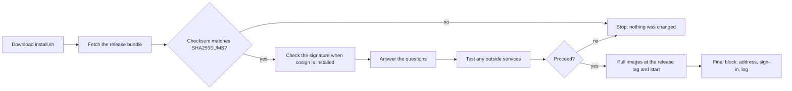

# Quick install

The installer sets up a full Space Works server from a published release. It asks every question first,
shows a summary and changes nothing until you confirm.

```sh
curl -fsSL https://github.com/SpaceWorks-Labs/SpaceWorks/releases/latest/download/install.sh | sh
```

Run it on a 64-bit Linux server (Ubuntu 24.04 is the tested target) as a user with `sudo`, or on macOS with
Docker Desktop running. On Windows, open an Ubuntu terminal in WSL2 or use a Linux VM and run the same
command there; the installer refuses a new native Windows install.



## What you download and how to verify it

Every release publishes these assets on its GitHub Releases page:

| Asset | What it is |
| --- | --- |
| `install.sh` | The standalone installer. |
| `spaceworks-<version>.tar.gz` | The deploy bundle: exactly the host files the installer needs. |
| `release.json` | The version and commit, for the tooling inside the bundle. |
| `SHA256SUMS` | Checksums of the three files above. |
| `SHA256SUMS.sig`, `SHA256SUMS.pem` | A keyless [cosign](https://docs.sigstore.dev/cosign/overview/) signature of `SHA256SUMS`, made by the repository's release workflow. |

The installer always checks the bundle against `SHA256SUMS`. It also checks the signature when `cosign` is
installed; without it, it says that only the checksum was verified. Only then does it run helpers from the
bundle, and images are pulled at that exact release tag. To check by hand:

```sh
tag=v0.12.0-main.7.abcdef012345   # a real tag from the Releases page
base=https://github.com/SpaceWorks-Labs/SpaceWorks/releases/download/$tag
curl -fsSLO $base/SHA256SUMS -O $base/SHA256SUMS.sig -O $base/SHA256SUMS.pem
cosign verify-blob SHA256SUMS --signature SHA256SUMS.sig --certificate SHA256SUMS.pem \
  --certificate-identity-regexp '^https://github.com/SpaceWorks-Labs/SpaceWorks/.github/workflows/release.yml@refs/heads/main$' \
  --certificate-oidc-issuer https://token.actions.githubusercontent.com
sha256sum --check --ignore-missing SHA256SUMS      # on macOS: shasum -a 256 -c
```

To read the script before running it, download it first (`curl -fsSLo install.sh <url>`), read it, then run
`sh install.sh`. The whole script is wrapped in one function, so an interrupted download runs nothing.

## Before you start

- 64-bit (x86_64 or arm64) Linux with root or `sudo`, or macOS with Docker Desktop running.
- At least 2 GB RAM (4 GB recommended) and 10 GB free disk.
- `curl`, `tar`, `bash` and Python 3.10 or newer. The installer offers to install Python on Debian, Ubuntu
  and Fedora.
- Outbound access to `github.com`, `api.github.com` and `ghcr.io`.
- Ports 80 and 443 free (the installer warns if not).

Add `--dry-run` to rehearse: it downloads and verifies the release, checks the machine and ports, prints the
plan and exits without installing, writing or starting anything.

## What it asks

**Use quick setup? [Y/n]** is the first question, and Enter accepts it. Quick setup asks only:

1. Full website or API-only.
2. The web address. A domain name turns on automatic HTTPS (your email becomes the certificate contact); Enter
   keeps plain HTTP on this computer.
3. The makerspace name.
4. Which areas you run (inventory, machines, events, bookings, membership, and so on).
5. The timezone and your email.

Everything else takes the recommended answer: one makerspace, bundled storage, the organization named after
the makerspace, the admin username `admin` with a generated password, no control-plane web access and no
deploy runner. Online payment keys are added later in Settings.

Answer **n** for the full questionnaire. It covers, in order: hosting model (one makerspace, several at
`/m/<slug>`, or hosting other makerspaces), Full or API-only, HTTPS (plain HTTP, automatic Caddy, or your own
reverse proxy), storage (bundled Silo or an outside S3 service), control-plane web access, web address,
organization and makerspace names, MFA, sign-in providers, whether the SpaceWorks product page is shown at the
site's front page (default yes), areas and their follow-up settings, the admin
account, optional Stripe keys, the repository and the optional deploy runner.

### Control-plane web access

The Django control plane at `/control/` is the superadmin's server-side tool. By default it is reachable only
from the server itself or through an SSH tunnel, and answers 404 everywhere else. The questionnaire asks
whether to also serve it on the site's own address (default **No**), which IP addresses may reach it, and,
with automatic HTTPS, an optional loopback tunnel port. Day-to-day platform work happens in the web
superadmin console instead. Details are in [Security hardening](security.md#control-plane-access).

### Sign-in choices

The questionnaire asks whether to require platform two-step sign-in (default yes) and which sign-in
providers to offer: Google, Apple and/or GitHub, or none (default Google). Provider keys are entered later
in the console; GitHub sign-in is for members only.

## Options

Pass options after `sh -s --`, or use the matching environment variable.

| Option | What it does |
| --- | --- |
| `--dry-run` | Checks and plan only. |
| `--version X.Y.Z` | Install that published release (0.12.0 or newer) instead of the latest (`SPACEWORKS_VERSION`). An older version than the installed one is refused. |
| `--frontend full` or `--frontend api-only` | Answer the website question up front (`SPACEWORKS_FRONTEND`). Chosen once, at first install. |
| `--repo owner/name` | Install and update from a fork (`SPACEWORKS_REPOSITORY`). |
| `--non-interactive --answers-file private.json` | Unattended install from a private (mode 0600) answers file. |
| `--resume` | Continue a verified incomplete install of the same release after a failure. |
| `--profile free` | Prepare the opt-in free single-process profile. See [Cloud and providers](cloud.md#free-profile). |
| `--uninstall` [`--purge`] | Remove the services and managed files; data and backups are kept. `--purge` also deletes local volumes after a confirmation phrase. |
| `--help` | List every option and requirement. |

`SPACEWORKS_DIR` (default `/opt/spaceworks`) sets the install directory.

```sh
curl -fsSL https://github.com/SpaceWorks-Labs/SpaceWorks/releases/latest/download/install.sh | sh -s -- --frontend api-only
```

## Running it again

On an existing install the same command shows a menu instead of reinstalling: update to the latest release,
change which areas are switched on, both, cancel, set up automatic deploys with a GitHub runner, turn web
access to the control panel on or off, and change outside services (database, Redis, storage, email). See
[Upgrades](upgrades.md) and [Hybrid setups](hybrid.md).

## When it finishes

The installer prints one final block: the address to open, how to sign in (a generated password is saved in a
private file it names), the guided setup on the dashboard, and where `install.log` is.

The full step-by-step guide, answers-file format and troubleshooting table are in
[Install and update](../install-and-update.md).
