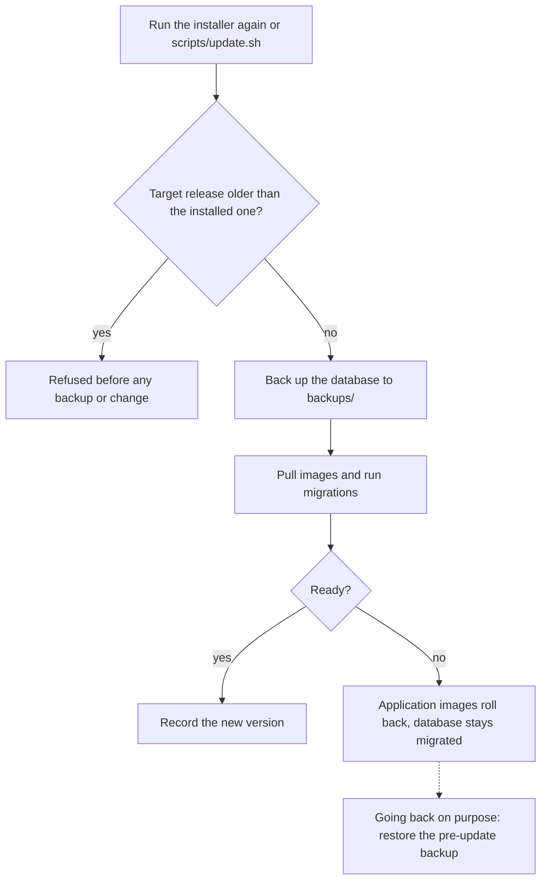

# Upgrades

Every push to `main` builds the container images, and a new release is cut when the `VERSION` file changes.
A server picks it up in one of three ways.

## The installer menu

Run the same one-line command you installed with. On an existing install it shows a menu and never silently
reinstalls:

1. **Update to the latest release.** Backs up the database, moves to the newest release, runs migrations and
   restarts. Areas and data stay as they are.
2. **Change which areas are switched on**, without a new version.
3. **Both.**
4. **Cancel** (the default).
5. **Set up automatic deploys** (a GitHub Actions runner).
6. **Turn web access to the control panel on or off.**
7. **Change outside services** (database, Redis, storage, email).

## The updater

Run it by hand as the install owner, from the install directory:

```bash
bash scripts/update.sh --force
bash scripts/update.sh --force --version 0.12.0-main.<run>.<sha>   # an exact published release
```

It locks, backs up PostgreSQL to `backups/`, pulls pinned images, runs the start-up checks and migrations,
waits for the app to report ready, and records the new version. The backup does not include uploaded files.



To change areas during an update, use `--modules` (review after updating) or `--no-module-changes` (images
only). With more than one space, name one with `--makerspace <slug>` or target all with `--all-makerspaces`;
non-interactive updates refuse to guess.

## Automatic deploys

A GitHub Actions runner on your server receives a deploy job after each release and runs the updater locally.
Nothing is pushed into your server and no port is opened for GitHub. Install the runner with
`bash scripts/install-runner.sh`, then set the repository variable `SPACEWORKS_DEPLOY` to `true`. The runner
effectively has root on the server: require approval for all external contributors' workflow runs, protect
`main`, and restrict the runner to your repository. Read the runner security notes in
[Install and update](../install-and-update.md#runner-security) before enabling it.

## Migrations

Migrations run as part of the update, before the app is reopened. Some changes are marked irreversible by the
release notes (account and role conversions), so verify a backup first. The upgrade notes for each release are
kept in the repository, for example [Upgrade to 0.12.0](../upgrade-to-0.12.0.md). There is no published 0.10
or 0.11 release: 0.12.0 includes everything prepared for the 0.11.0 candidate.

## Release channel

The installer installs the newest published release, the one GitHub marks as latest. Pin one with
`--version X.Y.Z` (0.12.0 or newer); a base version picks its newest build. Images use the immutable tag form
`X.Y.Z-main.<run>.<12-character commit>`. A fork must run its own **Continuous Release** workflow once before
it can be installed from, and its container packages must be public so a server can pull them.

## Rollback

Upgrades are **forward-only**. The updater and the installer refuse a target older than the installed
version, and `--force` does not override that. This stops an old release being pointed at a database a newer
one has migrated.

- **A failed update** restarts the application images that were running when it began. Database migrations
  that already ran stay applied. Nothing is restored automatically; the pre-update dump stays in `backups/`.
- **Going back on purpose** means restoring the pre-update dump the updater took (plus the matching object
  storage state if files changed), then deploying the release that dump came from. Follow
  [Restore a pre-update SQL dump](../update-recovery.md#restore-a-pre-update-sql-dump) and see
  [Backups and restore](backups.md#restore).

## Object storage note

From 0.9.0 the bundled object store is **Silo**, the maintained fork of the archived MinIO. Existing installs
switch automatically on their next update and keep their `minio_data` volume as-is. Back that volume up before
the first update, because there is no guaranteed way back to MinIO once Silo has written to it.
