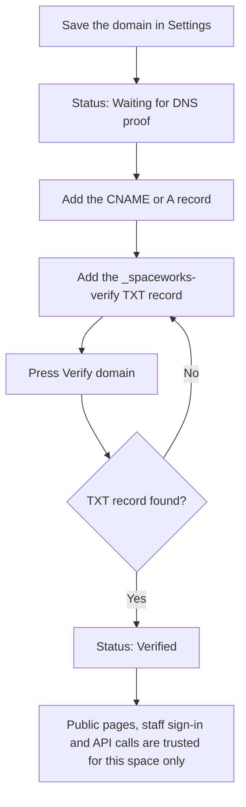

# Use your own domain with HTTPS

Give your space an address such as `tools.example.org` instead of the shared `/m/<slug>` address. The same steps cover a self-hosted server and a managed platform. They differ only in who has to prove ownership.

> **Note** Until a domain is **Verified** it gets no trust at all: no sign-in, no staff console, no API calls from browsers and no certificate. Visitors keep using the space's usual address in the meantime.

## Before you start

- You can edit DNS for the domain.
- You are a Space Manager of the space (or the platform superadmin).
- On a self-hosted server you can edit the server's `.env` and restart it.

## Steps

1. Open **Settings > Space > Branding & public site** and find **Your own domain or frontend**. Enter the hostname and save. The status reads **Waiting for DNS proof**.
2. At your DNS provider, point the hostname at the server with a `CNAME`, or with `A`/`AAAA` records.
3. Add the **DNS TXT record** the page shows. It has the form `_spaceworks-verify.<your domain>  TXT  <token>`.
4. Press **Verify domain**. DNS can take a while to spread; you can press the button again at any time. When the record is found the status turns to **Verified**.
5. Make sure the domain is served over **HTTPS** with a valid certificate. How depends on where it points:
   - **Your own SpaceWorks server, built-in Caddy.** Set `PUBLIC_DOMAIN`, add the domain to `ALLOWED_HOSTS` and add `https://<domain>` to `CSRF_TRUSTED_ORIGINS` in `.env`, then bring the stack up with the TLS layer (`SPACEWORKS_COMPOSE_LAYER=tls scripts/spaceworks-compose.sh bundled --profile tls up -d`). Caddy fetches the certificate itself.
   - **Your own nginx.** Choose HTTPS option 3 during setup, then install the generated `spaceworks-proxy.nginx.conf`. See [Run behind a reverse proxy](reverse-proxy-and-control-plane.md).
   - **Your own frontend host.** The certificate lives on that host. See [Single-tenant frontend](../single-tenant-frontend.md).



## What "Verified" turns on

Once verified, the deployment trusts the domain for four things, and only for this space: the public pages, staff sign-in (exactly `https://<domain>`), the space's own API calls, and on a managed platform an HTTPS certificate.

## Self-hosted differences

On a self-hosted server the platform superadmin does not need the TXT record: a domain the superadmin saves is **Verified** immediately, because the operator's word is enough. A Space Manager's domain still waits for DNS proof.

Saving a domain in Settings does not change `ALLOWED_HOSTS`, `CSRF_TRUSTED_ORIGINS` or your proxy's certificates. Those stay the operator's job (step 5).

If a server is switched from managed to self-hosted after deployment, run this once to promote existing custom domains to trusted. Check the list of domains first, because it vouches for every one of them:

```bash
python manage.py reconcile_selfhost_domains
```

> **Warning** Changing the domain starts over. The new domain goes back to **Waiting for DNS proof** and the old one loses trust at once. Passkeys are tied to a domain, so people whose only second factor is a passkey on the old domain must use their password and recovery codes on the new one. The settings page shows how many people this affects before you save.

## Hide the space from shared listings

A separate switch, **Hide this space from the platform**, keeps the space out of the platform directory, cross-space search and the shared sitemap without needing a custom domain. It is in the same settings page.

## See also

- [Run your space on your own domain or frontend](../own-domain-and-frontend.md) for the full trust model.
- [Self-hosting guide](../self-hosting.md#custom-domain-self-host).
