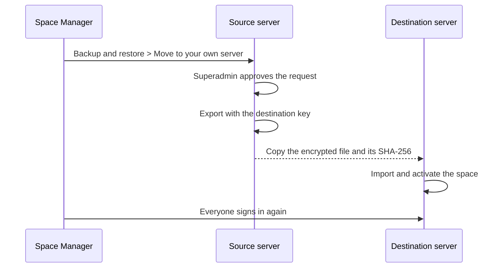

# Move a space to another server

Tenant migration moves **one space** between servers. The most common case is a space leaving a hosted platform to run on its own server.



## Before you start

- A running destination server on the same release or newer, with its restore key configured (`TENANT_MIGRATION_AGE_RECIPIENT` and `TENANT_MIGRATION_AGE_IDENTITY_FILE`).
- Superadmin access on both servers.
- A [verified backup](offsite-backups.md) of the source.

## Steps

1. **Request.** The Space Manager opens **Backup & restore > Move to your own server** and asks the platform operator to move the space.
2. **Approve and export.** On the source server the superadmin approves the request (**Platform > Data & recovery > Self-host moves**) and runs the export using the **destination server's** `TENANT_MIGRATION_AGE_RECIPIENT` as the one-shot key. The space is frozen for writes while the move is prepared; clients see HTTP 423 for it. The host form of the export is:

```bash
python manage.py export_portable_tenant_dump --makerspace <slug> --actor-id <superadmin id> \
  --output ./move.tar.age --recipient <destination age public key>
```
3. **Copy.** Move the encrypted archive and its SHA-256 to the destination.
4. **Import** on the destination as its superadmin:

```bash
scripts/spaceworks-compose.sh bundled run --rm -v "$PWD/move.tar.age:/move.tar.age:ro" backend --role management \
  python manage.py import_portable_tenant_dump --archive /move.tar.age --sha256 <digest> --actor-id <superadmin id> \
  [--slug <new-slug>] [--decisions decisions.json] [--no-activate]
```

5. **Check.** Open the space and confirm members, loans and evidence. Re-issue kiosk station URLs and PINs.
6. **Retire the source** space only once the move is confirmed.

## What travels and what does not

- Every person is created. Staff keep their roles; staff and members keep their password, authenticator and recovery codes. Passkeys only travel when the destination answers on the same domain.
- Sessions and devices never travel, so everyone signs in again.
- If an email already exists on the destination, the import refuses. Pass a `--decisions` file that links that person instead.
- Wallet signing credentials, platform request-rate overrides, the hosting switch and each space's hosting type are platform-level and are re-entered on the target.

> **Warning** A frozen space cannot be changed. If a move is interrupted and its gate expires or is orphaned, a superadmin can reopen the source with `python manage.py recover_source_migration_gate --makerspace <slug> --actor <username>`.

## Between hosted servers

Superadmins can also run and track moves from **Platform > Data & recovery** (the tenant migration pages) and import a space archive under **Import a space**.

## See also

- [Self-hosting guide: move a space to this server](../self-hosting.md#move-a-space-to-this-server-self-host-move)
- [Backup and restore](../backup-and-restore.md)
