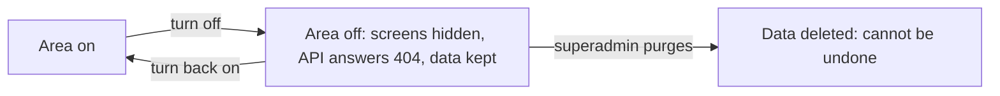

# Turn an area or add-on on or off safely

SpaceWorks is built from **areas** (Inventory, Machines, Events, Bookings, Shop and so on) and **add-ons** (SMS, chat apps, analytics). Each can be switched per space. Switching off **hides** an area and keeps its data; switching it back on restores everything.

## Before you start

- You are the Space Manager (or the platform superadmin).
- You know whether anyone depends on the area today (open requests, upcoming bookings).

## Steps in the console

1. Open **Areas & add-ons** (`/admin/modules`).
2. Find the area. Groups show how many of their modules are installed.
3. Turn it on or off and confirm. Turning something on also turns on anything it requires.
4. For finer control, open **Settings > Areas > Features**. Each area has capability switches (for example `loans.reservations` or `membership.guest_passes`) that follow the same rule: off hides the screens and the API answers as if the route did not exist.



> **Note** An area that is off answers with a typed `module_disabled` (or `feature_disabled`) 404. Nothing is deleted. Core modules (the hardware-loan spine) cannot be uninstalled.

## Delete an area's data (superadmin only)

Turning off never deletes. Deleting is a separate, deliberate step that only the platform administrator can take, and only for a module that is already off:

```bash
python manage.py purge_module_data bookings --list
python manage.py purge_module_data bookings --makerspace my-space
```

It asks you to type the space's slug back and cannot be undone. Payment records are kept. Take a [backup](offsite-backups.md) first.

## From the server

```bash
python manage.py list_modules --makerspace my-space
python manage.py install_module bookings --makerspace my-space
python manage.py uninstall_module bookings --makerspace my-space
```

The installer's menu option **2) Change which areas are switched on** and `scripts/update.sh --modules-only` do the same interactively. Updates keep your choices.

## What a new server starts with

An install with no profile has the six core modules plus member accounts. Install profiles (`minimal`, `workshop`, `lending`, `recommended`, `cloud`, `everything`, `events`, `bookings`) pick a starting set. The platform superadmin can see what new spaces start with under **Platform settings > Areas > Feature defaults**.

## See also

- [Module guide](../MODULES.md) and [what changes when a module is off](../MODULES-OFF.md)
- [Editions and module lifecycle](../MODULES-LIFECYCLE.md)
