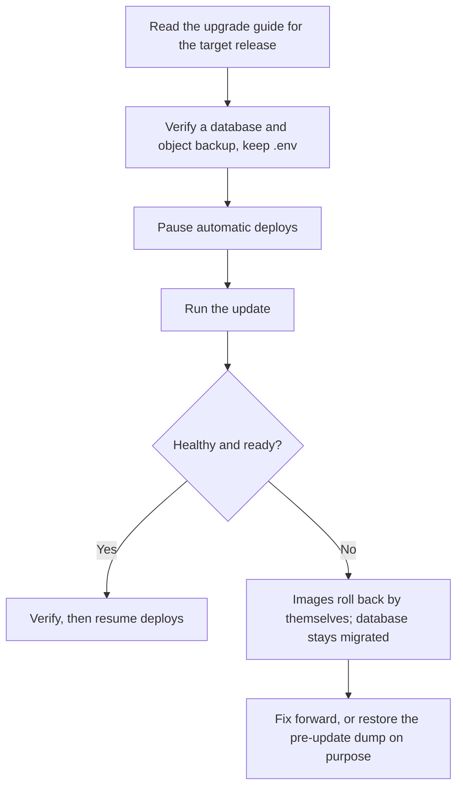

# Upgrade SpaceWorks safely

Upgrades are **forward-only**. The updater refuses an older target release and never points an old release at a database a newer one has migrated. Preparation is therefore what makes an upgrade safe.



## Before you update

1. Read the upgrade guide for your target, for example [Upgrade to 0.12.0](../upgrade-to-0.12.0.md). It lists new migrations and changed behaviour.
2. Verify a current database **and** object-storage backup, and keep a copy of `.env` off the server. The updater's pre-update dump covers the database only, not uploaded files. See [offsite backups](offsite-backups.md).
3. Pause automatic deploys and other writers for the maintenance window.
4. If you come from 0.9.x, complete the [fixed-role upgrade](../update-recovery.md#fixed-role-upgrade-2026-10-16) preview first: it is irreversible.
5. If you still run the retired all-in-one image, follow [moving off a single-box install](../update-recovery.md#moving-off-a-single-box-install).

## Update

Pick one:

- **Installer.** Run the one-line installer again and choose **1) Update to this release** (or **3) Both** to update and change areas).
- **By hand**, as the install owner:

```bash
bash scripts/update.sh --force
# or an exact published release
bash scripts/update.sh --force --version 0.12.0-main.<run>.<sha>
```

- **Automatic deploys** through a GitHub Actions runner on your server (`bash scripts/install-runner.sh`, then the repository variable `SPACEWORKS_DEPLOY=true`). The runner receives a deploy job after each release and runs `update.sh --force --no-module-changes --version <release>`.

The updater locks, backs up PostgreSQL to `backups/`, pulls pinned images, runs the migration and orchestration checks, waits for readiness, records `.spaceworks-version` and removes run-once containers.

Useful options: `--no-module-changes` (images only), `--modules-only`, `--all-modules`, `--makerspace <slug>`.

## Verify

- `GET /api/v1/health/readiness/` reports ready.
- Sign in as a superadmin and check **Platform** (backups, offsite copies and scheduler green).
- Spot-check a loan, an event and a payment receipt.

## If something goes wrong

- **A failed update** restarts the previous application images by itself. Forward migrations stay applied, and the pre-update dump stays in `backups/`.
- **Going back on purpose** means restoring that pre-update dump and the matching object-storage state, then deploying the release that dump came from. See [Database recovery after an update](../update-recovery.md#restore-a-pre-update-sql-dump). Never run an older release on a migrated database.

> **Warning** `--force` does not override the downgrade refusal. It fails with `Refusing release downgrade` before touching anything.

## See also

- [Install and update](../install-and-update.md)
- [Changelog](../changelog/index.md)
