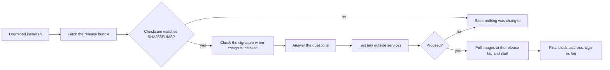
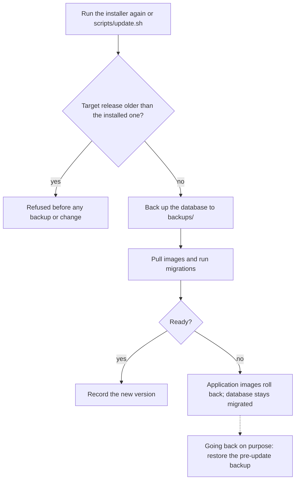

# Install and update Space Works

The step-by-step guide to installing Space Works on your own server, keeping it updated and changing
its modules. For a plain-language walkthrough read [Setting up Space Works](setup-for-makerspaces.md);
for the production reference (environment, TLS, backups, the control plane) read the
[self-hosting guide](self-hosting.md).

## Install in one line

On a 64-bit Linux server (Ubuntu 24.04 is the tested target) as a user with `sudo`, or on macOS with
Docker Desktop running:

```sh
curl -fsSL https://github.com/SpaceWorks-Labs/SpaceWorks/releases/latest/download/install.sh | sh
```

It installs the latest published release, asks every question first, shows a summary, and changes
nothing until you confirm. It ends with one block: the address to open, how to sign in and where the
install log is. Run the same command again later to update or change modules.



Pass options after `sh -s --`, or use environment variables:

```sh
curl -fsSL https://github.com/SpaceWorks-Labs/SpaceWorks/releases/latest/download/install.sh | sh -s -- --frontend api-only
curl -fsSL https://github.com/SpaceWorks-Labs/SpaceWorks/releases/latest/download/install.sh | SPACEWORKS_VERSION=0.12.0 sh
```

The older address `https://raw.githubusercontent.com/SpaceWorks-Labs/SpaceWorks/main/install.sh` still
works: it is a small script that fetches and runs the release installer above.

**Windows** is supported through WSL2 (Ubuntu) or a Linux VM: open the Ubuntu terminal and run the
same command there. `setup.ps1` is only a developer helper; on native Windows the installer refuses a
new install and says so. (Existing native Git Bash installs keep updating with `scripts/update.sh`; see
the [Windows support boundary](#windows-support-boundary).)

### Inspect before running

Piping a script to a shell is convenient but asks you to trust it blindly. To read it first:

```sh
curl -fsSLo install.sh https://github.com/SpaceWorks-Labs/SpaceWorks/releases/latest/download/install.sh
less install.sh        # read it
sh install.sh          # run it
```

The whole script is wrapped in one function, so an interrupted download runs nothing.

### Verify the download

Every release publishes `install.sh`, the deploy bundle `spaceworks-<version>.tar.gz`, `release.json`,
`SHA256SUMS` and a keyless [cosign](https://docs.sigstore.dev/cosign/overview/) signature of it
(`SHA256SUMS.sig` and `SHA256SUMS.pem`), made by this repository's release workflow. The installer
always checks the bundle against `SHA256SUMS`, and also checks the signature when `cosign` is
installed (without it, it says that only the checksum was verified). To check by hand:

```sh
tag=v0.12.0-main.7.abcdef012345   # a tag from the Releases page
base=https://github.com/SpaceWorks-Labs/SpaceWorks/releases/download/$tag
curl -fsSLO $base/SHA256SUMS -O $base/SHA256SUMS.sig -O $base/SHA256SUMS.pem
cosign verify-blob SHA256SUMS --signature SHA256SUMS.sig --certificate SHA256SUMS.pem   --certificate-identity-regexp '^https://github.com/SpaceWorks-Labs/SpaceWorks/.github/workflows/release.yml@refs/heads/main$'   --certificate-oidc-issuer https://token.actions.githubusercontent.com
sha256sum --check --ignore-missing SHA256SUMS      # on macOS: shasum -a 256 -c
```

### Step by step

1. **Check the machine.** 64-bit (x86_64 or arm64) Linux with root or `sudo`, or macOS with Docker
   Desktop running; at least 2 GB RAM (4 GB recommended; the installer warns); 10 GB free disk;
   `curl`, `tar`, `bash` and Python 3.10+ (the installer offers to install Python on
   Debian/Ubuntu/Fedora); outbound access to `github.com`, `api.github.com` and `ghcr.io`. Docker and
   Docker Compose are installed for you on Linux. Ports 80 and 443 should be free (the installer warns).
2. **Optionally rehearse it.** Add `--dry-run`: it downloads and verifies the release, checks the
   architecture, distribution, dependencies, Docker, disk, RAM and (after the questions) the ports,
   prints the plan and exits. Nothing is installed, written or started.
3. **Run the one-liner** and answer the questions (below). Enter accepts each `[default]`. The
   questions read from your terminal even though the script arrives through a pipe.
4. **Check the summary** and answer **Proceed? [Y/n]**. Up to here nothing on the machine has changed.
5. **Wait for it to finish** (a few minutes; images are pulled and the database is initialized). The
   installer prints numbered progress and keeps a log (`install.log` in the install directory).
6. **Read the final block**: the address to open, how to sign in (a generated password is saved in a
   private file it names), the guided setup on the dashboard, and where the install log is; then the
   log, backup and uninstall commands.

The installer runs only verified code: it downloads the release bundle, checks it against the
release's `SHA256SUMS` (and the signature, when `cosign` is present) and only then runs the helpers
inside that bundle. Images are then pulled at that exact release tag.

### Options

| Option | What it does |
| --- | --- |
| `--dry-run` | Checks and plan only; nothing is installed, written or started. |
| `--version X.Y.Z` or `--version X.Y.Z-main.<run>.<sha>` | Installs that published release (0.12.0 or newer) instead of the latest (`SPACEWORKS_VERSION`). A base `X.Y.Z` picks its newest run. An older version than the installed one is refused. |
| `--frontend full` / `--frontend api-only` | Answers the frontend question up front (`SPACEWORKS_FRONTEND`); a different value than an existing install's is refused. |
| `--repo owner/name` | Installs and updates from a fork (`SPACEWORKS_REPOSITORY`). |
| `--non-interactive --answers-file private.json` | Unattended install from a private (mode 0600) answers file. |
| `--resume` | Continues a verified incomplete install of the same release after a failure. |
| `--profile free` | Opt-in free single-process profile ([cloud-free](deploy/cloud-free.md)). |
| `--uninstall` [`--purge`] | Removes the services and managed files; data and backups are kept. `--purge` also deletes local volumes after you type a confirmation phrase. |
| `--help` | Prints every option and the requirements. |

`SPACEWORKS_DIR` (default `/opt/spaceworks`) sets the install directory.

**Update and uninstall.** Running the one-liner again over an existing install offers to update (the
database is backed up first), change modules, or both; updates only move forward. Uninstall with
`curl -fsSL https://github.com/SpaceWorks-Labs/SpaceWorks/releases/latest/download/install.sh | sh -s -- --uninstall`
(or `bash /opt/spaceworks/scripts/uninstall.sh`).

**Unattended installs** (CI, provisioning, any shell without a terminal) need an answers file; without
a terminal and without `--non-interactive --answers-file`, the installer stops before changing
anything and says so. The file holds the questionnaire's variable names; anything left out takes the
default. Minimal example (keep it mode 0600; it contains the admin password):

```json
{"schema_version": 1, "confirmed": true, "answers": {
  "ORG_NAME": "My Organization", "MSNAME": "My Makerspace",
  "ADMINEMAIL": "owner@example.org", "ADMINPASS": "a-long-private-password",
  "HTTPS_MODE": "2", "PUBLIC_DOMAIN": "space.example.org", "TLS_EMAIL": "owner@example.org"}}
```

```bash
curl -fsSL .../install.sh | sh -s -- --non-interactive --answers-file ./answers.json --frontend full
```

An answer that does not apply to your choices (or a misspelt key) is rejected before anything is
installed. Rerunning `--non-interactive` on an existing install needs no answers file: it updates.

### Forward-only versions

Upgrades only move forward (decision 219g). Over an existing install, `install.sh --version` with an
older release, and `scripts/update.sh --version` with an older or conflicting release, are refused
before anything is backed up or changed. Going back means restoring the pre-upgrade backup; see
[Rolling back](#rolling-back).



### Troubleshooting

| Message | What to do |
| --- | --- |
| `No terminal is available to answer the installer questions` | Run it from an interactive SSH/terminal session, or use `--non-interactive --answers-file`. |
| `The installer supports Linux and macOS` | You are in native Windows Git Bash: run it inside WSL2 (Ubuntu) or a Linux VM. |
| `Could not download` / `Could not reach` | The server cannot reach `github.com`, or a proxy rewrites TLS. Check `curl -I https://github.com` and retry. |
| `Checksum mismatch` | The download was corrupted or altered. Nothing was installed; retry, and report it if it repeats. |
| `No published release ... was found` | Check `--version` and `--repo`; a fork must run its **Continuous Release** workflow once. |
| `Release X predates this installer` | `--version` named a release older than 0.12.0; pin a newer one or omit `--version`. |
| `Refusing ...: ... is installed and upgrades are forward-only` | Choose a newer release, or restore a backup to go back ([Rolling back](#rolling-back)). |
| `TCP port N is already in use` | Stop the program holding it (`sudo ss -ltnp 'sport = :N'`), or choose the own-reverse-proxy HTTPS option (port 8080). |
| `At least 10 GB of free disk is needed` / `Insufficient host capacity` | Free disk on the install directory and Docker's data root (`docker info --format '{{.DockerRootDir}}'`). |
| `Warning: ... MiB RAM detected` | Add RAM or swap; the stack can be slow or restart under memory pressure. |
| `Docker is inaccessible` / `Docker Desktop is installed but not running` | Start Docker (`sudo systemctl start docker`, or Docker Desktop), then rerun. If you were just added to the `docker` group, sign out and back in. |
| `... contains state without a completed version marker` | A previous install stopped part-way: rerun with `--resume`, or move that directory aside. |
| `This install already has a frontend mode` | Full/API-only is chosen at first install; see [API-only and external storage](self-hosting.md). |
| `The app did not become ready in time` | `cd /opt/spaceworks && bash scripts/spaceworks-compose.sh bundled logs backend`, fix the cause, then rerun with `--resume`. |

### Uninstalling

As the install owner, from the install directory:

```bash
bash scripts/uninstall.sh                  # stop and remove the services and unchanged managed files
bash scripts/uninstall.sh --remove-runner  # also remove the GitHub Actions runner
bash scripts/uninstall.sh --purge-local-data --confirm DELETE-LOCAL-DATA:spaceworks   # also delete local volumes
```

The default keeps your data volumes, keys, `.env`, backups and anything you edited. The purge deletes
only this install's local Compose volumes (the confirmation names the install directory); external
buckets, offsite backups and recovery keys are never touched. `--help` lists the options.

### Release rehearsal (maintainers)

Before a release push, `bash scripts/ci/install-rehearsal.sh` runs the real installer end to end in a
privileged Ubuntu 24.04 Docker-in-Docker container, from the **local working tree**: it builds that
tree's images into a local registry and serves the tree as a published release from an offline HTTPS
stand-in for GitHub, then rehearses a fresh Full install and a fresh API-only install (dry run,
health, idempotent re-run, uninstall) and an upgrade from 0.9.3 that checks the data survives and that
both `install.sh --version <old>` and `update.sh --version <old>` refuse the downgrade. Give Docker
about 10 GiB RAM and 40 GiB disk. On an 8 GiB Docker VM, cap the container and run one scenario at a
time (the build cache persists, so reruns are fast): `REHEARSAL_MEMORY=6g REHEARSAL_SCENARIOS=full bash scripts/ci/install-rehearsal.sh`,
then `api`, then `upgrade`. The script header lists its other settings.

## Full install guide

Space Works runs entirely through Docker Compose. It brings up **PostgreSQL, Redis, Silo object storage
(the maintained, S3-compatible fork of the archived MinIO), the Celery worker/beat, and database
migrations** and wires them to the app for you (the images don't bake in any addresses; the compose
file passes them in). Pick one path.

**PDF fonts.** The Noto Sans CJK fonts used for Chinese, Japanese and Korean text in PDFs (certificates, badges, labels) are fetched while the backend image is built, from a pinned upstream commit and checked against pinned SHA-256 digests (`backend/scripts/bundle_cjk_fonts.py`); nothing is downloaded at run time. Use the published or locally built backend image so PDF rendering has these fonts; a bare Python install does not have them and CJK text will not render.

### Path 1: guided pinned install (easiest; no Git clone or local build)

One script checks the host, downloads the newest published GitHub release built from `main`,
generates all secrets, pulls its published images, and creates your first admin and makerspace.

**Before you start, you need:**

- a 64-bit (x86_64 or arm64) Linux server (Debian/Ubuntu, Fedora/RHEL/Alma/Rocky, Arch or openSUSE)
  or macOS; on Windows, WSL2 (Ubuntu) or a Linux VM;
- on Linux, root or a user with `sudo`. The installer installs Docker, Docker Compose and tar after
  confirmation; curl, CA certificates and Python 3.10+ must exist to verify the release (Python is
  offered on Debian/Ubuntu/Fedora). On macOS, Docker Desktop installed and running;
- internet access to `github.com` and `ghcr.io`, about 4 GiB RAM and at least 8 GiB free disk;
- a terminal, or an answers file for an unattended install. Prepare the answers below; required
  ports depend on your choices.

**Quick setup** is the first question, **Use quick setup? [Y/n]**, and Enter accepts it. It asks only:
Full or API-only, the web address (a domain name turns on automatic HTTPS with your email as the
certificate contact; Enter keeps plain HTTP on this computer), the makerspace name, the areas you run,
the timezone and your email. Everything else takes the recommended answer: one makerspace, bundled
storage, the organization named after the makerspace, the admin username `admin` with a generated
password, no control-plane web access, no runner, and every area follow-up at its default. Online
payment keys are added later in Settings. Quick setup is interactive only; an answers file
(`--non-interactive --answers-file`) always takes the full questionnaire below.

Answer **n** for the full questionnaire, which asks these choices in order. The curl installer selects
the **repository before downloading** that questionnaire; a source checkout asks it near the end.

1. **Hosting:** one makerspace (default), several at `/m/<slug>`, or hosting other makerspaces, each on
   a subdomain of your domain (platform domain required).
2. **Frontend:** **Full** (default) runs the web app and the API; **API-only** runs only the backend, for
   mobile apps and integrations, with no website container. API-only then asks for the website's HTTPS
   origin(s) if you host it elsewhere (such as Netlify); leave it blank when there is no website, and
   emailed links use this server until you set `PUBLIC_APP_BASE_URL` in `.env`. Pass
   `--frontend full|api-only` (or `SPACEWORKS_FRONTEND`) to `install.sh`/`setup.sh` to answer it up
   front; a noninteractive answers file uses `"RUN_FRONTEND": "1"` (Full) or `"2"` (API-only). The
   choice is made once, at first install, and recorded as `SPACEWORKS_RUN_FRONTEND=yes|no`; updates and
   rollbacks keep it, and a contradicting `--frontend` on an existing install is refused.
3. **HTTPS:** plain HTTP for LAN/trial (default), automatic Caddy (domain/certificate email), or your
   own reverse proxy. Platforms use automatic HTTPS; API-only requires HTTPS. Own-proxy setup writes
   `spaceworks-proxy.nginx.conf` and prints DNS, Certbot, installation and reload steps.
4. **Storage:** bundled Silo (default), or external S3 endpoint/region, separate private/public
   buckets, access/secret keys, public-image base URL and PUT/POST presigning.
5. **Control-plane proxy:** website access to `/control/` (default off), allowed peer IPs/CIDRs and,
   with automatic HTTPS, an optional loopback HTTPS SSH-tunnel port. SaaS and API-only behind your
   own proxy skip this choice. See [control-plane access](PROJECT-STATUS.md#admin-control-plane-superadmin-only).
   The recommended answer is the default, **No**: the control plane is then reachable only from the
   server itself through the SSH tunnel, so give a tunnel port (automatic HTTPS only) if you want it; with
   neither, `/control/` is off and the web superadmin console covers platform work. Choosing **Yes** serves `/control/` on the site's own address;
   if you do, give an IP allowlist and keep MFA on. The managed-hosting limiter is never asked about
   and stays off. Every hosting shape is compared in [choose your hosting](choose-your-hosting.md).
6. **Web address:** hostname/IP if not already supplied.
7. **Organization name:** created as the owner of your makerspace.
8. **Makerspace name:** then the first tenant subdomain on a platform.
9. **MFA:** platform two-step sign-in (default yes); superadmins enroll optionally.
10. **Sign-in providers:** Google, Apple and/or GitHub, or none (default Google). Keys come later in
    the console; GitHub is member-only. Then **Show the SpaceWorks product page at your site's front
    page? [Y/n]** (default yes, quick setup keeps yes). Answer **n** for a space that wants its own
    home at `/`: the front page then opens your space (or the `/spaces` directory when there are
    several). Change it later with `bash scripts/apply-settings.sh --landing on|off` (`HUB_LANDING_ENABLED`).
11. **Areas and follow-ups:** enable every area [y/N], or choose each in order: Inventory
    [Y/n], Machines [Y/n], Events [y/N], Bookings [y/N], Membership [y/N], Online payments [y/N],
    Reports [Y/n], Chat alerts [y/N]. Each yes asks its settings immediately: loan limits/renewals,
    self-checkout/kiosk, charges/currency/request access, certification/reminder leads, event
    audience/currency, admission/vouches/application form and optional plans/renewals as applicable.
    Then organization labels [y/N], timezone [UTC], quiet hours [22:00–08:00], daily digests [y/N]
    and staff MFA [y/N] when platform MFA is on. The edition is derived from the selected areas.
    See [all follow-up questions/defaults](setup-for-makerspaces.md#area-follow-up-questions).
12. **Admin:** username, email and password (blank generates one).
13. **Stripe:** optional secret/webhook key pair only with Online payments; uses the area currency.
14. **Repository:** `SpaceWorks-Labs/SpaceWorks` or your fork, unless already selected by curl install.
15. **Runner:** automatic GitHub Actions deploys [y/N], offered on Linux with running systemd.

Enter accepts each displayed default; invalid answers are asked again. One summary shows every choice,
the services and host actions before **Proceed? [Y/n]**. Answering no leaves the install directory absent
and runs no package manager or Docker changes. Only the pinned release is downloaded into temporary
storage before confirmation. The summary explains: "migrate builds the database tables. It runs once
and stops. It's required." and "orchestration is a start-up safety check. It runs once and stops.
It's required." It shows whether the runner will be installed. Production creates your admin and
makerspace, with no demo/example data.

### One command for everyone, forks included

The installer's first question is which GitHub repository to install and update from: press Enter for
the main project, or type your fork as `owner/name`. To skip the question (for example in a script),
pass the fork up front:

```bash
curl -fsSL https://github.com/YourName/SpaceWorks/releases/latest/download/install.sh | sh -s -- --repo YourName/SpaceWorks
```

`SPACEWORKS_REPOSITORY=YourName/SpaceWorks` on the `bash` side of the pipe does the same. The choice is
saved in the install's `.env`, so every later update, installer re-run and the deploy runner keep
following that repository, and its images (`ghcr.io/yourname/spaceworks-*`). Before a fork can be
installed it must have published a release: run its **Continuous Release** workflow on `main` once (fork
→ Actions → enable workflows → Continuous Release → Run workflow). The installer refuses a repository
with no published release and says so. GitHub may create a fork's images as **private** packages, which
a server cannot pull: on your profile or organization → **Packages**, open `spaceworks-backend` and
`spaceworks-frontend` → **Package settings → Change visibility → Public** (once, after the first release).

### Who runs it, and where it goes

Run it as your normal user. It asks for your `sudo` password when it needs root, adds you to the
`docker` group if required, and leaves the install owned by you. `curl … | sudo bash` also works and
keeps the install (and its optional runner service) owned by root. `bash install.sh --help` prints the
options and checklist, and `--dry-run` runs every check, without changing anything.

It installs to `/opt/spaceworks`; set `SPACEWORKS_DIR` on the `bash` side of the pipe to override that.
It detects x86_64/aarch64 and the host
distribution, checks dependencies, Docker, ports, disk space and existing state, then installs missing
Linux dependencies through apt, dnf/yum, pacman or zypper. It verifies release availability before
deploying; the downloaded source and backend/frontend images are pinned to the tagged release.

It prints your URL and login when it finishes and offers automatic deployment from published GitHub
releases. Installs and updates pin `X.Y.Z-main.<run>.<12-hex sha>` images. `setup.sh` pulls published
images by default; developers can explicitly build locally with `bash setup.sh --build`.

### Running the installer again

Run the same curl command later and an existing install shows a menu. It never silently reinstalls or
reruns first-instance setup:

1. **Update to the latest release** — backs up the database, moves to the newest main release, runs
   migrations and restarts. Modules and data stay as they are.
2. **Change modules only** — turn optional modules (events, bookings, machines, membership, payments…)
   on or off without downloading a new version.
3. **Update, then change modules** — option 1 followed by option 2.
4. **Cancel** — exit without changing anything (the default).

An update rerun uses the latest main archive's updater. After the database backup it installs the
closed host runtime bundle, retaining previous files in `backups/host-config-*` and refreshing the
Compose trust records before deployment.

### Hybrid setup: outside database, Redis, storage and email

Every component runs on your server by default, and quick setup always keeps all of them there. In the full
questionnaire you can move any one of them to an outside service and leave the rest local. Nothing about the
other components changes, and each outside service is tested before setup starts anything.

| Component | Enter (default) | Outside option | Answers-file keys |
| --- | --- | --- | --- |
| Website | Full: web app and API on this server | API-only, with the website hosted elsewhere (or none) | `RUN_FRONTEND`, `SITE_ORIGINS` |
| Database | Bundled PostgreSQL 16 | Any PostgreSQL 16 or 17: Supabase, Neon, Amazon RDS, your own | `DATABASE_CHOICE` (`1`/`2`), `EXTERNAL_DB_URL`, `EXTERNAL_DB_DIRECT_URL` |
| Redis | Bundled Redis | Any `rediss://` Redis: Upstash, Redis Cloud, ElastiCache | `REDIS_CHOICE` (`1`/`2`), `EXTERNAL_REDIS_URL` |
| File storage | Bundled Silo | Any S3-compatible service: Cloudflare R2, Backblaze B2, Amazon S3, Supabase Storage | `STORAGE` (`1`/`2`), `S3_ENDPOINT`, `S3_PUBLIC_ENDPOINT`, `S3_REGION`, `PRIVATE_BUCKET`, `IMAGE_BUCKET`, `S3_ACCESS_KEY`, `S3_SECRET_KEY`, `IMAGE_BASE_URL`, `STORAGE_PROFILE` (`limited`/`full`), `PRESIGN_METHOD` |
| Email | Set up later in the control panel | An SMTP server now (API providers such as Resend, Postmark, Brevo, SES, Mailgun and SendGrid are chosen in the control panel) | `EMAIL_CHOICE` (`1`/`2`), `SMTP_HOST`, `SMTP_PORT`, `SMTP_USER`, `SMTP_PASSWORD`, `SMTP_TLS`, `SMTP_FROM`, `SMTP_TEST` |

File storage is asked first. A single follow-up question then covers the database, Redis and email ("Use an outside
database, Redis or email server instead of any of those?"); answer `n` and everything else stays on this server. A
noninteractive answers file opens that question simply by naming `DATABASE_CHOICE`, `REDIS_CHOICE` or `EMAIL_CHOICE`.
To run with no Redis at all, use the cloud files instead (`docker-compose.managed-brokerless.yml`; see
[mix and match](deploy/mix-and-match.md#redis-optional)).

**Database.** Give the owner login (on Supabase, the `postgres` user) as a direct or session-mode URL with
`?sslmode=require`. Setup creates its own limited login on that server (`spaceworks_app`) with a generated password;
the owner login is used only by the one-shot set-up and migration jobs and is never given to the running services. The
database must be empty on a first install: setup refuses one that already contains tables, so nothing is overwritten.
A **transaction pooler** (Supabase port 6543, a Neon host containing `-pooler`) is refused with an explanation, because
the application holds advisory locks and `pg_dump` and migrations cannot run through one. A **session pooler**
(Supabase port 5432 on the `pooler.supabase.com` host) works for the running services; setup then also asks for the
direct URL, which migrations and backups use, and records `DATABASE_CONNECTION_MODE=session`.

**Storage profile.** `limited` suits R2, B2, Supabase Storage and most services: uploads use a presigned PUT, the
upload size is checked after the upload, and there is no object history. `full` is for Amazon S3 or MinIO with
versioning turned on (presigned POST with a size policy, version history). Setup records your answer in
`storage-config/capabilities.json` (no credentials) and the application never treats a limited store as the stronger
kind. Create a CORS rule on the private bucket for your website origin yourself.

**What setup tests, and what each test proves.** Before it writes the database pointer or starts a container, setup
runs these checks inside the backend image and prints one plain-language line per check, with the fix when one fails:

| Check | Proves |
| --- | --- |
| Database | The server is reachable, TLS is in use off your network, it is PostgreSQL 16 or 17, the image has the matching `pg_dump`, the login can create roles (for the limited login) and a table in the `public` schema, the `pgcrypto` and `pg_trgm` extensions are available, and (first install) the database is empty |
| Redis | `PING` answers and a value can be stored and read back |
| Storage | Both buckets open; write, read and delete work on the private bucket; a signed browser upload and download work through the browser-facing address; the public bucket is served at the public image URL; for `full`, versioning is on |
| Email | The SMTP host accepts the login, and (if you asked) a test message to the admin address is accepted |

If a check fails, nothing was started. Fix the named value in `.env` (or at the provider) and run `setup.sh` again.

**Backups and updates.** The pre-update backup and the in-app backup use the PostgreSQL client that matches the
server's major version (16 and 17 ship in the image) and refuse a transaction pooler with a message naming
`DATABASE_URL` and `SPACEWORKS_MAINTENANCE_DATABASE_URL`. The disaster-restore script (`scripts/restore.sh`) also works against an outside
database: it runs the same steps (pre-restore dump, replace, rollback if anything fails) from a one-off backend
container, using the version-matched `pg_dump`/`pg_restore` (16 or 17) and the **owner** login
(`SPACEWORKS_MAINTENANCE_DATABASE_URL`, the direct or session connection, never the transaction pooler and never the
narrow runtime login). See [Restore into an outside database](#restore-into-an-outside-database).

#### Restore into an outside database

For a disaster restore on a new server whose `.env` has `SPACEWORKS_DATABASE=external`, run the same flow as for a
bundled database (start the restore from the console or `scripts/import-backup.sh`, which calls the supervisor), then
the host supervisor `scripts/restore.sh <restore-uuid>` replaces the contents of the outside database. Differences:

- **Confirmation.** The outside database always holds the freshly migrated tables, so the restore refuses to
  replace it unless it holds no accounts yet or you confirm: pass `--replace` (`sudo bash scripts/restore.sh <uuid> --replace`),
  set `SPACEWORKS_RESTORE_REPLACE=1`, or, from a terminal, type the database name when asked.
- **Safety.** The runtime pointer and the owner login must name the same database; a pre-restore dump is written to
  the private work directory before anything is replaced and is put back if the restore fails or is interrupted.
- **Version.** The client is chosen by the server's major version (16 or 17); a different server major is refused.
- **Pooler.** Use the direct connection or the session pooler (Supabase port 5432); a transaction pooler is refused.
- **Provider limits.** If the provider will not let the owner end its own internal sessions, that step is skipped with
  a notice; the restore itself still runs. After the restore the narrow runtime login is re-granted automatically.

The bundled-database path is unchanged.

**Changing a component later.** `bash scripts/switch-services.sh status` shows where each component runs.

| Command | What it does |
| --- | --- |
| `Change outside services` (installer menu) | When you rerun the installer on an existing install, option 7 opens `scripts/switch-services.sh` for the database, Redis, storage and email |
| `bash scripts/switch-services.sh redis` | Switches Redis between this server and an outside URL, after you confirm that waiting jobs are dropped. Tests the new Redis first and restores the previous `.env` if anything fails |
| `bash scripts/switch-services.sh email` | Switches between control-panel email and an SMTP server |
| `bash scripts/switch-services.sh storage --files-copied` | Points at another S3-compatible service. Objects are never copied for you: copy both buckets first (`mc mirror`), then run it. Moving files back onto this server is a reinstall-time choice |
| `bash scripts/switch-services.sh database` | Refuses, and prints the steps. The database holds every record, so it is never switched in place or silently |

To move the database in either direction: take a backup (Settings, Backups); run `setup.sh` in a new folder, choose the
outside (or local) database and give it an empty database; restore the archive into the new install with
`scripts/import-backup.sh`; check it; retire the old install. The old database is untouched throughout.

#### Worked example: your server, Cloudflare R2, Supabase, Upstash and Resend

Backend and website on your own server, files in Cloudflare R2, the database on Supabase, Redis on Upstash, and email
through Resend. Prepare these first (provider prices and screens change; check them in your own account):

1. **Supabase:** a new project (PostgreSQL 15 is not supported: choose 16 or 17). From the connection settings copy the
   **direct** connection string (host `db.<ref>.supabase.co`, port 5432) with the `postgres` password. If your server has no
   IPv6, copy the **session pooler** string (port 5432, host `...pooler.supabase.com`) as well. Never the transaction
   pooler (port 6543). Leave the project's `public` schema empty.
2. **Cloudflare R2:** two buckets, for example `sw-private` and `sw-public`; an API token with object read and write on
   both; the public bucket on a custom domain such as `img.example.org`; a CORS rule on `sw-private` allowing your site
   origin with `PUT`, `GET`, `HEAD` and `ExposeHeaders: ETag`.
3. **Upstash:** a Redis database; copy the `rediss://default:<password>@<host>:6379` address.
4. **Resend:** verify your sending domain. Resend is chosen in the control panel after install (Platform email, a real
   test message). To configure it during setup instead, answer SMTP with host `smtp.resend.com`, port `587`, user
   `resend`, the API key as password, STARTTLS yes.

Then run the installer (`curl ... | sh`, or `bash setup.sh`), answer **n** to quick setup, and give:

| Question | Answer |
| --- | --- |
| Hosting model, website | `1`, `1` (Full) |
| HTTPS, domain | `2` (automatic HTTPS), `tools.example.org` |
| File storage | `2` |
| S3 endpoint | `https://<account-id>.r2.cloudflarestorage.com` |
| Address browsers use | Enter (same endpoint) |
| Region | `auto` |
| Private / public bucket | `sw-private` / `sw-public` |
| Access key / secret | The R2 token's key pair |
| Public image base URL | `https://img.example.org` |
| Storage profile | `limited` |
| Use an outside database, Redis or email? | `y` |
| Database | `2`; the Supabase URL (session pooler if IPv4-only); if it is a pooler, the direct URL too |
| Redis | `2`; the Upstash `rediss://` address |
| Email | `1` (set up in the control panel) or `2` with the SMTP values above |

The equivalent noninteractive answers (`--non-interactive --answers-file private.json`, `schema_version` 1, `confirmed`
true) use these keys under `answers`: `DATABASE_CHOICE` `"2"`, `EXTERNAL_DB_URL`, `EXTERNAL_DB_DIRECT_URL`,
`REDIS_CHOICE` `"2"`, `EXTERNAL_REDIS_URL`, `STORAGE` `"2"`, `S3_ENDPOINT`, `S3_REGION` `"auto"`, `PRIVATE_BUCKET`,
`IMAGE_BUCKET`, `S3_ACCESS_KEY`, `S3_SECRET_KEY`, `IMAGE_BASE_URL`, `STORAGE_PROFILE` `"limited"`, `EMAIL_CHOICE`
`"1"`, plus the usual `ORG_NAME` and `ADMINEMAIL`.

Setup then tests Supabase (reachable, PostgreSQL 16 or 17, TLS, matching `pg_dump`, can create the limited login and a
table, empty database), Upstash (`PING`, a stored value), and R2 (both buckets, a signed upload and download through
the browser-facing address, the public image URL). Only when all pass does it write the database pointer and start the
services. R2 is a limited store, so an upload's size is checked when it is finalised and there is no version history; take
off-server backups of the R2 buckets and of the database through Supabase as well as the in-app backup. None of this has
been run against live Supabase, R2, Upstash or Resend accounts for 0.12.0; the files, scripts and settings were checked
statically.

For other compute (Render, Railway, Cloud Run, Kubernetes) and for every provider's endpoint rules, see
[mix and match](deploy/mix-and-match.md).

### Path 2: manual prebuilt-image setup

Pull the two published images and start the stack, after `cp .env.example .env` (fill in the few
values it asks for):

```bash
export MAKERSPACE_IMAGE_TAG=latest        # or pin a release, e.g. 0.5.1-main.42.a1b2c3d4e5f6
bash scripts/init-host-orchestration.sh   # one-time root-owned pointer/key/config state
scripts/spaceworks-compose.sh bundled up -d
```

With the default repository this pulls **`ghcr.io/spaceworks-labs/spaceworks-backend`** and
**`ghcr.io/spaceworks-labs/spaceworks-frontend`** and brings up the full stack automatically.

## Updating

Every merge to `main` builds a release: `.github/workflows/release.yml` publishes the Docker images and
the GitHub release. A server picks it up in one of two ways.

### Automatic deploys with GitHub Actions (recommended)

A GitHub Actions runner on your server receives a `deploy` job right after each release is published
and runs the updater locally. Nothing is pushed into your server and no port is opened for GitHub. You
need a **Linux server with systemd** and **admin access to the GitHub repository** you install from.

1. **Install the runner on the server.** Answer **yes** to *"Install a GitHub Actions runner on this
   server for automatic deploys?"* during setup, or later run, as the install owner:

   ```bash
   bash scripts/install-runner.sh
   ```

   It asks for a **registration token**. Get it on GitHub: the repository → **Settings → Actions →
   Runners → New self-hosted runner**, then copy the token shown in the `config.sh` command (it expires
   after an hour). Paste it at the prompt; it isn't echoed or saved. The script downloads GitHub's
   runner, checks it against GitHub's published checksum, registers it with the label
   `spaceworks-prod`, and runs it as a system service owned by the SpaceWorks install owner.
2. **Check the runner is online.** Settings → Actions → Runners shows it as **Idle** with the label
   `spaceworks-prod`.
3. **Turn deploys on.** Settings → **Secrets and variables → Actions → Variables → New repository
   variable**: name `SPACEWORKS_DEPLOY`, value `true`. Without it the deploy job is skipped, so a repo
   or fork with no runner never waits forever.
4. **Lock down who can reach the runner** (required; see [Runner security](#runner-security) below):
   - Settings → **Actions → General → Fork pull request workflows** → *Require approval for all
     external contributors*.
   - Protect `main` so only you can merge (Settings → Branches → `main` → restrict who can push, and
     apply the rule to administrators).
   - In an organization, put the runner in a runner group limited to this repository (and, if your plan
     offers it, to `release.yml` on `refs/heads/main`).
5. **Test it.** Merge something to `main`, or re-run the latest *Continuous Release* workflow. The run
   ends with a `deploy` job that runs on your server:

   ```bash
   bash "$SPACEWORKS_DIR/scripts/update.sh" --force --no-module-changes --version <that release>
   ```

   It takes a database backup, pulls the release, runs the orchestration check and `migrate`, waits
   for the app to report healthy, and rolls back the application images if it doesn't. Overlapping
   deploys queue rather than run together. The job log on GitHub shows each step, and the database
   backup taken before the update stays in `backups/` on the server.

To remove the runner: `bash scripts/install-runner.sh --remove` (it asks for a removal token from the
same Runners page), then delete the `SPACEWORKS_DEPLOY` variable.

### Manual updates

Run an update by hand as the install owner:

```bash
bash scripts/update.sh --force
# Or deploy an exact published main release:
bash scripts/update.sh --force --version 0.9.1-main.42.a1b2c3d4e5f6
```

The updater locks, backs up PostgreSQL to `backups/`, pulls pinned images, starts the stack through its
migration and orchestration gates, waits for readiness, records `.spaceworks-version`, and removes
successful run-once containers. A failed deployment attempts to restore the previous application images.
Forward database migrations remain applied; the backup is never restored automatically and does not
include uploaded files. See [recovery instructions](update-recovery.md).

### Rolling back

Upgrades are **forward-only by policy (decision 219g)**. The updater refuses any target release older
than the installed `.spaceworks-version`, or the same version from a conflicting run, and `--force` does
not override that: it fails with `Refusing release downgrade` before taking a backup or touching a
container.

- **A failed update** rolls itself back: the updater restarts the application images that were running
  when it began (`scripts/update-rollback.sh`). Forward database migrations stay applied, which is why
  this is only safe for the release that was just running.
- **Going back to an older version on purpose** means restoring the pre-upgrade backup the updater took
  in `backups/` (plus the matching object storage state), then deploying the version that backup came
  from on the restored database. Follow [Restore a pre-update SQL dump](update-recovery.md#restore-a-pre-update-sql-dump).
  Never point an older release at a database a newer release has migrated.

Explicit `MAKERSPACE_BACKEND_IMAGE` / `MAKERSPACE_FRONTEND_IMAGE` values override the repository-derived
image names. Forks need their own published release, runner and `SPACEWORKS_DEPLOY=true` variable.
The installer prints the GitHub steps and preserves runner registration on reruns; use
`bash scripts/install-runner.sh` later to install or replace it, or `--remove` to remove it.
See [operator update steps](self-hosting.md#updating).

### Runner security

This repository is public. GitHub recommends self-hosted runners only for private repositories: a fork's
pull request can change workflows to target your runner. The runner controls Docker, effectively root
on this server. Require approval for **all external contributors'** workflow runs; restrict the runner
to this repository (and `release.yml` on `refs/heads/main` through a runner group where available).
Never add the self-hosted label to a `pull_request` workflow. The deploy job uses no checkout or
third-party actions. Keep runner auto-updates enabled. Read the
[required runner security settings](self-hosting.md#security) before enabling automatic deploys.

## Upgrades and module changes

Updates select the newest main release from GitHub. An interactive update reviews the live area switches
after the new release is healthy. The useful explicit forms are:

```bash
bash scripts/update.sh --force --modules                    # update, then review modules
bash scripts/update.sh --force --no-module-changes          # update images only
bash scripts/update.sh --modules-only --makerspace my-space # modules only; no release check
bash scripts/update.sh --all-modules --without=printing,payments \
  --makerspace my-space --confirm-removals
bash scripts/update.sh --all-modules --all-makerspaces      # explicit cross-tenant target
```

Modules belong to a makerspace through `Makerspace.enabled_modules`, not to the deployment as a whole.
When more than one makerspace exists, select one with `--makerspace <slug>` or deliberately target all
with `--all-makerspaces`; non-interactive updates refuse to guess. `--modules` requests the interactive
area menu, while `--modules-only`, `--areas=inventory,machines,...`, `--all-modules`, `--without=a,b`,
`--confirm-removals` and `--no-module-changes` support explicit operator and automation flows.

**Upgrading to 0.12.0 (first prepared for the unpublished 0.11.0 candidate): the control plane.** `/control/` is now server-only by default, enforced by Django as
well as the proxies: with `CONTROL_PLANE_PROXY=false` the website answers 404 for it, and it opens only on
the server and through the SSH tunnel (`CONTROL_PLANE_TUNNEL_PORT`). Nothing is migrated: an install that
set `CONTROL_PLANE_PROXY=true` keeps its website route and allowlist exactly as before. We recommend the
tunnel, or at least an allowlist plus MFA; see [Reaching the control plane](self-hosting.md#reaching-the-control-plane).
Everyday platform work (IP rules, account disable and two-step reset, request queues, restore drills,
self-host moves) is in the web superadmin console under Platform settings.

Turning an area off hides its surfaces and calls `uninstall_module`; it does **not** delete rows.
`purge_module_data` is a separate destructive command and is never called by setup or update. See
[Choosing modules](choosing-modules.md) for the areas, the per-module commands and purging.

## Object storage: MinIO is archived, Space Works now uses Silo

The MinIO server project has been archived and no longer receives releases or security fixes, so from
**0.9.0** Space Works stores evidence photos, images and documents in
[**Silo**](https://github.com/pgsty/silo) (`pgsty/silo`) instead — the maintained community fork of
MinIO. It speaks the same S3 API and keeps MinIO's `MINIO_*` settings, ports (9000 API, 9001 console)
and on-disk format, so nothing changes in your `.env`.

- **Existing installs switch automatically** on their next update. Silo reads the existing
  `minio_data` volume as-is: buckets, object versions, versioning and public-read settings carry over
  with no migration step. The Compose service and volume keep the name `minio` on purpose, so endpoint
  URLs such as `http://minio:9000` stay valid.
- **Back up `minio_data` before that first update** (see the [self-hosting guide](self-hosting.md#backups)).
  Silo does not guarantee a rollback to MinIO once it has written to the volume.
- The image is pinned with `SILO_IMAGE_TAG`; the old `MINIO_IMAGE_TAG` and `MC_IMAGE_TAG` settings are
  no longer used and can be removed from `.env`.
- Silo is licensed AGPL-3.0, the same as MinIO.

## Windows support boundary

New installs on Windows use **WSL2 (Ubuntu) or a Linux VM** (decision 220a): the one-line installer
refuses a new native Git Bash install, and `setup.ps1` is only a developer helper. Inside WSL2 the Linux
instructions apply unchanged.

- **Tier 1 — native (existing installs):** run and upgrade an existing native install with Docker
  Desktop plus Git Bash (`scripts/update.sh`, or the installer's re-run menu). Because native Git Bash
  normally has no `flock`, the updater falls back to a PID/timestamp directory lock, automatically
  clears a dead owner's lock, and provides `--override-lock` for a verified wedged or unreadable owner.
- **Tier 2 — WSL2 required:** in-place restore, backup import and compound host orchestration. Those
  supervisors depend on Linux AF_UNIX sockets and root-owned-file trust semantics with no native Windows
  equivalent; this tier does not have native parity.
