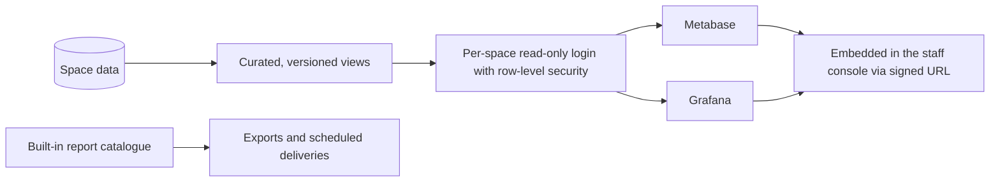
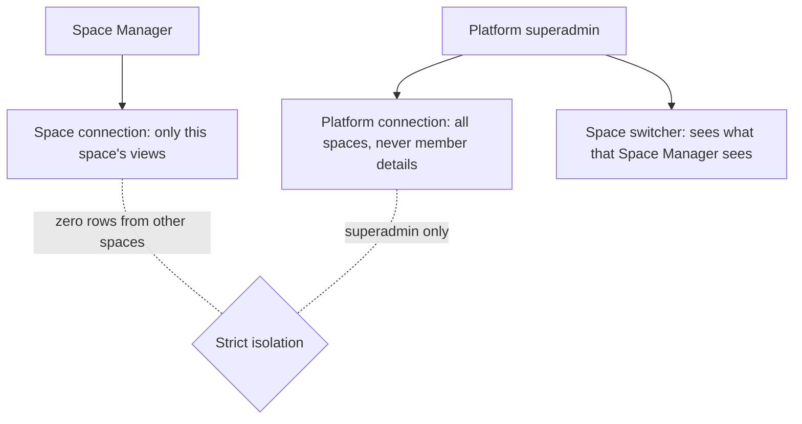

# Analytics and reports

There are two layers. **Reports** are built into the staff console: tables, charts and CSV or XLSX exports. **Analytics** adds your own dashboards in Metabase or Grafana, fed from a read-only login over curated database views.

## What it does and who uses it

| Who | What they do |
| --- | --- |
| Area manager | Reads reports for their own area only (an Inventory Manager sees inventory, a Machine Manager only their machine types). |
| Space Manager | Sees every report for the space, schedules deliveries, sets up the Metabase or Grafana connection and web telemetry. |
| Platform superadmin | Sees what any space's Space Manager sees through a space switcher, plus platform-wide pages and one platform Metabase or Grafana across all spaces. |

## Switching it on and off

- **`reports`** is a standalone area, deliberately not part of Inventory, so switching Inventory off does not take machine and event reports with it. Off means no report screens, exports or scheduled deliveries. A report whose source module or feature is off is hidden, not listed as disabled.
- **`analytics`** is a separate module, off by default, with no dependencies. Off means the Analytics tab and its routes answer 404 and the space's analytics views return no rows. The connection, dashboard list and database login are kept, so switching it on again restores them.
- Features: `reports.saved_views` (on), `reports.event_pdf`, `reports.event_exports`, `bookings.analytics`, `bookings.utilization_pdf`, `bookings.exports`, `membership.insights`.

## Key settings

- **Scheduled reports:** daily, weekly or monthly, to a notification destination or a list of emails, delivered as a short-lived private download link. A schedule can require non-empty rows or a metric threshold, and role recipients are resolved at send time.
- **Analytics login:** the Space Manager creates, rotates and revokes a per-space read-only database login. The password is shown once and stored only as ciphertext.
- **Member details in analytics:** off by default; names and emails appear only in the `members` view and only when the space turns it on.
- **Dashboards:** for Metabase, the site URL and embedding secret plus the dashboards to show. For Grafana, the URL, organization and a service-account token, with a downloadable provisioning bundle. A space picks Metabase, Grafana or both.
- **Web telemetry:** at most one page-analytics provider (Plausible, Umami, GA4, Firebase Analytics or PostHog), optional session replay (Clarity or PostHog, limited to the public about page), and optional diagnostics. Each stays off until configured and the visitor consents. See [web telemetry providers](../web-telemetry-providers.md).

## Main flows

**Isolation is strict.** A per-space login can read only that space's curated views, has no access to base tables, and returns nothing when analytics is off. Platform views and connections are superadmin-only. Per-space telemetry sends only that space's page events to that space's provider, and the platform provider is used only on platform pages. The views carry no secrets, tokens, evidence keys or contact fields, and each follows its area's switch, so a view for a switched-off area returns no rows. The view list is in [analytics views](../analytics-views.md).

## Money it can raise

None. The payments ledger view shows amounts only.

## Notifications it sends

Scheduled report deliveries, and credential and connection changes are audited rather than notified.

## Reports and analytics

The catalogue covers every module either with a substantive report or a gated row in an operational-health report. Every export carries provenance: who generated it, when, for which space, which version and filters. Setup guides: [Metabase](../metabase-setup.md) and [Grafana](../grafana-setup.md).

## Data kept and purged

Closed historical buckets are append-only, non-PII rollups; corrections add a revision. Purging `reports` deletes saved views, schedules and delivered files. Purging `analytics` or the space drops its database login.

## Decisions

- **Reports are standalone**, so one area's switch never kills another area's reports.
- **Every analytics tool works at both scopes** with equal features: per space and for the platform.
- **Strict isolation is tested**: no row from another space ever reaches a space's dashboard.
- **Grafana sits beside Metabase**, reusing the same login and views, rather than a second data path.
- **Hosting limits apply**: if the database cannot create roles, the console says analytics is unavailable and nothing else is affected.
