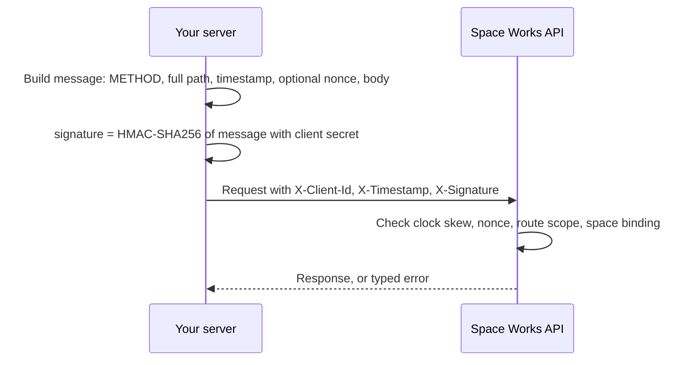
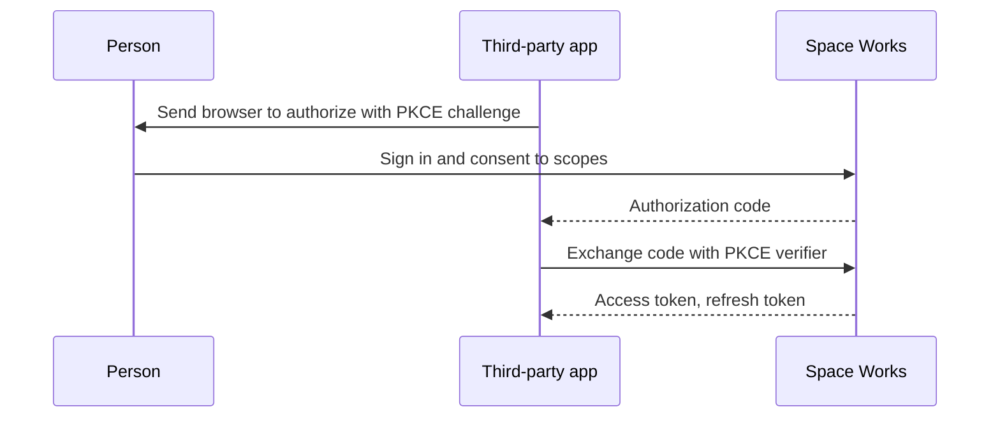

# API clients and integrations

Space Works has a documented HTTP API. Four kinds of credential let other systems use it, and none can do more than its owner may do at that moment. The interactive reference is on every deployment at `/docs/` (Swagger), `/redoc/` and `/schema/`. See the [API guide](../api-guide.md) and the exact [signing protocol](../api-client-protocol.md).

## What it does and who uses it

| You are | Use | Acts as |
| --- | --- | --- |
| A backend of your own (ERP, script, sync job) | **API client** (signed server client) | The client, on public routes and signed reads |
| Another space's backend reading your public data | **API client of type "Another space"** (peer) | The client, read-only: public catalogue, events and stats |
| A person automating their own work | **Personal access token** | That person, within the token's scopes |
| A third-party app that people sign in to | **App connection** (OAuth 2.0 and OIDC) | Each person who connects it, within the consented scopes |

Space Managers create clients and app connections for their space; a superadmin can do so for any space and alone may grant operator-only scopes.

## Switching it on and off

There is no module switch: nothing is issued until someone creates it. API-client issuance sits with the notification group in the module console. A client bound to a space can reach only that space's routes, so a switched-off module's routes answer 404 to clients as well as to people.

## Key settings

- **Client type and scopes.** The public vocabulary is `public:read`, `public:write`, `public:*` and `legacy:v1`, plus per-area scopes such as `public:catalogue:read`. Space staff may grant exactly `public:read` and `public:write`; wildcards and `legacy:v1` need a superadmin. A peer client may hold only catalogue, events and stats read scopes, and reaches only GET and HEAD routes.
- **Secrets.** Shown once. Rotating keeps the old secret working for 24 hours; revoking stops it at once and keeps history.
- **Personal access tokens** (`/account/api-access`): a name, scopes and an expiry (90 days by default, at most a year). Shown once, stored as a digest, with last use shown. Creating one needs a fresh sign-in check. Scopes: `account:read` and `account:write`, public scopes, and `staff:read` and `staff:write` for one space where the person holds a staff role.
- **App connections:** a name, HTTPS redirect URIs, confidential or public type, and allowed scopes. The flow is authorization code with required PKCE.

## Main flows

Credential shapes for the public API: a **signed server client** (`X-Client-Id`, `X-Timestamp`, `X-Signature`, optional `X-Nonce`), a **browser client** (client ID plus a registered origin, identified but never trusted for higher rate limits), and a **publishable key** scoped to one space's public site. An unregistered route is denied before any wildcard is considered, and `legacy:v1` is frozen to the routes it covered at cutover. Outbound events use the signed `webhook` channel described under [Notifications and messaging](notifications-and-messaging.md).

**Limits.** Tokens and app connections never reach sign-in, passkeys, credential and security settings, API clients, backups, superadmin routes or `/control/`, and never read payee or payout money.

## Money it can raise

None.

## Notifications it sends

Key-request decisions and invitations from the client console. Credential changes are audited.

## Reports and analytics

Per-client usage and telemetry, and the enforcement report of grants outside the vocabulary. Every grant, rotation and revoke is in the audit log.

## Data kept and purged

Revoking keeps history; deleting removes the client. Personal tokens are stored only as digests, and secrets only as ciphertext or once-shown values.

## Decisions

- **Scopes are per route from a frozen registry**, so a new route is never silently reachable by an old wildcard.
- **Credentials never exceed their owner.** Every request replays the person's live permissions.
- **Mobile apps get backend support only**, through app connections and native sessions.
- **Peer clients are read-only and tenant-bound**, enforced at grant time and on every request.
- **Retired scopes confer nothing.** Old admin and report scopes are rejected and never auto-converted.
