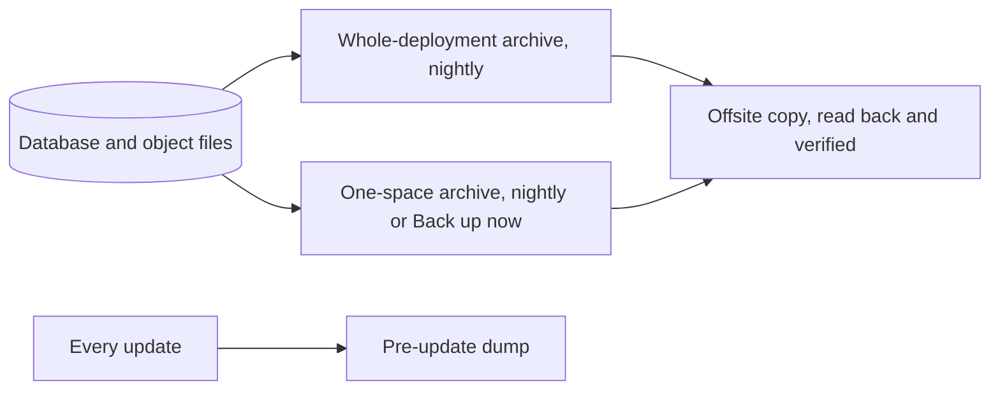
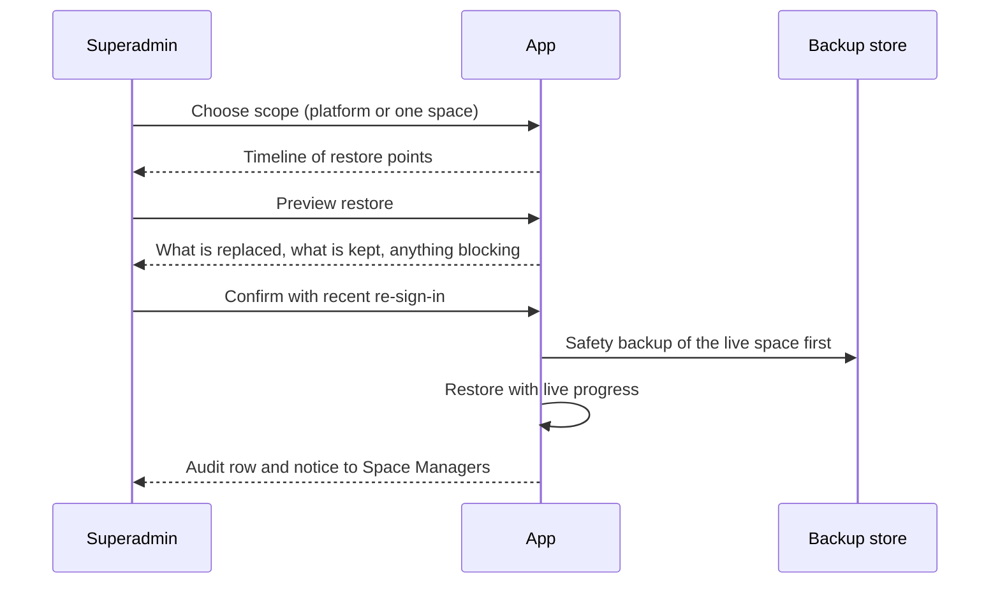

# Backup and migration

Backup and restore are platform duties, not a module: there is no switch and the old `backup` module key was retired. This page is the summary; the step-by-step guide is [Backup and restore](../backup-and-restore.md), and server procedures are in [Self-hosting](../self-hosting.md).

## What it does and who uses it

| Who | What they do |
| --- | --- |
| Platform superadmin | Takes and restores whole-deployment and per-space backups, manages offsite destinations, runs drills. Everything is available in the web console and in `/control/`. |
| Space Manager | Sees a read-only "Last backup" line and uses data export for their own copy. |
| Operator with host access | Runs the disaster restore scripts and key rotation on the server. |

## Switching it on and off

It is always on. Nightly archives run automatically; offsite destinations are optional and you add them under Backup and restore, Offsite copies.

## Key settings

- **Backup settings:** retention (nightly archives keep 7 daily and 4 weekly copies; on-demand archives keep a configured number of days).
- **Offsite destinations:** any S3-compatible bucket you own (R2, B2, S3, Supabase Storage, MinIO elsewhere). Space Works uploads the encrypted archive, reads it back and checks size and checksum before it counts, and re-checks verified copies every 30 days. The newest verified copy is never pruned.
- **Keys:** the platform key opens whole-deployment archives and must stay off the server. Keep an independent copy of your `.env` off the server too.

## Main flows

**Offsite safety.** Adding and testing a destination needs no extra proof, but pushing now, rotating credentials, retiring a destination, renaming or changing its retention, and rehydrating an archive all require you to have signed in again within the last ten minutes. Each step is audited.

**Restore choices.**

| Situation | What to use |
| --- | --- |
| One space damaged or edited by mistake | Restore one space in the app, with a preview first |
| Server or database lost | Disaster restore from a whole-deployment archive (bundled or outside database) |
| An update went wrong | Roll back to the pre-update dump and deploy that release; the updater refuses a downgrade |
| Moving one space to another server | Tenant export and import |

A one-space restore rolls the space back to the archive except what is append-only: the live audit history, payments, settlements, refunds and charges recorded after the restore point, and evidence photos newer than the archive are kept and flagged. Other spaces are never changed. Anything that would be left dangling blocks the restore until resolved. Accounts are never resurrected once deleted.

**Tenant migration and export.** A space can be exported on one server and imported on another as a portable archive, with a preview and checks before anything is written. Platform-level settings (request-rate overrides, the hosting switch, each space's hosting type and wallet signing credentials) never travel and are re-entered on the target. Secrets for integrations are never in an export. Members can also export their own data, and whole-account deletion is covered in [account deletion](../privacy-account-deletion.md).

## Money it can raise

None. Pending payments travel in a portable dump, but a payment with a live online checkout blocks the dump, and a dump is refused if money was settled after it was frozen.

## Notifications it sends

A restore outcome (completed or failed) is emailed to the space's Space Managers and shown as a console notice.

## Reports and analytics

Backup status, last verified copy and restore drills show on the platform health cards. Every backup, restore and destination change is in the audit log.

## Data kept and purged

Backups hold the database, object files, encrypted fields as stored and the immutability triggers, but not your `.env`, the platform key, files you mounted yourself or expired evidence photo bytes. Evidence records, remarks, scans and the audit trail remain. A space purge is a separate, deliberate superadmin action.

## Decisions

- **Backup is a platform duty with no switch**, and the superadmin platform key always unlocks every space's backup.
- **A safety backup always precedes a restore**, and the restore refuses if it fails.
- **Per-space and whole-deployment restore share one flow**, including restoring one space from a whole-deployment archive.
- **Append-only records are never rolled back.** Audit, money and evidence are kept and flagged instead.
- **Destructive offsite actions need a recent sign-in.**
- **Restore drills use a throwaway server identity** and never touch live data or keys.
