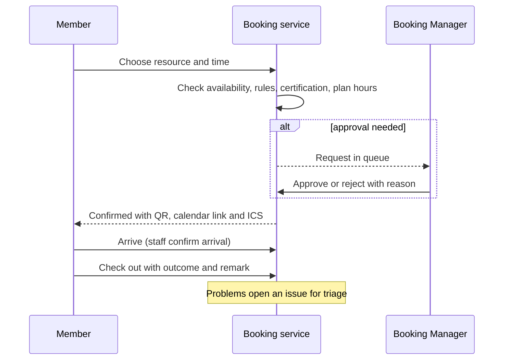

# Bookings

Bookings lets people reserve a room, a bench or a machine's time slot. It works for signed-in accounts without needing Membership, and an existing membership waiver is still honoured.

## What it does and who uses it

| Who | What they do |
| --- | --- |
| Member or account | Books a resource, sees confirmation details, gets reminders, checks out, reports a problem. |
| Booking Manager | Manages resources, rules, prices, the Requests queue, check-in and room maintenance. Sees only booking money. |
| Resource staff grant holder | A member account with delegated rights on one resource: editing details, managing reservations, check-in or releasing the page. |
| Space Manager | Everything, including pricing defaults and organization hours. |

## Switching it on and off

Switch the `bookings` module per space. Off removes the booking pages, availability, API routes, reminders and booking reports; reservations are kept. Features are separate switches: `bookings.recurring`, `bookings.staff_grants`, `bookings.clone`, `bookings.staff_tools`, `bookings.confirmations`, `bookings.checkin`, `bookings.passes`, `bookings.organization_bookings`, `bookings.website`, `bookings.embed`, `bookings.api_read`, `bookings.broadcasts`, `bookings.analytics`, `bookings.utilization_pdf`, `bookings.exports`, `bookings.room_maintenance`, `bookings.room_repairs`, `bookings.issue_reporting` and `bookings.calendar_feed` (on). Room outages block bookings only while `bookings.room_maintenance` is on.

## Key settings

- Per resource: opening hours, rules, prices (per booking, per hour or per day with a cap), approval required, public availability display, cut-off and cancellation rules, a link to machine types and required certifications.
- Space defaults for pricing, plus a refund policy: staff-cancelled bookings refund in full; a member cancellation follows the space's refund policy.
- Public resource pages with rules, amenities, FAQs and a gallery (up to twelve public photos) through `bookings.website`; embedding from exact approved origins only.
- A **house booking** lets staff reserve a room for a space-run event with no member booker, no charge and no plan hours used.

## Main flows

**Availability** comes from one place: resource hours minus existing reservations, room outages (while room maintenance is on), and machine repair windows. A pending event booking holds its slot tentatively.

**Included hours.** A membership plan can include booking and machine hours per term. Each booking draws them down through an insert-only ledger before any price is applied; a rejection or an in-policy cancellation puts them back. Without Membership there are no plans, so nothing is included.

**Organization bookings.** With `bookings.organization_bookings`, staff book a space for an organization's partner event, made for the organization's contact member. Each organization can hold a per-space **hours bank**: an allowance plus an append-only ledger of grants, adjustments, consumption and releases. The balance is derived, not stored, per period (all time, month or year). Organization bookings draw from the bank before any charge; manual adjustments need a reason and cannot go below zero. Organization admins see the bank read-only on their organization page.

## Money it can raise

`charges.bookings` records a charge when a paid booking is confirmed. Price is frozen at approval. Online payment is `payments.bookings`; otherwise staff record a receipt. See [Payments](payments.md).

## Notifications it sends

Booking confirmation, reminders (also to account-only bookers), approval or rejection, cancellation and restoration, check-in prompts, campaign emails from `bookings.broadcasts`, and issue and maintenance notices to the Booking Manager. Alerts for a room's grant holders follow the same rule as named people: admitted only if they can see that room.

## Reports and analytics

Resource calendar occupancy, utilisation PDF for a period, reservation exports with contacts and answers (managers with audit authority only), room maintenance and repair spend, and booking income and spending. Arrival is counted, never measured as time used.

## Data kept and purged

Switching off keeps reservations and history. A Bookings purge removes reservations, arrival and departure history, campaign history, galleries, staff grants and the included-hours ledger; the payment ledger stays. Organization hours rows are purged with Bookings.

## Decisions

- **Bookings never needs Membership.** Any active account can book; waivers still apply to existing members.
- **Included hours are an insert-only ledger**, so a refund or restore can always be reversed exactly.
- **Organization hours are a bank with a ledger**, never a stored counter.
- **Room outages are a feature, not a core rule**: they block or warn only while room maintenance is on.
- **Public pages show a neutral "Unavailable" for outages** and never repair detail.
- **House bookings** let a space run its own events without inventing a booker or a charge.

## Monthly booking quota

The superadmin can cap how many bookings a space creates per month (`bookings_monthly`, default none). Member, staff and organization bookings all count, and a cancelled booking still counts for that month. The next create answers 409 `booking_quota_reached`; existing bookings are never touched.
