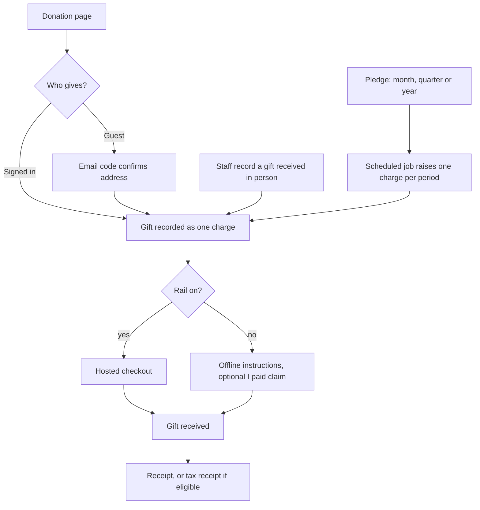

# Donations and sponsors

Donations lets a space take gifts and sponsorship. It has no module key of its own. It is a set of four optional features on the core money ledger, so it works with or without online payments.

## What it does and who uses it

| Who | What they do |
| --- | --- |
| Donor | Gives one-off or on a schedule from the public donation page, signed in or as a guest confirmed by an emailed code. A guest gets a private status link and never sees anyone else's gift. |
| Sponsor | Has a public name, tier, logo and website, and a private contact. Appears on the sponsor wall if the space opts in. |
| Fundraising role | A combinable role that holds only the donations authority: gifts, campaigns, pledges, sponsors, donation refunds and donation reports. It never sees other areas' money. |
| Space Manager | Holds the same authority, and sets the non-profit profile. |

## Switching it on and off

All four switches are off by default, and a space can use any of them:

- `finance.donations`: the donation page, campaigns and funds, one-off gifts, desk gifts and receipts.
- `finance.recurring_donations`: pledges that raise one charge per month, quarter or year (needs donations).
- `finance.tax_exempt_receipts`: tax-exempt receipts such as India 80G (needs donations).
- `finance.sponsors`: sponsors, tiers, perk checklists, sponsorship charges and the sponsor wall.

`charges.donations` (on) records every gift and sponsor payment as a charge; `payments.donations` adds the online rail and needs the Payments module. Switching a feature off hides its screens and routes and stops its jobs; gifts, pledges and sponsors are kept and their charges stay in the ledger.

## Key settings

- **Non-profit profile:** a flag, legal name, registration number, a list of tax exemptions with validity dates (schemes include India 80G and 12A, US 501(c)(3), UK charity, Canadian charity, Australian DGR, or other), signatory name and footer text. Tax receipts need the profile on and a deductible scheme valid on the receipt date; India 12A alone unlocks no tax receipt.
- **Donation page:** intro, suggested amounts, minimum, campaigns and funds with goals and windows.
- **Donor privacy:** donors are anonymous unless they opt in to be named. An 80G receipt asks for the donor's PAN, which is always encrypted, shown only as its last four characters and never part of a report.
- **Sponsor wall:** opt-in, on the public pages and on an event page.

## Main flows

A missed or paused pledge period is skipped, never back-charged, and no card is ever stored: the giver pays each charge like any other.

## Money it can raise

Gifts, pledge periods and sponsorship payments are income in the ledger's donations area. Giving one back is a refund case that staff open and decide; direct refund routes refuse donation charges. See [Payments](payments.md).

## Notifications it sends

Gift received and receipt, pledge reminders, payment claims, and a staff notice when a sponsor perk is due within a week.

## Reports and analytics

Campaign progress, pledges (active, missed, paused, cancelled), sponsor perks due or fulfilled, and the donations money area. None of them shows a donor's name, contact or PAN. The staff Donations tab also exports a CSV, which is audited.

## Data kept and purged

Switching off keeps gifts, pledges and sponsors. Their charges stay in the ledger and are never purged. A purge of a feature removes its own records only.

## Decisions

- **Donations are features, not a module.** They ride on the permanent ledger so a donor's history never depends on a module being installed.
- **Delegation is a role.** The Fundraising role exists so a volunteer can run fundraising without any other financial access.
- **Receipts follow the profile.** Without a non-profit profile and a deductible scheme, the receipt says it is not a tax receipt.
- **Donors are anonymous by default**; recognition is an opt-in.
- **Recurring means one charge per period**, not stored card payments.
