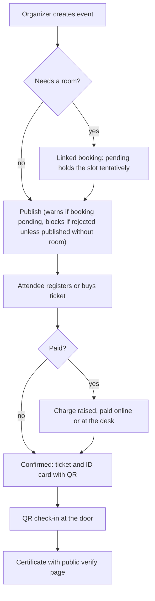
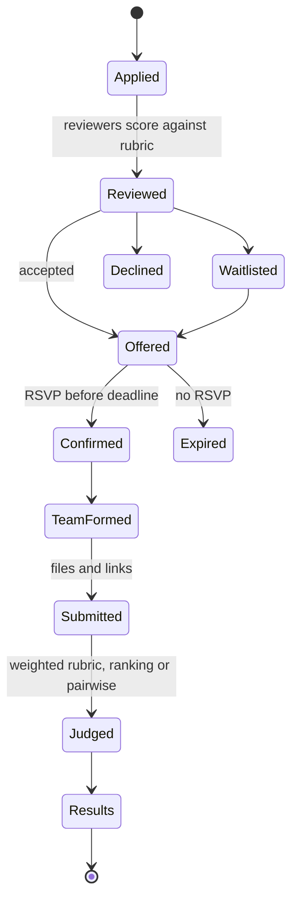

# Events

Events lets a space run workshops, open nights, classes, meetups and hackathons: publish them, take registrations (free or paid), check people in and give them certificates. Hackathons and the volunteer and mentor tools are features inside Events, not a separate module.

## What it does and who uses it

| Who | What they do |
| --- | --- |
| Attendee | Registers, buys tickets, receives an ID card or ticket with a QR, checks in, gets a certificate. Sign-in is required; there is no guest RSVP. |
| Event Manager | Creates and runs events, tickets, add-ons, promo codes, check-in and broadcasts. |
| Co-organizer or organizer | Runs one event with event-scoped permissions, optionally limited to a track or time window. |
| Volunteer, mentor, judge, sponsor representative | Event-scoped roles held on a member account, not staff accounts. |
| Space Manager | Everything, including refund policy and venue fees. |

## Switching it on and off

Switch the `events` module on or off per space. Off hides event pages, registration, tickets, check-in and the public event feed; registrations, orders, snapshots and private files are kept. Every feature below is its own switch and is off by default unless noted. `event_reimbursements` is a second module that requires Events.

Feature groups:

- **Publishing:** `events.website`, `events.embed`, `events.short_links` (`/e/<code>`), `events.public_feed`, `events.calendar_feed` (on), `events.online_delivery`.
- **Registration and tickets:** `events.account_registration`, `events.invites`, `events.ticket_types`, `events.promo_codes`, `events.orders` with `events.seat_holds`, `events.addons`, `events.series_passes`, `events.transfers`; `events.desk_collect`, `events.refund_override`, `events.ticket_designs`.
- **Identity and check-in:** `events.id_cards`, `events.wallet_passes`, `events.offline_checkin`, `events.checkin_lists`, `events.attendance_confirmation`.
- **Guests:** `events.guest_passes` (needs `membership.guest_passes`).
- **Programmes:** `events.hackathons`, `events.applications`, `events.application_stages`, `events.mentoring`, `events.mentor_rounds`, `events.volunteering`, `events.crew`, `events.project_gallery`, `events.pairwise_judging`, `events.finalists`, `events.peoples_choice`, `events.prize_payouts`, `events.entry_fees`, `events.paid_teams`, `events.deposits`, `events.mentor_chat_alerts`, `events.submission_integrity`, `events.prize_claims`, `events.gallery_search`, `events.saved_views`, `events.accepted_addons`, `events.crew_claims`, `events.team_moderation`, `events.crew_kinds`, `events.scores_export`.
- **Venue:** `events.venue_fees`, plus a linked booking when Bookings is on.
- **Certificates:** `events.certificate_designer`, and reports `reports.event_pdf` and `reports.event_exports`.

Choosing Events during setup does not silently enable hackathons, mentoring, rounds, volunteering or the gallery.

## Key settings

- Audience per event: member, signed-in account or invitation; organizations can be an audience with `events.organization_audience`.
- Ticket types with public and member prices, sales windows and capacity.
- Refund policy per space: full refund up to a set time before, then a percentage, then none, with an optional cancellation fee. An event may override it only to be more generous.
- Waiver rules for non-members before they are on site (a Space Manager setting, required by default).
- Minors: `membership.minors` records people under the age of majority and requires a guardian's e-signed consent before registration, check-in or other steps, as the space's minors settings decide.
- Saved details: a member's answers can be saved to their own account and pre-fill later forms; sensitive fields are saved only if the member opts in.

## Main flows

**Hackathons** support solo, team or team-finder admission as the organizer chooses, rolling or batch decisions with staged private results, waitlist and overbooking, blind review, custom submission stages, uploads and links (including hardware file formats with in-browser previews for 3D and Gerber), judging with a weighted rubric or top-three ranking, and a public gallery that shows only what teams mark public. KiCad files are download-only. Submission files are removed 365 days after results while records and hashes stay.

**Guest passes** are dated permits on an existing account, never memberships: event-linked passes for non-member registrants, member-sponsored passes and a paid day pass. Borrowing and machine use by guests are per-space choices. **Volunteers** post shifts and verified hours that can count as membership credit. **Reimbursements** let crew or participants claim expenses; payouts are only recorded, never sent automatically.

## Money it can raise

`charges.events` records every registration, ticket, add-on order, venue fee, entry fee, paid team and deposit as a charge. Online payment is `payments.events`; desk collection records a receipt. Every refund is a staff-approved case, and cancelling a space-run event opens a refund due for the full amount. Hackathon prizes, payouts and reimbursements are money out and are recorded only. See [Payments](payments.md).

## Notifications it sends

Registration and booking confirmations (with an `.ics` invite and optionally the ticket PDF), reminders, "are you still coming" prompts, application decisions, broadcasts (with a short undo hold), mentor alerts in team chat, shift notices, and refund updates.

## Reports and analytics

Event analytics in the drawer, an optional post-event PDF, registration and feedback exports, funnel and attendance reports, lending and guest-pass views per event. Co-organizers get their own event's analytics.

## Data kept and purged

Switching off keeps everything. An explicit Events purge deletes events, orders, seats, dues, holds and programme data and queues private-file deletion; payment ledger rows stay because they are permanently core.

## Decisions

- **Hackathons live inside Events** with their own opt-in switches, so a plain event space carries none of that weight.
- **Sign-in is required to register.** Guest RSVP was declined; non-members attend under a guest pass.
- **Minors and guardian consent are supported** through a per-space setting; there is no hard-coded age limit.
- **Organizations host only through a space they own.**
- **Money out is never automatic.** Prizes, reimbursements and payouts are recorded by a person.
- **An event link to a room booking never silently acts.** Moving or cancelling an event offers to change the booking and fee but does not do it for you.
- **Embeds use one route only**, with an exact-origin allow-list.

## Monthly event quota

The superadmin can cap how many events a space creates per month (`events_monthly`, default none). The next create answers 409 `event_quota_reached`; existing events are never touched.

## Registration lifecycle, series invites, check-in lists and saved views

- **Delete a draft.** Only a draft with no registrations, ticket orders or charges can be deleted (the cover image is freed and the delete is audited). Anything else is cancelled so its history stays.
- **Re-accept a declined guest.** A full event no longer refuses: the guest joins the end of the waitlist. A paid place goes back through the charge and payment-link path.
- **24-hour payment window** (switch `events.pay_window`, off by default). A paid place that staff approve, promote or re-accept is held for 24 hours. If the charge is still unpaid the place is released, the unpaid charge is voided through the payments service (the ledger row stays) and the next waitlisted person is offered it. A payment that arrives first simply ends the window.
- **Refund can cancel tickets** (switch `events.refund_cancels_tickets`, needs `events.orders`). When staff approve a refund on a ticket order or a paid registration they can tick "cancel the tickets". The refund is exactly what they approved (a price below the currency's smallest unit is still refused); afterwards every live seat of that order is voided and its registration cancelled, the waitlist moves and attendees are told. It runs after the approval commits; if it fails the refund stands and the failure is audited so tickets can be cancelled by hand. Repeating it changes nothing.
- **Staff expense claims** (switch `events.staff_claims`, needs Event reimbursements). Staff file a travel claim for themselves or for a speaker or volunteer (their registration). It is funded from the event's pools like a crew claim (the crew pool when there is one) and is refused if the pool cannot cover it. Finance then decides it and the payee accepts and claims as for any award. Who filed it is in the audit log.
- **Money and Spending in the event PDF; orders CSV.** The post-event PDF adds Money (income, refunds, other income, net) and Spending (expenses, payouts, budget, budget left) sections, per currency, only when the space tracks or takes event payments and the viewer sees event finance. The orders CSV (one row per ticket order, buyer name and email included) needs `events.orders` and counts against the monthly report-export limit. A series page shows a money card for the same viewers.
- **Series invite lists** (switch `events.series_invites`, needs `events.invites`). Allow chosen emails to register for every occurrence of an invite-only series, including ones added later. Entries are never used up and can be removed; the list keeps only a digest of each email. Limit key `series_invites`.
- **Check-in lists** (ride `events.checkin_lists`). Lists can be reordered, archived and restored. A collection can be undone within 60 seconds (the record stays, marked undone). A waitlisted guest can collect only with an explicit override, a lapsed guardian consent stops a minor, and each list shows how many guests are eligible and how many collected. The guest list can filter by "collected" or "not collected" per list and its CSV gains a `Check-in: <list>` column per open list. Limit key `checkin_lists` (per event).
- **Guest list filters and presets.** Filter by attendance reply (yes, no, waiting, not asked); ready-made presets show server counts.
- **Saved views for one event** (switch `events.event_saved_views`, needs `events.saved_views`). A view saved on one event's guest list shows only for that event and can be renamed. Limit key `saved_views` (per person and list).

## Event badges (designer, roles, desk printing)

Three switches, all **on by default** once Events and *Event ID cards* are on: `events.badge_designer`, `events.badge_desk_print` and `events.role_badges`. Off means no screen, a 404 from the API and no roster badge data; designs are kept.

- **Badge designer.** Each event's badge is designed in the same way as in SpaceWorks-Events: Classic, Bold or Minimal; stock presets A6, 4 x 6, 6 x 4, 3 x 4, 4 x 3 and CR80 (portrait or landscape, or a custom size of 40-300 mm); a heading, a label and a footer (`{{team}}` fills the team name); email, organisation logo, event logo, Space Works symbol, photo and up to 6 sponsor logos on or off; up to 8 registration answers, chosen, reordered and relabelled; long names shrink to stay on one line; every item can be moved and resized in millimetres. The design is stored as `badge_v1` settings on the event card design and compiled to ordinary card layers on every save, so approval, history, sheets, wallet passes, e-mail and verification work unchanged. A badge design is edited only in the badge designer; **Convert to free canvas** turns it into an ordinary card design you can edit layer by layer (one way, audited).
- **Check-in QR.** Badges carry the registration's current check-in code (the `checkin_qr` layer, event cards only). Printing a badge never rotates the code; rotating stays an explicit staff action. With no live code the slot prints a placeholder.
- **Design files.** Export writes a `spaceworks-event-badge` file. Import also accepts SpaceWorks-Events design files (`swe-id-card-design`, `yuyu-id-card-design`) exactly as written; settings SpaceWorks does not use are dropped and listed.
- **Role badges.** Crew, volunteer, speaker, mentor, judge and organiser can each have their own badge design. A role without one prints the attendee badge. Resolution tries the role's design at each step (ticket type, event, organisation library, space default) before falling back.
- **Role detection.** A card's role is worked out when it is issued and every time the event reconciles: an approved co-organiser or crew of kind organiser is an organiser, then a judge, mentor or volunteer contributor, then crew (a crew kind of volunteer, mentor or judge keeps that role), then a speaker, otherwise an attendee. A role you set by hand locks the card (audited as "Event card role set by hand") until you release the lock. With `events.role_badges` off only crew, mentor and speaker are told apart.
- **What a badge carries.** The email only when the design prints it; registration answers only when the design prints that exact answer and the question is not sensitive; the crew kind ("Volunteer · Door"); sponsor logos; and the check-in QR. A badge never contains more than the design prints, on screen, in the offline roster or at the station.
- **Desk, station and offline printing** (`events.badge_desk_print`). The check-in desk and the PIN station print the saved badge the moment someone is checked in. The offline roster carries each person's badge data, v2-credential holders and the published badge per role with the logos, so a desk keeps printing with the network down. Every print is reported as an append-only receipt (desk, station, offline or bulk; idempotent; audited without names). Limit key `event_badge_prints_monthly` (default none): it refuses only starting an online print or a bulk job; offline prints are never blocked and count when they sync.
- **Bulk badges.** Print by audience (confirmed, attendees without crew, crew, a role, checked in, not yet checked in, all) as A4 or Letter sheets with crop marks, or one card per page for card and label printers. "All" also lists waitlisted and pending people as provisional badges at the desk (no verify QR).
- **How the desk prints (UI).** After a check-in the badge is drawn in the browser (QR generated locally from the check-in payload, logos as data URLs) and printed through a shared print shell (`frontend/src/components/card-print/`): a window whose `@page` is the stock size with no margin, waiting up to 2 seconds for images and fonts. Receipts are sent at once when online; offline they wait in the encrypted check-in store and travel with the next sync (`badge_receipts`). A desk can switch to a check-in list with `?list=<id>`; a scan then collects from that list. Without the switch the older PDF flow remains.
- **Designed tickets.** Ticket designs can place the date, time, venue, price, order and team. Once the holder has checked in, the designed ticket is withdrawn (410 `ticket_used`), like the live tear-off.
- **Old desk badge.** The certificate-layer desk badge stays read-only for one release and is removed in 0.13.

### Badge designer

Under **Cards and tickets**, **Card design**, the event's badge opens in the badge designer while `events.badge_designer` is on (off: the free-canvas card designer, as before).

- **Role tabs.** Attendee always; with `events.role_badges` on, also crew, volunteer, speaker, mentor, judge and organiser. A role uses the attendee badge until it is given its own design, a copy of the attendee badge with the role's label.
- **Autosave and offline copy.** Every change saves 800 ms later against the design's revision. The status reads Saved, Unsaved changes, Saving…, Saved on this device only or Not saved. Offline, the design is kept in the browser and saved when the connection returns; it is offered back on reopen. If someone else saved first, the organiser loads their version or keeps their own.
- **What you can set.** Style, colour (colour or black and white), paper (presets, Turn, custom size), heading, label and footer, logos, shown items, up to 8 registration answers, a text watermark (up to 32 characters, strength 4-30 %, accent or text colour, angle), and each item's position, size, text size and bold. The preview is drawn from the same layers the server prints.
- **Import and export.** Export writes the current settings, unsaved edits included, as a `spaceworks-event-badge` file. Import checks the file in the browser, then the server normalises it and lists anything dropped; answers this event's form lacks can be removed in one step.
- **Convert to free canvas.** Confirmed, one way and audited. Afterwards the badge opens in the card designer; **Start a badge designer design instead** replaces that draft with a fresh badge.

## Content, drafts, analytics and discovery

- **Covers are stored as WebP.** An event or series cover is decoded, turned upright, capped at 2048 px and re-encoded as WebP with all metadata (camera, location, colour profile) removed. The uploaded original is deleted and storage is charged for the stored copy.
- **Richer broadcasts.** The message supports `#` headings, `>` quotes, `1.` numbered lists and `[text](https://...)` or `[text](mailto:...)` links on top of bold, italic and bullets. Raw HTML, images, other link types and links that look like credentials are refused; the plain-text copy shows each link as `text (address)`.
- **Private drafts.** A broadcast draft belongs to the person who started it: nobody else (a superadmin included) can read, change or send it. Starting a new broadcast reopens your existing draft for that event; discard it with the delete action. Scheduled and sent broadcasts stay visible to event staff.
- **Event analytics** now show sign-ups per day (in the event's time zone), written-answer counts per open question (the text is never shown) and arrival windows that widen from 15 minutes up to 8 hours for long events.
- **Insights** (switch `events.space_insights`, on by default). A space with `manage_events`, and an organisation's governors for its hosted events, see the top events of the last 180 days by attendance and the share of returning attendees. Events or groups under 10 people are left out.
- **Discovery filters** (switch `events.discovery_filters`, on by default). Public discovery can be narrowed by `tag` and by `organization` (slug), and search also finds tags and the names of organisations whose public profile is on. A space with the switch off is left out of a tag or organisation filter.
