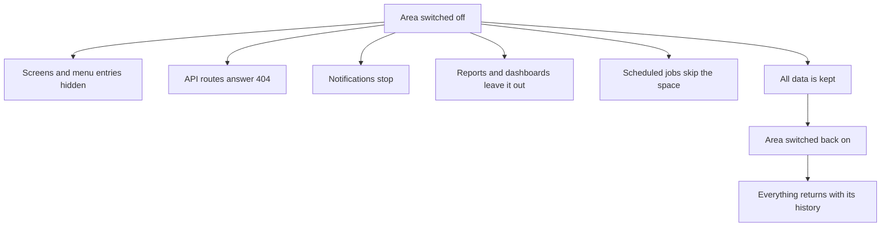

# Areas and modules overview

Space Works is one system that each makerspace shapes to its own needs. You switch **areas** and **modules** on or off per space, and a switched-off area disappears everywhere: its screens, its menu entries, its API routes, its notifications, its reports and its scheduled work. Nothing is deleted when you switch something off, and switching it back on restores it with its history.

## How switching works

| Level | What it is | Who changes it |
| --- | --- | --- |
| **Core** | The loan safety spine: catalogue, request workflow, staff console, QR, scanner and evidence photos. Always on. | Nobody |
| **Module** | A whole capability such as Events, Bookings, Shop or Payments. | Space Manager or the platform superadmin |
| **Feature** | A narrower switch inside a module, for example `events.ticket_types` or `machines.sessions`. Inert while its module is off. | Space Manager, or the module's manager if the Space Manager delegated that module's settings |

Ticking a feature in the platform console also ticks its parent module and the modules that module depends on, with a notice that says what was added. Unticking a module unticks its features and lists them. Nothing is ever re-ticked silently.

Setup asks about **areas** rather than individual module keys: Inventory, Machines, Events, Bookings, Membership, Online payments, Reports and Chat alerts. Inventory, Machines and Reports default to yes in setup, the others to no. See [choosing modules](../choosing-modules.md) and the full [module reference](../MODULES.md).

## Areas and modules at a glance

| Page | Area or module | What it gives you | Default for a new space |
| --- | --- | --- | --- |
| [Inventory](inventory.md) | Inventory (six core modules plus optional ones) | Loans, QR and boxes, evidence photos, returns, accountability, direct handouts, self-checkout, repairs, To-Buy | On. The area switch can turn it off; the safety records stay |
| [Machines](machines.md) | `machines`, `machine_service`, `printing` | Machine registry, job requests and queue, certifications, sessions, maintenance and repairs | Off (setup suggests yes) |
| [Events](events.md) | `events`, `event_reimbursements` | Events, tickets, guest passes, hackathons, volunteers, venue bookings, certificates, QR check-in | Off |
| [Bookings](bookings.md) | `bookings` | Rooms and spaces, availability, included hours, organization bookings | Off |
| [Shop](shop.md) | `shop` | Catalogue, stock, front-desk sales, online pickup orders | Off |
| [Memberships](memberships.md) | `membership`, `presence`, `member_accounts` | Plans, terms, renewals, join funnel, member dashboard, presence check-in | Member accounts on; membership and presence off |
| [Payments](payments.md) | `payments` plus the core money ledger | Online card rail; money owed is tracked even without it | Rail off; tracking on |
| [Donations](donations.md) | `finance.*` features (no module key) | Donation page, campaigns, sponsors, receipts | Off |
| [Analytics](analytics.md) | `reports`, `analytics` | Reports and exports, Metabase and Grafana per space and for the platform, web telemetry | Reports on in setup; analytics off |
| [Notifications and messaging](notifications-and-messaging.md) | `notifications`, `email`, `telegram`, `slack`, `mattermost`, `discord`, `webhook`, `sms`, `whatsapp`, `mobile` | Inbox, email, chat alerts, SMS, WhatsApp, push | Inbox and email installed by setup; chat, SMS, WhatsApp and push off |
| [Organizations](organizations.md) | Platform entity, not a module | Organization accounts, organization admins, organization bookings | Always present, idle until used |
| [Backup and migration](backup-and-migration.md) | Platform duty, not a module | Backups, offsite copies, restore, one-space move | Always on |
| [API clients](api-clients.md) | Platform feature | Signed clients, scopes, tokens, app connections | Nothing issued until you create it |
| [Platform](platform.md) | Superadmin console | Spaces, hosting type, plans, limits and rates | Always on |

## Decisions

- **Inventory is an area, not a permanent fixture.** It is on by default and can be switched off for a space that has no tools to lend, while its safety records stay installed.
- **Optional things stay optional.** Anything beyond the loan spine is off until someone turns it on, and a new feature is added under its natural parent rather than as another top-level module.
- **Off means off.** A switched-off layer is removed everywhere, not just hidden in one screen.
- **Retire rather than delete.** The old Maintenance and To-Buy modules became features under Inventory, Machines and Bookings, and existing spaces kept them switched on.
