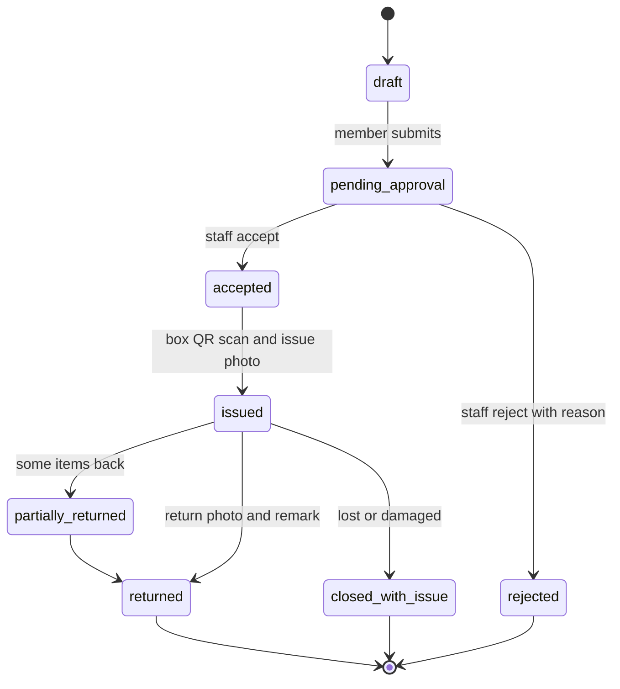
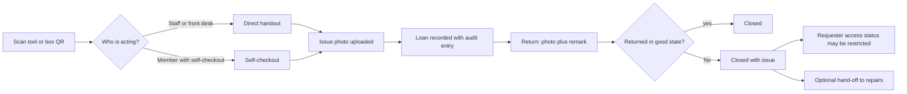

# Inventory

Inventory is the original purpose of Space Works: lending hardware with proof. Every handover produces evidence, meaning a QR scan, photos, remarks and an audit entry, so you can always say who had what, in what state, and when it came back.

## What it does and who uses it

| Who | What they do |
| --- | --- |
| Public visitor | Browses the public catalogue at `/m/<slug>/inventory`. Storage locations, box IDs, QR codes, scan history and requester history are never shown. |
| Member or signed-in account | Requests items, follows the request, renews, withdraws, and (when enabled) self-checks-out a tool by scanning its QR. |
| Inventory Manager | Runs the full hardware lifecycle: products, assets, stock, requests, returns, To-Buy, repairs and inventory finance. Cannot manage printing, staff or space settings. |
| Handover role (front desk) | Issues accepted requests, makes direct handouts and takes returns on a narrow counter console. Cannot accept or reject requests or edit inventory. |
| Space Manager | Everything, and the settings for all of the above. |

Core pieces that are always installed: the public catalogue, the request workflow, the staff console, QR management, the scanner and evidence uploads. Optional modules add asset units (individually tracked units), containers (shelf and box hierarchy), bulk import, stock transfers (including between spaces), QR print batches, stocktake and guest handover.

## Switching it on and off

- **The Inventory area switch** (`loans.enabled`, labelled Inventory) is on by default. Turned off, it hides every inventory surface: staff tabs, the public catalogue, member borrowing, self-checkout, the kiosk, inventory reports, dashboard tiles and related notifications. Data is kept and returns when you switch it on.
- **What never goes away.** Requests, handovers, evidence, QR records and accountability stay installed, because they are the evidence trail. They cannot be uninstalled.
- **Optional modules** (`asset_units`, `containers`, `bulk_import`, `stock_transfers`, `qr_print_batches`, `stocktake`, `guest_handover`) switch individually. A module that is off answers its API routes with 404, but existing records stay readable and a loan already issued can always be returned.
- **Features inside Inventory:** reservations, pickup windows, waitlist, withdrawals, renewals, borrowing limits, kit checklists, consumables, vendors, expected-back dates, `inventory.self_checkout` (on by default), `inventory.contact_self_checkout` and `inventory.kiosk` (off).

## Key settings

- **Loan policy:** default loan days (items and categories can override), renewal mode, maximum renewals and the extension length, borrowing limits (active loans and items), reminder offsets. See [loan policy](../loan-policy.md).
- **Who may request:** with Membership on, an active member; with it off, any signed-in account; with member accounts off, a borrower gives name, phone and an email confirmed by a one-time code.
- **Self-renewal for account-only borrowers** is a Space Manager setting, off by default.
- **Evidence retention:** an optional per-space policy that deletes stored photo bytes after a window while keeping the record, remarks, scans and audit trail.
- **Public visibility per item:** `is_public`, `show_public_count` and `public_availability_mode` (exact count, status only or hidden).
- **Pricing:** deposit, rental per loan or per day with a cap, late, damage and lost fees, set under Settings, Pricing, Inventory.

## Main flows

Hard rules that never bend: reviewed-request hardware cannot be issued without a box QR scan and an issue photo; a direct handout or self-checkout needs uploaded issue evidence and an eligible scanned tool; a return needs a photo and a remark; issued quantity cannot exceed accepted quantity without authorized workflow permission.

**Accountability.** A loss or damage ties back to the requester's access status. A restricted account can still see and pay its own charges, because paying is how the restriction is cleared, but borrowing and requests stay closed.

**Contextual lending.** A loan can be linked to an event, a specific booking or both, or stand alone. The link adds context only: cancelling the event or booking never silently returns issued items or erases the borrower trail. Event equipment gets time-window availability and a per-event return window.

**Repairs and To-Buy.** `inventory.issue_reporting` lets a borrower report a problem from their loan; `inventory.maintenance` and `inventory.repairs` add schedules, repair jobs and a shared technician directory; a damaged return can be handed off to repairs; `inventory.tobuy` records purchases as expenses and raises stock when marked bought.

## Money it can raise

Charge tracking for this area is `charges.loans`: deposits, rental, late, damage and lost fees. Per-day rental can be charged at checkout for the planned days (capped) or at return for the actual days. Staff can waive a fee with an audited reason. Damage and lost fees above zero need the return evidence photo. Kiosk and direct handouts are charged like reviewed loans. The online card rail (`payments.loans`) is optional; without it staff record cash or UPI with a receipt. See [Payments](payments.md).

## Notifications it sends

Request received, accepted, ready, issued, due soon, overdue and return confirmed, plus waitlist, maintenance reminders and repair updates. Each follows the member's channels and the space's notification matrix. See [Notifications and messaging](notifications-and-messaging.md).

## Reports and analytics

Inventory valuation, utilisation by category, overdue items by borrower, event-wise and booking-wise lending, repairs and technician workload, and income versus spending including To-Buy. Inventory managers see only inventory. See [Analytics](analytics.md).

## Data kept and purged

The core spine (requests, evidence rows, QR scans, audit) is never separately purgeable. Evidence rows are immutable and only disappear with a whole-space purge. Stock transfers, QR print batches and stocktake sessions are purgeable by the superadmin. Switching the area off deletes nothing.

## Decisions

- **Evidence is the product.** Photo records, remarks and scans are append-only; only the stored picture bytes may expire under the retention policy, and an expired photo reads as expired rather than broken.
- **Every presigned upload lands in a staging location.** The final object key is never writable by a client, so an accepted photo cannot be swapped afterwards.
- **Account-less borrowing exists only when member accounts are off.** Then everyone, including signed-in staff, uses the name, phone and email-code form, and self-checkout works the same way.
- **Area roles do not cross.** Event and Booking Managers get no lending authority; combine roles to give a person both.
- **Inventory can be switched off per space**, while the safety records stay.
- **The word "Lending" became "Inventory"** in the product; internal keys such as `loans.*` keep their old spelling so nothing breaks.
