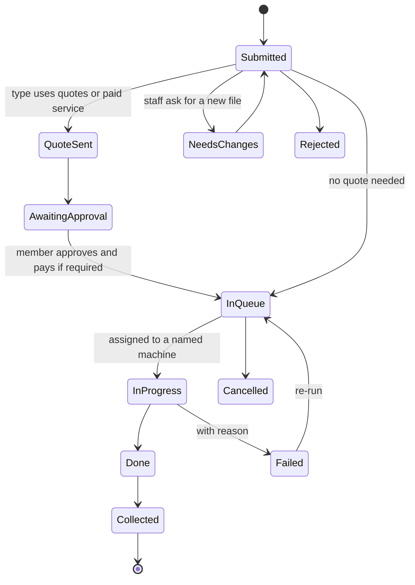
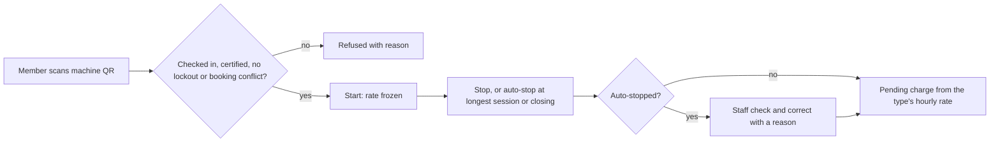

# Machines

Machines covers everything that is operated rather than borrowed: 3D printers, laser cutters, CNC routers, vinyl cutters, PCB mills and any other type you configure.

## What it does and who uses it

| Who | What they do |
| --- | --- |
| Member | Requests a job, follows its place in the queue, approves a quote, starts and stops a metered session, reports a problem. |
| Machine Manager | Runs the machine types they are linked to: queue board, quotes, certifications, sessions, maintenance. Scope is per person, by machine type and/or individual machine, and no link means no machines. |
| Technician | Sees and updates repair jobs assigned to them, and reads incidents on the machine types and machines they cover. |
| Certified instructor | Opens a supervised session for guests or members who are not yet certified. |
| Space Manager | Everything, and the rate card. |

Modules: `machines` (registry, operators, usage, documents), `machine_service` (job requests and consoles) and `printing` (the 3D print queue, a machine type under machines).

## Switching it on and off

Switch the Machines area, or the modules and features individually. With the area off the whole machine side disappears: registry, queue, maintenance, consumables and their reports. Records stay and return when switched on.

Main features, each its own switch: `machines.job_requests` and `machines.job_quotes` (on with the module), `machines.batch_start`, `machines.pay_before_pickup`, `machines.time_booking` (needs Bookings), `machines.sessions`, `machines.induction_events` (needs Events), `machines.supervised_sessions`, `machines.certifications`, `machines.certification_reminders`, `machines.maintenance`, `machines.repairs`, `machines.issue_reporting`, `machines.tobuy`, `machines.warranty`, `maintenance.meters`, `maintenance.reminders`, `maintenance.calendar_feed`, and `safety.incidents` for a space-level incident register.

## Key settings

- **Machine types** with their accepted file formats, whether they take quotes or prepayment, hourly rate, minimum and longest session (default four hours), and whether certification is required.
- **Consumable pools** scoped to one machine or one machine type, with an optional public colour and material name.
- **Certification types** per machine type with a validity period. Expiry is enforced at the stored instant with no grace.
- **Failure outcome per type.** A space-fault job re-runs free at the front of the queue; a member-fault job follows the type's failure charge, and failed jobs are free by default.

## Main flows

Every machine type shares one **Request a job** flow: pick a type, upload files in an accepted format, add material and notes, and confirm pickup and failure terms. Members must be signed in; there are no guest submissions. The member sees a timestamped timeline, a live "#N in queue" position, "You're next" and an estimated finish. The estimate simulates the queue across compatible machines in parallel, rounds up, labels itself an estimate, and says so when jobs ahead have no estimate.

**Certifications** are training evidence: a type is deactivated rather than deleted, and a grant is revoked rather than edited. An uncertified member is refused when requesting work or booking a linked space; an audited override needs authority over the whole machine type and a stated reason. An event can be marked an **induction** so staff grant certifications to attendees in one step. **Supervised sessions** let a certified instructor take an uncertified person onto a machine.

**Maintenance and repairs.** Schedules (by date or by usage meters), logs, documents, overdue lists and a calendar feed. A reported problem becomes a repair job. A technician is either a staff member with the Technician role or an outside contractor with contact details and no account. Staff pick which technicians to notify, each send is recorded, and the system only notifies: visits, fixes, parts, quotes and payouts are recorded by staff. Machine Managers can act as the technician on their own types.

## Money it can raise

`charges.machines` records a charge when a priced job completes or a metered session stops: by machine time, per job or by material used. Quotes and prepayment apply only when the type uses them. Cancelling a running job records the material used so far as a cost with no charge to the member. Online payment is `payments.machines`; otherwise staff mark the charge paid with a receipt. See [Payments](payments.md).

## Notifications it sends

Queue changes, "You're next", "Ready to collect", quote sent, certification expiring (members and a counts-only staff digest), maintenance due and overdue, repair assignment, and a closing notice to the reporter when a repair is fixed.

## Reports and analytics

Machine jobs register, sessions by member and machine, utilisation, busiest days and hours, idle machines, flagged sessions, certification coverage and holders, fab lab health, printer-service money, repairs and technician workload, and machine income versus spending by type. A Machine Manager sees only their own types.

## Data kept and purged

Machine rows host warranty, consumables and service history, so they are not purged piecemeal; purge the service queue first, then archive and purge the space. Sessions and their corrections are purged with the sessions feature. Finalized consumable costs go with their service sources.

## Decisions

- **One uniform job flow for every machine type.** The 3D-printer form moved onto it and its old links still work.
- **A visible lifecycle for every job**, including needs-changes, rejected, failed and cancelled states, with every step audited.
- **Machine scope is per person** for Machine Manager and Technician, by machine type and/or individual machine (new in 0.12.0).
- **Metered sessions are optional** and bill only when machine charging is on; prepaid credits and a wallet were considered and declined.
- **Printer and device integrations are not built yet.** Only the server-side foundation exists, off by default.
- **Technician requests are notify-only.** Money is never sent automatically; payouts are recorded as repair expenses once approved.
