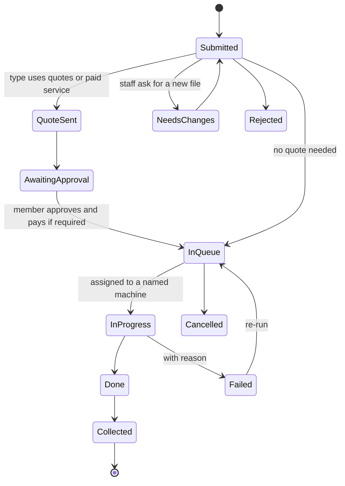
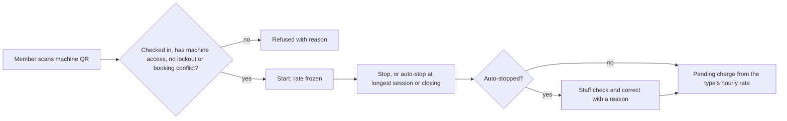

# Machines

Machines covers everything that is operated rather than borrowed: 3D printers, laser cutters, CNC routers, vinyl cutters, PCB mills and any other type you configure.

## What it does and who uses it

| Who | What they do |
| --- | --- |
| Member | Requests a job, follows its place in the queue, approves a quote, starts and stops a metered session, reports a problem. |
| Machine Manager | Runs the machine types they are linked to: queue board, quotes, machine access, sessions, maintenance. Scope is per person, by machine type and/or individual machine, and no link means no machines. |
| Technician | Sees and updates repair jobs assigned to them, and reads incidents on the machine types and machines they cover. |
| Instructor | Opens a supervised session for guests or members who have no machine access yet. |
| Space Manager | Everything, and the rate card. |

Modules: `machines` (registry, operators, usage, documents) and `machine_service` (job requests and consoles for every machine type: 3D printers, lasers, CNC, cutters). The 3D print queue is one machine type inside Machine service; the separate `printing` module was retired in 0.12.0 and a space that had it keeps Machine service on.

## Switching it on and off

Switch the Machines area, or the modules and features individually. With the area off the whole machine side disappears: registry, queue, maintenance, consumables and their reports. Records stay and return when switched on.

Main features, each its own switch: `machines.job_requests` and `machines.job_quotes` (on with the module), `machines.batch_start`, `machines.pay_before_pickup`, `machines.time_booking` (needs Bookings), `machines.sessions`, `machines.integrations` (with `.access`, `.usage_billing`, `.video`), `machines.supervised_sessions`, `machines.maintenance`, `machines.repairs`, `machines.issue_reporting`, `machines.tobuy`, `machines.warranty`, `maintenance.meters`, `maintenance.reminders`, `maintenance.calendar_feed`, and `safety.incidents` for a space-level incident register.

## Key settings

- **Machine types** with their accepted file formats, whether they take quotes or prepayment, hourly rate, minimum and longest session (default four hours), and whether a booking is required.
- **Consumable pools** scoped to one machine or one machine type, with an optional public colour and material name.
- **Machine access** (below): a space manager gives each member access, per machine or per machine type, with an optional end date.
- **Failure outcome per type.** A space-fault job re-runs free at the front of the queue; a member-fault job follows the type's failure charge, and failed jobs are free by default.

## Main flows

Every machine type shares one **Request a job** flow: pick a type, upload files in an accepted format, add material and notes, and confirm pickup and failure terms. Members must be signed in; there are no guest submissions. The member sees a timestamped timeline, a live "#N in queue" position, "You're next" and an estimated finish. The estimate simulates the queue across compatible machines in parallel, rounds up, labels itself an estimate, and says so when jobs ahead have no estimate.

## Machine access replaces certifications

Machine use is **given by the space manager** (a Machine Manager can do it inside their own machine scope). Nobody needs a certification, training record or induction to use a machine any more.

- **A grant** names one member and either one machine or every machine of a type, with an optional end date and a note. It is revoked, never edited away, and every grant, renewal and revoke is audited. The member is told when access is given, removed, and a week before it ends.
- **Open to all members** is a per-machine switch (off by default). On, any active member may use that machine with no grant.
- **Where it applies, through one rule:** starting a machine session, requesting a machine job, booking a room or machine linked to a machine type, linking a machine booking to an event, a guest pass with "after access", and the device adapter's `access.authorize` (reasons `no_machine_access` and `machine_access_expired`).
- **Supervision stays separate.** A supervised session is still a machine setting: an instructor can take someone with no access onto a machine inside the session.
- **Where to find it:** Machines, under Machine access (the whole space), the Machine access tab on a machine type or machine, a member's own page, and the member register (select members, then give machine access). Members see their own list under Profile & card, My machine access.
- **Upgrade:** every member who qualified through a certification keeps access as a grant (with the same end date), machines that were never gated become open to all members, and live guest certifications become grants. Nothing is deleted.

### Retired with machine certifications (decision 319)

Retired as a feature, not only as a gate. The records are kept, read-only, in data export, account export and /control/; no screen, switch or message offers them.

- **Screens and menu entries removed:** the Certifications tab on a machine type, the certification grants and training notes list, the event Induction panel and its upcoming-inductions list, the member Certifications page (now My machine access), the certification override field on staff bookings and on linking a machine booking to an event, the certification lead days setting.
- **Switches retired (always read off, hidden from settings):** `machines.certifications`, `machines.certification_reminders`, `machines.induction_events`. The keys stay registered so stored settings, purge plans and drift guards keep working.
- **Routes retired (answer 410 `certifications_retired`):** `admin/makerspace/<id>/certification-types`, `admin/certification-types/<id>` and `/grants` and `/members`, `admin/certification-grants/<id>/revoke` and `/renew`, `member/makerspaces/<id>/certifications`, and the induction routes (`induction-events`, `events/<id>/induction`, `/induction/grant`, `induction-links/<id>`, `guest-certification-grants/<id>/revoke`).
- **Notices:** the certification family now carries machine access notices (granted, revoked, expiring); its stored preferences keep working.
- **Reports and dashboard:** the certification coverage and holders reports stay as history; the dashboard counts machine access ending within 30 days instead.
- **Not touched:** event certificates (attendance and award certificates on Card Studio).

**Maintenance and repairs.** Schedules (by date or by usage meters), logs, documents, overdue lists and a calendar feed. A reported problem becomes a repair job. A technician is either a staff member with the Technician role or an outside contractor with contact details and no account. Staff pick which technicians to notify, each send is recorded, and the system only notifies: visits, fixes, parts, quotes and payouts are recorded by staff. Machine Managers can act as the technician on their own types.

## Money it can raise

`charges.machines` records a charge when a priced job completes or a metered session stops: by machine time, per job or by material used. Quotes and prepayment apply only when the type uses them. Cancelling a running job records the material used so far as a cost with no charge to the member. Online payment is `payments.machines`; otherwise staff mark the charge paid with a receipt. See [Payments](payments.md).

## Notifications it sends

Queue changes, "You're next", "Ready to collect", quote sent, machine access given, removed or ending soon, maintenance due and overdue, repair assignment, and a closing notice to the reporter when a repair is fixed.

## Machine use logged with an event

A session or a service request can be tagged "This is for an event" (no switch; wherever Machines and Events are both on). The member picks from the open events of this space they may act for; an adapter may pass `event_id`, ignored unless the member is eligible; the Space Manager or a Machine Manager in scope can set, change or clear it later, audited with before and after. The event page shows the machine use, and an organiser can record approval to charge an item's cost to the event: a record only, the member's own charge stands until staff settle it. See [Log machine use for an event](../how-to/machine-use-for-events.md).

## Reports and analytics

Machine jobs register, sessions by member and machine, utilisation, busiest days and hours, idle machines, flagged sessions, certification history (coverage and holders), fab lab health, printer-service money, repairs and technician workload, and machine income versus spending by type. A Machine Manager sees only their own types.

## Data kept and purged

Machine rows host warranty, consumables and service history, so they are not purged piecemeal; purge the service queue first, then archive and purge the space. Sessions and their corrections are purged with the sessions feature. Finalized consumable costs go with their service sources.

## Decisions

- **One uniform job flow for every machine type.** The 3D-printer form moved onto it and its old links still work.
- **A visible lifecycle for every job**, including needs-changes, rejected, failed and cancelled states, with every step audited.
- **Machine scope is per person** for Machine Manager and Technician, by machine type and/or individual machine (new in 0.12.0).
- **Metered sessions are optional** and bill only when machine charging is on; prepaid credits and a wallet were considered and declined.
- **Device adapters (new in 0.12.0).** Switch on `machines.integrations` (off by default) to connect printers, power relays, door controllers, shelf pointers and scanners through a vendor-neutral adapter API; vendor adapters live outside this repository. Child switches `.access`, `.usage_billing` and `.video` turn on card, NFC or PIN access decisions, usage records and a short audited camera watch. The adapter never decides on its own: sessions, machine access, bookings and charges follow the normal rules, and an adapter is never a user. The same API carries job dispatch, kiosk checkout, camera watch with optional audio, timelapses, detections, telemetry history, an offline access list for doors and remote configuration. SpaceWorks never automates on its own: rules live in the adapter. See [Manage device adapters](../how-to/adapter-console.md).
- **What printing ships now.** The foundation only: print requests through the job workflow, label printers, and enrolled printers that pull jobs and report back. Vendor adapters are built separately; see [Machine printing and connecting machines](../how-to/machine-printing.md).
- **Technician requests are notify-only.** Money is never sent automatically; payouts are recorded as repair expenses once approved.

## Machines now on the public page

With Machines on, the space's public page shows **Machines now**: each public machine as in use, free or out of service, with counts. It never shows who is using a machine, and machines that are not public are left out. Display screens can show the same panel; see [Presence](presence.md).
