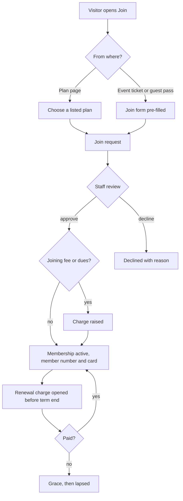
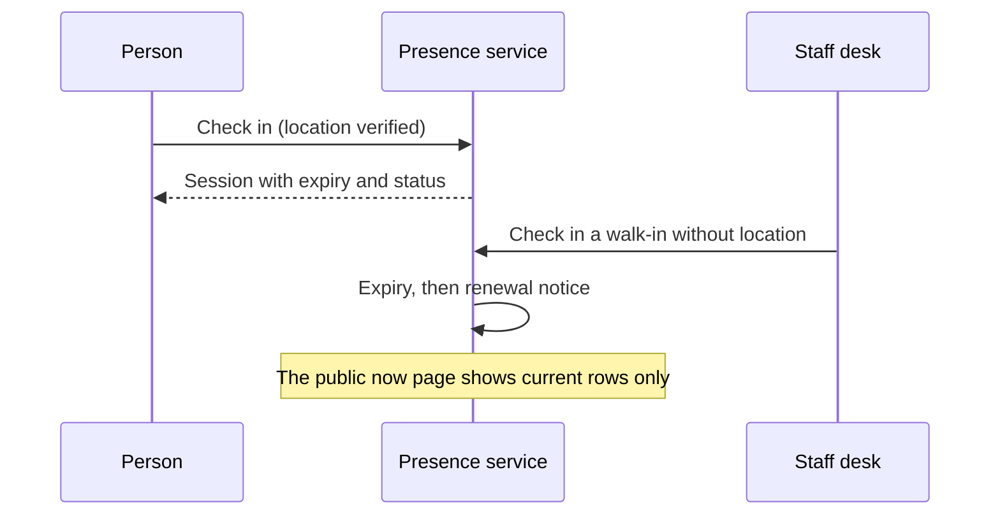

# Memberships

Memberships is the community layer: who belongs to the space, on what plan, for how long, and who is in the building right now. It sits on top of **member accounts**, the sign-in system for people.

## What it does and who uses it

| Who | What they do |
| --- | --- |
| Visitor | Asks to join, picks a listed plan, follows a join link from an event ticket or guest pass. |
| Member | Pays dues, renews, sees their own history, cards and notices, checks in. |
| Space Manager | Approves joins, manages plans, terms, renewals, the member register and member cards. |
| Staff at the desk | Check members and walk-ins in and scan member cards (card scanning only identifies a person). |

Three modules: `member_accounts` (self sign-up, password, social and phone login, the member area), `membership` (join requests, plans, referrals, profiles, directory, cards) and `presence` (time-limited check-in). Staff sign-in is core and is never switched off by any of them.

## Switching it on and off

- `member_accounts` is **on by default** for new spaces. A space can deliberately turn it off to become account-less; then accounts exist for staff only and borrowers use a name, phone and email-code form.
- `membership` is off by default and **requires member accounts**: installing it adds them automatically.
- `presence` is independent and off by default.
- With Membership off, people can still borrow and book (any signed-in account), staff can create walk-in records, and waivers stay. What goes is enrolment, plans, referrals, profiles, the directory and member cards. Charges for membership become inert.
- Feature switches include plan rules, public plans, the renewal desk, member import (CSV or Excel, and a shared Google Sheet), admission tools, member numbers, titles, consent ledger, erasure requests, history, register tools, insights, monthly summary, auto-renew, lifecycle mail, self-service, self-export, ID programmes, wallet passes, guest passes, day passes, minors, volunteer credit and the join funnel. All start off.

## Key settings

- **Plans:** rolling, financial-year, fixed end date or lifetime; new and renewal prices; per-plan joining fee, rejoin rule, payment timing and join mode; included booking and machine hours per term; per-plan borrowing limits.
- **Terms** freeze their price, joining fee, currency and type, and every standing change is written to an append-only history.
- **Renewals:** local-day opening, bounded checkout retries, a promised grace period (grace delays borrowing lapse and never auto-revokes), an optional rule that lapsed members cannot borrow.
- **Refund policy per plan:** full refund within a number of days of term start, then pro rata or a percentage, then none, with an optional fee.
- **Presence:** privacy of names, expiry presets (1 to 4 hours), and `presence.geofence` (on), a location check that requires an in-range device reading for self check-in. Staff can check people in without it. GPS can be spoofed, so treat it as a courtesy check.

## Main flows

**The member dashboard** is gated on the Membership module: request history, returned items, membership fee and outstanding amounts per currency, and a notices feed derived from the member's own records. Payment visibility is separate: any active, unrestricted account that owns a charge can see and pay it, even without a membership.

**Guest passes, day passes and minors** hang off Membership: a guest pass is a dated permit, a day pass is a paid one-day pass with no automatic credit toward joining, and minors need a guardian's e-signed consent according to the space's settings.

**Member units (districts, chapters, branches)** are a switch (`membership.units`, off by default) for clubs and associations that run several groups inside one space. A space names up to four levels (for example State, District, Chapter) and builds a tree of units, each with a short code (1 to 6 capital letters or digits). Members belong to one unit; the join link `?unit=CODE` (or an invite link that preselects a unit) puts a joiner in the right one, and a plan can be limited to some units and everything beneath them. Each unit can carry its own offline payment instructions; a unit without any shows its nearest parent's. A member sees their own unit's instructions (and which unit they came from) on their charge instead of the space-wide ones, and the space's UPI QR is hidden then, because it points at the space's account; a member with no unit, or whose units have none, sees the space-wide instructions. A unit-scoped staff member can list, record and settle only the charges of members in their unit (an out-of-scope charge answers not found, also on a collection sheet), and their cash-in-hand figure covers only their own receipts. Units are archived, never deleted. A second switch, `membership.unit_scoped_staff`, lets a Space Manager confine a staff member to one unit: their member list, join requests, renewals and register then show only that unit and the ones under it, and they cannot change space-wide settings. Superadmin and organization governors are never narrowed. Importing members can land them in a unit, and in "verify" mode each row waits for the unit lead to approve it before any invitation is sent. The number of units can be capped per space (`member_units`).

**Asking an applicant for changes** (`membership.ask_changes`, off by default): a manager can send a pending join request back with a note. The applicant gets a notice, edits their answers and resubmits once; the request returns to the review queue (or to vouching, keeping the vouches already given). A request can be sent back only once, so the loop always ends; the applicant can still cancel it and staff can still decline it, and its expiry clock restarts when it is sent back.

**What the join form collects** (`membership.join_photo`, `membership.join_contact_fields`, both off by default): each plan chooses whether the form asks for a member-card photo (off, optional or required) and for a phone number and a state (hidden, optional or required). On approval the phone fills the account only when it has none, the state becomes the member's state code for GST place of supply only when none is recorded, and the photo goes to the member card with the consent the applicant gave and never replaces a photo the card already has. Join forms can also carry section headings (a heading above a question, no answer) to break a long form into parts; a heading only shows while a question below it is shown. In the staff console the three switches and the register's bulk switch sit under Settings › Joining and the register, the plan form gains a "Join form extras" block, and the join-form builder gains "Add section heading" and "Can print on the member card" once the space's form is switched to the new builder.

**Register, roster and bulk actions** (`membership.register_bulk`, off by default): the member register, the roster and the "print cards for everyone matching" job all use one filter (search by name, email or member number, a standing chip such as expiring or lapsed, plan, title, unit). From the register, up to 200 members at a time can be given a title, moved to a unit, sent a renewal reminder, issued a card or emailed their card. Each member is handled on their own and gets a result, so one refusal never stops the rest; members outside a unit-scoped manager's unit are never touched.

## Money it can raise

`charges.membership` records joining fees, dues, renewal charges and day passes. Online payment is `payments.membership`. An approved membership refund ends the term it paid for unless staff choose to keep the membership. See [Payments](payments.md).

## Notifications it sends

Join request updates, renewal reminders, lifecycle mail (owner-only), card ready, presence expiry, broadcasts, and a monthly staff summary. Members can mute optional families.

## Reports and analytics

Join-month cohorts, retention at 3, 6 and 12 months, MRR and ARR per currency (MRR needs finance access and is a projection, separate from collected revenue), the member register export, renewal, collection, expiry-calendar, win-back and funnel reports. Also: collected revenue by plan (cash collected net of refunds, unlike the MRR projection), a 30, 60 and 90 day renewal forecast, and the median and 90th-percentile wait for a membership application decision. With member units on there are two more count-only reports, a **unit league** (active members per unit including the units beneath it, members who joined in the period, requests waiting) and a **level league** (units and members per level); they never show a name or an amount. A unit-scoped staff member sees their own unit's figures only in these reports, the renewal forecast, the approval times and the collected-revenue report.

## Member cards: numbering, titles, organisation design and desk printing

Every member holds one card, even when the space belongs to an organisation: the same number, QR and check page serve as both the space and organisation membership card, and the design may show the organisation's name too.

- **Numbering** (`membership.card_numbering`, off by default): a prefix and pattern such as `{PREFIX}-{YYYY}-{SEQ:4}` per space and per title. Tokens: PREFIX, SEQ, MEMBER, YYYY, YY (the SEQ counter restarts each year when the pattern has one). A new pattern is a draft that goes live when its card design is published. The number is frozen on the card when it is issued and survives reissue and renewal.
- **Title cards**: each title shows whether it inherits, has a draft, is published or has unpublished changes, plus how many live cards carry it. With `membership.title_card_reissue` on, changing someone's main title reissues their card (same number, new QR; the old printed card says "A newer card was issued").
- **Organisation default design**: an organisation can set one default card design for every space it owns. It needs card management in all of them and is used after a title or plan design and before the space's own default.
- **Join answers on the card**: mark a question "printable" in the join form and a design can place it. Sensitive questions never print.
- **Bulk jobs from the register**: choose cards by the same filter as the member register (search, plan, role, title, standing) instead of ticking each one.
- **Scanning a check link as staff** shows who the member is and offers renew, record payment or revoke, only to staff who may scan cards in that space. Anyone else sees "not found".
- **Staff ID cards** (`membership.staff_cards`, off by default): one card per active staff member showing their name,
  photo (their member-card photo, if they have one), every role they hold and, for Machine Managers and Technicians,
  the machine types and machines they look after. It has its own number scheme (`STF-0001` by default), its own
  design (the member looks with a STAFF band) and a public check page that shows name, "Staff", roles and
  valid/revoked, never contact details. The card ends by itself when the staff access ends (role row revoked, account
  disabled or restricted) and is reissued, same number and new QR, when the roles change; a card problem never blocks
  the staff change. `membership.staff_cards_auto_issue` issues one as soon as a role is granted. Limit key
  `staff_cards_issued_monthly` (none by default). Staff see their own card under My cards.
- **Unit tags on member cards**: designs can place `unit`, `unit_code`, `units` and `level1` to `level4`, and
  numbering patterns can use `{UNIT}` and `{U1}` to `{U4}` (needs `membership.units`).
- **Desk printing** (`membership.card_desk_print`): print a card face at 300 dpi on A6, 4x6, 3x4 or CR80.
- **Public check page**: the holder's name shows by default for spaces created from 0.12.0; existing spaces keep it hidden until the holder opts in, and any holder can hide it. Contact details, units and answers never show.
- **Limits**: a space can be capped on member cards issued per month and on wallet passes (platform operator setting, default none). A card limit never blocks a membership activation.

## Data kept and purged

Switching off keeps everything. A purge removes join requests, profiles with their projects and imagery, and member cards with photos (QR codes are revoked, never deleted). Memberships, waivers and acceptance evidence stay, since they are core authorization and liability records. A Presence purge removes sessions, settings and preferences.

## Decisions

- **Membership requires member accounts**, so members-only rules always work.
- **One account per person across spaces.** Staff roles are granted to an existing account; the platform superadmin account stays separate.
- **Waivers stay even without Membership** because they are liability evidence.
- **Cards identify, they do not authorize.** Scanning a card needs its own permission and the Inventory Manager never gets it.
- **Self-service renewal for account-only borrowers** is off by default and a Space Manager setting.
