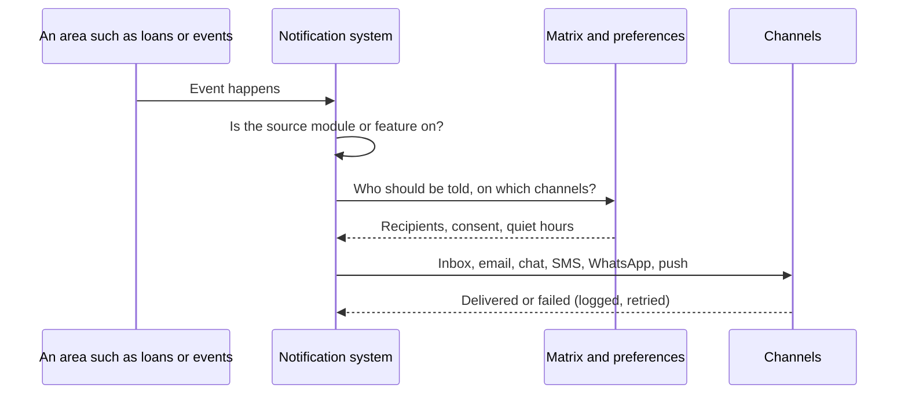

# Notifications and messaging

Every module emits notices through one notification system. The space decides, per kind of event, which channel carries it; people decide which of their own channels they want.

## What it does and who uses it

| Who | What they do |
| --- | --- |
| Member | Reads their inbox, connects personal channels, mutes optional families, picks quiet hours and a daily digest. |
| Staff | Receive alerts for their area, manage their own channels under My channels. |
| Space Manager | Configures channel credentials under Communication channels and the matrix of which event goes where. |
| Platform superadmin | Sets platform-level senders and provider settings. |

## Channels and their switches

| Channel | Module key | Notes |
| --- | --- | --- |
| In-app inbox | `notifications` | Optional inbox plus the emitters for every module. |
| Email | `email` | Tenant email delivery. Account recovery and verification mail are platform mail and are not this switch's to disable. |
| Telegram | `telegram` | **Outbound only.** Group alerts and provider-proven private messages. The webhook accepts only the private link-up message and discards every other callback; no chat message carries buttons. |
| Slack, Mattermost, Discord | `slack`, `mattermost`, `discord` | Incoming-webhook chat alerts. |
| Signed webhooks | `webhook` | Your own HTTPS endpoint receives each routed notice as signed JSON, with the same matrix, retries and delivery log as chat. |
| SMS | `sms` | Twilio. Consent-based; OTP sign-in codes are independent. |
| WhatsApp | `whatsapp` | Approved templates through Twilio or Meta, personal messages only. |
| Push | `mobile` with `mobile.push` | Native push to enrolled devices. Watch-friendly short titles and Open or Mark seen buttons (`mobile.watch_actions`). Browser push is `notifications.web_push`. |

Each channel is a separate module, so a space that only uses Discord carries no Slack surface. Turning a channel on never makes an unconfigured channel send, and turning it off stops sending even though the webhook is still stored.

Extra features: `notifications.inbox_snooze`, `notifications.web_push`, `notifications.escalation` (re-ping an urgent staff notice once after 30 minutes), `notifications.member_inbox`, `notifications.member_preferences`, `notifications.quiet_hours`, `notifications.digests`, `billing.reminders` and `events.broadcasts`.

## Platform credentials and usage limits

New in 0.12.0. A space with no credentials of its own for a channel can fall back to the platform's shared ones. The Space Manager chooses which channels the space uses, whether the platform credentials may be used, and can save the space's own credentials (these are never counted against any limit). The superadmin can set a monthly limit per space on the shared path only; by default there is none. When a limit is reached, new sends on the shared path are refused or skipped and staff are told once per month. Details and the list of limits: [Platform and superadmin](platform.md#usage-limits-on-platform-credentials).

## Switching it on and off

Switch each channel module per space. A module that is off stops its own delivery and every notice from an area that is off is never produced: no inbox row, post, email or push. A chat room whose last five deliveries all failed is switched off automatically with a staff notice. Security mail and mandatory mail follow their own rules and are not blocked by these switches.

## Key settings

- **Matrix:** for each event family and channel, whether it is on. Only the payer's receipt email is on by default for payments.
- **Personal preferences:** multi-select categories per channel, email fallback, one-click unsubscribe. Safety mail stays on.
- **Quiet hours** in the space's time zone, and daily digest.
- **Rooms and recipients:** staff pick rooms, roles or named people; area managers manage alert recipients for their own machines when delegated.
- **Provider setup** for SMS and WhatsApp: see the [messaging operator guide](../messaging-channels.md). Contract details: [notification contract](../notification-contract.md).

## Main flows

**First start.** Fresh installs send by default. An upgraded deployment holds sending until an operator runs `notification_cutover activate`, so a new notification system never starts talking to people without notice.

## Money it can raise

None. SMS and WhatsApp use provider billing, and platform metering counts messages without charging a member.

## Notifications it sends

All of them: loans, requests, machine queue and repairs, bookings, events and hackathons, membership and renewals, payments and refunds, shop orders, donations, backups and security. Details by area are on each area's page.

Added in 0.12.0:

- **Monthly allowance reached.** When a monthly quota the platform operator set for your space (events, bookings, payments) stops something new from starting, the Space Managers and the operator get one notice in their inbox for that month. Anything already started can still be paid, settled and refunded.
- **Hours bank running low.** When an organization's included hours at your space fall to a fifth, and again when they run out, the Space Managers and Booking Managers are told once for that period. Bookings over the limit are charged for the remainder.
- **"Not coming" answers.** When someone answers No to an event's attendance check, the event's organisers are told whether their place was released, a refund needs a decision, or the place is left to them. Yes answers stay in the counts on the Emails tab.
- **Guest certificates.** A guest-pass holder certified after an induction (or revoked) is told, as a member would be.
- **Guardian consent.** When staff record a minor and name a guardian who has an account, that guardian is asked to sign the consent. The notice never names the minor.

Every notice follows the same rules: the space's switches and the people's own choices decide who gets it and on which channel, area managers only hear about their own area, and the words are translatable.

## Reports and analytics

With Reports on, a communications health report shows delivery cohorts, segment estimates, delivery and read rates, and a labelled current consent snapshot. Platform usage shows counts only.

## Data kept and purged

Switching a channel off keeps its history and stored credentials, so re-enabling needs no re-entry. What an explicit purge deletes for each channel is listed in the [switch-off reference](../MODULES-OFF.md).

## Decisions

- **Telegram is outbound only.** Chat is not a decision surface: accept and reject buttons were removed, and there is no bot path into the request state machine.
- **Notifications live in one module for every area.** Areas emit; they do not send.
- **Each channel is separately switchable** and additive to the credential check.
- **SMS and WhatsApp are opt-in modules**, consent-based, and OTP codes are independent of them.
- **Fresh installs send, upgrades wait** for an explicit activation.
- **Each notice is written in the recipient's language.** The language is the person's own choice, then the space default, then the system default; every in-app, email, push, SMS and WhatsApp text is translatable and built for that person, not for whoever triggered it.
