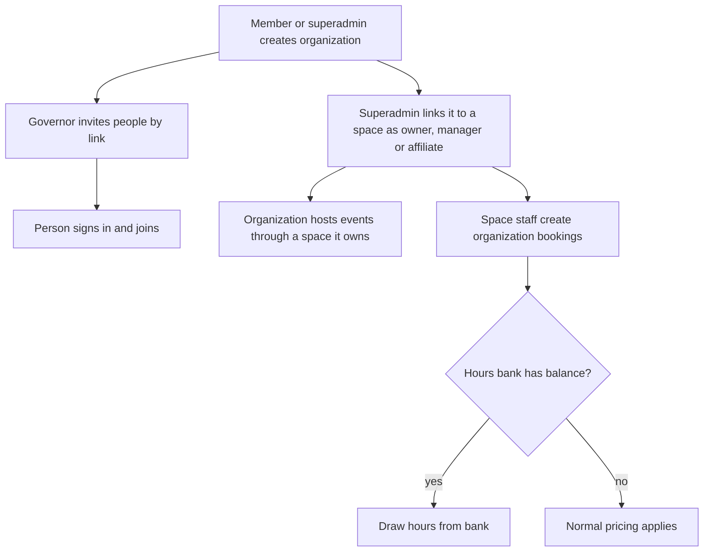

# Organizations

An organization is a shared profile for a group that works with one or more spaces: a college club, a company, a community group. It is a platform entity, not a module, so it has no per-space switch. It is always present and stays idle until someone creates one.

## What it does and who uses it

| Who | What they do |
| --- | --- |
| Organization governor (admin) | Edits the profile and public page, invites people, grants governor seats, sees the organization console. |
| Organization member | Registers for events opened to the organization and, if they are an admin, sees the organization's included-hours balance and ledger read-only (not a list of its bookings). |
| Space Manager | Books on the organization's behalf and manages its hours bank in their own space. |
| Platform superadmin | Approves links between organizations and spaces and can create organizations on anyone's behalf. |

An organization has its own public page at `/o/<organization>` listing its linked spaces and its events across its own and other spaces. Only public spaces and listed events appear.

## Switching it on and off

- **Self-creation by members** is a platform switch, **off by default**. Where it is off, the platform administrator creates organizations.
- **Using organizations** in a space needs no switch. Related features inside modules have their own: `events.organization_audience`, `events.organization_sender`, `bookings.organization_bookings` and `membership.id_programmes`.
- A new space is created with an **owner organization**: the installer, API, staff console and `/control/` all ask for an existing organization or a new name.

## Key settings

- Profile: name, slug, website, public page content and artwork.
- People: invitations by single-use link (optionally tied to one email address, with an expiry), suspend and reactivate, governor seats. Mutations by governors need a recent sign-in, and the last active governor cannot be removed.
- Links to spaces: owner, manager or affiliate, with at most one owner per space. Link changes are superadmin-only.
- Organization ID programmes hosted by a space, when that feature is on.

## Main flows

**Authority.** Belonging to an organization can grant actions but never identity. It never reveals anyone's personal details, and organization grants never become Space Manager identity. An organization-derived grant is checked live, so losing membership removes it.

**Organization bookings.** Staff book a space for an organization's partner event, made for the organization's contact member. See [Bookings](bookings.md) for the per-space hours bank and its append-only ledger.

**Events.** Organizations host events only through a space they own. A collaborative event can name organizations as organizers or partners, and an organization audience admits live members of the organizer and venue-owner organizations.

**Review (optional).** With `ORGANIZATION_REVIEW_REQUIRED` on, a self-created organization starts pending review and is inert: no public page, no space links, no invitations. A superadmin approves it, asks for changes (the applicant edits and resubmits) or declines it with a reason; a declined organization holds its slug for 30 days. An approved organization can later be suspended: it stays active so members keep their data rights, but it disappears from public pages. The applicant and the superadmins are told by email, and every step is in the audit log.

**Public directory (opt-in).** `ORGANIZATION_PUBLIC_DIRECTORY_ENABLED` serves a searchable public list of organizations that turned on both "discoverable" and "public profile". The organization page also shows its home space's public membership plans while that space has the plans switch on.

**Who counts as a member.** Someone with an active community membership in a space the organization **owns** (not one it only manages or is affiliated with) counts as a member of the organization automatically, and stops counting the moment that membership ends, expires or is revoked. This is worked out live; nothing is copied, nobody is made a governor, and it grants no actions. Invited members still exist, and a person in both is counted once. Governors see a read-only roll-up of **counts only**, never names. There is no separate organization card: the home space's member card is the card.

## Money it can raise

None of its own. Charges raised through an organization booking or event follow the normal area rules. See [Payments](payments.md).

## Notifications it sends

Organization invitations (also offered on the invitee's own chat channels when the address belongs to a verified account), and the notices from the events and bookings it takes part in.

## Reports and analytics

Attendance and bookings appear in the Events and Bookings reports of the spaces involved. An organization page shows its own events across spaces.

## Data kept and purged

Organizations are deployment-global, so a space or module purge never deletes a shared organization or a foreign organizer. Deleting an organization is refused while it has space links, retained references or artwork. The organization hours bank rows are left out of space exports and purged with Bookings.

## Decisions

- **An organization is a platform entity**, not a per-space module, because it spans spaces.
- **Self-creation is off by default**, with a daily limit that survives deletion.
- **Every new space has an owner organization**, assigned in the same transaction that creates the space.
- **Governance is separate from space roles.** Organization governors never gain space authority by being governors.
- **Organizations host only through a space they own.**
