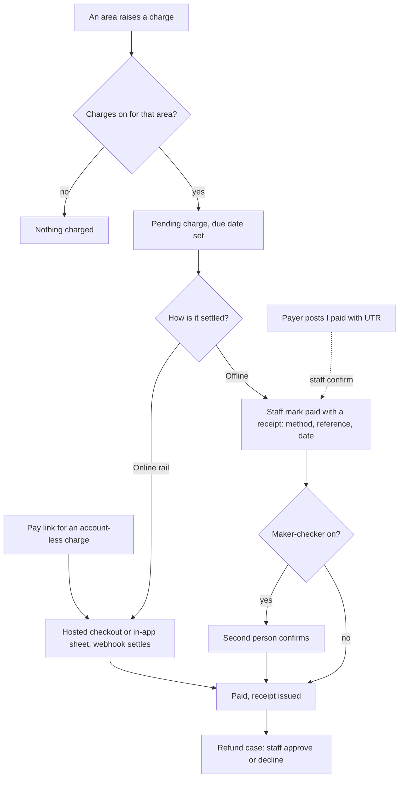

# Payments

Space Works separates two things that are often confused. The **ledger** records money owed and money paid, and it is always there. The **rail** is the optional online card and UPI checkout. A makerspace that only takes cash needs the ledger and never the rail.

## What it does and who uses it

| Who | What they do |
| --- | --- |
| Payer | Sees and pays their own charges, posts an "I paid" claim, requests a refund, downloads receipts. |
| Area manager | Records an offline payment or waiver for charges in their own area and works that area's payments queue. |
| Space Manager and finance staff | See everything: the ledger, receipts, settlements, refunds, reconciliation and reports. |

Money authority is narrow on purpose. Only the Space Manager holds the view-finance and record-payment grants; each area manager handles the charges that belong to their area.

## Switching it on and off

| Layer | Switch | Default | Off means |
| --- | --- | --- | --- |
| Charge tracking | `charges.enabled` plus one `charges.<area>` per area (loans, machines, bookings, events, membership, shop, donations) | On | Nothing is priced or charged in that area, no money screens show, flows finish without a payment step |
| Online rail | `payments` module, `payments.enabled`, then `payments.<area>` and provider credentials | Off | Charges still exist; staff settle them offline |
| Ledger and receipts | none, permanent | Always on | Cannot be switched off or removed |

Each area decides its own mode, so a space can lend for free while charging for machines. Turning a module on switches its `charges.<area>` key back on, so a new module never starts untracked by accident.

## Key settings

- Payment terms (due date offset), reminder ladder (`billing.reminders`, off), numbered receipts and credit notes (`billing.documents`, on), tax (`billing.tax`: a single named tax or India GST), UPI details for claims.
- Rate cards and price lists per area, with per-item overrides, member discounts (one best automatic discount, then a promo code) and refund policies.
- Provider setup for Stripe and Razorpay, including Stripe Connect. Details in the [payment billing guide](../payment-billing.md) and [mobile integration guide](../mobile-integration.md).

## Main flows

- **Offline settlement** requires a receipt written in the same transaction as the payment status, and receipts are append-only: corrections are new rows that amend earlier ones.
- **Maker-checker** (`billing.maker_checker`, off) makes a second person with record-payment authority confirm every offline settlement. The recorder can never confirm their own.
- **"I paid" claims** (`billing.offline_claims`) show a UPI QR for the exact amount; the payer posts a claim with a reference and staff confirm or reject it. A claim moves no money.
- **Pay links** (`billing.pay_links`) are signed, expiring links for one account-less charge that staff raised.
- **Refunds** are cases. Cancelling a paid event, booking or membership computes a "refund due" from the space's policy, and staff approve it. Online refunds go through the provider; offline refunds record the cash returned. Money never moves automatically.
- **A restricted member can still pay.** An account restricted over an unpaid or lost-item charge can see and pay its own charges, because paying clears the restriction. A revoked member cannot.
- **Online exceptions:** late, duplicate or mismatched captures are accepted but flagged and the receipt held for a staff decision; disputes are recorded without automatic action.
- **Currencies:** amounts are stored with three decimals everywhere. Two-decimal currencies keep trailing zeros, yen has no subunit, and KWD, BHD, OMR, JOD and TND move in 10-fils steps. Rounding is half-up per line.

## Money it can raise

All of it: inventory loans, machine jobs and sessions, bookings, event tickets and orders, memberships, shop sales and donations. Money out (To-Buy purchases, repair payouts, reimbursements, refunds) is recorded in the same finance ledger, which reports income versus spending by month and by area.

## Notifications it sends

Charge raised, payment received (the payer's receipt email is the only default-on one), refund updates, due and overdue reminders if enabled, and staff notices for flagged captures and disputes. Financial amounts never go to staff chat.

## Receipts, collection sheet and cash in hand

Three optional settings (all off by default, each in the space's feature list):

- **Receipt numbers per financial year** (`billing.fy_receipts`): a space that charges no tax can number receipts per financial year, for example `R26-27/0001`, gapless. The day it is switched on is the cut-over; receipts already issued keep their numbers. With tax on, tax invoices already use their own yearly series.
- **SAC code per plan** (`billing.plan_sac`, needs tax): a membership plan can carry its own 4 to 8 digit SAC code. It is frozen on the GST charge when it is raised, so invoices and the GSTR-1 summary show it; changing the plan later never rewrites an invoice.
- **Collection sheet** (`billing.collection_sheet`): record up to 200 cash, UPI, bank or cheque payments in one sheet (`POST .../billing/collection-sheet`). Every row is an ordinary offline settlement with its own receipt, so the two-person check still applies and a row can come back as awaiting a second person. A row that fails (already paid, not found, duplicate) fails alone. A superadmin can cap rows per month (`collection_sheet_rows_monthly`); that only stops starting a new sheet, never settling one charge. Cash a collector hands over is recorded with `POST .../billing/cash-handovers`; it is a transfer, not spending.

## Reports and analytics

Cash in hand per collector (cash recorded, less cash refunds and hand-overs), finance ledger, income versus spending, cash book by method and currency, reconciliation, refund reports, settlement and claim queues, and a donations area. Area managers see only their area, scoped by role.

## Data kept and purged

The ledger can never be tombstoned or purged by switching a module. The `payments` rail module can be tombstoned, which drops the key and removes checkout, Connect, refunds-through-provider, credentials and webhooks, but not the payment history.

## Decisions

- **Money owed is tracked without the rail.** Online payment is opt-in.
- **A charge raised with no gateway is marked unclaimed** and claimed once by the first checkout that reaches a provider.
- **Free, offline and online are three first-class modes** for every chargeable area, verified area by area.
- **Every money movement is in the ledger**, including spending.
- **Payee and payout details need an interactive session**; tokens and app connections never read them.
- **Pending payments travel in a portable dump**; only a live checkout blocks it.

## Monthly payment quota

The superadmin can cap a space's paid transactions per month (count, and money per currency). Once reached, starting a NEW paid ticket, booking, shop order, plan purchase or donation answers 409 `payment_quota_reached`. Charges that already exist can always be paid, online on any rail and offline; refunds still work and the ledger still records debts. On the platform's own online rail the same rule holds: only a charge raised after the allowance was reached is refused (`platform_rail_limit_reached`); a charge raised earlier stays payable.
