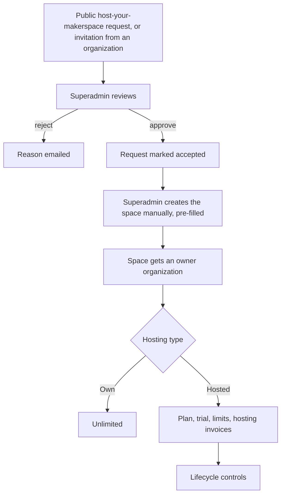
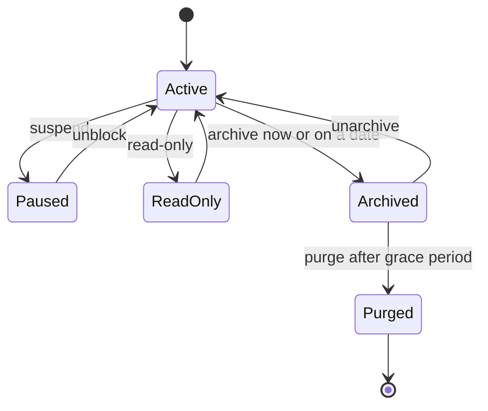

# Platform and superadmin

The platform is the install itself. One person, the **platform superadmin**, looks after it: creating spaces, choosing what each space can use, setting limits if they want any, and keeping everything recoverable. There is one deployment mode, self-hosted, and every capability described here is available in every install.

## What it does and who uses it

| Who | What they do |
| --- | --- |
| Platform superadmin | Works in the web superadmin console (and `/control/` as a fallback). Has a separate account from everyone else, with its own sign-in. |
| Space Manager | Runs one space and sees that space's plan usage and remaining allowances, if any are set. |
| Host operator | Installs, updates and recovers the server. See the [self-hosting guide](../self-hosting.md). |

The superadmin always has access to everything in every space. There is no per-space switch that hides a space from the platform, and viewing members' protected personal details asks for a short reason, a recent sign-in, and writes an audit row the space's managers can see.

The console groups its pages as: Platform dashboard, Spaces, Platform analytics, People and access, Platform security, Data and recovery, and Platform settings (email, sign-in providers, messaging and apps, mobile apps, chat templates and Stripe Connect).

## Switching it on and off

The platform console is always on. One optional capability has a switch: **Hosting other makerspaces**, off by default. It unlocks the Hosted type for spaces, plans, hosting billing and the public host-your-makerspace request form. With it off, every space behaves as an Own space. The older `MANAGED_PLANS_ENABLED` environment setting remains only as an optional override.

## Key settings

| Setting | What it does |
| --- | --- |
| **Hosting type per space** | **Own space**: no plan, no limits, no hosting billing, like a plain install. **Hosted space**: plan, trial and hosting billing can apply. One install can mix both. A space created directly by the superadmin is Own; one created from a hosting request is Hosted. Changing the type is audited and deletes nothing. |
| **Plans** | Named bundles of limits (members, staff, storage, products, assets, machines, events, bookings, API clients, monthly email, SMS and WhatsApp, guest and day passes per day, and more) and the modules a plan allows. A new plan starts with every limit empty. |
| **Per-space overrides** | Each limit row shows the effective value, where it comes from and current usage. A value of `-1` means unlimited; blank follows the plan. |
| **Request rate limits** | Deployment-wide API throttles (login, one-time codes, uploads and so on) with an environment default; the superadmin may override a scope within ten times either side of it, and every change is audited. |
| **Security locks** | Per-space security settings can be locked so the space cannot loosen them. |
| **Module defaults** | Read-only for the superadmin; the setup areas choice owns them. |

**No limits by default.** Every limit is unlimited for every space, Own or Hosted, until the superadmin sets one through a plan or an override. Built-in fair-use values are only suggestions shown in the console. When a limit applies, the person who hits it is told which limit and, where a plan applies, its name. Space Managers see their remaining allowance, area managers see what they use, and the superadmin sees every space's usage against its limit.

## Main flows

**Lifecycle controls** (all superadmin-only, with a fresh identity check, audited): pause (public pages go offline, jobs and outbound messages stop, nothing deleted, money already sent still settles), read-only (view and export only), transfer ownership, scheduled archive and purge with reminder emails at 30, 7 and 1 days, announcements to chosen spaces, and per-space health cards. Accepting a hosting request only marks it accepted. "Approve and create the space" does it all at once: it creates the space (a makerspace, or an organization workspace when the applicant asked for one), its owner organization, and sends the requester governor and Space Manager invitations; if any step fails nothing is created. An organization workspace starts with Events, Memberships (with member ID cards) and Bookings on, Inventory and Machines off, and everything can be switched later; its public page is `/o/<slug>`, and its `/m/<slug>` address leads there. Self-hosted installs get the request form by setting `PUBLIC_SPACE_REQUESTS_ENABLED`. In the web console, **Spaces → Create space** asks first whether you are creating a makerspace or an organization workspace (the kind cannot change later), and the request form at `/hosting` lets applicants choose either, with the location optional for an organization. The Onboarding list shows each request's kind and filters by it; an organization request is approved from `/control/` until the console's approve action creates organization workspaces too.

## Usage limits on platform credentials

New in 0.12.0. When a space has no credentials of its own for a channel, it can fall back to the platform's shared ones (the platform mail account, SMS, WhatsApp, push, wallet certificates and the platform payment rail). The superadmin can cap how much a space uses that shared path each month.

- **Default is no limit.** Nothing is enforced until the superadmin sets a value for a space; an empty value or -1 means unlimited.
- **Only the shared path is counted.** Mail, SMS, WhatsApp or wallet sent with the space's own credentials is never counted or limited.
- **Payments.** A limit only refuses a new online payment page on the platform rail. Offline settlement and the space's own gateway are untouched.
- **Where it is set.** Per space, in the superadmin's limits for that space. The first time a space reaches a limit in a month an audit entry is written and staff see a notice.

The Space Manager decides which notification channels the space uses, whether the platform credentials may be used at all, and can save the space's own credentials instead. See [Notifications and messaging](notifications-and-messaging.md) and [Own and hosted spaces](../hosting/managed-spaces.md).

## Money it can raise

Hosting billing, when Hosting other makerspaces is on: each Hosted space can be given an invoice record (fee, due date, paid, offline receipt), optionally paid online through the platform's own Stripe or Razorpay keys with a second switch. A space goes read-only after a grace period for an overdue invoice only if the superadmin turns on auto-enforcement, which is off by default. Money never moves unless the payer opens the checkout.

## Notifications it sends

Space Managers are emailed when their space is paused, unblocked or has a scheduled archive and purge, and when ownership is transferred. Hosting-request decisions are emailed to the applicant, with a reason when rejected. Announcements can optionally email Space Managers.

## Reports and analytics

The **platform overview** combines every live space's counts for people, inventory, machines, events, bookings, membership, money per currency and operations, always beside the per-space table. A block follows each space's own switches, so a space with an area off adds nothing to that block. It shows counts and money only, never a member's name or contact, and never adds money across currencies. A CSV export is audited. Platform-wide Metabase and Grafana are described under [Analytics](analytics.md).

## Data kept and purged

Pausing, read-only and archiving delete nothing. A purge is permanent, typed back by slug, and the audit history of every control stays. Plan assignments are removed with the space; hosting invoices and receipts are kept as the platform's records. Platform records such as plans, invoices, requests and throttle overrides never travel in a space export. See [Backup and migration](backup-and-migration.md).

## Decisions

- **There is one deployment mode.** What was once a separate managed product is an optional capability of a normal self-hosted install, switched on by the superadmin.
- **Own and Hosted spaces can mix** in one install, chosen per space.
- **Limits default to unlimited**, so a plain install is never restricted by surprise.
- **The superadmin always has full access.** The old per-space switch that hid a space from the platform was removed; security settings can be locked instead.
- **Approval never auto-provisions.** The superadmin creates each space by hand, so ownership and organization are a conscious choice.
- **Hosting is optional and hybrid-friendly.** Database, cache, file storage, email and website can each be local or external. See [hosting other makerspaces](../hosting/managed-spaces.md) and [self-hosting](../self-hosting.md).

## Quotas and the platform's credentials

The platform operator can set monthly quotas on any space, own or hosted: events created, bookings created, paid transactions (count) and money taken (per currency), plus the allowance of the platform's own email, SMS, WhatsApp, push, wallet and online-payment credentials. Nothing is set by default, so nothing is limited. Only the superadmin sets them (per space, or for up to 50 spaces at once with re-authentication); every change is audited. The Space Manager sees usage against each limit, read-only. When a platform-credential allowance is first reached in a month, the Space Managers and the superadmins get one in-app notice.

Each space also chooses whether the platform's credentials may be used when it has none of its own (email, SMS, WhatsApp, push, wallet). It is on for new spaces; turning it off pauses that channel for the space while the in-app inbox keeps delivering.

## Every limit key, grouped by area

Every countable per-space resource has a limit key the superadmin can set on any space (own or hosted) in the space's limits, or on up to 50 spaces at once. **Nothing is set by default, so nothing is limited**: blank, `null` or `-1` means no limit. A limit only refuses the **start** of something new (a typed `409`, with a code such as `boxes_quota_reached` and the limit in the body). It never blocks reading or exporting data, settling or refunding a payment, recording a debt, returning issued items, or a member's privacy request.

| Area | Key | Unit and what is counted |
| --- | --- | --- |
| People | `members`, `staff`, `guest_passes` | Active members, staff seats, passes issued today. |
| People | `membership_plans` | Membership plans that are not archived. |
| People | `organizations_linked` | Organizations linked to the space. |
| Inventory | `products`, `assets` | Products and tracked assets. |
| Inventory | `boxes` | Active QR boxes. |
| Inventory | `kiosk_stations` | Scanner and handover stations. |
| Machines | `machines`, `print`, `machine_service_open`, `machine_service_submit` | Machines, print requests this month, open and daily service requests. |
| Machines | `machine_jobs_monthly` | Machine jobs requested this month, every machine type. |
| Machines | `machine_sessions_monthly` | Member or staff sessions started this month (a session reported by a machine is counted, never refused). |
| Machines | `devices` | Enrolled devices that are not revoked. |
| Events | `events`, `events_monthly` | Published events now, events created this month. |
| Events | `event_registrations_monthly` | Registrations and ticket seats created this month; a seat that is later claimed counts once. |
| Bookings | `bookings`, `bookings_monthly` | Active bookings now, bookings created this month (a cancelled booking keeps counting, and restoring it does not count it again). |
| Bookings | `bookable_spaces` | Active bookable spaces. |
| Shop | `shop_products` | Shop products that are not archived. |
| Shop | `shop_orders_monthly` | Shop orders (online and desk) created this month. |
| Money | `payments_monthly_count`, `payments_monthly_amount` | Paid transactions and money taken this month (per currency). |
| Money | `donation_campaigns` | Active campaigns and funds. |
| Messaging | `email`, `telegram`, `slack`, `mattermost`, `discord`, `webhook`, `native_push`, `sms`, `whatsapp` | Daily notifications per channel. |
| Messaging | `platform_email_monthly`, `platform_sms_monthly`, `platform_whatsapp_monthly` | Messages sent with the platform's account this month. |
| Messaging | `platform_push_monthly` | Push deliveries (one per recipient, or per device for staff alerts) through the platform this month. |
| Messaging | `platform_wallet_monthly` | New wallet passes signed with the platform's certificates this month (own certificates never count). |
| Integrations | `api_clients` | Active API clients. |
| Integrations | `api_requests_per_minute` | Requests per minute for each API client of the space. It can only lower the client's tier rate; no value keeps the tier rate. |
| Integrations | `analytics_connections` | Configured analytics providers (Metabase and Grafana count one each). |
| Integrations | `webhook_endpoints` | Outbound webhook endpoints configured as notification destinations (active or not); the per-day `webhook` key still counts deliveries. |
| Integrations | `report_exports_monthly` | Report downloads this month. |
| Integrations | `data_exports`, `custom_domain` | Active data exports; custom domain allowed. |
| Storage | `storage`, `upload_bytes` | Total managed bytes; the largest single upload. |
| Storage | `storage_evidence_bytes` | Bytes of evidence photos that have not expired under retention. |
| Storage | `storage_public_images_bytes` | Managed bytes that are not evidence (public images and other files); needs hosting accounting to be on. |

Space Managers see usage for every limited key, read-only. An area manager sees only the keys of the areas they manage (for example an inventory manager sees boxes and evidence storage, a machine manager sees jobs, sessions and devices).
