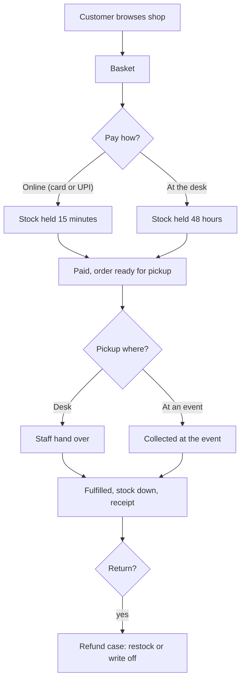

# Shop

The Shop sells consumables, kits and merch. Each space runs its own catalogue, stock, prices and receipts, and nothing is shared between spaces.

## What it does and who uses it

| Who | What they do |
| --- | --- |
| Customer | Browses `/m/<slug>/shop`, orders online for pickup, sees "My shop orders". |
| Shop Manager | Built-in role: catalogue, stock, orders, the front-desk point of sale, cash-up and shop reports. |
| Front desk | Sells over the counter and hands over pickups. |
| Space Manager | Everything, plus shop settings and tax. |

## Switching it on and off

Off by default. Switch the `shop` module per space. Off means no shop route answers (`shop_closed`), no shop job runs and nothing shows; rows are kept and everything returns when you switch it on. Shop notices are checked when they are created, so no notice is written while the Shop is off.

Features, each optional: `shop.online`, `shop.guest_checkout`, `shop.holds`, `shop.member_prices`, `shop.tax`, `shop.returns`, `shop.cash_up`, `shop.event_pickup` (needs Events), `shop.order_limits`, `shop.public_stock`, `shop.receipts`, `shop.reorder`, `shop.bundles` and `shop.consumable_link`.

## Key settings

- Catalogue: categories, products, variants (such as sizes), images, SKU, visibility and stock.
- Holds: 15 minutes for online orders, 48 hours for pay-at-desk (on by default).
- Member prices and members-only items, using the space's member discounts.
- Tax rate and HSN code per product, with tax-inclusive prices (needs `billing.tax`).
- Returns window and whether returned stock is restocked or written off.
- Public stock display: In stock, Low or Sold out, with exact counts opt-in per product.
- Receipts at 80 mm or A4 and by email.

## Main flows

If an event used for pickup is cancelled, the order moves to staff coordination rather than disappearing, and staff cannot hand over an order with an interrupted pickup until it is moved.

## Money it can raise

Every sale is one charge in the finance ledger under the shop area, so it appears in income-versus-spending reports. `charges.shop` is on by default and is turned back on whenever the shop is installed; with it off the shop shows no prices and sells nothing. Online payment is `payments.shop`; without the Payments module, online orders are paid at the desk. Cash refunds are recorded by the Shop Manager and use the two-person check when that is on. See [Payments](payments.md).

## Notifications it sends

Order received, ready for pickup, fulfilment or delivery status (also as webhooks), low stock (a To-Buy draft with `inventory.tobuy`, otherwise a staff notice), and refund updates.

## Reports and analytics

Sales, stock, cash-up variance and shop income, visible to the Shop Manager and the Space Manager.

## Data kept and purged

A superadmin purge removes the catalogue, stock history and cash sessions. Orders that carry a charge keep their payment record and documents, because those are permanently core.

## Decisions

- **The shop is its own top-level module**, an exception to the rule that new features sit under an existing parent.
- **Every sale goes through the ledger**, so there is no separate till total to reconcile.
- **Shop money belongs to the Shop Manager.** Other area managers do not see it.
- **A space with the Shop off carries no shop surface at all**, including notices.
