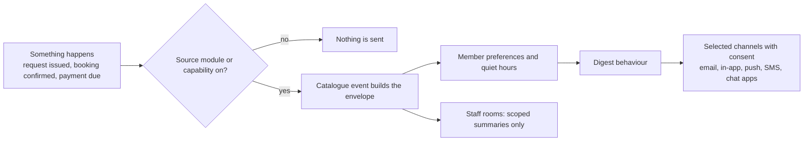

# Notification coverage after Phase 3 wiring

This is the complete trigger inventory from `audit-spec-notify.out.txt` (2026-10-16).
Updated for the 2026-10-18 reconciliation source contracts; runtime/provider verification remains
with the release operator. The original inventory date does not establish current rollout success.
**TRUE means the stated producer/adapter is wired, not a runtime/provider test result.**
PARTIAL names a remaining part of the target; RETAINED means the existing intentional path.
All personal rows remain subject to the [integration limits](notification-contract.md#integration-limits-in-this-tree).
Member-token admission and authenticated OAuth completion/settings are wired. Meta and Twilio
WhatsApp providers and the whatsapp module are registered; the former missing-module blocker is
resolved. Sending remains paused until the independent conversion/replay/activation checkpoints
in [the rollout guide](notification-reconciliation-rollout.md). The old addressed send loop is inert.

Personal = every selected and eligible medium: email, in-app,
native push, SMS (Twilio), Telegram, Slack, Mattermost, Discord, WhatsApp (Twilio or Meta).
Chat endpoints require verification and consent; narrow legacy email allowances are recorded below.
Email fallback requires tenant and recipient permission and no unsubscribe. Native push
also requires an active device grant. Unconfigured channels never become recipients.
Rooms = configured staff-only Telegram/Slack/Mattermost/Discord/signed-webhook destinations,
using the existing recipient and machine/type/category scope. Requester and campaign bodies
never go to rooms. Staff and owners receive separate envelope bodies.

Each account owner is explicit; no address/name-to-chat inference. Existing verified email
delivery remains for external invitees without an account. Account-only booking, event,
payment and loan owners do not acquire a universal membership requirement.

| Trigger from audit | Target audience | Channels / obligation | Code status (2026-10-17) |
|---|---|---|---|
| Hardware `submitted`, `accepted`, `rejected`, `issued`, `partially_returned`, `returned`, `closed_with_issue` | Authorized staff and explicit domain owner | Separate staff personal + scoped room summaries and owner personal envelopes; closed_with_issue bypasses personal email opt-out, but requires the email module | TRUE -- request/staff/owner sources + guarded rooms and shared equipment email-policy/render hooks [H] |
| Legacy overdue `return_reminder`, for spaces without a loan policy | Borrower/custodian; scoped staff for staff variants only | Mandatory email remains independent of selected personal chat; preserve suppression, module exemptions and never-deferred policy | TRUE — mandatory-email reminder producer; same-owner verified-contact compatibility leg [H] |
| Loan-policy ladder: advance/due/overdue borrower `return_reminder` | Borrower/custodian; scoped staff for staff variants only | Mandatory email remains independent of selected personal chat; preserve suppression, module exemptions and never-deferred policy | TRUE — revision-bound ladder intents; mandatory email plus selection [H] |
| Loan-policy `overdue_escalated` | Authorized scoped staff | Staff personal + scoped rooms; preserve machine/type/category narrowing; no default member fan-out | TRUE — staff escalation source and scoped rooms [H] |
| Loan `deposit_raised`, `late_fee_raised` | Authorized staff and explicit domain owner | Separate staff personal + scoped room summaries and owner personal envelopes | TRUE — staff hardware summary; single owner charge through payments [H/O] |
| Tool `back_available` watch | Explicit watcher/member/owner | Personal; preserve existing address eligibility and authenticated document links; no rooms | TRUE — watch source, latch, unsubscribe/rearm/visibility checks [H] |
| Tool `problem_report.filed` | Authorized hardware staff | Staff personal + scoped room summary; no requester identity/body in a room beyond the approved staff summary | TRUE — problem-report source and editor catalog event [H] |
| Printer service `submitted`, `accepted`, `started`, `rejected`, `completed` | Authorized staff and explicit domain owner | Separate staff personal + scoped room summaries and owner personal envelopes | TRUE — service source + owner/staff envelopes [H] |
| Printer service `failed`, `collected` | Authorized staff and explicit domain owner | Separate staff personal + scoped room summaries and owner personal envelopes | TRUE — service terminal-edge sources [H] |
| Printer reprint creation | Authorized staff and explicit domain owner | Separate staff personal + scoped room summaries and owner personal envelopes | TRUE — reprinted service edge [H] |
| Non-printer machine service `submitted`, `accepted`, `rejected`, `started`, `completed`, `failed`, `collected` | Authorized staff and explicit domain owner | Separate staff personal + scoped room summaries and owner personal envelopes | TRUE -- source-backed producer and machine_service-specific module override [H] |
| Machine service (every type) requester `next`, `started`, `completed`, `cancelled` | Request owner only (owner self-notice) | Owner personal envelope only; never rooms; optional lifecycle notices (preferences, requester mutes, opt-outs, suppression all win) | TRUE — durable once-only intents: `next` keyed by the stable envelope `machines.service:<id>:next:requester:<owner>`, the other three by immutable row markers; rendered at delivery [H] |
| Machine service staff `cancelled` | Authorized scoped staff | Staff personal + scoped room summaries (no requester content) | TRUE — cancelled edge through the existing service fan-out [H] |
| Maintenance `schedule_created`, `schedule_updated`, `schedule_deactivated`, `logged`, `schedule_completed` | Authorized scoped staff | Staff personal + scoped rooms; preserve machine/type/category narrowing; no default member fan-out | TRUE — compatibility barrel delegates to the source-backed adapter [H] |
| Maintenance calendar `due_soon`, `overdue` | Authorized scoped staff | Staff personal + scoped rooms; preserve machine/type/category narrowing; no default member fan-out | TRUE — calendar reaches the adapter through the maintenance barrel [H] |
| Usage-meter maintenance threshold | Authorized scoped staff | Staff personal + scoped rooms; preserve machine/type/category narrowing; no default member fan-out | TRUE — meter reaches the adapter through the maintenance barrel [H] |
| Certification grant/renewal `granted`; `revoked` | Affected certified member and authorized machine-type staff | Member personal; separate machine-type-scoped staff personal + rooms | TRUE — member + scoped staff sources [H] |
| Certification `expiring`, `expired` | Explicit watcher/member/owner | Personal; preserve existing address eligibility and authenticated document links; no rooms | TRUE — owner-only expiry source [H] |
| Certification daily expiry digest | Authorized scoped staff | Staff personal + scoped rooms; preserve machine/type/category narrowing; no default member fan-out | TRUE — live-count staff digest source [H] |
| Inventory reorder-point `low_stock` | Authorized scoped staff | Staff personal + scoped rooms; preserve machine/type/category narrowing; no default member fan-out | TRUE — threshold source wired from availability [H] |
| Consumable restock `low_stock`; procurement `procurement_received` | Authorized scoped staff | Staff personal + scoped rooms; preserve machine/type/category narrowing; no default member fan-out | TRUE — automatic low_stock and procurement barrel delegate to the adapter [H] |
| Event `published`, `cancelled`, `completed` | Authorized event staff and affected registration owners | Staff personal + rooms; separate attendee personal lifecycle fan-out against the live registration audience | TRUE — staff/rooms plus live registration-owner fan-out [E] |
| Event registration `registration_created`, `registration_pending_approval`, `registration_waitlisted`, `registration_approved`, `registration_rejected`, `registration_cancelled`, `registration_promoted` | Authorized staff and explicit domain owner | Separate staff personal + scoped room summaries and owner personal envelopes | TRUE — separate staff/delegate/owner envelopes [E] |
| Event `registration_restored` | Authorized staff and explicit domain owner | Separate staff personal + scoped room summaries and owner personal envelopes | TRUE — restored registration source [E] |
| Event check-in `registration_attended` | Authorized staff and explicit domain owner | Separate staff personal + scoped room summaries and owner personal envelopes | TRUE — attended registration source [E] |
| Event series `series_published`, `series_cancelled`, `series_completed`, `series_generation_failed` | Authorized event staff; affected series registration owners | Staff personal + rooms; owner personal for publication/cancellation/completion; generation failure staff-only and never deferred | TRUE — series fan-out; generation failure staff-only [E] |
| Event start `reminder` | Explicit watcher/member/owner | Personal; preserve existing address eligibility and authenticated document links; no rooms | TRUE — account-only reminder source, no membership dependency [E] |
| Event broadcast campaign | Live campaign audience only | Personal selected channels; email retains verified-email/module/unsubscribe gates; live original sender authority + resource + audience rechecked every batch; no staff-room campaign bodies | TRUE — batch cursor and envelopes commit together; saved selections use personal email/fallback, others keep legacy email; both recheck live policy on retry [E] |
| Event bulk invitation | Explicit invitee | Verified email / manually shared invite for unknown accounts; proven accounts may receive private navigation notices; never room bearers | RETAINED — verified-email/share path; optional account-linked notice not added [E] |
| Event certificate creation/render/reissue/revoke | Direct certificate recipient (registration, contribution or award subject) | Personal navigation; eligible ready active PDF may use typed private attachment; no badge secret/recipient details in rooms | Existing owner source plus programme direct-subject adapter; full programme eligibility/recovery/provider acceptance remains pending below [E] |
| Booking `created`, `confirmed`, `rejected`, `cancelled`, `restored`, `completed`, `no_show` | Authorized staff and explicit domain owner | Separate staff personal + scoped room summaries and owner personal envelopes | TRUE — staff/owner/grant envelopes, legacy rooms and same-owner contact email compatibility [B] |
| Booking start `reminder` | Explicit watcher/member/owner | Personal; preserve existing address eligibility and authenticated document links; no rooms | TRUE — account-only personal reminder source plus same-owner contact email compatibility [B] |
| Booking broadcast campaign | Live campaign audience only | Personal selected channels; email retains verified-email/module/unsubscribe gates; live original sender authority + resource + audience rechecked every batch; no staff-room campaign bodies | TRUE — saved selections use envelopes; others batch email [B] |
| Booking arrival confirmation/reversal | Booking owner and authorized booking staff | Separate owner personal / staff personal + scoped room summaries if emitted by booking lane | NOT EMITTED — services_arrival records audit/history only [B] |
| Membership `request_pending`, `member_joined` | Authorized staff and explicit domain owner | Separate staff personal + scoped room summaries and owner personal envelopes | TRUE — lifecycle/application sources [O] |
| Membership welcome after activation; member verification | Explicit watcher/member/owner | Personal; preserve existing address eligibility and authenticated document links; no rooms | TRUE — owner envelope + preserved direct-mail fallback [O] |
| Membership approval `approved` | Authorized membership staff and approved applicant | Staff personal + rooms; owner private activation/welcome notice, deduplicated with welcome mail | TRUE — approval/welcome share owner intent [O] |
| Membership/admission `declined`, `awaiting_payment`, `payment_due` | Authorized staff and explicit domain owner | Separate staff personal + scoped room summaries and owner personal envelopes | TRUE — application source; revoked-owner shared refusal still applies [O] |
| Membership `renewal_due`, `lapsed`, `renewal_failed`, `renewed`, `grace_started`, `cancelled` | Explicit watcher/member/owner | Personal; preserve existing address eligibility and authenticated document links; no rooms | TRUE — term sources and transactional reminder completion [O] |
| Membership invitation/referral | Explicit invitee | Verified email / manually shared invite for unknown accounts; proven accounts may receive private navigation notices; never room bearers | TRUE — explicit account notice; existing contact email/share preserved [O] |
| Member broadcast | Live campaign audience only | Personal selected channels; email retains verified-email/module/unsubscribe gates; live original sender authority + resource + audience rechecked every batch; no staff-room campaign bodies | TRUE — audited producer calls notify_broadcast for each selected account [O] |
| Payments `charge_raised`, `payment_received`, `refund_issued` | Authorized staff and explicit domain owner | Separate staff personal + scoped room summaries and owner personal envelopes | TRUE — ledger owner/staff sources; no rail dependency [O] |
| Payments `payment_due_soon`, `payment_due_today`, `payment_overdue`, `payment_failed` | Explicit watcher/member/owner | Personal; preserve existing address eligibility and authenticated document links; no rooms | TRUE — pending-debt live checks and durable reminder revisions [O] |
| Payment receipt/invoice/credit-document `document_issued` | Explicit watcher/member/owner | Personal; preserve existing address eligibility and authenticated document links; no rooms | TRUE — document source plus preserved direct-mail fallback [O] |
| Staff account invitation | Explicit invitee | Verified email / manually shared invite for unknown accounts; proven accounts may receive private navigation notices; never room bearers | RETAINED — email/private-share; no optional chat notice [O] |
| Event staff invitation | Explicit invitee | Verified email / manually shared invite for unknown accounts; proven accounts may receive private navigation notices; never room bearers | RETAINED — email/private-share; no optional chat notice [E] |
| Booking-resource staff invitation | Explicit invitee | Verified email / manually shared invite for unknown accounts; proven accounts may receive private navigation notices; never room bearers | RETAINED — email/private-share; no optional chat notice [B] |
| Organization invitation creation/revocation/redemption | Explicit inviter/invitee | Audit/shareable link remains; account-linked private notice if added; never infer a chat identity | RETAINED — audit/share link; no account-linked notice added [O] |
| API-access request resolved | Explicit requester; authorized staff | Separate requester personal and staff summaries; route legacy direct Telegram through staff envelope | TRUE — private requester and staff source/room bodies [O] |
| Device `offline`, `recovered` | Authorized scoped staff | Staff personal + scoped rooms; preserve machine/type/category narrowing; no default member fan-out | TRUE — immutable outage/recovery edge sources [O] |
| Subdomain request resolved | Explicit requester; authorized staff | Separate requester personal and staff summaries; route legacy direct Telegram through staff envelope | TRUE — private requester and staff source/room bodies [O] |
| Makerspace archive requested/resolved | Superadmins / requesting staff | Platform email remains ungated; tenant rooms are not equivalent recipients | RETAINED — ungated platform mail [O] |
| Scheduled report ready | Authorized selected staff | Existing selected email/room; personal endpoint selection must preserve report disclosure authority; never post unrestricted report links | TRUE — selected role/action personal navigation; external email retained [O] |
| Stocktake scheduled/completed | Authorized scoped staff | Staff personal + scoped rooms; preserve machine/type/category narrowing; no default member fan-out | PARTIAL — producer and legacy inbox dedup wired; stock category still requires procurement [O] |
| First email delivery failure | Authorized staff | In-app + selected staff personal; suppress recursive failure notification storms | TRUE — first-failure source and legacy inbox mirror share intent/UUID deduplication [O] |
| Daily notification digest | Explicit recipient | Email only; rebuild from currently eligible sources; chat digest preferences refused | TRUE — email-only, source-revalidated personal digest [C] |
| Password-reset link/OTP | Mailbox owner | Platform email only; synchronous/redacted authentication proof; never reroute | RETAINED — synchronous/redacted platform email [C] |
| Email-verification OTP | Mailbox owner | Platform email only; synchronous/redacted authentication proof; never reroute | RETAINED — synchronous/redacted platform email [C] |
| Authenticator-enrollment email confirmation | Mailbox owner | Platform email only; synchronous/redacted authentication proof; never reroute | RETAINED — email-only authentication proof [C] |
| Phone login/link OTP | Phone owner | Existing platform authentication SMS only; separate from WhatsApp consent | RETAINED — existing SMS authentication [C] |
| Delivery tests | Space Manager / own verified endpoint or selected staff room | Provider.test diagnostics, including both WhatsApp providers; no member data in body | PARTIAL -- both factories/module registered; cutover activation held, staff SMS consent path unavailable [C] |
| Platform problem-check beat task | Operators | Cache/dashboard remains intentional; no notification trigger added | RETAINED — cache/dashboard, no new trigger [O] |

Three module exemptions stay exactly `(account,password_reset)`, `(account,email_verification)` and
`(hardware,return_reminder)`; the two backup custody alarms left with custody itself (P1b).
`closed_with_issue` is a separate personal-opt-out exception. Bounce/complaint suppression wins
even for mandatory mail. Authentication and custody bodies must never enter staff rooms.

Provider proof contract: Telegram private `/start` with secret-header verification and both chat/from
identity; Slack workspace-bound OIDC; Mattermost configured-server OAuth; Discord identify OAuth;
WhatsApp signed matching inbound/opt-in reply. STOP revokes. Only verified inbound opens the WhatsApp
24-hour window; outside it an approved event/audience/locale template binding is required.

Loan deposit/late-fee notices and payment-family notices must share a stable financial source
identity/revision so the owner receives one charge notice rather than duplicate domain mail.

Source-backed adapters register `NotificationSource(eligible, render?)`; each applies its domain's
live ownership/state/revision or sender/audience checks. The shared personal layer adds account
standing, tenant servability, staff scope, channel gates, preference, endpoint consent/verification
and generation on each attempt/digest. Room source revalidation is implemented for equipment;
other room summaries retain legacy retry policy. Registration alone does not wire a producer.

Presence adds a separate TRUE producer: `presence/notifications.py` emits `presence.expiry` at
expiry, default in-app/native push, no email fallback. Revision/new-session checks and the ten-minute
window suppress stale prompts. The catalog and feature choice union include PRESENCE; new source/standing checks retain
member-account boundaries. It has no room delivery.

## Events programme checkpoint (2026-10-18)

GF4 installs the real sources below; the programme features are per-space switches, off for a
new space. Authored runtime
composition is not provider acceptance. The [contract](notification-contract.md#events-programme-contract-checkpoint-2026-10-18)
defines recipient/privacy/retry rules. No Docker, provider or browser delivery pass is claimed.

| New kinds / family | Installed source / producer | Verification still required |
| --- | --- | --- |
| Application submit, released decisions, RSVP/expiry/withdrawal, deadline and team eligibility changes | `events.application`; `contracts/admission_registration.py` installs A's enqueue adapter, F/P preparation and canonical registration bridge | Released revision/owner audience, registration dedup, retries and cancellation against the real adapters |
| Date review | `events.answer_date`; A/P date-notice adapter and committed lifecycle | Current date-source revision and no computed-age disclosure |
| Team membership/request/reopen/disband and explicitly addressed invitations | `events.team`, `events.team_invite`; `hackathons/team_notifications.py` | Live roster/invite revision, verified unique recipient and no bearer in metadata |
| Submission submit/amend/withdraw/lock | `events.submission`; `submissions/notifications.py`, workflow and deadlines | Current sealed source/version/state and active-team audience |
| Role submit/approve/reject/decline/withdraw/revoke/complete/reopen/reconfirm/cancel | `events.role_assignment`; `contributions/role_notices.py` | Current role/version/feature and private owner audience |
| Shift reminders/cancellation and office-hour cancellation | `events.contributor`; persisted contributor notices and `contributions/runtime_notices.py` | Current generation, source state, live recipients and overlapping reminder dedup |
| Help transitions and attention | `events.mentor_help`; persisted intent/sweeps and C runtime adapter | Current claim/on-shift/organizer/private audience, lease expiry and broker loss recovery |
| `judge_assigned`, `assignment_invalidated`, released results | `events.judging`; `judging/provider_notices.py` plus periodic notice recovery | Current assignment/version/state/role/conflict or released announcement/result revision and eligible sealed snapshot recipients |
| Certificate ready/revoked | `events.certificate`; direct-subject source and typed private PDF resolver | Current C/D immutable proof, render/recovery/revocation and real provider attachment |
| Broadcast v2 | `programme/broadcast_*`, `broadcast_channels.py` | Preview/test/schedule/cancel, current authority/audience, provider failure and race acceptance |

`contracts/registration.py`, `admission_registration.py` and the judging/certificate
registrations compose the production adapters query-free at startup. The source manifest
names actual sources; it is not a substitute for recipient/render/dispatch implementations.
Reminders, committed contributor/help work, admission maintenance, broadcast release,
judging notices, private asset validation/cleanup and certificate rendering/printing have
bounded recovery entry points in beat and the beat-less runner. Run the source/task guards
and broker-loss checks before enabling any feature.

Typed personal PDF dispatch supports payment and certificate sources by default, never
badge secrets or rooms. Run `tests/events/programme/attachments/`, admission notification
contract tests, mentoring notification trigger/diagnostic tests, judging lifecycle tests,
communications schedule/self-test files and existing `tests/billing_docs/test_r2_*.py` with
real installed sources and provider failure/revocation boundaries. Broader assignment,
scan and correction coverage must be judged against its actual producer, not an invented
generic source name. See the GF4 closure report for exact remaining checks.

Code ownership for the status column (all paths under `backend/apps/`):

- **[H] Equipment:** `hardware_requests/notifications_p2*.py`, `inventory/notifications_p2.py`,
  `machines/notifications_p2_{service,certifications,maintenance,stock}.py`; actual barrel/callers
  are indexed in [SOURCE-MAP-NOTIFICATIONS.md](SOURCE-MAP-NOTIFICATIONS.md). Maintenance/procurement
  barrels now delegate; machine_service/stocktake/core-inventory source overrides resolve
  selective installs. Equipment email hooks participate in the shared resolver/mail path. `hardware.owner_mailbox`
  preserves the owner's same verified contact mailbox separately from the shared resolver.
- **[E] Events:** `events/notifications.py`, `notification_envelopes.py`, `notification_sources.py`,
  `broadcast_channels.py`, `reminders.py` and `services_certificates.py`. Staff in-app/push and
  default campaign email are pre-skipped in envelopes because existing paths own them; saved
  campaign selections use the personal resolver for all channels, including email fallback. Invitations retain
  their existing delivery; account-only history/reminders do not acquire a Membership dependency.
- **[B] Bookings:** `bookings/notifications.py`, `notification_sources.py`, `reminder_envelopes.py`,
  `broadcasts_personal.py`, `notification_owner_mailbox.py`, `services_arrival.py`. The email-only
  owner compatibility source preserves an unverified account's same booking contact address for
  lifecycle/reminders; live gates and one reserved email leg prevent parallel envelope mail.
  Whitelisted operational staff email allows active unverified staff; campaigns keep verified-email
  gates. Account-less guest contact mail remains. No arrival notification trigger is introduced.
- **[O] Other:** `makerspaces/notifications_p2*.py`, `payments/notifications_p2.py`,
  `apiclients/notifications_p2.py`, `devices/notifications_p2.py`, `operations/notifications_p2*.py`.
  `operations/notifications_p2.direct_mail_unless_routed` preserves existing welcome/verification/
  invitation/document mail without duplicating an envelope email leg. `notifications/broadcasts.py`
  calls `notifications_p2_broadcasts.notify_broadcast`. Stocktake/first-failure legacy inbox mirrors
  share source intent and UUID identity with personal delivery; scheduled-report legacy sent
  status is not transport proof. Archive/custody and invitations retain existing producer ownership.
- **[C] Contract:** `integrations/notification_{outbox,resolution,delivery,digest,proofs}.py`,
  `notification_api_*.py`, provider registration in `integrations/apps.py` and mounts in `urls.py`.
  `notification_catalog.py` now lists problem_report.filed, membership joined/verified/invitation/
  vouched, document_issued, subdomain/report/email-failure and stocktake events. PRESENCE is
  included in the reconciled feature choices. `notification_resolution.legacy_staff_email_allowed`
  narrowly preserves operational unverified staff email, never campaigns or requester/member mail.

**Deliberate exception — machine-service owner self-notices.** `next`, `started`, `completed`
and `cancelled` reach only the request's owner (`member`, else the historical `requester`,
never a free-text contact). Their sender authority is the owner's *current* ownership plus live
account standing plus the immutable marker/stable key — not the staff member, member or device
that caused the transition. The initiator is recorded only in audit and envelope context
(`user:<id>` or `device:<binding>`), so a device-applied completion (no actor) still delivers
exactly once and a staff member losing machine scope never suppresses a requester's own notice.
`started`/`completed`/`cancelled` survive later transitions; `next` additionally requires the
request still be the accepted head of its bucket/queue at delivery and is never re-reserved.
Imported tenants never replay them: markers travel as data and rows imported as accepted carry
`imported_head_notified`. See `docs/notification-contract.md` ("Owner self-notices").

## Release 0.12.0 coverage by module (decision 221(f))

Every notice below goes through the one pipeline: an envelope with the member's preferences,
quiet hours and digest behaviour, gated by its source module or capability
(`EVENT_SOURCES`), so an off module sends nothing. Event-linked loans use the same Inventory loan types
with the event as context. "Reminder lead" settings are per space: `event_reminder_lead_hours`
and `booking_reminder_lead_hours` take a list such as `[24, 1]` for a day-ahead and an hour-ahead
reminder (the default stays `[24]`); the loan ladder uses the loan policy's reminder offsets.

| Module | Notice (catalogue event) | Reaches | Gate |
|---|---|---|---|
| Inventory | request submitted, accepted (collect it, with a pickup window when set), rejected | borrower, staff | `request_workflow` |
| Inventory | `pickup_expiring`: one reminder before an accepted request lapses (24 h ahead, or half of a window under two days) | borrower | `loans.pickup_windows` |
| Inventory | issued, due soon / overdue (`return_reminder` ladder), `overdue_escalated` | borrower, staff | `request_workflow` |
| Inventory | `renewed`: the new due date (staff are told only of a self-renewal) | borrower, staff | `loans.renewals` |
| Inventory | returned, partially returned, closed with issue: the confirmation names the outcome | borrower, staff | `request_workflow` |
| Inventory | `waitlist_offer`, `back_available`, `linked_event_changed` | borrower, watcher | `loans.waitlist`, `inventory.notify_when_back`, `events` |
| Events | registration created, pending, waitlisted, approved, promoted, cancelled, restored, `registration_updated` (changed time), `reminder` (configured leads), event `cancelled` | registrant, organizers | `events` |
| Events | `linked_booking_changed` (moved, cancelled, rejected, restored): Event/Space Managers, per-event `publish_schedule` delegates, organizer-organization managers from other spaces | organizers | `events` and `bookings` |
| Bookings | created, confirmed (also sent for a reschedule), rejected, cancelled, restored, `reminder` | booker, booking staff | `bookings` |
| Bookings | `linked_event_changed`: the booker, booking staff, per-room `manage_reservations` grant holders, and an account-less guest booker by email | as listed | `bookings` and `events` |
| Bookings | `room_outage`: bookers and booking staff | booker, staff | `bookings.room_repairs` or `bookings.room_maintenance` |
| Membership | `renewal_due`, `grace_started`, `lapsed`, `renewed`, `renewal_failed`, payment due; payment recorded is the payments `payment_received` notice | member | `membership` |
| Shop | `shop_order_ready`, `shop_order_reminder`, `shop_order_pickup_moved_to_space`, `shop_order_collected` (handed over), cancelled, lapsed | buyer | `shop` |
| Machines / repairs | job status (`printing` family: accepted, started, completed, failed, collected), `repair_closed` for the reporter | requester, reporter | `machines`, `*.issue_reporting` or `*.repairs` |

Account reporters and borrowers get the pipeline envelope; an account-less guest keeps one direct
email to the address on the booking, loan or report. Shop webhook events for these orders belong
to the integrations catalogue, not to this table.
