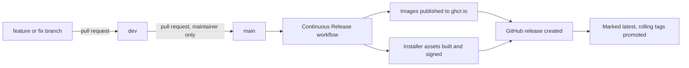

# Release process

## Branches

Work lands on `dev` through pull requests. The maintainer promotes tested changes from `dev` to `main` with a
pull request, and `main` is protected. Every commit that reaches `main` builds the container images and cuts a GitHub release, because every
merge or push to `main` must bump `VERSION` (see below). Required checks on pull requests are `frontend`,
`backend`, `contracts`, `rules` and, for pull requests into `main`, `version-bump`.

## Version names

The root `VERSION` file holds the release series, a semantic version such as `0.12.0`. Each build gets an
immutable identifier:

| Where | Form | Example |
| --- | --- | --- |
| `VERSION` file | `X.Y.Z` | `0.12.0` |
| Image tag and the server's version marker | `X.Y.Z-main.<run number>.<12-character commit>` | `0.12.0-main.7.abcdef012345` |
| Git tag | `v` plus the image tag | `v0.12.0-main.7.abcdef012345` |
| Release title shown to people | `SpaceWorks <version>` | `SpaceWorks 0.12.0` |

Servers pin the exact build, so an update always selects one known release. Every merge or push to `main` bumps
`VERSION`; see the next section.

## Every merge to main bumps VERSION

`VERSION` must be a strictly higher semantic version than `main` already has (equal or lower is refused),
the version strings that mirror it must agree, and `docs/release-<VERSION>.md` must exist. Enforced twice:

- **Pull request into `main`** - the `version-bump` job in `checks.yml` runs
  `scripts/ci/check_version_bump.py` against the base branch's `VERSION` and the repository's tags. Mark
  `version-bump` as a required status check in branch protection so a merge cannot skip it.
- **Push to `main`** - the `prepare` job in `release.yml` fails when `VERSION` equals the previous `main`
  commit's, or when a `v<VERSION>` release/tag already exists, instead of silently building.
- **`workflow_dispatch`** - a manual run re-runs the current `VERSION` (for example to retry a failed build)
  and skips both checks.

Version strings that must match `VERSION`: `SPECTACULAR_SETTINGS["VERSION"]` in
`backend/config/settings_schema.py`, `info.version` in `frontend/openapi-schema.json`, and the README
version badge. (`frontend/package.json` carries no product version.)

To bump, run `sh scripts/bump-version.sh <new-version>`. It refuses a non-increasing version, updates all of
the above, creates `docs/release-<new-version>.md` from a short template if missing (fill it in), and runs
the check. Then regenerate `frontend/src/generated/api.ts` if the schema changed.

## What a release contains

The release workflow builds and publishes the `spaceworks-backend` and `spaceworks-frontend` images, then
attaches installer assets built by `scripts/release-assets.sh`:

- `install.sh`, the standalone installer;
- `spaceworks-<version>.tar.gz`, the deploy bundle of host files;
- `release.json`, the version and commit;
- `SHA256SUMS`, plus `SHA256SUMS.sig` and `SHA256SUMS.pem`, a keyless cosign signature made with the workflow's
  GitHub identity (no stored signing key).

The release is created without the "latest" flag first. Only after the images are verified and promoted does
the workflow mark it latest, which is what `releases/latest/download/install.sh` serves. If a newer commit
reaches `main` while an older build runs, the older build cannot promote itself or clean up. The installer
selects the newest release that is neither a draft nor a pre-release. Release notes are generated from the
merged pull requests. Verification steps are on [Quick install](../hosting/quick-install.md#what-you-download-and-how-to-verify-it).

## After a release

- Older images and releases are pruned, keeping the current and previous builds for automatic application
  rollback; the release history itself is kept.
- Servers with the optional GitHub Actions runner and `SPACEWORKS_DEPLOY=true` deploy the new release
  automatically; others update with the installer menu or `scripts/update.sh`. See
  [Upgrades](../hosting/upgrades.md).
- Upgrades only move forward. A release must therefore be safe to migrate to, with a backup taken first.

## Security checks

A weekly and on-change `pip-audit` workflow scans backend dependencies. Each release's image findings and
accepted risks are written up in the release's security summary. See the
[0.12.0 security summary](../security-summary-0.12.0.md).
