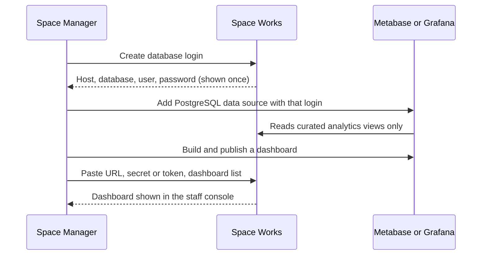

# Connect analytics

**You will finish with** a Metabase or Grafana instance reading one space's curated views through a read-only login, and a dashboard visible inside the staff console.

**You need** the **Analytics** add-on switched on for the space (it is off by default), a Space Manager or platform administrator account, and a Metabase or Grafana you can reach. Space Works does not bundle either; any Metabase (Cloud or self-hosted) or Grafana 10 or later works. You need no account or key from Space Works itself.

> **Note** The login Space Works creates can read only that space's curated **views**, never raw tables, another space or the platform views. Member names and e-mails are not in the views unless you switch on **Show member details**, which is off by default.



## Part 1: Turn analytics on

1. Open **Settings**, then **Areas & add-ons**, and switch on **Analytics**.

   **Expected:** an **Analytics** entry under **Insights** in the menu appears for the space. With the add-on off, every analytics screen is hidden and the space's views return no rows; your connection is kept for when you switch it back on.

## Part 2: Create the read-only login

2. Open **Insights**, then **Analytics**. Choose **Connection settings**.

3. Under **Database login** press **Create login**. (This needs the Space Manager or platform administrator.)

   **Expected:** Space Works shows, once, the host, port, database, schema (`spaceworks_analytics`), username and password. Press **Copy password**.

   > **Warning** The password is shown only once and Space Works keeps only ciphertext. **Rotate** issues a new password (update your dashboard tool afterwards). **Revoke** removes the login.

## Part 3A: Connect Metabase

4. Open Metabase and finish its first-run wizard if it is new. That creates a Metabase admin, unrelated to Space Works.

5. In Metabase choose **Admin**, **Databases**, **Add database**, **PostgreSQL**. Enter the host, port, database, user and password from step 3. Use SSL if the database is on another network. Under advanced options restrict **Schemas** to `spaceworks_analytics`.

   > **Tip** The host Space Works shows is the address the Space Works app uses. If Metabase is on a different network, use the database's reachable address instead.

6. In Metabase open **Admin**, **Settings**, **Embedding**, enable **Static embedding** and copy the **embedding secret key**.

7. Build a dashboard from a saved question on any view. Open it, choose **Sharing**, **Embed**, **Publish**, and note its numeric id (the number in its URL).

8. Back in Space Works under **Connection settings**, set **Dashboard tool** to Metabase. Enter the **Metabase site URL** (no trailing path, credentials, query or fragment), the **Embedding secret key** (encrypted and write-only) and the dashboard list: each id and title.

   **Expected:** staff holding the analytics permission now see those dashboards in the console. Each is shown through a signed link that expires after ten minutes; the secret never reaches the browser.

## Part 3B: Connect Grafana instead (or as well)

9. In Grafana choose **Administration**, **Users and access**, **Service accounts**, **Add service account**. Give it the **Viewer** role, then **Add service account token** and copy the token. Note the **organization ID**; it is 1 unless you made more.

10. In Space Works under **Connection settings**, open **Grafana**. Press **Download provisioning bundle**. The zip contains a PostgreSQL data source, a dashboard loader and one starter dashboard per area that is on for the space (inventory, machines, events, bookings, money and membership).

    **Expected:** the bundle never contains a password. The password field reads `PASTE_PASSWORD_HERE`. Right after you create or rotate the login you can choose **Download Grafana bundle with this password**, which fills it in inside your browser only.

11. Unzip the bundle into Grafana's provisioning folders and restart Grafana, or add the PostgreSQL data source by hand and import each dashboard JSON with **Dashboards**, **New**, **Import**.

12. Enter the **Grafana URL**, the **organization ID** and the **service-account token** in Space Works, then press **Test connection**.

    **Expected:** Space Works checks Grafana's health, then lists dashboards with the token, and says which worked. **Replace token** rotates it and **Remove token** forgets it.

13. Under the dashboard list add each dashboard with its **uid** (the part after `/d/` in its URL), a title and how to show it. **Public:** in Grafana choose **Share**, **Share externally**, copy the access token from the link and paste it here. **Image:** the server renders a PNG with the token, which needs Grafana's image renderer.

    > **Warning** Anyone with a public dashboard link can see that dashboard. Its data still comes only through this space's login. Grafana must allow framing (`GF_SECURITY_ALLOW_EMBEDDING=true`). On static-hosting deployments the operator adds your Grafana or Metabase origin to `FRAME_ORIGINS`; Docker installs need nothing.

## Part 4: Check it

14. In Metabase's SQL editor or a Grafana query, run:

    ```sql
    select distinct makerspace_id from spaceworks_analytics.inventory_products;
    ```

    **Expected:** only your own space's id comes back.

15. Revoke the login in Space Works and refresh your dashboard tool.

    **Expected:** the data source starts failing at once. Create a new login to restore it.

16. A blank embedded dashboard usually means the site URL is unreachable from the browser, static embedding or sharing is off, or (on static hosting) the origin is missing from `FRAME_ORIGINS`.

## Who sees what

| Who | Sees |
| --- | --- |
| Space Manager | The space's dashboards, plus the connection, token, login and bundle |
| Other staff and members | Nothing: the analytics permission is held by the Space Manager role only |
| Platform administrator | Any space's analytics, plus the separate platform connection |

Every view, change, token save, rotation, test, bundle download and dashboard opened is audited, and entries never contain the URL, token or secret.

## What you have now

A live dashboard. Next: read the list of [analytics views](../analytics-views.md) to see what you can chart, and the long-form [Metabase](../metabase-setup.md) and [Grafana](../grafana-setup.md) guides. A platform administrator has a parallel **Platform settings**, **Analytics** connection covering every space, with no member details.
