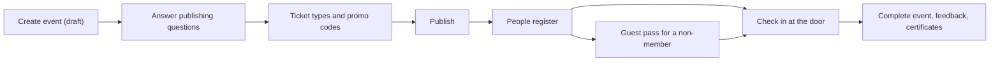

# Run your first event

**You will finish with** a published event with a free and a paid ticket type, two registrations, one guest pass for a non-member, and attendance recorded at check-in.

**You need** the **Events** area switched on (**Settings**, **Areas & add-ons**), an Event Manager or Space Manager account, and a second account to register. For the paid ticket to take card payment you need an online provider; without one you can still record payment at the desk. See [Take payments](take-payments.md).

## Part 1: Create the event

1. Open **Events** and press **New event**.

   **Expected:** a form opens with a live preview of how the listing will look.

2. Fill in the title, description, date, time and place. Press **Create event**.

   **Expected:** the event is created as a **draft**. Drafts are invisible to the public.

3. Open the event, then **More**, then **Settings**. Under **Event photo** upload a **Public event image** (a wide image works best).

4. Still in **Settings**, open **Publishing**. Answer the three questions: who can see it, who can find it, and how people attend.

   > **Note** "Who can see it" and "who can find it" are different. An event can be open to anyone with the link but not listed in discovery.

5. Press **Publish**.

   **Expected:** the status changes from draft to published, the event appears on your public **Events** page, and **Check-in** now opens.

## Part 2: Add tickets

6. Open **More**, then **Tickets & invites**.

7. Under **Ticket types**, add a free ticket: name "Community seat", price 0, audience as you like, capacity 20 (0 means unlimited), and the dates sales start and end. Press **Add ticket type**.

8. Add a second ticket: "Supporter", a fixed price, capacity 10.

   **Expected:** both appear under **Ticket types**.

   > **Warning** A ticket's price and audience lock once someone registers with it, and a used ticket cannot be deleted. Use **Deactivate** instead.

9. Under **Promo codes**, choose a percentage or fixed discount, optionally set your own code, how many uses and an expiry, then **Create promo code**.

   **Expected:** the code is shown once. Copy it now; you cannot read it again.

10. Under **Invitations**, optionally create an invitation code for someone special, or use **Bulk email invitations** (up to 200 addresses). Each code is shown once.

    > **Tip** Several places per buyer, add-ons such as meals or kits, and series passes need the paid-ticketing features. Turn them on under **Settings**, **Areas**, **Features** and see the Event Manager guide.

## Part 3: Take a registration

11. In a private window, sign in as your second account and open the event page. Press **Register**, choose **Community seat**, accept the host's waiver if one is shown, and submit.

    **Expected:** the page says **Registration received**. If capacity is full it says **You're on the waitlist**, and if the event needs approval it says **Application awaiting approval**. There is no guest sign-up: every registrant needs an account.

12. As staff, open the event's **Registrations** tab.

    **Expected:** the roster lists your registrant. **Overview** counts going, waitlist, awaiting approval and checked in. Row actions include **Approve**, **Reject**, **Promote** (from the waitlist), **Mark attended**, **Correct attendance** and **Cancel registration**.

13. Press **Add registration** and register a walk-in yourself.

14. For the paid ticket, register again as the supporter. On an unpaid row, open **Collect payment**, choose how it was received (cash, UPI, bank transfer, card machine, cheque or other), add a reference and press **Record payment**. Or press **Email pay link**.

    **Expected:** you record money actually received. Nothing is taken automatically.

## Part 4: Issue a guest pass

A guest pass is a dated permit for someone who is not a member. It is never a membership and the guest gets no member card.

15. Make sure the feature is on: **Settings**, **Areas**, **Features**, and tick **Guest passes** under Membership. Then open **Settings**, **People**, **Guest passes** and choose what a pass unlocks: nothing, on-site only, or borrowing with a deposit.

16. Open **Members** and then the **Guests** tab. Press **Issue a pass**.

17. Enter the guest's e-mail or account number. The guest needs an account; for a walk-in with none, add them from **Direct handout** first. Optionally enter a sponsoring member's account number; leave it blank for a pass from the space itself. Press **Issue pass**.

    **Expected:** the pass appears in the list as live, with **Withdraw pass** and, if a waiver is outstanding, a button to record the waiver.

18. At the door the guest shows the pass QR. Scan it in the **Scanner** tab, or paste the code under **Check a guest pass**.

    **Expected:** the result says **Valid pass** with the guest's name and the expiry, or **Not valid**.

## Part 5: Check people in

19. Open the event, then **Check-in**. Press **Scan online**, then **Check in by QR** and scan the registrant's ticket.

20. Press **Confirm attendance**, then **Scan another**.

    **Expected:** the person is marked attended. Waitlisted people cannot be checked in.

    > **Tip** No signal at the door? Where offline check-in is on, press **Download roster** before the doors open, **Scan offline** at the door, and **Synchronize** when you are back online. A shared device can check in with a **PIN check-in station**.

21. Open **Overview**.

    **Expected:** the checked-in count has gone up.

## Part 6: Wrap up

22. When the event is over, press **Complete event**. To call it off instead, press **Cancel event**: it tells everyone registered and closes registration.

23. Optional follow-ups under **More**: **Feedback** (a survey), **Certificates and ID cards**, and **Broadcasts** (email everyone registered).

## What you have now

A repeatable pattern. Run the same flow weekly with **Series** (open **Events**, then **Series**, then **New series**). Hackathons, applications, judging and volunteers are in the [events programme guide](../events/README.md). Role detail is in the [Event Manager guide](../user-guides/event-manager.md).
