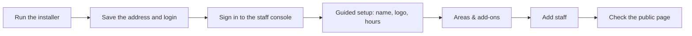

# Set up your first makerspace

**You will finish with** a running install, a space with a name, logo and opening hours, the areas you actually use switched on, one extra staff member, and a public page you can open in a private browser window.

**You need** a 64-bit Linux server (or a computer with Docker Desktop for a trial), a user who can run `sudo`, and about 30 minutes. For the full installer reference see [Install and update](../install-and-update.md); for a plainer walkthrough of the questions see [Setting up Space Works](../setup-for-makerspaces.md).



## Part 1: Install

1. Open a terminal on the server and run the one-line installer from the project README:

   ```sh
   curl -fsSL https://github.com/SpaceWorks-Labs/SpaceWorks/releases/latest/download/install.sh | sh
   ```

   **Expected:** the installer starts by checking your system and listing anything it would install (such as Docker). Nothing changes yet.

2. Choose the **Hosting** shape. For one makerspace, pick the single-space option. Several spaces on one server use shared addresses like `/m/<slug>`.

   **Expected:** the next question asks whether this server serves the website too.

3. Answer **Website** (serve it here, or API only), **HTTPS** and **Storage**. For anything other people will use, choose automatic HTTPS with your domain. Plain HTTP is only for a trial on `localhost`. Choose the bundled file storage unless you already have an S3-compatible bucket.

   > **Tip** If you are only trying Space Works, accept every default and use `localhost` as the address. You can change the address later with the installer.

4. Answer the remaining questions: your web address, the organization name, the name of your makerspace, the admin username, email and password, who may submit borrow requests, and two-step sign-in. Leave the password blank to have a strong one generated.

   **Expected:** the questions about **Areas** list Inventory, Machines and Reports as defaults. Events, Bookings, Membership, online payments and chat apps default to off. You can change all of these later in the console, so do not agonise.

5. Read the summary and confirm with `Y`.

   **Expected:** images download and start. The first run takes a few minutes.

6. When the installer finishes, copy the final block: the address to open, the admin login, and the install log location.

   > **Warning** If you let the installer generate the admin password, this block is the only time it is shown. Also keep a copy of the generated `.env` file somewhere safe and off the server; it holds your encryption keys. See [Back up and restore](../backup-and-restore.md).

## Part 2: Sign in and run the guided setup

7. Open the staff console address from the final block. It ends in `/admin`. Sign in with the admin login.

   **Expected:** you land in the console as the platform administrator. If you see a **Find a makerspace** picker, choose your space under **Your makerspaces**. A banner says you are working in the space as the platform superadmin and that every change is audited.

   > **Note** The platform administrator account is separate from a Space Manager account. In step 14 you give someone the Space Manager role so day-to-day work does not need the platform login.

8. The **guided setup** opens by itself on a new space. It has five steps: name your space, add your logo, set opening hours, choose what your space runs, and invite your staff. Every step has **Skip for now**; close it at any time and it resumes where you stopped.

   **Expected:** the first step asks for your space's name and address.

9. Fill in the name and address, then continue. On the logo step, upload a square or wide logo image.

   **Expected:** the preview of your header shows the logo in place of the default Space Works mark.

10. On the hours step, set your **Timezone** first, then the opening hours for each weekday. Mark days you are shut as **Closed**.

    **Expected:** the public page will later show "open now" or "closed" from these hours, in your timezone.

11. On the areas step, switch on only what you will use in the next month. Unsure? Leave Inventory on and skip the rest; each area is one switch away.

    **Expected:** a toast confirms the change. If an area needs another, the row says **Also installs** and lists what comes with it.

12. Skip the staff step for now (you will do it properly below) and close the guided setup.

    **Expected:** back on **Home** (the console's landing page), a **Next steps** card shows how far you are. Its ticks come from your real records, not from the browser.

## Part 3: Choose what your space runs

13. Open **Settings** and, in the **Areas** group, choose **Areas & add-ons**. Each whole area (Inventory, Machines, Events, Bookings, Shop and others) and each add-on (SMS, chat apps, analytics) has a switch.

    **Expected:** switching one off hides it and keeps its data; switching it on restores everything. Core areas say **Always on**.

    > **Note** Finer switches inside an area are under **Settings**, **Areas**, **Features**. If a feature's area is off, the row tells you to turn the area on first. A reference for what each switch does is in [Choosing modules](../choosing-modules.md).

## Part 4: Add your first staff member

14. Open **Staff & roles** (listed under **People** in Settings, and in the console menu as **Users**) and press **Add staff**.

15. Under **Add by**, choose **A member of this space** to pick someone who already has an account, or **Invite by email**. Tick their roles. For a first helper, **Inventory Manager** or **Handover** is a safe choice. Press **Grant roles** or **Send invitation**.

    **Expected:** a person you invited by email appears under **Invitations** with **Resend** and **Revoke**. Someone granted roles directly appears in the staff list.

    > **Tip** Roles combine. A person can be Inventory Manager and Event Manager at once. **Space Manager** and **Member** are always held alone, and only the platform administrator gives or removes Space Manager. Give your own personal account the Space Manager role from the platform console so you are not running the space as the platform administrator.

16. Ask your new staff member to sign in. Staff accounts must set up two-step sign-in; that is a platform rule.

    **Expected:** after they sign in they see only the screens their roles allow.

## Part 5: See your public page

17. Open **Settings**, then **Branding & public site**. Check the **Public display name** and logo. Under **Profile & location** (listed as **General**), tick **Publish public site** and **Show public inventory** if you want people to browse tools.

18. Open a private (incognito) browser window and visit your public address. On a single-space install this is the root address. On a shared site it is `/m/<your-slug>`.

    **Expected:** a page with your name, logo, opening hours and one card per area you switched on. Tools to borrow live on the **Inventory** page, which opens from that home.

    > **Warning** Hiding public inventory keeps all items; it only removes the public Inventory page.

19. Back in **Settings**, open the **Overview** checklist and tick off what is left: support email, how people get notified, and (if you use memberships) the check-in area.

## What you have now

A working space you can lend from. Next: [Lend your first tool](lend-your-first-tool.md). To understand every settings group, read the [Space Manager guide](../user-guides/space-manager.md).

## If something is missing

- **No Home card or Next steps:** you may be signed in as a role that has no setup access. Sign in as the Space Manager.
- **An area's menu entry is not there:** the area is off under **Areas & add-ons**, or your role does not include it.
- **The page does not load over HTTPS:** check the installer's HTTPS choice and that your domain points at the server. See [Choose your hosting](../choose-your-hosting.md).
