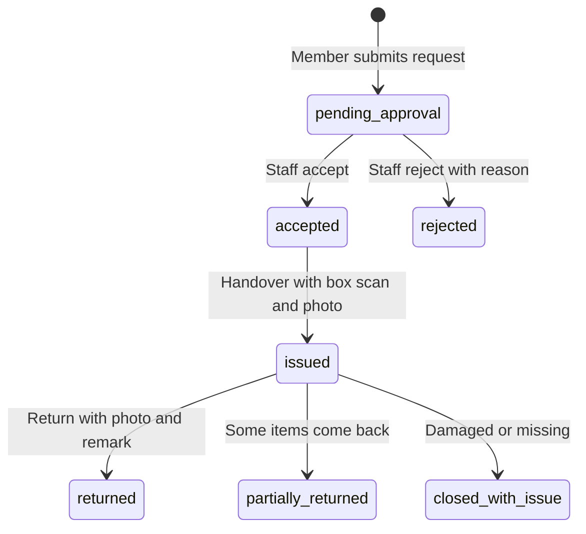

# Lend your first tool

**You will finish with** one tool in your inventory, a box with a QR label, and a complete loan record: the request, the handover photo and box scan, and the return photo and remark.

**You need** a Space Manager or Inventory Manager account, the **Inventory** area switched on (it is on by default), a phone or webcam for photos, and a second account to play the borrower. A printer for labels helps but is not required to read along.

> **Note** Space Works will not hand over a reviewed request without a **box QR scan and an issue photo**, and will not take a return without a **return photo and a remark**. That evidence is the point of the system: it is what lets you answer "who has the drill?" later.

## Part 1: Add the tool

1. Open **Inventory** in the staff console (the menu entry may read **Items**) and press **Add item**.

   **Expected:** a form opens asking for a name, category, quantity and how the item is tracked.

2. Name it, for example "Cordless drill". Pick or create a category. To create one first, open **Categories**, press **Add category**, give it a name and an order, then come back.

3. Set the quantity, and choose how it is tracked: as a **count** (ten identical clamps) or as **individual units with their own QR** (one specific drill). For this tutorial choose individual units with a quantity of 1.

4. Choose its public visibility: whether it is listed on the public Inventory page, and whether visitors see an exact count, only a status such as Available, or nothing. Press save.

   **Expected:** the item appears in the list. Open it and use **Item photo** to add a picture; listed items show that photo publicly. (Handover photos are a separate thing and are never public.)

   > **Tip** Storage locations, box codes and QR codes are never shown on the public site, however you set visibility.

## Part 2: Create a box and print labels

5. Open **Containers** and press **New container**. Choose box, bin or shelf, name it ("Drill box A") and save.

   **Expected:** the container appears in the list. Its **Scan history** is empty for now.

   > **Note** If you do not see **Containers**, the feature is switched off under **Settings**, **Areas & add-ons**.

6. Open **QR Tools** (the page title is **QR labels**) and press **New batch**. Enter a title, a label type and a prefix, then **Create batch**.

7. Press **Add labels**, choose your drill and the number of units, then **Download all (ZIP)**. Print the labels and stick one on the drill and one on the box.

   **Expected:** a ZIP of label images downloads. **Reprint a unit** makes a replacement label for a unit that already exists.

8. Open **Scanner** and scan the box label with a phone or scanner.

   **Expected:** the scanner shows the box it belongs to; **View contents** lists what is inside.

   > **Tip** Already have QR labels from another system? In **Scanner**, scan the label, then press **Create new item** or **Link to existing item**. You do not have to reprint. A revoked label can never be linked again.

## Part 3: Set the loan rules

9. Open **Inventory**, then the settings menu on that page, and choose **Inventory settings**.

10. Set the **Loan policy**: how long a loan lasts and how many renewals are allowed. Optionally set **Borrow limits**.

    **Expected:** the loan length you set becomes the default due date for new loans.

    > **Note** Inventory Managers can always change loan length and renewals unless the Space Manager has locked them.

## Part 4: Request the tool as a borrower

11. Sign in as the second account in a private window. Open the space's home, then **Inventory**.

    **Expected:** your drill is listed with live availability.

12. Press **+** on the drill. It goes into **Your request** (on a phone, **Review request**).

13. Fill in **Request purpose** and, if the space asks, **When will you collect?**. Press **Submit request**.

    **Expected:** the page shows **Request submitted**. If your space runs memberships, this account must be an active member and have accepted the waiver first, or the request is refused with a clear message.

## Part 5: Accept it

14. In the staff console open **Requests**. **Pending review** is the first queue.

15. Press **Review** on the request, then **Accept**. You may lower any line, or set it to 0 to decline just that item. Press **Accept** again to confirm.

    **Expected:** the request moves to **Ready for handover**. The drill now shows as unavailable to others because accepting reserves it.

    > **Tip** To say no instead, press **Reject** and write a **Reason**; the member sees it.

## Part 6: Hand it over with evidence

16. Open **Requests**, then **Ready for handover**, and press **Start handover**.

17. **Scan container:** scan the QR on the box. **Check borrower card:** look at or scan the member's card and tick that you checked them against the request.

18. **Check items:** confirm each item. A tool with its own QR is scanned individually; use **Scan items continuously** for several.

19. **Photo and confirmation:** take the issue photo, add a remark ("Battery charged, two bits in case") and press **Confirm issue**. Press **Print receipt** if the borrower wants paper.

    **Expected:** the request moves to **Active loans**. Space Works refuses to continue until the box scan and the photo are present.

    > **Tip** If a unit is broken at handover, use **Reject as broken** in the quick form and choose where it goes: the repair shelf or out of inventory.

## Part 7: Take it back

20. When the borrower returns the drill, open **Requests**, then **Active loans**, and press **Record return**.

21. Scan the box and check the borrower as before. For the drill choose **Returned**, **Damaged** or **Missing**. Items you mark **Not returned now** stay on loan, so partial returns work.

22. Take the return photo and write the **Return remark**, then press **Confirm return**.

    **Expected:** the loan closes as returned. A **Damaged** item goes to the **To-be-fixed** shelf (the **Repair shelf** in the menu). A **Missing** item stays on the borrower's record under **Accountability**.

## Part 8: See the trail

23. Open **Ledger** to see everything out right now; filter by **Reviewed**, **Direct** or **Self-checkout**, or tick **Overdue only**. Open **Accountability** and press **Open loan** on your loan to see its handover and return evidence.

    **Expected:** you see the request, the box scan, both photos and both remarks, with who did what and when. The audit log holds the same events and cannot be edited.

## What you have now

A full loan trail. Variations worth trying next:

- **Direct handout:** lend a tool without a request, from the front desk. See the [handover desk guide](../user-guides/handover-desk.md).
- **Self-checkout:** let members borrow QR-labelled tools themselves, with a photo. See the [member guide](../user-guides/member.md).
- **Stocktake and transfers:** reconcile shelves with records, and move stock between containers. See the [Inventory Manager guide](../user-guides/inventory-manager.md).
- **Late fees and deposits:** see [Take payments](take-payments.md) and [Loan policy](../loan-policy.md).
