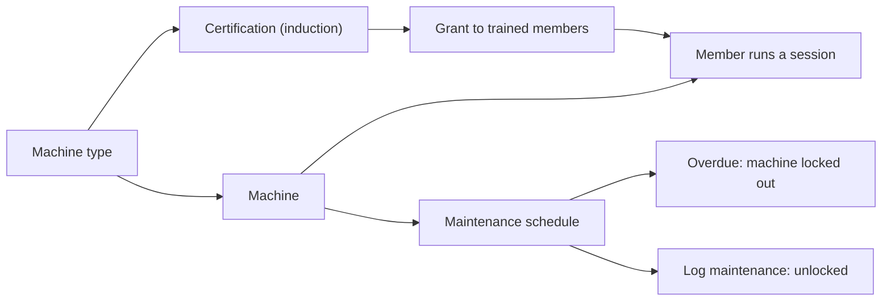

# Machines and inductions

**You will finish with** a machine type with one machine, a certification (an induction) that gates its use, an induction event that certifies attendees in one step, a timed session on the machine, and a recurring maintenance schedule.

**You need** the **Machines** area switched on (it is on by default), a Machine Manager or Space Manager account, and members to train. The member has to be checked in and certified before a session or a certified booking works.

> **Note** What people call an *induction* appears in the console as a **Certification**. Where an event is used to run training, it is marked as an **induction** event.

## Part 1: Create a machine type and a machine

1. Open **Machines** and press **Add machine type**.

2. Enter the name (for example "Laser cutters"), choose an icon, and choose how use is measured: weight, volume, length, a count or minutes. Press **Create type**.

   **Expected:** the type opens with the tabs **Machines**, **Service queue**, **Queue board**, **Consumables**, **Certifications** and **Settings**.

   > **Note** A machine type groups machines that work the same way and holds their prices, rules and training. Creating or editing types needs type-configuration rights; managers without them see types read-only. A Machine Manager only sees the types the Space Manager assigned them. **A Machine Manager with no types picked sees no machines.**

3. On the **Machines** tab press **Add machine**, fill in the form and press **Add**. Optionally add a photo and its warranty, then press **Done**.

   **Expected:** the machine is listed. Click it to open its drawer with **Overview**, **Operators**, **Consumables**, **Usage**, **Maintenance**, **Documents**, **Errors**, **Warranty** and **Sessions**.

4. Use **Mark running** or **Mark idle** to show its state.

## Part 2: Create a certification

5. Open the type, then **Certifications**, and press **New certification type**.

6. Name it ("Laser safety induction"). Set how many days it stays valid; leave it blank if it never expires.

7. Tick **Required for service requests** and **Required for bookings** to gate those flows. Press **Save certification**.

   **Expected:** from now on a job request or booking on this type is refused for anyone without a current certification. A staff booking can override the rule with a reason, and every override is audited.

## Part 3: Train people

8. Open the certification and press **View grants**. Choose the member and press **Grant certification**. Add training notes if you like.

   **Expected:** the grant appears. Members see it under **Certifications** in their account.

9. Later use **Renew** or **Revoke** (with the reason).

   > **Tip** Where certification reminders are on, set them under the type's **Settings**, **Reminder policy**. Members are told before expiry and staff get a digest.

### Certify a whole group with an induction event

10. Create an event as in [Run your first event](first-event.md) and open it.

11. On the event's **Overview** tab, find the **Induction** panel. Under **Certifications this event inducts**, choose a certification and press **Mark as induction**.

    **Expected:** the panel notes that nothing is granted until you press **Grant**. Linking an induction also needs access to the event.

12. After attendees check in, return to the panel. **Checked-in attendees** lists them; select the ones who passed and press **Grant certification to N selected**.

    **Expected:** **Grant results** shows who was certified. Anyone already certified is marked, and guests appear tagged as guests. Use **Revoke** to undo a grant.

## Part 4: Run a session

13. Open the type, then **Settings**, then **Machine sessions**. Set the **Longest session** and press **Save**.

14. Open a machine's drawer, choose **Session QR** and **Show QR**. Print it and stick it on the machine.

15. As a certified, checked-in member scan that QR. The page is **Use this machine**. It shows the rate, the longest session and closing time. Press **Start session**, and **Stop session** when finished.

    **Expected:** the machine's **Sessions** view shows the session under **Live**, then under **Closed**.

16. As staff, open the **Sessions** view. Its three lists are **Live**, **To check** and **Closed**. On a session you can **Stop session**, **Confirm**, **Correct time** (minutes and a reason) or **Assign member**. **Start for a member** starts one on someone's behalf.

    **Expected:** a session that was never stopped ends at the longest length, at check-out or at closing time and waits under **To check**. Sessions bill the type's hourly rate only while machine charges are switched on.

## Part 5: Schedule maintenance

17. Open the machine's drawer, then **Maintenance**, and press **New schedule**.

18. Choose the trigger: every so many days, or, where usage meters are on, every so many hours or jobs. Choose whether the next date counts from when it was done or follows a fixed calendar. Press **Create schedule**.

19. When the work is done, press **Log maintenance** (or **Complete maintenance** on a due item), say what was done and add parts and notes.

    **Expected:** the next due date is set from the schedule.

    > **Warning** Overdue maintenance locks the machine. It shows **Locked out** and jobs cannot start on it until the maintenance is logged.

20. For a one-off fix use **Work orders**, **New work order** (what, priority, due date), **Start work**, then **Close work order** with what was done, cost and parts.

21. Under the type's **Settings**, set the **Reminder policy** to warn maintainers before and after a due date. **Maintenance calendar**, then **Create or rotate calendar link** gives a personal calendar feed.

22. Hand repairs to a technician: open **Repairs**, triage a report and press **Send to technicians**. A Technician works only the jobs assigned to them. See the [machine manager and technician guide](../user-guides/machine-manager-and-technician.md).

## What you have now

Machines that only trained people can use, with a record of every session and every service. To take paid jobs from members, set **Job requests** under the type's **Settings** and read [Run the job queue](../user-guides/machine-manager-and-technician.md#how-do-i-run-the-job-queue). Background reference: [Machine training and maintenance](../machine-training-maintenance.md).
